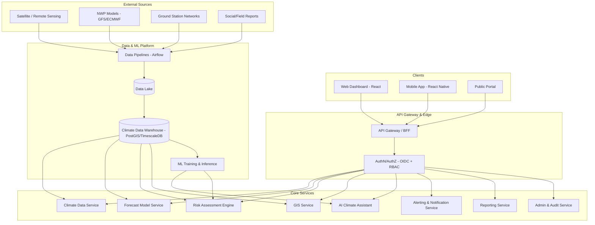

# ClimateShield Nexus

**AI-Powered Climate Risk Intelligence Platform**

[]()
[]()
[]()
[]()

> Version: 1.0.0-foundation &nbsp;|&nbsp; Author: ClimateShield Nexus Architecture Team &nbsp;|&nbsp; Last Updated: 2026-07-27

---

## Table of Contents

1. [What is ClimateShield Nexus?](#what-is-climateshield-nexus)
2. [Why It Exists](#why-it-exists)
3. [Primary Adopter](#primary-adopter)
4. [Core Capabilities](#core-capabilities)
5. [Target Users](#target-users)
6. [High-Level Architecture](#high-level-architecture)
7. [Repository Structure](#repository-structure)
8. [Documentation Map](#documentation-map)
9. [Technology Stack](#technology-stack)
10. [Getting Started (Foundation Phase)](#getting-started-foundation-phase)
11. [Project Status](#project-status)
12. [Governance & Contribution](#governance--contribution)
13. [License](#license)
14. [Revision History](#revision-history)

---

## What is ClimateShield Nexus?

**ClimateShield Nexus** is a modular, enterprise-grade climate intelligence platform that fuses artificial intelligence, climate science, geographic information systems (GIS), machine learning, and real-time weather data into a single decision-support system. It converts raw meteorological, satellite, and remote-sensing data into **actionable intelligence** for national meteorological agencies, disaster management authorities, and cross-sector government planners.

This repository is the **complete pre-coding foundation** for the platform: architecture, requirements, data models, API contracts, UI/UX specifications, DevOps blueprints, security design, and delivery planning — everything five engineers need to begin implementation without ambiguity.

## Why It Exists

Africa faces disproportionate climate risk (flood, drought, heatwave, crop failure, disease vectors) with fragmented tooling: forecast data lives in one system, GIS in another, agriculture advisories in a third, and disaster response coordination happens over phone calls and spreadsheets. ClimateShield Nexus unifies these workflows into one auditable, API-first platform so that a meteorologist, a disaster management officer, and a government planner can act on the **same trusted data** in real time.

## Primary Adopter

The platform is designed **first** for the **Kenya Meteorological Department (KMD)** as the flagship deployment, and **architected modularly** so that other National Meteorological and Hydrological Services (NMHSs) across Africa (e.g., IGAD-ICPAC member states) can adopt it with configuration changes rather than code forks — see [`docs/01_Project_Vision.md`](docs/01_Project_Vision.md) and [`docs/06_System_Architecture.md`](docs/06_System_Architecture.md).

## Core Capabilities

| Domain | Capability |
|---|---|
| **Forecasting** | Numerical weather prediction ingestion, ensemble forecast visualization, nowcasting |
| **Risk Intelligence** | Flood, drought, heatwave, agriculture, infrastructure, and population-exposure risk models |
| **GIS** | Interactive maps, satellite imagery, remote sensing overlays, spatial analytics |
| **AI** | Climate Assistant (LLM-based), recommendation engine, anomaly detection, forecast bias-correction |
| **Early Warning** | Multi-channel alerting (SMS, email, push, API webhook) aligned to CAP (Common Alerting Protocol) |
| **Reporting** | Automated PDF/Excel climate bulletins and situation reports |
| **Administration** | RBAC, audit logging, system monitoring, API management, data pipeline orchestration |

## Target Users

Super Administrator · KMD Administrator · Meteorologist · Climate Scientist · GIS Analyst · Disaster Management Officer · Government Planner · Agriculture Officer · Aviation Officer · Water Resources Officer · Health Sector Officer · NGO · Researcher · Public User

Full personas, goals, and permission matrices: [`docs/02_Business_Requirements.md`](docs/02_Business_Requirements.md) and [`docs/13_Security_Design.md`](docs/13_Security_Design.md).

## High-Level Architecture



Detailed diagrams: [`docs/06_System_Architecture.md`](docs/06_System_Architecture.md), [`docs/07_ERD.md`](docs/07_ERD.md), [`docs/08_DFD.md`](docs/08_DFD.md).

## Repository Structure

See the full annotated tree in [`docs/38_Project_Structure.md`](docs/38_Project_Structure.md). Top-level layout:

```
ClimateShield-Nexus/
├── docs/                  # All planning, architecture & design documentation
├── backend/               # Core services (scaffold only, pre-code)
├── frontend/              # Web dashboard (scaffold only, pre-code)
├── ai-engine/             # AI/ML services (scaffold only, pre-code)
├── climate-processing/    # Climate data pipelines (scaffold only, pre-code)
├── gis-services/          # GIS/spatial services (scaffold only, pre-code)
├── mobile/                # Mobile app (scaffold only, pre-code)
├── database/              # SQL schemas, migrations plan
├── scripts/               # Setup/dev automation scripts
├── docker/                # Container definitions
├── kubernetes/            # K8s manifests
├── .github/workflows/     # CI/CD pipeline definitions
└── tests/                 # Test strategy scaffolding
```

## Documentation Map

| # | Document | Purpose |
|---|---|---|
| 01 | [Project Vision](docs/01_Project_Vision.md) | Mission, goals, success metrics |
| 02 | [Business Requirements](docs/02_Business_Requirements.md) | Stakeholders, business goals, personas |
| 03 | [Software Requirements Specification](docs/03_Software_Requirements_Specification.md) | Full SRS (IEEE 830 style) |
| 04 | [Functional Requirements](docs/04_Functional_Requirements.md) | Module-by-module functional requirements |
| 05 | [Non-Functional Requirements](docs/05_Non_Functional_Requirements.md) | Performance, availability, scalability, compliance |
| 06 | [System Architecture](docs/06_System_Architecture.md) | C4 diagrams, service boundaries, deployment topology |
| 07 | [ERD](docs/07_ERD.md) | Entity relationship diagrams |
| 08 | [DFD](docs/08_DFD.md) | Data flow diagrams (levels 0-2) |
| 09 | [Database Dictionary](docs/09_Database_Dictionary.md) | Table/column-level data dictionary |
| 10 | [User Stories](docs/10_User_Stories.md) | Persona-driven user stories |
| 11 | [Use Cases](docs/11_Use_Cases.md) | Detailed use case specifications |
| 12 | [API Specification](docs/12_API_Specification.md) | REST/GraphQL contract overview |
| 13 | [Security Design](docs/13_Security_Design.md) | AuthN/AuthZ, threat model, RBAC matrix |
| 14 | [Testing Strategy](docs/14_Testing_Strategy.md) | Test pyramid, tooling, coverage targets |
| 15 | [Deployment Guide](docs/15_Deployment_Guide.md) | Environments, CI/CD, infra-as-code |
| 16 | [Git Workflow](docs/16_Git_Workflow.md) | Branching model, commit/PR conventions |
| 17 | [Coding Standards](docs/17_Coding_Standards.md) | Language style guides, review checklist |
| 18 | [Risk Assessment](docs/18_Risk_Assessment.md) | Project & technical risk register |
| 19 | [UI Design System](docs/19_UI_Design_System.md) | Design tokens, components, accessibility |
| 20 | [Project Roadmap](docs/20_Project_Roadmap.md) | Phases, milestones, releases |
| 21 | [Wireflows](docs/21_Wireflows.md) | Screen-to-screen navigation flows |
| 22 | [Sequence Diagrams](docs/22_Sequence_Diagrams.md) | Cross-service interaction sequences |
| 23 | [State Diagrams](docs/23_State_Diagrams.md) | Entity lifecycle state machines |
| 24 | [Activity Diagrams](docs/24_Activity_Diagrams.md) | Business process workflows |
| 25 | [Product Backlog](docs/25_Product_Backlog.md) | Epics, features, prioritization |
| 26 | [Acceptance Criteria](docs/26_Acceptance_Criteria.md) | Gherkin-style acceptance criteria |
| 27 | [Data Models](docs/27_Data_Models.md) | Domain/logical data models |
| 28 | [Validation Rules](docs/28_Validation_Rules.md) | Field-level and business validation rules |
| 29 | [Logging & Monitoring](docs/29_Logging_and_Monitoring.md) | Observability strategy |
| 30 | [Backup & Recovery](docs/30_Backup_and_Recovery.md) | RPO/RTO, DR strategy |
| 31 | [Environment Variables](docs/31_Environment_Variables.md) | Full config reference |
| 32 | [Project Development Plan](docs/32_Project_Development_Plan.md) | SDLC, team structure, ceremonies |
| 33 | [User Manual](docs/33_User_Manual.md) | End-user operating guide |
| 34 | [Developer Guide](docs/34_Developer_Guide.md) | Local setup, contribution workflow |
| 35 | [API Guide](docs/35_API_Guide.md) | Practical API usage guide with examples |
| 36 | [System Maintenance](docs/36_System_Maintenance.md) | Ops runbooks, patching |
| 37 | [Project Change Log](docs/37_Project_Change_Log.md) | Documentation-level change history |
| 38 | [Project Structure](docs/38_Project_Structure.md) | Full annotated repository tree |
| 39 | [Module Breakdown](docs/39_Module_Breakdown.md) | Module ownership and dependencies |
| 40 | [Developer Assignment](docs/40_Developer_Assignment.md) | Team allocation for 5-developer squad |
| 41 | [Project Timeline](docs/41_Project_Timeline.md) | Gantt-style delivery timeline |
| 42 | [Final Project Checklist](docs/42_Final_Project_Checklist.md) | Go/no-code readiness checklist |

## Technology Stack

See [`docs/06_System_Architecture.md`](docs/06_System_Architecture.md#technology-stack) for the fully justified stack. Summary:

- **Frontend**: React 18 + TypeScript, Vite, TanStack Query, Mapbox GL / Leaflet, Tailwind CSS
- **Mobile**: React Native (Expo)
- **Backend**: Node.js (NestJS) core services + Python (FastAPI) for AI/ML and climate processing
- **AI/ML**: Python, PyTorch/XGBoost, LangChain-style RAG for the Climate Assistant, MLflow
- **GIS**: PostGIS, GeoServer, Mapbox GL JS, GDAL
- **Data**: PostgreSQL + PostGIS + TimescaleDB, Redis, Kafka, Apache Airflow, S3-compatible object storage
- **Infra**: Docker, Kubernetes, Terraform, GitHub Actions, Prometheus + Grafana, ELK/OpenSearch

## Getting Started (Foundation Phase)

This repository currently contains **no application source code** — it is the documentation and planning foundation. To begin implementation:

1. Read [`docs/01_Project_Vision.md`](docs/01_Project_Vision.md) through [`docs/06_System_Architecture.md`](docs/06_System_Architecture.md) in order.
2. Review [`docs/40_Developer_Assignment.md`](docs/40_Developer_Assignment.md) to find your module ownership.
3. Copy `.env.example` to `.env` and review [`docs/31_Environment_Variables.md`](docs/31_Environment_Variables.md).
4. Follow [`docs/34_Developer_Guide.md`](docs/34_Developer_Guide.md) for local environment bring-up (Docker Compose skeleton in `docker/`).
5. Follow [`docs/16_Git_Workflow.md`](docs/16_Git_Workflow.md) before opening your first branch.

## Project Status

🟠 **Pre-Development / Foundation Complete** — see [`docs/42_Final_Project_Checklist.md`](docs/42_Final_Project_Checklist.md) for readiness sign-off status.

## Governance & Contribution

- [CONTRIBUTING.md](CONTRIBUTING.md)
- [CODE_OF_CONDUCT.md](CODE_OF_CONDUCT.md)
- [SECURITY.md](SECURITY.md)
- [CHANGELOG.md](CHANGELOG.md)
- [ROADMAP.md](ROADMAP.md)

## License

Licensed under the [Apache License 2.0](LICENSE).

## Revision History

| Version | Date | Author | Change |
|---|---|---|---|
| 1.0.0-foundation | 2026-07-27 | ClimateShield Nexus Architecture Team | Initial complete pre-coding foundation |
