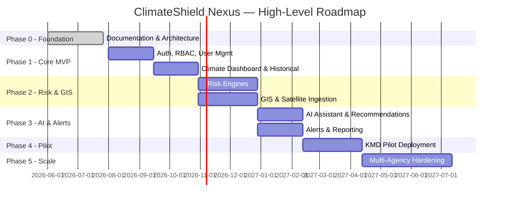

# ClimateShield Nexus — Roadmap

> Version: 1.0 | Author: ClimateShield Nexus Product & Architecture Team | Last Updated: 2026-07-27

## Table of Contents

1. [Purpose](#purpose)
2. [Roadmap Overview](#roadmap-overview)
3. [Phase Breakdown](#phase-breakdown)
4. [Timeline (Gantt)](#timeline-gantt)
5. [Success Metrics per Phase](#success-metrics-per-phase)
6. [References](#references)
7. [Revision History](#revision-history)

## Purpose

Provides a top-level, at-a-glance roadmap. Full detail (sprints, dependencies, staffing) lives in [`docs/20_Project_Roadmap.md`](docs/20_Project_Roadmap.md) and [`docs/41_Project_Timeline.md`](docs/41_Project_Timeline.md).

## Roadmap Overview

```mermaid
flowchart LR
    A[Phase 0\nFoundation\n(this repo)] --> B[Phase 1\nCore Platform MVP]
    B --> C[Phase 2\nRisk Intelligence\n& GIS]
    C --> D[Phase 3\nAI Climate Assistant\n& Alerts]
    D --> E[Phase 4\nKMD Pilot\nDeployment]
    E --> F[Phase 5\nScale &\nMulti-Agency Rollout]
```

## Phase Breakdown

| Phase | Name | Outcome |
|---|---|---|
| 0 | Foundation | This repository: complete architecture, requirements, and planning artifacts |
| 1 | Core Platform MVP | Auth, User/Role Management, Climate Dashboard, Historical Data, Admin |
| 2 | Risk Intelligence & GIS | Flood/Drought/Heatwave/Agriculture risk models, Interactive GIS, Satellite ingestion |
| 3 | AI & Early Warning | AI Climate Assistant, Recommendation Engine, Alerts/Notifications, Reports |
| 4 | KMD Pilot | Production pilot with KMD forecasters and disaster-management officers |
| 5 | Scale & Multi-Agency | Multi-tenant hardening for additional NMHS adopters, mobile app GA |

## Timeline (Gantt)



## Success Metrics per Phase

| Phase | Key Metric |
|---|---|
| 1 | 100% of core RBAC/user flows pass acceptance criteria ([`docs/26_Acceptance_Criteria.md`](docs/26_Acceptance_Criteria.md)) |
| 2 | Risk model outputs validated against 3 historical events (flood/drought/heatwave) |
| 3 | Alert delivery latency < 5 min from trigger to multi-channel dispatch |
| 4 | KMD forecaster daily-active-usage ≥ 80% during pilot window |
| 5 | Platform onboards a second NMHS with < 2 engineer-weeks of configuration |

## References

- [`docs/20_Project_Roadmap.md`](docs/20_Project_Roadmap.md)
- [`docs/41_Project_Timeline.md`](docs/41_Project_Timeline.md)
- [`docs/32_Project_Development_Plan.md`](docs/32_Project_Development_Plan.md)

## Revision History

| Version | Date | Author | Change |
|---|---|---|---|
| 1.0 | 2026-07-27 | ClimateShield Nexus Product & Architecture Team | Initial version |
