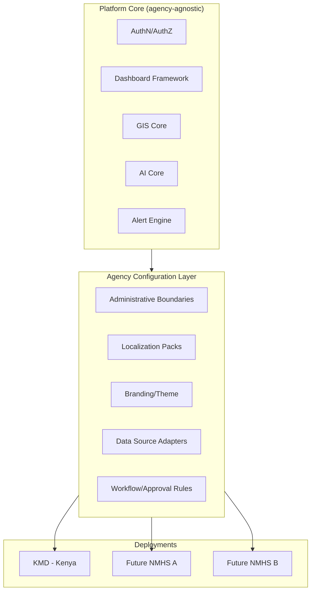

# 01 — Project Vision

## Purpose

Defines the mission, vision, strategic goals, guiding principles, and success metrics for ClimateShield Nexus. This document is the north star referenced by every other document in this repository.

> Version: 1.0 | Author: ClimateShield Nexus Architecture Team | Last Updated: 2026-07-27

## Table of Contents

1. [Vision Statement](#vision-statement)
2. [Mission](#mission)
3. [Problem Statement](#problem-statement)
4. [Strategic Goals](#strategic-goals)
5. [Guiding Principles](#guiding-principles)
6. [Scope Summary](#scope-summary)
7. [Primary Adopter Context — KMD](#primary-adopter-context--kmd)
8. [Modularity for Multi-Agency Adoption](#modularity-for-multi-agency-adoption)
9. [Success Metrics](#success-metrics)
10. [Stakeholder Map](#stakeholder-map)
11. [Assumptions & Constraints](#assumptions--constraints)
12. [Out of Scope](#out-of-scope)
13. [References](#references)
14. [Revision History](#revision-history)

## Vision Statement

> "Every meteorologist, disaster manager, and government planner in Africa should be able to answer 'what climate risk are we facing, and what should we do about it?' from a single trusted platform, in minutes, not days."

## Mission

ClimateShield Nexus unifies climate data ingestion, AI-driven analysis, GIS visualization, and early-warning dissemination into one modular platform, starting with the Kenya Meteorological Department (KMD) as the flagship national deployment.

## Problem Statement

| Problem | Current State | Impact |
|---|---|---|
| Fragmented data | Forecast, satellite, station, and social data live in siloed systems | Slow, error-prone manual correlation |
| Manual risk assessment | Flood/drought/heatwave risk assessed via spreadsheets and expert judgment alone | Delayed or inconsistent warnings |
| Limited GIS accessibility | GIS tooling requires specialist desktop software | Non-GIS-specialist officers cannot self-serve spatial insight |
| Alert latency | Warnings distributed via manual phone/email chains | Minutes-to-hours delay in reaching at-risk populations |
| No unified audit trail | Decisions and data sources not consistently logged | Difficult post-event review and accountability |
| Reporting overhead | Bulletins built manually in Word/Excel | High staff time cost, inconsistent formatting |

## Strategic Goals

1. **Unify** climate, weather, satellite, and GIS data into one authoritative platform.
2. **Automate** flood, drought, heatwave, agriculture, infrastructure, and population-exposure risk scoring.
3. **Accelerate** early-warning dissemination to under 5 minutes from model trigger to multi-channel alert.
4. **Democratize** GIS and AI-assisted analysis for non-specialist government officers.
5. **Institutionalize** auditability, transparency, and reproducibility of every forecast/decision.
6. **Enable** modular, low-effort adoption by additional African NMHSs after the KMD pilot.

## Guiding Principles

- **Data sovereignty first** — data stays within agency-controlled infrastructure/regions unless explicitly exported.
- **Modular over monolithic** — every module is independently deployable and independently disable-able per agency.
- **Explainable AI** — every AI-generated recommendation must cite underlying data and confidence level.
- **Offline-tolerant** — dashboards and mobile clients degrade gracefully under Africa's variable connectivity.
- **Accessibility by default** — WCAG 2.1 AA minimum across all interfaces (see [`docs/19_UI_Design_System.md`](19_UI_Design_System.md)).
- **API-first** — every capability exposed via documented API before any UI is built on top of it.
- **Security by design** — least privilege, defense in depth, full audit trail (see [`docs/13_Security_Design.md`](13_Security_Design.md)).

## Scope Summary

In scope for the full platform: authentication/authorization, dashboards (climate, forecast, GIS, AI, analytics, admin), climate data management, forecast models, historical data, risk assessment (flood, drought, heatwave, agriculture, infrastructure, population exposure), environmental monitoring, interactive GIS, satellite/remote sensing, reporting (automated, PDF, Excel), AI Climate Assistant and recommendation engine, alerts/notifications, audit logs, monitoring, system settings, API management, data pipelines, ML, data validation, and climate processing. Full module list: [`docs/39_Module_Breakdown.md`](39_Module_Breakdown.md).

## Primary Adopter Context — KMD

The Kenya Meteorological Department is Kenya's authoritative source for weather forecasts, climate services, and severe weather warnings, operating under the Ministry responsible for Environment and Climate Change. ClimateShield Nexus is designed to:

- Integrate with KMD's existing ground station network and forecasting workflows.
- Support Kenya's 47 counties as the primary administrative/spatial unit for risk aggregation.
- Align alert formats with the WMO Common Alerting Protocol (CAP) and Kenya's National Disaster Risk Management framework.
- Support English and Swahili localization from day one.

## Modularity for Multi-Agency Adoption

Configuration-driven onboarding is detailed in [`docs/06_System_Architecture.md`](06_System_Architecture.md#multi-tenancy--modularity) and [`docs/39_Module_Breakdown.md`](39_Module_Breakdown.md).

## Success Metrics

| Metric | Target | Measured By |
|---|---|---|
| Time-to-warning (trigger → multi-channel dispatch) | < 5 minutes | [`docs/29_Logging_and_Monitoring.md`](29_Logging_and_Monitoring.md) |
| Forecaster daily active usage during pilot | ≥ 80% | Product analytics dashboard |
| Risk model accuracy vs. historical events | ≥ 85% precision on back-tested flood/drought events | ML validation reports |
| Platform availability | 99.5% (pilot), 99.9% (production, see [`docs/05_Non_Functional_Requirements.md`](05_Non_Functional_Requirements.md)) | Uptime monitoring |
| Time to onboard a second NMHS | < 2 engineer-weeks | Delivery retrospective |
| Accessibility compliance | WCAG 2.1 AA on 100% of primary user flows | Automated + manual audit |

## Stakeholder Map

| Stakeholder | Interest | Influence |
|---|---|---|
| KMD Leadership | Operational adoption, national credibility | High |
| KMD Meteorologists/Forecasters | Daily tool usability | High |
| National Disaster Management Authority | Early-warning reliability | High |
| Ministry of Environment & Climate Change | Policy alignment, funding | High |
| County Governments | Localized risk data | Medium |
| Agriculture/Water/Health/Aviation Sector Officers | Sector-specific advisories | Medium |
| NGOs & Researchers | Data access for humanitarian/scientific work | Medium |
| General Public | Public safety information | Medium (indirect) |
| Development Partners / Donors | Impact reporting | Medium |

## Assumptions & Constraints

- KMD provides access to existing station network APIs and historical archives.
- Initial deployment targets cloud or KMD-approved data-center infrastructure within Kenya's data residency requirements.
- Connectivity in rural/field contexts may be intermittent — mobile and public-facing surfaces must tolerate this.
- Budget and staffing follow the 5-developer core team defined in [`docs/40_Developer_Assignment.md`](40_Developer_Assignment.md) for the foundation-to-MVP phase.

## Out of Scope

- Hardware procurement for ground stations or satellite receivers.
- Replacing KMD's existing NWP model execution infrastructure (the platform **consumes** NWP output, it does not run global NWP models itself in v1).
- Building a dedicated call-center/IVR system (integration point only).

## References

- [`docs/02_Business_Requirements.md`](02_Business_Requirements.md)
- [`docs/06_System_Architecture.md`](06_System_Architecture.md)
- [`docs/20_Project_Roadmap.md`](20_Project_Roadmap.md)
- WMO Common Alerting Protocol (CAP) v1.2
- Kenya National Disaster Risk Management Policy

## Revision History

| Version | Date | Author | Change |
|---|---|---|---|
| 1.0 | 2026-07-27 | ClimateShield Nexus Architecture Team | Initial version |
