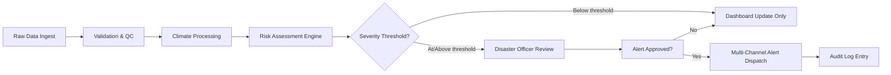

# 02 — Business Requirements

## Purpose

Captures business goals, stakeholder personas, business rules, and the value proposition for each target user group, forming the bridge between [`01_Project_Vision.md`](01_Project_Vision.md) and the technical [`03_Software_Requirements_Specification.md`](03_Software_Requirements_Specification.md).

> Version: 1.0 | Author: ClimateShield Nexus Product Team | Last Updated: 2026-07-27

## Table of Contents

1. [Business Objectives](#business-objectives)
2. [User Personas](#user-personas)
3. [Role-to-Module Value Map](#role-to-module-value-map)
4. [Business Rules](#business-rules)
5. [Business Process Overview](#business-process-overview)
6. [Regulatory & Institutional Alignment](#regulatory--institutional-alignment)
7. [Cost-Benefit Summary](#cost-benefit-summary)
8. [Dependencies](#dependencies)
9. [References](#references)
10. [Revision History](#revision-history)

## Business Objectives

| Objective | Owner | KPI |
|---|---|---|
| Reduce time-to-warning for severe weather | KMD Operations | < 5 min trigger-to-dispatch |
| Improve forecast-to-decision traceability | KMD Meteorology Division | 100% of alerts linked to source model run |
| Reduce manual reporting effort | KMD Communications | ≥ 60% reduction in bulletin production time |
| Increase cross-sector data reuse | Government Planning Directorate | ≥ 5 sector offices actively consuming shared risk data within 6 months of pilot |
| Enable data-driven agriculture advisories | Ministry of Agriculture liaison | Advisory issued within 24h of a detected drought risk escalation |

## User Personas

### Super Administrator
- **Goal**: Platform-wide configuration, tenant/agency onboarding, global security policy.
- **Pain today**: No centralized control plane across disparate legacy tools.
- **Needs**: Multi-tenant admin console, audit visibility, system health dashboard.

### KMD Administrator
- **Goal**: Manage KMD-specific users, roles, data sources, and branding.
- **Needs**: User Management, Role Management, System Configuration modules.

### Meteorologist
- **Goal**: Monitor live forecasts, validate model output, issue advisories.
- **Needs**: Forecast Dashboard, Climate Data Management, Forecast Models.

### Climate Scientist
- **Goal**: Analyze historical climate trends, validate risk models, publish research-grade reports.
- **Needs**: Historical Climate Data, Analytics Dashboard, Climate Reports.

### GIS Analyst
- **Goal**: Produce spatial risk layers, manage satellite/remote-sensing overlays.
- **Needs**: Interactive GIS, Satellite Data, Remote Sensing, GIS Dashboard.

### Disaster Management Officer
- **Goal**: Real-time situational awareness, coordinate response, issue alerts.
- **Needs**: Risk Assessment (all types), Alerts, Notifications, GIS Dashboard.

### Government Planner
- **Goal**: Long-term infrastructure and policy planning informed by climate projections.
- **Needs**: Analytics Dashboard, Climate Reports, Infrastructure Risk.

### Agriculture Officer
- **Goal**: Advise farmers on planting/irrigation windows using drought/rainfall data.
- **Needs**: Agriculture Analysis, Drought Analysis, AI Recommendation Engine.

### Aviation Officer
- **Goal**: Access aviation-relevant weather hazards (visibility, wind shear, storms).
- **Needs**: Forecast Dashboard, Environmental Monitoring, Alerts.

### Water Resources Officer
- **Goal**: Monitor basin-level water availability and flood risk.
- **Needs**: Flood Analysis, Environmental Monitoring, GIS Dashboard.

### Health Sector Officer
- **Goal**: Anticipate climate-sensitive disease outbreaks (heatwave, flood-linked).
- **Needs**: Heatwave Analysis, Population Exposure, Analytics Dashboard.

### NGO
- **Goal**: Access public/restricted risk data for humanitarian program planning.
- **Needs**: Public/restricted API access, Climate Reports.

### Researcher
- **Goal**: Access historical and processed datasets for academic study.
- **Needs**: Historical Climate Data, API access, Data export.

### Public User
- **Goal**: View current conditions, forecasts, and public alerts.
- **Needs**: Public dashboard (read-only), Alerts subscription.

Full persona-to-permission mapping: [`docs/13_Security_Design.md`](13_Security_Design.md#rbac-matrix).

## Role-to-Module Value Map

| Role | Primary Modules |
|---|---|
| Super Administrator | Administration Dashboard, System Configuration, API Management, Audit Logs |
| KMD Administrator | User Management, Role Management, System Configuration |
| Meteorologist | Forecast Dashboard, Forecast Models, Climate Data Management |
| Climate Scientist | Historical Climate Data, Analytics Dashboard, Climate Reports |
| GIS Analyst | Interactive GIS, Satellite Data, Remote Sensing |
| Disaster Management Officer | Flood/Drought/Heatwave Analysis, Alerts, GIS Dashboard |
| Government Planner | Infrastructure Risk, Analytics Dashboard, Climate Reports |
| Agriculture Officer | Agriculture Analysis, AI Climate Assistant |
| Aviation Officer | Forecast Dashboard, Environmental Monitoring |
| Water Resources Officer | Flood Analysis, Environmental Monitoring |
| Health Sector Officer | Heatwave Analysis, Population Exposure |
| NGO / Researcher | Climate Reports, API access (restricted/public tiers) |
| Public User | Climate Dashboard (public view), Alerts (subscribe only) |

## Business Rules

| ID | Rule |
|---|---|
| BR-01 | Every alert issued must reference a traceable data source and model/version. |
| BR-02 | Only users with `Meteorologist` role or above may publish an official forecast. |
| BR-03 | Risk assessments above "High" severity require Disaster Management Officer acknowledgment before public alert dispatch. |
| BR-04 | Public User accounts default to read-only, alert-subscription-only access. |
| BR-05 | All data exports by NGO/Researcher roles are logged with purpose-of-use metadata. |
| BR-06 | County-level (or equivalent administrative unit) is the minimum spatial aggregation granularity for public-facing risk display. |
| BR-07 | AI-generated recommendations must always display a confidence score and a "human review required" flag above a defined risk threshold. |
| BR-08 | Historical data corrections must preserve the original record via versioning (no hard deletes) — see [`docs/28_Validation_Rules.md`](28_Validation_Rules.md). |

## Business Process Overview

## Regulatory & Institutional Alignment

- WMO Common Alerting Protocol (CAP) v1.2 for alert structure.
- Kenya Data Protection Act, 2019 — governs handling of any personal data (e.g., subscriber contact info).
- Kenya National Disaster Risk Management Policy — alert escalation alignment.
- WMO Global Basic Observing Network standards — station data ingestion compatibility.

## Cost-Benefit Summary

| Category | Current Cost/Risk | Platform Benefit |
|---|---|---|
| Manual bulletin production | ~X staff-hours/week | Automated Report generation (docs/04) |
| Delayed warnings | Human/economic loss from late response | Sub-5-minute dispatch pipeline |
| Duplicated GIS tooling licenses | Recurring desktop GIS license costs | Web-based Interactive GIS module |
| Fragmented sector advisories | Inconsistent guidance across ministries | Shared AI Recommendation Engine |

## Dependencies

- KMD station network API availability (see [`docs/12_API_Specification.md`](12_API_Specification.md)).
- NWP model output feeds (GFS/ECMWF or KMD-run models).
- Satellite/remote-sensing data provider agreements.
- SMS/push notification gateway contracts (see [`.env.example`](../.env.example)).

## References

- [`docs/01_Project_Vision.md`](01_Project_Vision.md)
- [`docs/03_Software_Requirements_Specification.md`](03_Software_Requirements_Specification.md)
- [`docs/10_User_Stories.md`](10_User_Stories.md)
- [`docs/13_Security_Design.md`](13_Security_Design.md)

## Revision History

| Version | Date | Author | Change |
|---|---|---|---|
| 1.0 | 2026-07-27 | ClimateShield Nexus Product Team | Initial version |
