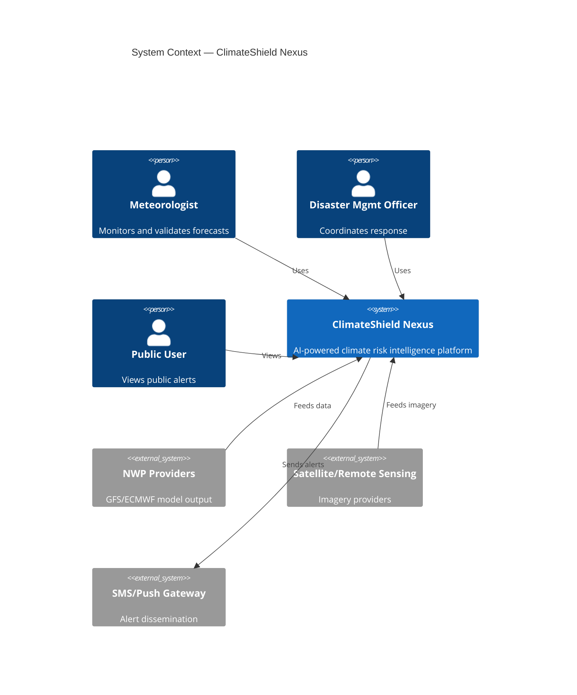

# 03 — Software Requirements Specification (SRS)

## Purpose

Formal Software Requirements Specification, structured per IEEE 830 conventions, defining the complete external behavior of ClimateShield Nexus for engineering, QA, and stakeholder sign-off.

> Version: 1.0 | Author: ClimateShield Nexus Architecture Team | Last Updated: 2026-07-27

## Table of Contents

1. [Introduction](#introduction)
2. [Overall Description](#overall-description)
3. [System Features Summary](#system-features-summary)
4. [External Interface Requirements](#external-interface-requirements)
5. [System Models](#system-models)
6. [Requirement Traceability](#requirement-traceability)
7. [Appendices](#appendices)
8. [References](#references)
9. [Revision History](#revision-history)

## Introduction

### 1.1 Purpose
Define functional and non-functional behavior of ClimateShield Nexus sufficient for independent implementation by five developers with no further requirements discovery needed for MVP scope.

### 1.2 Document Conventions
- **Shall** = mandatory requirement
- **Should** = recommended, deviations must be documented
- **May** = optional
- Requirement IDs: `SRS-<MODULE>-<NUMBER>` (e.g., `SRS-AUTH-001`)

### 1.3 Intended Audience
Developers, QA engineers, KMD technical stakeholders, security reviewers, project managers.

### 1.4 Product Scope
See [`docs/01_Project_Vision.md`](01_Project_Vision.md#scope-summary) and [`docs/39_Module_Breakdown.md`](39_Module_Breakdown.md).

### 1.5 References
IEEE 830-1998; WMO CAP v1.2; OWASP ASVS 4.0; WCAG 2.1.

## Overall Description

### 2.1 Product Perspective
ClimateShield Nexus is a new, standalone, cloud-deployable platform that integrates with external NWP, satellite, and station-network data sources via defined API adapters (see [`docs/12_API_Specification.md`](12_API_Specification.md)).

### 2.2 Product Functions (Summary)
See [`04_Functional_Requirements.md`](04_Functional_Requirements.md) for the exhaustive list; top-level function groups:

1. Identity & Access (Authentication, Authorization, User/Role Management)
2. Dashboards (Climate, Forecast, GIS, AI, Analytics, Administration)
3. Climate Data Management (ingestion, historical data, forecast models)
4. Risk Assessment (flood, drought, heatwave, agriculture, infrastructure, population exposure)
5. Environmental Monitoring & GIS (interactive GIS, satellite, remote sensing)
6. Reporting (automated reports, PDF/Excel export)
7. AI (Climate Assistant, recommendation engine, knowledge base)
8. Early Warning (alerts, notifications)
9. Platform Operations (audit logs, monitoring, settings, API management, data pipelines, ML ops, data validation)

### 2.3 User Classes and Characteristics
See [`docs/02_Business_Requirements.md`](02_Business_Requirements.md#user-personas).

### 2.4 Operating Environment
- Server: Linux containers (Docker/Kubernetes), cloud or KMD data center
- Client: Modern evergreen browsers (Chrome, Edge, Firefox, Safari, last 2 versions); Android 10+/iOS 14+ for mobile
- Database: PostgreSQL 15+ with PostGIS 3.4+, TimescaleDB 2.x
- Minimum bandwidth target: usable at 3G speeds (~1 Mbps) with degraded imagery

### 2.5 Design and Implementation Constraints
- Must support offline-tolerant public dashboard rendering (cached last-known-good state).
- Must be deployable within Kenya-based data residency boundaries.
- Must support English and Swahili from initial release.
- Must expose all core capability via REST API before UI consumption (API-first, see [`01_Project_Vision.md`](01_Project_Vision.md#guiding-principles)).

### 2.6 User Documentation
[`docs/33_User_Manual.md`](33_User_Manual.md), [`docs/34_Developer_Guide.md`](34_Developer_Guide.md), [`docs/35_API_Guide.md`](35_API_Guide.md).

### 2.7 Assumptions and Dependencies
See [`docs/01_Project_Vision.md`](01_Project_Vision.md#assumptions--constraints) and [`docs/02_Business_Requirements.md`](02_Business_Requirements.md#dependencies).

## System Features Summary

| Feature Group | Priority | Detailed Spec |
|---|---|---|
| Authentication & Authorization | Must-have | [`04_Functional_Requirements.md`](04_Functional_Requirements.md#authentication) |
| User & Role Management | Must-have | [`04_Functional_Requirements.md`](04_Functional_Requirements.md#user-management) |
| Dashboards (6 variants) | Must-have | [`04_Functional_Requirements.md`](04_Functional_Requirements.md#dashboards) |
| Climate Data Management | Must-have | [`04_Functional_Requirements.md`](04_Functional_Requirements.md#climate-data-management) |
| Risk Assessment (6 types) | Must-have | [`04_Functional_Requirements.md`](04_Functional_Requirements.md#risk-assessment) |
| Interactive GIS / Satellite | Must-have | [`04_Functional_Requirements.md`](04_Functional_Requirements.md#gis--remote-sensing) |
| Climate Reports | Must-have | [`04_Functional_Requirements.md`](04_Functional_Requirements.md#climate-reports) |
| AI Climate Assistant | Should-have (Phase 3) | [`04_Functional_Requirements.md`](04_Functional_Requirements.md#ai-climate-assistant) |
| Alerts & Notifications | Must-have | [`04_Functional_Requirements.md`](04_Functional_Requirements.md#alerts--notifications) |
| Audit Logs / Monitoring | Must-have | [`04_Functional_Requirements.md`](04_Functional_Requirements.md#platform-operations) |
| Settings / API Management | Must-have | [`04_Functional_Requirements.md`](04_Functional_Requirements.md#platform-operations) |
| Data Pipelines / ML | Must-have | [`04_Functional_Requirements.md`](04_Functional_Requirements.md#data-pipelines--ml) |

## External Interface Requirements

### 3.1 User Interfaces
Per [`docs/19_UI_Design_System.md`](19_UI_Design_System.md); responsive web (desktop/tablet) + mobile companion app.

### 3.2 Hardware Interfaces
None directly — integrates with existing KMD station hardware via its network API layer only.

### 3.3 Software Interfaces
| Interface | Protocol | Spec |
|---|---|---|
| NWP data feeds (GFS/ECMWF/KMD models) | GRIB2 over HTTPS/FTP | [`docs/12_API_Specification.md`](12_API_Specification.md) |
| Satellite/remote sensing provider | REST/HTTPS, GeoTIFF | [`docs/12_API_Specification.md`](12_API_Specification.md) |
| KMD station network | REST/HTTPS, JSON | [`docs/12_API_Specification.md`](12_API_Specification.md) |
| SMS gateway (Africa's Talking or equivalent) | REST/HTTPS | [`.env.example`](../.env.example) |
| Email (SMTP) | SMTP/TLS | [`.env.example`](../.env.example) |
| Push notifications (FCM) | REST/HTTPS | [`.env.example`](../.env.example) |

### 3.4 Communications Interfaces
TLS 1.2+ for all external communication; internal service mesh mTLS (see [`docs/13_Security_Design.md`](13_Security_Design.md)).

## System Models

Additional models: [`docs/06_System_Architecture.md`](06_System_Architecture.md), [`docs/07_ERD.md`](07_ERD.md), [`docs/08_DFD.md`](08_DFD.md).

## Requirement Traceability

Full traceability matrix (requirement → user story → acceptance criteria → test case) maintained in [`docs/26_Acceptance_Criteria.md`](26_Acceptance_Criteria.md#traceability-matrix) and cross-referenced from [`docs/10_User_Stories.md`](10_User_Stories.md).

## Appendices

- Glossary: see [`docs/09_Database_Dictionary.md`](09_Database_Dictionary.md#glossary) for data terms; domain glossary embedded per-document where first used.

## References

- [`docs/04_Functional_Requirements.md`](04_Functional_Requirements.md)
- [`docs/05_Non_Functional_Requirements.md`](05_Non_Functional_Requirements.md)
- [`docs/06_System_Architecture.md`](06_System_Architecture.md)

## Revision History

| Version | Date | Author | Change |
|---|---|---|---|
| 1.0 | 2026-07-27 | ClimateShield Nexus Architecture Team | Initial version |
