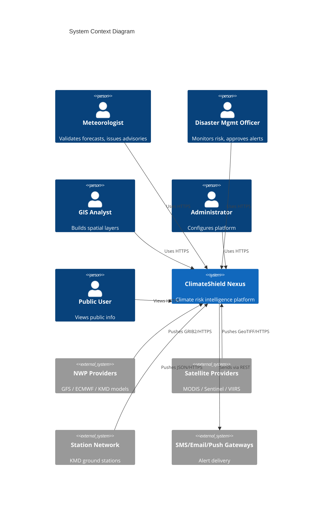
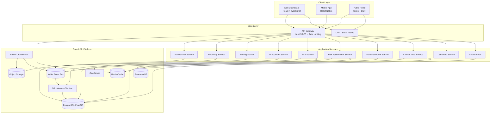
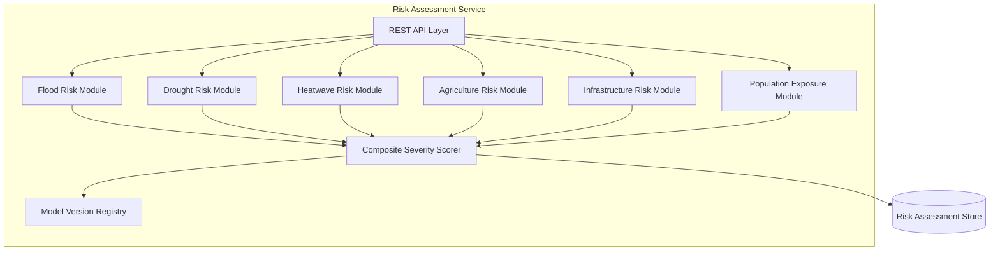
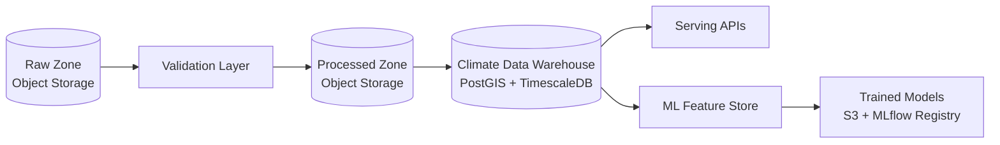
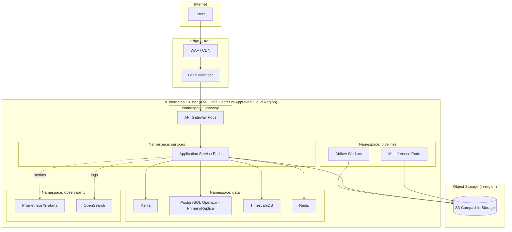

# 06 — System Architecture

## Purpose

Defines the technical architecture of ClimateShield Nexus: service decomposition, communication patterns, deployment topology, technology stack, and the multi-tenancy model enabling modular adoption beyond KMD.

> Version: 1.0 | Author: ClimateShield Nexus Architecture Team | Last Updated: 2026-07-27

## Table of Contents

1. [Architecture Principles](#architecture-principles)
2. [C4 Model — Context](#c4-model--context)
3. [C4 Model — Containers](#c4-model--containers)
4. [Service Catalog](#service-catalog)
5. [C4 Model — Components (Risk Assessment Engine)](#c4-model--components-risk-assessment-engine)
6. [Data Architecture](#data-architecture)
7. [Technology Stack](#technology-stack)
8. [Deployment Topology](#deployment-topology)
9. [Multi-Tenancy & Modularity](#multi-tenancy--modularity)
10. [Integration Architecture](#integration-architecture)
11. [Resilience & Failure Handling](#resilience--failure-handling)
12. [Architecture Decision Records (ADR) Index](#architecture-decision-records-adr-index)
13. [References](#references)
14. [Revision History](#revision-history)

## Architecture Principles

1. **Modular monolith → microservices path**: start with clearly bounded modules (see [`docs/39_Module_Breakdown.md`](39_Module_Breakdown.md)); split into independent services only where scale/ownership demands it.
2. **API-first**: every service exposes a versioned REST API; UI consumes only public contracts.
3. **Event-driven where latency-sensitive**: risk recomputation and alerting run off a Kafka event backbone, not polling.
4. **Stateless services, stateful stores**: all application services are horizontally scalable; state lives in PostgreSQL/PostGIS, TimescaleDB, Redis, and object storage only.
5. **Separation of climate processing from serving**: heavy geospatial/ML processing runs in dedicated pipeline workers, never inline with user-facing API requests.

## C4 Model — Context

## C4 Model — Containers

## Service Catalog

| Service | Responsibility | Primary Store | Language |
|---|---|---|---|
| Auth Service | AuthN, MFA, session/token issuance | PostgreSQL, Redis | Node.js/NestJS |
| User/Role Service | User & role CRUD, RBAC enforcement data | PostgreSQL | Node.js/NestJS |
| Climate Data Service | Ingestion API, historical data query, validation | PostgreSQL/PostGIS, TimescaleDB | Node.js/NestJS |
| Forecast Model Service | Model registry, forecast retrieval | TimescaleDB, S3 | Python/FastAPI |
| Risk Assessment Service | Flood/drought/heatwave/agri/infra/population risk scoring | PostgreSQL/PostGIS | Python/FastAPI |
| GIS Service | Spatial layer serving, satellite tiles | PostGIS, GeoServer, S3 | Python/FastAPI |
| AI Assistant Service | Conversational assistant, RAG over knowledge base | Vector store, S3 | Python/FastAPI |
| Alerting Service | Threshold evaluation, CAP formatting, multi-channel dispatch | PostgreSQL, Kafka | Node.js/NestJS |
| Reporting Service | Scheduled/on-demand PDF/Excel generation | S3 | Node.js/NestJS |
| Admin/Audit Service | Audit log, system config, API key management | PostgreSQL | Node.js/NestJS |
| Data Pipeline Orchestrator | Ingest/validate/process/publish DAGs | S3, Kafka | Python/Airflow |
| ML Inference Service | Serve trained risk/forecast/AI models | S3 (artifacts), PostgreSQL | Python/FastAPI + MLflow |

## C4 Model — Components (Risk Assessment Engine)

## Data Architecture

See [`docs/07_ERD.md`](07_ERD.md), [`docs/08_DFD.md`](08_DFD.md), and [`docs/27_Data_Models.md`](27_Data_Models.md) for logical/data models.

## Technology Stack

| Layer | Choice | Rationale |
|---|---|---|
| Frontend Web | React 18 + TypeScript, Vite, TanStack Query, Tailwind CSS | Fast iteration, strong typing, large talent pool in Kenya's dev market |
| Mapping | Mapbox GL JS / MapLibre + Leaflet fallback | Vector tile performance; MapLibre avoids vendor lock-in for public sector |
| Mobile | React Native (Expo) | Code-sharing with web team, faster iteration for 5-person team |
| API Gateway/BFF | NestJS | Structured, TypeScript-native, strong DI for RBAC middleware |
| Core Services | Node.js (NestJS) | Shared language with frontend reduces context switching |
| Scientific/GIS/ML Services | Python (FastAPI) | Ecosystem fit (GDAL, xarray, scikit-learn, PyTorch) |
| Orchestration | Apache Airflow | Mature DAG scheduling for climate data pipelines |
| Relational/Spatial DB | PostgreSQL + PostGIS | Industry-standard, open-source spatial database |
| Time-Series DB | TimescaleDB | Native Postgres extension, efficient for station/gridded time series |
| Cache/Session | Redis | Low-latency session/rate-limit store |
| Event Bus | Apache Kafka | Durable event backbone for risk recompute & alert triggers |
| Object Storage | S3-compatible (MinIO on-prem / S3 in cloud) | Portability across KMD data center and cloud |
| GIS Tile Serving | GeoServer + GDAL | Open standards (WMS/WMTS/WFS) |
| ML Platform | PyTorch, XGBoost, MLflow | Flexibility for both deep learning and gradient-boosted risk models |
| AI Assistant | RAG pipeline (vector store + Claude models via Anthropic API) | Explainable, citation-capable responses (see [`docs/13_Security_Design.md`](13_Security_Design.md) for AI governance) |
| CI/CD | GitHub Actions | Native to repo hosting, ample marketplace actions |
| IaC | Terraform + Kubernetes manifests | Cloud-agnostic, matches [`NFR-PORT-001`](05_Non_Functional_Requirements.md#portability--interoperability) |
| Observability | Prometheus + Grafana, OpenTelemetry, OpenSearch/ELK | Open-source, self-hostable within KMD infrastructure |

## Deployment Topology

Environment matrix (dev/staging/production) and CI/CD pipeline: [`docs/15_Deployment_Guide.md`](15_Deployment_Guide.md).

## Multi-Tenancy & Modularity

ClimateShield Nexus uses a **single-tenant-per-deployment with shared codebase** model for v1 (row-level `agency_id` scoping reserved for future SaaS mode):

| Aspect | Approach |
|---|---|
| Codebase | One codebase, one deployment per agency (KMD first) |
| Configuration | Agency-specific config (boundaries, branding, thresholds, integrations) externalized to `docs/planning/agency-config/` templates and environment variables |
| Data isolation | Dedicated database/schema per deployment; no cross-agency data commingling |
| Future SaaS mode | `agency_id` column reserved on all core tables (see [`docs/09_Database_Dictionary.md`](09_Database_Dictionary.md)) to enable multi-tenant mode in a later major version without schema rewrite |

## Integration Architecture

| External System | Integration Pattern | Doc |
|---|---|---|
| NWP Providers | Scheduled pull (GRIB2) via Airflow DAG | [`docs/12_API_Specification.md`](12_API_Specification.md) |
| Satellite Providers | Scheduled pull + webhook for near-real-time products | [`docs/12_API_Specification.md`](12_API_Specification.md) |
| KMD Station Network | REST polling + optional webhook push | [`docs/12_API_Specification.md`](12_API_Specification.md) |
| SMS/Email/Push Gateways | Outbound REST from Alerting Service | [`.env.example`](../.env.example) |
| Third-party API consumers (NGO/Researcher) | Scoped API keys via API Management | [`docs/12_API_Specification.md`](12_API_Specification.md) |

## Resilience & Failure Handling

- **Circuit breakers** on all external data-source adapters; stale-data fallback with clear "last known good" UI indication.
- **Dead-letter queues** in Kafka for failed pipeline events, surfaced on the Administration Dashboard.
- **Alert dispatch redundancy**: SMS/email/push are dispatched in parallel, not sequentially, so one channel's failure doesn't delay others.
- **Database failover**: PostgreSQL primary/replica with automated failover (see [`docs/30_Backup_and_Recovery.md`](30_Backup_and_Recovery.md)).

## Architecture Decision Records (ADR) Index

ADRs are maintained under [`docs/architecture/`](architecture/). Key initial decisions:

| ADR | Title |
|---|---|
| ADR-001 | Modular monolith-to-microservices approach for MVP |
| ADR-002 | PostgreSQL/PostGIS + TimescaleDB as unified data platform |
| ADR-003 | Kafka as the event backbone for risk recompute and alerting |
| ADR-004 | Single-tenant-per-deployment model with future multi-tenant readiness |

## References

- [`docs/05_Non_Functional_Requirements.md`](05_Non_Functional_Requirements.md)
- [`docs/07_ERD.md`](07_ERD.md)
- [`docs/08_DFD.md`](08_DFD.md)
- [`docs/12_API_Specification.md`](12_API_Specification.md)
- [`docs/15_Deployment_Guide.md`](15_Deployment_Guide.md)
- [`docs/39_Module_Breakdown.md`](39_Module_Breakdown.md)

## Revision History

| Version | Date | Author | Change |
|---|---|---|---|
| 1.0 | 2026-07-27 | ClimateShield Nexus Architecture Team | Initial version |
