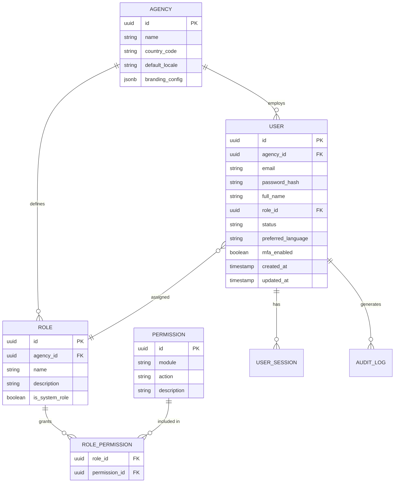
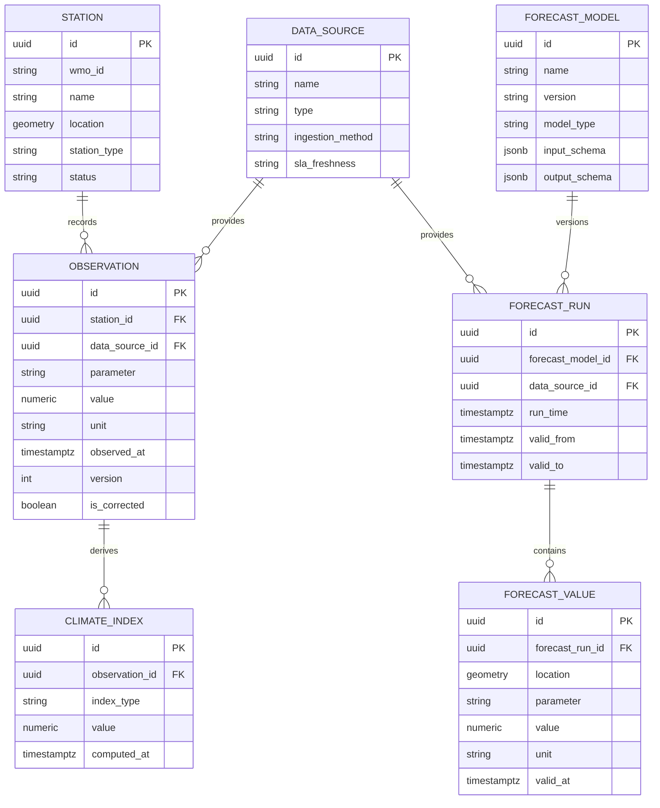
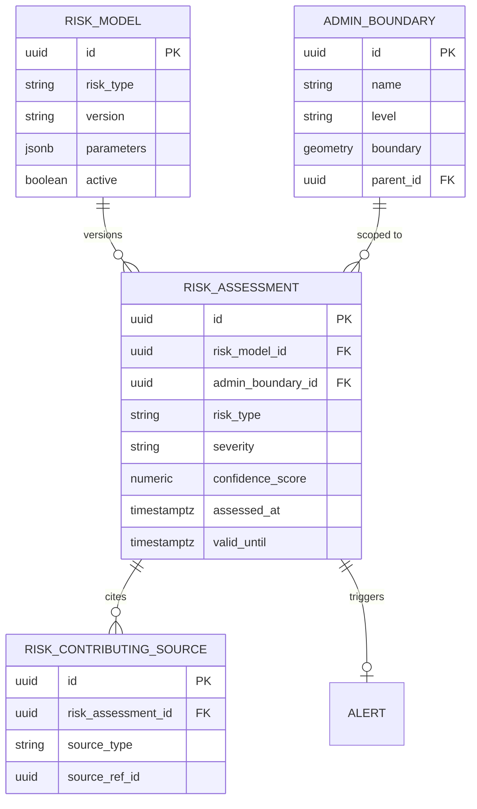
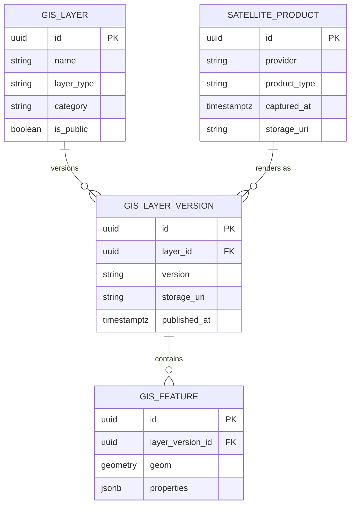
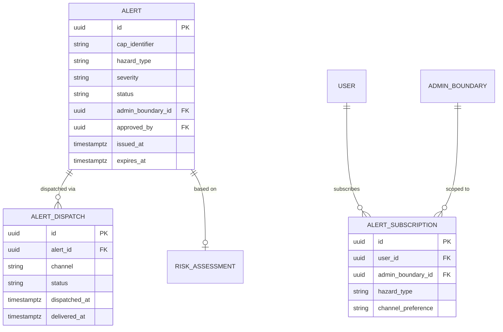
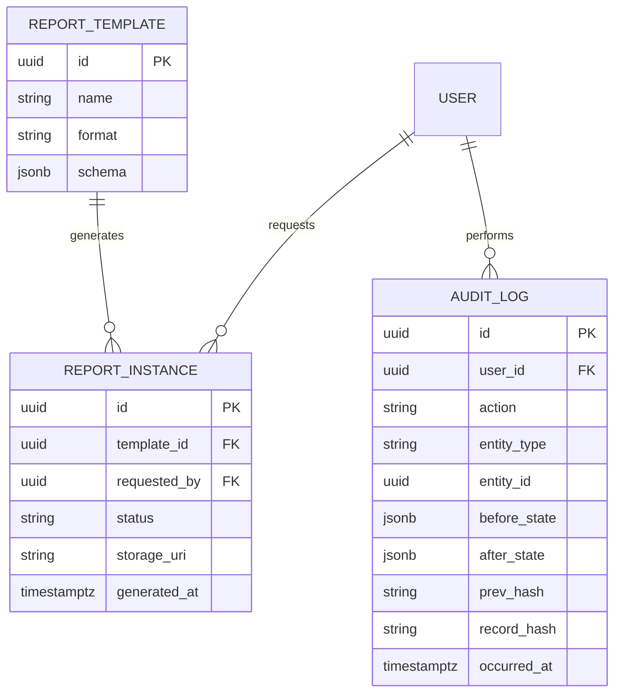
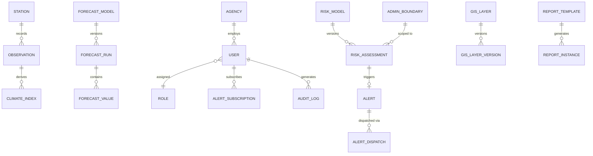

# 07 — Entity Relationship Diagram (ERD)

## Purpose

Defines the logical entity relationships underpinning ClimateShield Nexus's relational data model. Physical column-level detail is in [`docs/09_Database_Dictionary.md`](09_Database_Dictionary.md); domain-level model narrative is in [`docs/27_Data_Models.md`](27_Data_Models.md).

> Version: 1.0 | Author: ClimateShield Nexus Database Architecture Team | Last Updated: 2026-07-27

## Table of Contents

1. [Scope](#scope)
2. [Core Identity & Access ERD](#core-identity--access-erd)
3. [Climate Data & Forecasting ERD](#climate-data--forecasting-erd)
4. [Risk Assessment ERD](#risk-assessment-erd)
5. [GIS & Spatial ERD](#gis--spatial-erd)
6. [Alerts & Notifications ERD](#alerts--notifications-erd)
7. [Reporting & Audit ERD](#reporting--audit-erd)
8. [Full Consolidated ERD](#full-consolidated-erd)
9. [Notation Notes](#notation-notes)
10. [References](#references)
11. [Revision History](#revision-history)

## Scope

Covers all persistent entities for MVP scope (Phases 1-3 in [`docs/20_Project_Roadmap.md`](20_Project_Roadmap.md)). Entities are grouped by bounded context matching the service catalog in [`docs/06_System_Architecture.md`](06_System_Architecture.md#service-catalog).

## Core Identity & Access ERD

## Climate Data & Forecasting ERD

## Risk Assessment ERD

## GIS & Spatial ERD

## Alerts & Notifications ERD

## Reporting & Audit ERD

## Full Consolidated ERD

## Notation Notes

- `||--o{` = one-to-many, `}o--||` = many-to-one, `||--o|` = one-to-zero-or-one.
- All `geometry` columns use PostGIS `geometry`/`geography` types (SRID 4326 default; see [`docs/09_Database_Dictionary.md`](09_Database_Dictionary.md)).
- All tables include `agency_id` (nullable until multi-tenant mode is activated, see [`docs/06_System_Architecture.md`](06_System_Architecture.md#multi-tenancy--modularity)) except where shown for brevity.

## References

- [`docs/09_Database_Dictionary.md`](09_Database_Dictionary.md)
- [`docs/27_Data_Models.md`](27_Data_Models.md)
- [`docs/06_System_Architecture.md`](06_System_Architecture.md)
- `database/schema/` (SQL DDL)

## Revision History

| Version | Date | Author | Change |
|---|---|---|---|
| 1.0 | 2026-07-27 | ClimateShield Nexus Database Architecture Team | Initial version |
