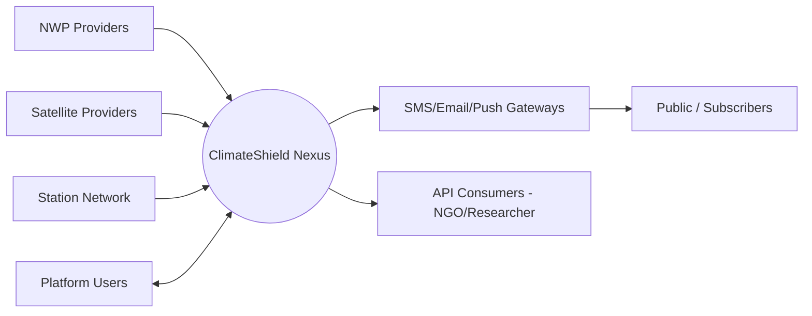
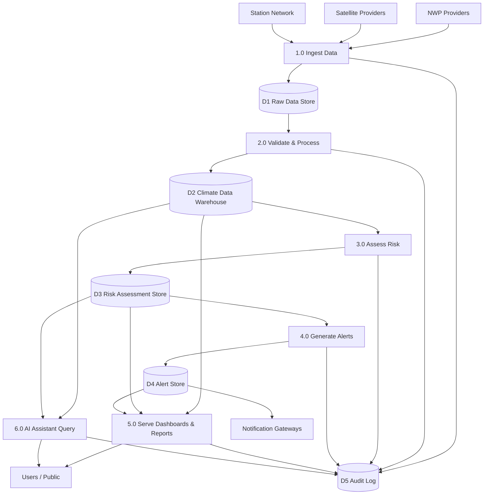
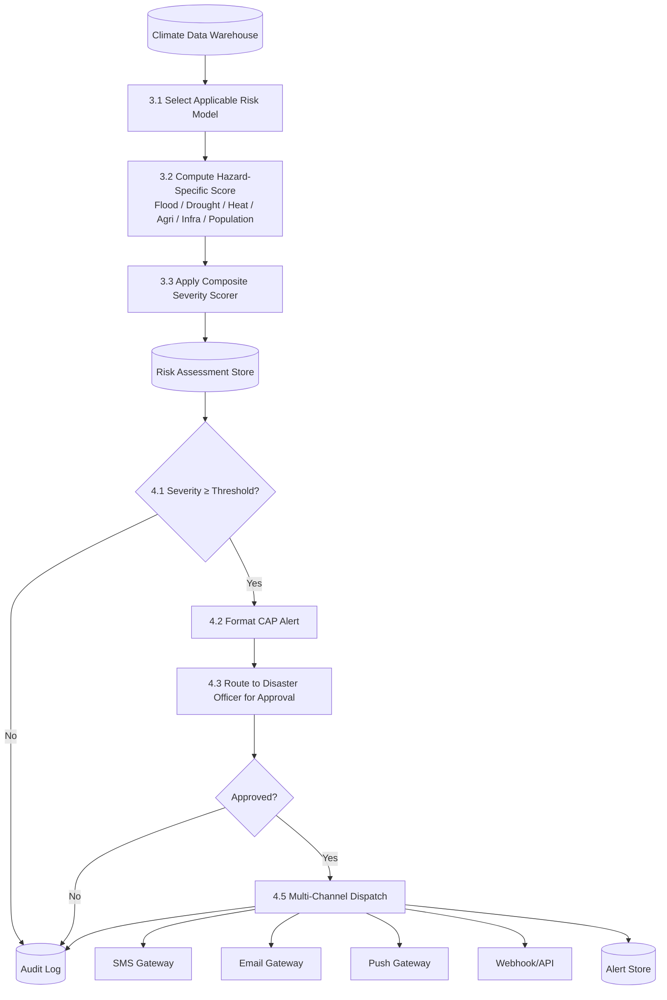

# 08 — Data Flow Diagrams (DFD)

## Purpose

Traces how data moves through ClimateShield Nexus from external sources to end-user consumption, across three levels of decomposition (Context/Level 0, Level 1, Level 2 for the highest-risk flow).

> Version: 1.0 | Author: ClimateShield Nexus Architecture Team | Last Updated: 2026-07-27

## Table of Contents

1. [Level 0 — Context Diagram](#level-0--context-diagram)
2. [Level 1 — Major Processes](#level-1--major-processes)
3. [Level 2 — Risk Assessment & Alerting (Detail)](#level-2--risk-assessment--alerting-detail)
4. [Level 2 — AI Climate Assistant (Detail)](#level-2--ai-climate-assistant-detail)
5. [Data Stores Summary](#data-stores-summary)
6. [External Entities Summary](#external-entities-summary)
7. [References](#references)
8. [Revision History](#revision-history)

## Level 0 — Context Diagram



## Level 1 — Major Processes



## Level 2 — Risk Assessment & Alerting (Detail)



## Level 2 — AI Climate Assistant (Detail)

```mermaid
flowchart TB
    USER[User Query] --> P6_1[6.1 Intent & Scope Parsing]
    P6_1 --> P6_2[6.2 Retrieve Relevant Context\nRAG over Knowledge Base + Live Data]
    D2[(Climate Data Warehouse)] --> P6_2
    D3[(Risk Assessment Store)] --> P6_2
    KB[(Knowledge Base\nVector Store)] --> P6_2
    P6_2 --> P6_3[6.3 Generate Response with Citations]
    P6_3 --> P6_4{Confidence ≥ Threshold?}
    P6_4 -- Yes --> RESP[Return Response to User]
    P6_4 -- No --> FLAG[Flag "Human Review Required"]
    FLAG --> RESP
    P6_3 --> D5[(Audit Log)]
```

## Data Stores Summary

| Store | Content | Owning Service |
|---|---|---|
| D1 Raw Data Store | Untouched ingested payloads (GRIB2, GeoTIFF, JSON) | Data Pipeline Orchestrator |
| D2 Climate Data Warehouse | Validated observations, forecasts, indices | Climate Data / Forecast Model Services |
| D3 Risk Assessment Store | Computed risk scores, versioned by model | Risk Assessment Service |
| D4 Alert Store | Issued alerts, dispatch status | Alerting Service |
| D5 Audit Log | Immutable action trail | Admin/Audit Service |
| Knowledge Base (Vector Store) | Climate science reference embeddings | AI Assistant Service |

## External Entities Summary

| Entity | Data Direction | Format |
|---|---|---|
| NWP Providers | Inbound | GRIB2 |
| Satellite Providers | Inbound | GeoTIFF/NetCDF |
| Station Network | Inbound | JSON |
| SMS/Email/Push Gateways | Outbound | REST/JSON |
| API Consumers (NGO/Researcher) | Outbound (pull) | REST/JSON, GeoJSON |
| Platform Users | Bidirectional | HTTPS/JSON |

## References

- [`docs/06_System_Architecture.md`](06_System_Architecture.md)
- [`docs/07_ERD.md`](07_ERD.md)
- [`docs/22_Sequence_Diagrams.md`](22_Sequence_Diagrams.md)
- [`docs/28_Validation_Rules.md`](28_Validation_Rules.md)

## Revision History

| Version | Date | Author | Change |
|---|---|---|---|
| 1.0 | 2026-07-27 | ClimateShield Nexus Architecture Team | Initial version |
