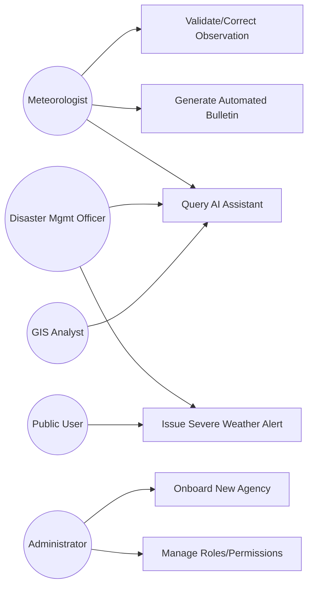

# 11 — Use Cases

## Purpose

Detailed use case specifications for the platform's highest-complexity and highest-risk workflows, expanding on [`docs/10_User_Stories.md`](10_User_Stories.md) with preconditions, flows, and exceptions.

> Version: 1.0 | Author: ClimateShield Nexus Product Team | Last Updated: 2026-07-27

## Table of Contents

1. [Use Case Diagram — Overview](#use-case-diagram--overview)
2. [UC-01: Issue Severe Weather Alert](#uc-01-issue-severe-weather-alert)
3. [UC-02: Validate and Correct Observation Data](#uc-02-validate-and-correct-observation-data)
4. [UC-03: Generate Automated Climate Bulletin](#uc-03-generate-automated-climate-bulletin)
5. [UC-04: Query AI Climate Assistant](#uc-04-query-ai-climate-assistant)
6. [UC-05: Onboard a New Agency (Multi-Agency Modularity)](#uc-05-onboard-a-new-agency-multi-agency-modularity)
7. [UC-06: Manage User Roles and Permissions](#uc-06-manage-user-roles-and-permissions)
8. [References](#references)
9. [Revision History](#revision-history)

## Use Case Diagram — Overview

## UC-01: Issue Severe Weather Alert

| Field | Detail |
|---|---|
| **Actors** | System (Risk Assessment Engine), Disaster Management Officer, Public User (receiver) |
| **Preconditions** | A risk assessment has crossed a configured severity threshold |
| **Trigger** | `RISK_ASSESSMENT` severity ≥ `High` |

**Main Flow**
1. Risk Assessment Service publishes a risk-threshold-breach event.
2. Alerting Service formats a CAP-compliant draft alert.
3. Disaster Management Officer is notified of a pending-approval alert.
4. Officer reviews contributing data sources and confidence score.
5. Officer approves (or edits severity/message) and submits.
6. Alerting Service dispatches via SMS, email, push, and webhook in parallel.
7. Alerting Service records delivery status per channel.
8. Audit Log records the full chain: assessment → draft → approval → dispatch.

**Alternate Flows**
- 5a. Officer rejects: alert marked `rejected`, reason captured, no dispatch.
- 6a. A channel fails: retried per [`SRS-ALT-006`](04_Functional_Requirements.md#alerts--notifications); other channels unaffected.

**Postconditions**: Alert record `issued`; subscribers in the affected boundary notified; audit trail complete.

**Exceptions**: If no Disaster Management Officer acknowledges within a configurable SLA (default 15 minutes) for `Severe`/`Extreme` alerts, the system escalates via secondary on-call notification (see [`docs/29_Logging_and_Monitoring.md`](29_Logging_and_Monitoring.md)).

## UC-02: Validate and Correct Observation Data

| Field | Detail |
|---|---|
| **Actors** | Meteorologist, Data Pipeline (system) |
| **Preconditions** | Observation ingested and flagged by automated QC as out-of-range or inconsistent |

**Main Flow**
1. Pipeline flags an observation failing a validation rule ([`docs/28_Validation_Rules.md`](28_Validation_Rules.md)).
2. Meteorologist reviews flagged record in Climate Data Management module.
3. Meteorologist confirms erroneous value, enters corrected value and reason.
4. System creates a new versioned record; original retained with `superseded_by` link.
5. Downstream risk/forecast recomputation triggered if the corrected observation feeds an active model window.

**Postconditions**: Corrected observation is authoritative; original preserved for audit.

## UC-03: Generate Automated Climate Bulletin

| Field | Detail |
|---|---|
| **Actors** | Scheduler (system), KMD Administrator, Report recipients |

**Main Flow**
1. Scheduled trigger fires per report template's cadence (daily/weekly/monthly).
2. Reporting Service aggregates latest climate, forecast, and risk data.
3. Report rendered per template (PDF and/or Excel).
4. Report stored in object storage; metadata recorded (`report_instance`).
5. Report distributed to configured recipient list via email.

**Alternate Flows**: On-demand generation by an authorized user follows the same steps starting at step 2, triggered manually instead of by scheduler.

## UC-04: Query AI Climate Assistant

| Field | Detail |
|---|---|
| **Actors** | Any authenticated role with AI Assistant access, AI Assistant Service |

**Main Flow**
1. User submits natural-language question.
2. Assistant retrieves relevant live data (climate warehouse, risk store) and knowledge-base context via RAG.
3. Assistant generates a response with explicit source citations and a confidence score.
4. If confidence is below threshold or topic is high-stakes (e.g., evacuation guidance), response is flagged "human review required."
5. Interaction logged for audit and future model evaluation.

**Exceptions**: If underlying data sources are stale beyond SLA, Assistant must disclose this in its response rather than presenting stale data as current.

## UC-05: Onboard a New Agency (Multi-Agency Modularity)

| Field | Detail |
|---|---|
| **Actors** | Super Administrator |
| **Preconditions** | New agency has a signed deployment agreement and defined administrative boundaries |

**Main Flow**
1. Super Administrator creates a new `agency` record (name, country code, locale, branding).
2. Administrative boundary layers imported for the new agency's jurisdiction.
3. Data source adapters configured (station network, NWP feed, satellite provider) per [`docs/12_API_Specification.md`](12_API_Specification.md).
4. Seed roles/permissions provisioned; first KMD-equivalent Administrator account created.
5. Risk model thresholds calibrated for the new agency's hazard profile.
6. Smoke-test dashboards and alert dispatch in a staging environment before go-live.

**Postconditions**: New agency operates independently with no cross-agency data visibility (see [`docs/06_System_Architecture.md`](06_System_Architecture.md#multi-tenancy--modularity)).

## UC-06: Manage User Roles and Permissions

| Field | Detail |
|---|---|
| **Actors** | KMD Administrator, Super Administrator |

**Main Flow**
1. Administrator opens Role Management.
2. Administrator selects an existing role or creates a custom role.
3. Administrator assigns permissions from the permission catalog (module + action granularity).
4. System validates no active user is left without a valid role on save.
5. Change recorded to Audit Log.

**Exceptions**: Deleting a role in use is blocked with an explanatory error (`SRS-ROLE-003`).

## References

- [`docs/10_User_Stories.md`](10_User_Stories.md)
- [`docs/22_Sequence_Diagrams.md`](22_Sequence_Diagrams.md)
- [`docs/24_Activity_Diagrams.md`](24_Activity_Diagrams.md)
- [`docs/26_Acceptance_Criteria.md`](26_Acceptance_Criteria.md)

## Revision History

| Version | Date | Author | Change |
|---|---|---|---|
| 1.0 | 2026-07-27 | ClimateShield Nexus Product Team | Initial version |
