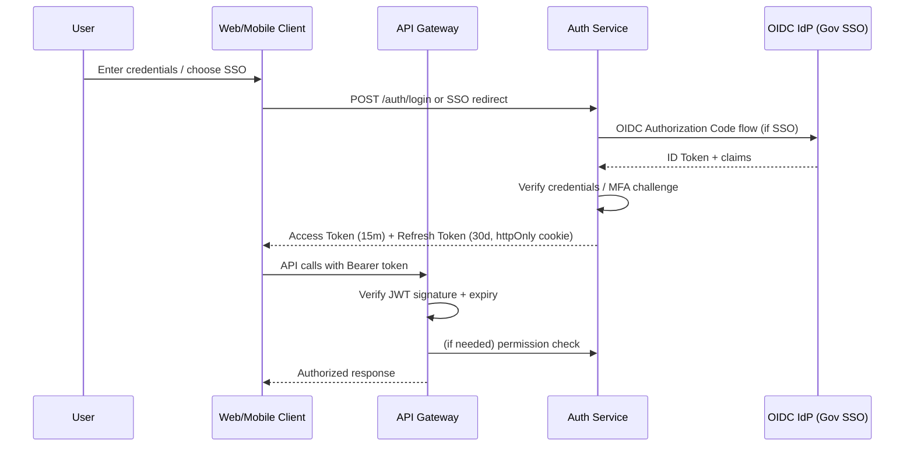

# 13 — Security Design

## Purpose

Defines the security architecture of ClimateShield Nexus: authentication, authorization/RBAC matrix, threat model, data protection, AI governance, and audit integrity controls. Binding for all implementation per [`NFR-SEC-*`](05_Non_Functional_Requirements.md#security).

> Version: 1.0 | Author: ClimateShield Nexus Security Engineering | Last Updated: 2026-07-27

## Table of Contents

1. [Security Objectives](#security-objectives)
2. [Authentication Architecture](#authentication-architecture)
3. [Authorization Model](#authorization-model)
4. [RBAC Matrix](#rbac-matrix)
5. [Threat Model (STRIDE)](#threat-model-stride)
6. [Data Protection](#data-protection)
7. [Network Security](#network-security)
8. [AI Governance & Safety](#ai-governance--safety)
9. [Audit Integrity](#audit-integrity)
10. [Secrets Management](#secrets-management)
11. [Incident Response](#incident-response)
12. [Compliance Mapping](#compliance-mapping)
13. [References](#references)
14. [Revision History](#revision-history)

## Security Objectives

1. Protect the integrity of early-warning data — a compromised or manipulated alert is a public-safety risk.
2. Enforce least-privilege access across 14 distinct personas.
3. Ensure every privileged action is attributable and tamper-evident.
4. Protect population-sensitive data (exposure, vulnerability layers) from unauthorized disclosure.
5. Maintain availability of the alert-dispatch path under adverse conditions (DDoS, partial outage).

## Authentication Architecture



- Password hashing: Argon2id (fallback bcrypt cost ≥ 12).
- MFA: TOTP (RFC 6238) primary, SMS OTP fallback — required for Administrator, Meteorologist, Disaster Management Officer roles per [`SRS-AUTH-003`](04_Functional_Requirements.md#authentication).
- Session/refresh tokens stored as httpOnly, Secure, SameSite=Strict cookies for web; secure keychain storage for mobile.

## Authorization Model

RBAC with boundary-scoped attributes:

```
Permission = (Module, Action, Scope)
Scope ∈ { Global, Agency, AdminBoundary(ids[]) }
```

Every API request re-evaluates `user.role.permissions` against the requested `(module, action, scope)` triple — no client-side trust (`SRS-AUTHZ-005`).

## RBAC Matrix

Legend: **V**=View, **C**=Create, **E**=Edit, **D**=Delete, **A**=Approve, **X**=Export

| Role | Climate Data | Forecasts | Risk Assessment | GIS | AI Assistant | Alerts | Reports | User/Role Mgmt | Audit Log | System Config |
|---|---|---|---|---|---|---|---|---|---|---|
| Super Administrator | VCEDX | VCEDX | VCEDX | VCEDX | VCEDX | VCEDAX | VCEDX | VCEDX | VX | VCEDX |
| KMD Administrator | VCEX | VCEX | VCEX | VCEX | VX | VCEAX | VCEX | VCE (agency-scoped) | VX | VCE (agency-scoped) |
| Meteorologist | VCE | VCE | VC | V | VX | VC | VC | — | — | — |
| Climate Scientist | VX | VX | VX | V | VX | V | VCX | — | — | — |
| GIS Analyst | V | V | V | VCEDX | VX | V | VX | — | — | — |
| Disaster Mgmt Officer | V | V | VX | V | VX | VCAX | VCX | — | — | — |
| Government Planner | V | V | VX | V | VX | V | VCX | — | — | — |
| Agriculture Officer | V (agri params) | V | VX (agri) | V | VX | V (agri hazards) | VX | — | — | — |
| Aviation Officer | V (aviation params) | V | V | V | VX | V (aviation hazards) | VX | — | — | — |
| Water Resources Officer | V (hydro params) | V | VX (flood) | V | VX | V (flood) | VX | — | — | — |
| Health Sector Officer | V | V | VX (heat, pop exposure) | V | VX | V (heat) | VX | — | — | — |
| NGO | V (public+restricted per agreement) | V | V | V | — | V (subscribe) | VX | — | — | — |
| Researcher | VX (historical) | VX | VX | VX | — | V (subscribe) | VX | — | — | — |
| Public User | V (public only) | V (public only) | V (public summary) | V (public layers) | — | V (subscribe) | — | — | — | — |

Detailed permission catalog (module × action definitions) maintained in `database` seed data referencing [`docs/09_Database_Dictionary.md`](09_Database_Dictionary.md#identity--access-tables).

## Threat Model (STRIDE)

| Threat | Example | Mitigation |
|---|---|---|
| **S**poofing | Attacker impersonates a Disaster Management Officer to approve a fake alert | MFA, short-lived JWTs, device/session binding, anomaly detection on approval patterns |
| **T**ampering | Modification of risk assessment data in transit or at rest | TLS 1.2+, DB-level checksums, hash-chained audit log |
| **R**epudiation | Officer denies approving a harmful alert | Immutable, hash-chained audit log with MFA-bound approval action |
| **I**nformation Disclosure | Population exposure/vulnerability data leaked | RBAC scope enforcement, field-level redaction for lower-privilege roles, encryption at rest |
| **D**enial of Service | Flood of requests to alert-dispatch API during a real event (worst possible timing) | Rate limiting, WAF, auto-scaling, dedicated priority queue for alert dispatch |
| **E**levation of Privilege | Public User account escalates to Administrator via IDOR | Server-side authorization on every request, deny-by-default, regular access-control testing |

## Data Protection

| Control | Detail |
|---|---|
| Encryption in transit | TLS 1.2+ everywhere; mTLS between internal services |
| Encryption at rest | AES-256 (cloud KMS or LUKS-backed volumes in KMD data center) |
| Field-level sensitivity | Population exposure/vulnerability fields tagged `Restricted`; masked for roles without explicit grant (see [SECURITY.md](../SECURITY.md#data-sensitivity-classes)) |
| Data retention | Observational/forecast data retained indefinitely (climate record value); audit logs ≥ 7 years; session data purged per [`docs/30_Backup_and_Recovery.md`](30_Backup_and_Recovery.md) |
| PII minimization | Only subscriber contact info (phone/email) treated as PII; segregated table, encrypted, access-logged |

## Network Security

- Public ingress only through WAF + CDN; direct database/service access blocked from the internet.
- Kubernetes network policies enforce namespace-level isolation (gateway → services → data, one direction).
- Internal service-to-service auth via mTLS + short-lived service identity tokens (SPIFFE/SPIRE pattern recommended).

## AI Governance & Safety

| Control | Detail |
|---|---|
| Source citation | Every AI Assistant response must cite underlying data/time range ([`SRS-AI-002`](04_Functional_Requirements.md#ai-climate-assistant)) |
| Confidence disclosure | Responses include a numeric/qualitative confidence indicator |
| Human-in-the-loop gate | High-stakes topics (evacuation, casualty estimates) always flagged for human review before external distribution (`SRS-AI-005`) |
| Prompt injection defense | Knowledge base content sanitized/sandboxed from user-supplied instructions; system prompt isolation |
| Logging | All AI interactions logged with PII minimization for audit and model evaluation (`SRS-AI-006`) |
| Data leakage prevention | AI Assistant scoped to the querying user's RBAC permissions — never surfaces data the user couldn't otherwise access |

## Audit Integrity

- `audit_log` table is **append-only** (DB trigger denies UPDATE/DELETE).
- Each record stores `prev_hash` and `record_hash` (SHA-256 hash chain) so tampering is detectable by chain-verification job.
- Periodic (daily) integrity verification job compares the live chain against an externally stored checkpoint hash (e.g., written to object storage with object-lock/WORM).

## Secrets Management

- No secrets in source control — enforced via pre-commit hook + CI secret scanning (see [`.github/workflows/`](../.github/workflows/)).
- Runtime secrets sourced from a vault (HashiCorp Vault or cloud KMS/Secrets Manager), injected at deploy time.
- `.env.example` documents required variables with placeholder values only.

## Incident Response

| Phase | Action |
|---|---|
| Detection | Automated alerting on anomalous auth patterns, audit-chain break, or SLO breach |
| Triage | On-call engineer classifies severity per [SECURITY.md](../SECURITY.md#disclosure-timeline) |
| Containment | Revoke affected sessions/API keys, isolate affected service via network policy |
| Eradication & Recovery | Patch, redeploy, restore from verified backup if integrity compromised ([`docs/30_Backup_and_Recovery.md`](30_Backup_and_Recovery.md)) |
| Post-Incident Review | Root-cause document within 5 business days, tracked in `docs/security/` |

## Compliance Mapping

| Requirement | Standard |
|---|---|
| OWASP ASVS Level 2 | Application security baseline |
| Kenya Data Protection Act, 2019 | Personal data handling |
| WMO CAP v1.2 | Alert payload structure |
| ISO/IEC 27001 (aspirational, Phase 5) | Information security management alignment |

## References

- [`docs/05_Non_Functional_Requirements.md`](05_Non_Functional_Requirements.md#security)
- [`docs/09_Database_Dictionary.md`](09_Database_Dictionary.md)
- [`docs/30_Backup_and_Recovery.md`](30_Backup_and_Recovery.md)
- [SECURITY.md](../SECURITY.md)
- `docs/security/` — threat models, pen-test plans

## Revision History

| Version | Date | Author | Change |
|---|---|---|---|
| 1.0 | 2026-07-27 | ClimateShield Nexus Security Engineering | Initial version |
