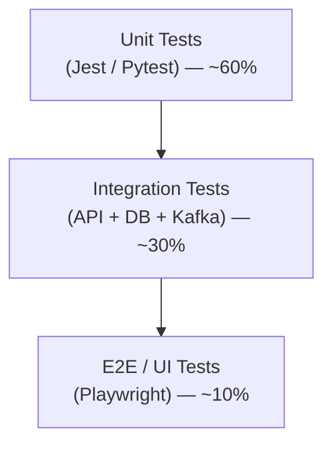

# 14 — Testing Strategy

## Purpose

Defines the testing approach, tooling, coverage targets, and quality gates for ClimateShield Nexus across unit, integration, end-to-end, performance, security, and data/model validation layers.

> Version: 1.0 | Author: ClimateShield Nexus QA Engineering | Last Updated: 2026-07-27

## Table of Contents

1. [Testing Philosophy](#testing-philosophy)
2. [Test Pyramid](#test-pyramid)
3. [Test Types & Tooling](#test-types--tooling)
4. [Coverage Targets](#coverage-targets)
5. [Module-Specific Testing Considerations](#module-specific-testing-considerations)
6. [Test Environments](#test-environments)
7. [CI Quality Gates](#ci-quality-gates)
8. [Test Data Management](#test-data-management)
9. [Defect Management](#defect-management)
10. [References](#references)
11. [Revision History](#revision-history)

## Testing Philosophy

- **Shift-left**: tests are written alongside code, not after; PRs without tests for new logic are rejected (see [CONTRIBUTING.md](../CONTRIBUTING.md)).
- **Risk-weighted coverage**: alerting, risk-assessment, and authorization code paths require the highest rigor since defects there have public-safety consequences.
- **Deterministic tests**: no test may depend on live external data providers; use recorded fixtures/mocks.

## Test Pyramid

## Test Types & Tooling

| Test Type | Tooling | Scope |
|---|---|---|
| Unit | Jest (Node.js services), Pytest (Python services) | Pure logic, risk scoring formulas, validators |
| Integration | Supertest/Jest + Testcontainers (Postgres/Kafka), Pytest + Testcontainers | Service-to-DB, service-to-Kafka, service-to-service contracts |
| Contract | Pact or OpenAPI schema validation | Frontend/backend and third-party integration contracts |
| End-to-End | Playwright | Critical user journeys (login → dashboard → alert approval) |
| Performance/Load | k6 or Locust | API p95 latency, concurrent user targets ([`docs/05_Non_Functional_Requirements.md`](05_Non_Functional_Requirements.md#performance)) |
| Security | OWASP ZAP (DAST), Semgrep/CodeQL (SAST), `npm audit`/`pip-audit` (SCA) | Automated in CI; annual manual pen test |
| Accessibility | axe-core (automated) + manual screen-reader pass | WCAG 2.1 AA per [`docs/19_UI_Design_System.md`](19_UI_Design_System.md) |
| ML/Model Validation | Custom back-testing harness against historical events | Risk model precision/recall, forecast bias metrics |
| Data Quality | Great Expectations (or equivalent) | Pipeline validation rules from [`docs/28_Validation_Rules.md`](28_Validation_Rules.md) |

## Coverage Targets

| Component | Minimum Line Coverage | Notes |
|---|---|---|
| Auth Service | 90% | Highest sensitivity |
| Risk Assessment Service | 90% | Public-safety critical |
| Alerting Service | 90% | Public-safety critical |
| Climate Data / Forecast Services | 80% | |
| GIS Service | 75% | Spatial edge cases via integration tests |
| AI Assistant Service | 70% | Response quality validated via eval harness, not just line coverage |
| Frontend (React) | 70% | Focus on state logic and critical components over pixel-perfect UI tests |
| Overall platform | 80% | Enforced in CI, see [`docs/05_Non_Functional_Requirements.md`](05_Non_Functional_Requirements.md#maintainability) |

## Module-Specific Testing Considerations

| Module | Special Consideration |
|---|---|
| Risk Assessment | Back-test against ≥ 3 historical flood/drought/heatwave events per hazard type before promoting a model version to production |
| Alerts | Chaos-test channel failure (simulate SMS gateway outage) to verify parallel-dispatch resilience |
| GIS | Visual regression testing on map rendering for key layer combinations |
| AI Assistant | Golden-set evaluation (curated Q&A pairs) run on every model/prompt change; citation-accuracy check |
| Data Pipelines | Idempotency tests — re-running a DAG on the same input must not duplicate data |

## Test Environments

| Environment | Purpose | Data |
|---|---|---|
| Local | Developer machine (Docker Compose) | Synthetic fixtures |
| CI | Automated PR checks | Synthetic fixtures + Testcontainers |
| Staging | Pre-production validation, UAT | Anonymized/sampled production-like data |
| Production | Live | Real |

Full environment matrix: [`docs/15_Deployment_Guide.md`](15_Deployment_Guide.md#environments).

## CI Quality Gates

A PR cannot merge unless, per [`.github/workflows/`](../.github/workflows/):

1. Lint passes (ESLint/Prettier for TS, Ruff/Black for Python).
2. Unit + integration tests pass with coverage ≥ module target.
3. SAST (Semgrep/CodeQL) reports no new High/Critical findings.
4. Dependency scan (SCA) reports no new High/Critical CVEs.
5. Mermaid diagrams in changed docs render without syntax errors.
6. For UI changes: axe-core accessibility check passes.

## Test Data Management

- Synthetic data generators produce realistic station/forecast/risk fixtures without exposing real operational data in lower environments.
- Staging data is a sampled, anonymized subset of production (PII/subscriber data excluded or masked).
- Historical event replay fixtures (for model back-testing) stored under `tests/fixtures/historical-events/`.

## Defect Management

| Severity | Definition | Response SLA |
|---|---|---|
| Critical | Alert dispatch broken, data corruption, security breach | Immediate, all-hands |
| High | Core module unusable for a role, incorrect risk severity output | Same business day |
| Medium | Degraded UX, non-blocking bug | Next sprint |
| Low | Cosmetic, minor inconsistency | Backlog |

## References

- [`docs/05_Non_Functional_Requirements.md`](05_Non_Functional_Requirements.md)
- [`docs/17_Coding_Standards.md`](17_Coding_Standards.md)
- [`docs/26_Acceptance_Criteria.md`](26_Acceptance_Criteria.md)
- `tests/` — test scaffolding and fixtures

## Revision History

| Version | Date | Author | Change |
|---|---|---|---|
| 1.0 | 2026-07-27 | ClimateShield Nexus QA Engineering | Initial version |
