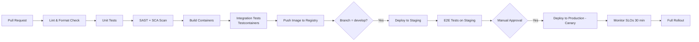
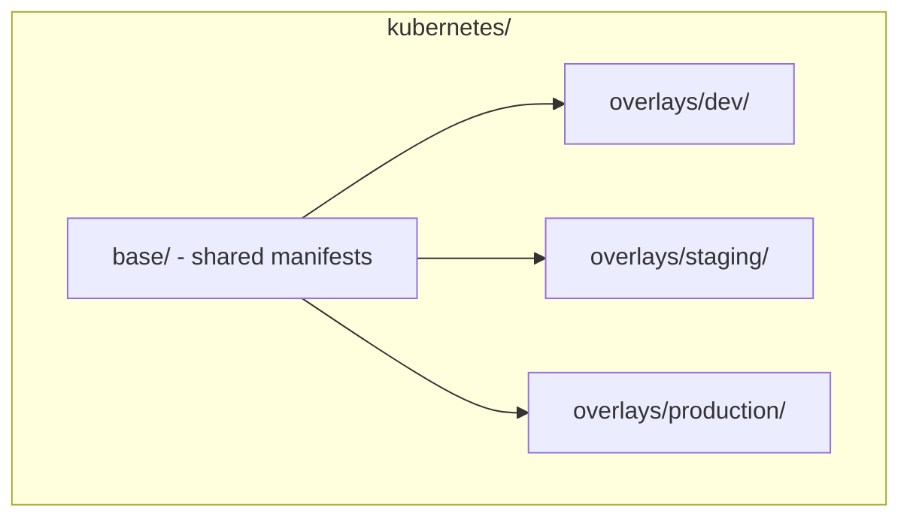

# 15 — Deployment Guide

## Purpose

Defines environments, CI/CD pipeline, infrastructure-as-code approach, and release procedure for ClimateShield Nexus.

> Version: 1.0 | Author: ClimateShield Nexus DevOps Team | Last Updated: 2026-07-27

## Table of Contents

1. [Environments](#environments)
2. [CI/CD Pipeline](#cicd-pipeline)
3. [Infrastructure as Code](#infrastructure-as-code)
4. [Release Process](#release-process)
5. [Rollback Procedure](#rollback-procedure)
6. [Deployment Checklist](#deployment-checklist)
7. [Container Strategy](#container-strategy)
8. [Kubernetes Layout](#kubernetes-layout)
9. [Secrets & Configuration](#secrets--configuration)
10. [References](#references)
11. [Revision History](#revision-history)

## Environments

| Environment | Purpose | Deploy Trigger | Data |
|---|---|---|---|
| Local | Developer workstation | `docker compose up` | Synthetic |
| CI | Automated test execution | Every PR | Synthetic/ephemeral |
| Staging | UAT, pre-production validation, KMD stakeholder review | Merge to `develop` | Sampled/anonymized |
| Production | Live pilot/rollout | Merge to `main` + manual approval gate | Real |

## CI/CD Pipeline

Implemented via [`.github/workflows/`](../.github/workflows/): `ci.yml` (lint/test/scan), `build.yml` (container build/push), `deploy-staging.yml`, `deploy-production.yml`.

## Infrastructure as Code

- **Terraform** provisions cloud/data-center primitives: VPC/network, managed Postgres (or VM for KMD-hosted Postgres), object storage buckets, Kubernetes cluster, DNS, WAF/CDN.
- **Kubernetes manifests** (Kustomize overlays per environment) define workloads, services, ingress, network policies, HPA.
- **No manual production changes** — all changes flow through IaC + PR review (`NFR-MAINT-004`).
- State stored remotely (e.g., encrypted S3 backend) with locking.

Directory layout: `docker/` (Dockerfiles, Compose for local dev), `kubernetes/` (base + overlays), `scripts/` (bootstrap helpers).

## Release Process

1. Feature branches merge to `develop` via PR (see [`docs/16_Git_Workflow.md`](16_Git_Workflow.md)).
2. `develop` auto-deploys to Staging; QA/UAT sign-off recorded against the release candidate.
3. Release branch cut (`release/x.y.z`); changelog updated ([`docs/37_Project_Change_Log.md`](37_Project_Change_Log.md)).
4. Merge to `main` triggers canary deployment (5% traffic) to Production.
5. SLO dashboards monitored for 30 minutes minimum; automatic rollback on error-rate/latency breach.
6. Full rollout on healthy canary; tag release in git.

## Rollback Procedure

1. Trigger `rollback` workflow with target previous stable tag.
2. Kubernetes deployment reverts to prior image digest (kept in registry per retention policy).
3. If a database migration was part of the release, apply the corresponding down-migration only if it is non-destructive; otherwise roll forward with a hotfix (destructive down-migrations are avoided by design — see [`docs/17_Coding_Standards.md`](17_Coding_Standards.md#database-migrations)).
4. Incident recorded per [`docs/13_Security_Design.md`](13_Security_Design.md#incident-response) if user-impacting.

## Deployment Checklist

- [ ] All CI quality gates green ([`docs/14_Testing_Strategy.md`](14_Testing_Strategy.md#ci-quality-gates))
- [ ] Migrations reviewed by Database Architect
- [ ] Feature flags configured for any partially-rolled-out feature
- [ ] Runbook updated if operational behavior changed ([`docs/36_System_Maintenance.md`](36_System_Maintenance.md))
- [ ] Alert-path smoke test executed on staging
- [ ] Rollback plan confirmed

## Container Strategy

- Multi-stage Dockerfiles (build stage → slim runtime stage) per service under `docker/<service>/Dockerfile`.
- Base images pinned by digest; scanned via Trivy/Grype in CI.
- Non-root container user; read-only root filesystem where feasible.

## Kubernetes Layout

Namespaces: `gateway`, `services`, `data`, `pipelines`, `observability` (see [`docs/06_System_Architecture.md`](06_System_Architecture.md#deployment-topology)).

## Secrets & Configuration

- Environment variables per [`docs/31_Environment_Variables.md`](31_Environment_Variables.md), sourced from Vault/cloud Secrets Manager at deploy time.
- ConfigMaps for non-sensitive config; Secrets (K8s) or external-secrets-operator for sensitive values.
- `.env.example` is the canonical variable list — kept in sync via CI check.

## References

- [`docs/06_System_Architecture.md`](06_System_Architecture.md)
- [`docs/14_Testing_Strategy.md`](14_Testing_Strategy.md)
- [`docs/16_Git_Workflow.md`](16_Git_Workflow.md)
- [`docs/31_Environment_Variables.md`](31_Environment_Variables.md)
- `docker/`, `kubernetes/`, `.github/workflows/`

## Revision History

| Version | Date | Author | Change |
|---|---|---|---|
| 1.0 | 2026-07-27 | ClimateShield Nexus DevOps Team | Initial version |
