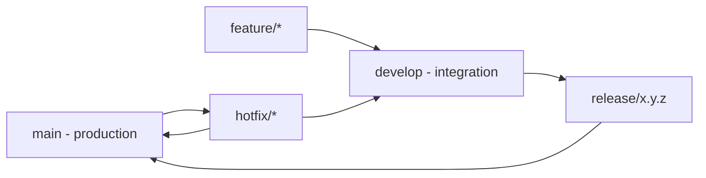

# 16 — Git Workflow

## Purpose

Defines the branching model, commit conventions, PR process, and repository hygiene rules for ClimateShield Nexus.

> Version: 1.0 | Author: ClimateShield Nexus DevOps Team | Last Updated: 2026-07-27

## Table of Contents

1. [Branching Model](#branching-model)
2. [Branch Naming](#branch-naming)
3. [Commit Convention](#commit-convention)
4. [Pull Request Flow](#pull-request-flow)
5. [Branch Protection Rules](#branch-protection-rules)
6. [Tagging & Releases](#tagging--releases)
7. [Merge Strategy](#merge-strategy)
8. [Handling Hotfixes](#handling-hotfixes)
9. [References](#references)
10. [Revision History](#revision-history)

## Branching Model

Trunk-based with short-lived feature branches, gitflow-lite for releases:



- `main`: always deployable to production; protected.
- `develop`: integration branch, auto-deploys to Staging.
- `feature/*`, `fix/*`, `docs/*`, `chore/*`: short-lived, branched from `develop`.
- `release/x.y.z`: cut from `develop` for release stabilization.
- `hotfix/*`: branched from `main` for urgent production fixes, merged back to both `main` and `develop`.

## Branch Naming

`<type>/<module>-<short-description>`

Examples: `feature/risk-flood-scoring`, `fix/alert-dispatch-retry`, `docs/api-spec-webhooks`, `chore/upgrade-nestjs`.

## Commit Convention

[Conventional Commits](https://www.conventionalcommits.org/):

```
<type>(<scope>): <short summary>

<optional body>

Refs: CSN-<issue-number>
```

| Type | Use |
|---|---|
| `feat` | New feature |
| `fix` | Bug fix |
| `docs` | Documentation only |
| `refactor` | Code change with no behavior change |
| `test` | Adding/adjusting tests |
| `chore` | Tooling, dependencies, build config |
| `perf` | Performance improvement |
| `security` | Security-relevant fix (also flag reviewers) |

## Pull Request Flow

1. Open PR from feature branch → `develop` (or `main` for hotfixes).
2. CI runs full quality gate ([`docs/14_Testing_Strategy.md`](14_Testing_Strategy.md#ci-quality-gates)).
3. Required reviewers approve per [CONTRIBUTING.md](../CONTRIBUTING.md#review--approval).
4. Squash-merge with a Conventional Commit summary message.
5. Branch deleted after merge.

## Branch Protection Rules

| Branch | Rule |
|---|---|
| `main` | No direct pushes; requires PR + 2 approvals + green CI; requires up-to-date branch before merge |
| `develop` | No direct pushes; requires PR + 1-2 approvals (per change type) + green CI |
| `release/*` | No direct pushes; only cherry-picks/fixes via PR |

## Tagging & Releases

- Semantic versioning: `vMAJOR.MINOR.PATCH` (e.g., `v1.2.0`).
- Tag created on merge of `release/x.y.z` into `main`.
- Release notes generated from Conventional Commit history, published alongside [`docs/37_Project_Change_Log.md`](37_Project_Change_Log.md) update.

## Merge Strategy

- **Squash merge** for feature/fix branches into `develop`/`main` (clean linear history).
- **Merge commit** for `release/*` → `main` (preserves release boundary).
- Rebase (not merge) to keep a feature branch current with `develop` before requesting review.

## Handling Hotfixes

1. Branch `hotfix/<desc>` from `main`.
2. Fix, test, PR with expedited 1-reviewer path for Critical severity (per [`docs/14_Testing_Strategy.md`](14_Testing_Strategy.md#defect-management)).
3. Merge to `main`, tag patch release, deploy.
4. Immediately back-merge `main` → `develop` to avoid regression reintroduction.

## References

- [CONTRIBUTING.md](../CONTRIBUTING.md)
- [`docs/15_Deployment_Guide.md`](15_Deployment_Guide.md)
- [`docs/17_Coding_Standards.md`](17_Coding_Standards.md)
- [`docs/37_Project_Change_Log.md`](37_Project_Change_Log.md)

## Revision History

| Version | Date | Author | Change |
|---|---|---|---|
| 1.0 | 2026-07-27 | ClimateShield Nexus DevOps Team | Initial version |
