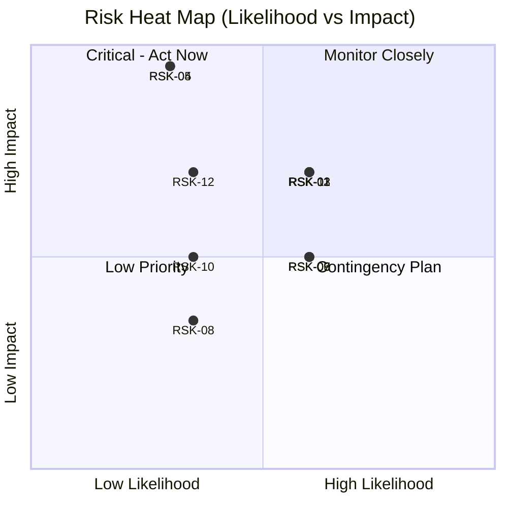

# 18 — Risk Assessment (Project & Technical Risk Register)

## Purpose

Identifies and tracks project delivery and technical risks for ClimateShield Nexus — distinct from the platform's climate-hazard "Risk Assessment" module ([`docs/04_Functional_Requirements.md`](04_Functional_Requirements.md#risk-assessment)), this document covers **program risk**.

> Version: 1.0 | Author: ClimateShield Nexus Program Management | Last Updated: 2026-07-27

## Table of Contents

1. [Risk Scoring Model](#risk-scoring-model)
2. [Risk Register](#risk-register)
3. [Risk Heat Map](#risk-heat-map)
4. [Top Risks — Mitigation Detail](#top-risks--mitigation-detail)
5. [Review Cadence](#review-cadence)
6. [References](#references)
7. [Revision History](#revision-history)

## Risk Scoring Model

`Score = Likelihood (1-5) × Impact (1-5)`; **Low** 1-6, **Medium** 8-12, **High** 15-25.

## Risk Register

| ID | Risk | Likelihood | Impact | Score | Owner | Status |
|---|---|---|---|---|---|---|
| RSK-01 | Delayed/limited access to KMD station network API credentials | 3 | 4 | 12 (Medium) | Product Team | Open |
| RSK-02 | NWP/satellite data provider rate limits or licensing constraints | 3 | 4 | 12 (Medium) | Architecture Team | Open |
| RSK-03 | 5-developer team insufficient for full MVP scope within timeline | 3 | 4 | 12 (Medium) | Program Management | Open |
| RSK-04 | AI Assistant produces incorrect/misleading recommendation on high-stakes query | 2 | 5 | 10 (Medium) | Security Engineering | Open — mitigated by design |
| RSK-05 | Alert dispatch channel (SMS/email/push) outage during a real severe-weather event | 2 | 5 | 10 (Medium) | DevOps Team | Open — mitigated by design |
| RSK-06 | Data residency/compliance requirements not fully known until Phase 1 discovery | 3 | 3 | 9 (Medium) | Security Engineering | Open |
| RSK-07 | GIS performance degradation with high-resolution satellite layers at national scale | 3 | 3 | 9 (Medium) | GIS Architecture | Open |
| RSK-08 | Underestimated effort for multi-language (English/Swahili) content and RTL-safe design | 2 | 2 | 4 (Low) | UI/UX Team | Open |
| RSK-09 | Key-person dependency given small team size | 3 | 3 | 9 (Medium) | Program Management | Open |
| RSK-10 | Stakeholder requirement changes after Phase 1 discovery invalidate foundation assumptions | 2 | 3 | 6 (Low) | Product Team | Open |
| RSK-11 | Model back-testing reveals risk model accuracy below target (85% precision) | 3 | 4 | 12 (Medium) | Data Science Team | Open |
| RSK-12 | Public-sector procurement/budget cycle delays infrastructure provisioning | 2 | 4 | 8 (Medium) | Program Management | Open |

## Risk Heat Map

## Top Risks — Mitigation Detail

### RSK-04: AI Recommendation Accuracy
- **Mitigation**: Mandatory citation + confidence scoring ([`SRS-AI-002`](04_Functional_Requirements.md#ai-climate-assistant)); human-review gate on high-stakes topics ([`SRS-AI-005`](04_Functional_Requirements.md#ai-climate-assistant)); golden-set evaluation before every model/prompt change ([`docs/14_Testing_Strategy.md`](14_Testing_Strategy.md#module-specific-testing-considerations)).
- **Contingency**: AI Assistant is Should-have, not Must-have, for MVP — can be disabled via feature flag (`FEATURE_AI_ASSISTANT`) without blocking launch.

### RSK-05: Alert Dispatch Channel Outage
- **Mitigation**: Parallel multi-channel dispatch (not sequential); circuit breakers; channel health monitoring on the Administration Dashboard ([`docs/06_System_Architecture.md`](06_System_Architecture.md#resilience--failure-handling)).
- **Contingency**: Manual dispatch runbook documented in [`docs/36_System_Maintenance.md`](36_System_Maintenance.md).

### RSK-03: Team Capacity vs. Scope
- **Mitigation**: MoSCoW-prioritized backlog ([`docs/25_Product_Backlog.md`](25_Product_Backlog.md)); phased roadmap defers Should/Could-have modules ([`docs/20_Project_Roadmap.md`](20_Project_Roadmap.md)).
- **Contingency**: Scope negotiation checkpoint at end of each phase in [`docs/41_Project_Timeline.md`](41_Project_Timeline.md).

### RSK-11: Risk Model Accuracy Below Target
- **Mitigation**: Back-testing against ≥ 3 historical events per hazard before production promotion; versioned models allow safe rollback ([`docs/09_Database_Dictionary.md`](09_Database_Dictionary.md#risk-assessment-tables)).
- **Contingency**: Ship with wider confidence bands and explicit "provisional model" labeling until accuracy target is met.

## Review Cadence

Risk register reviewed at the start of every sprint/iteration by the Program Management lead and Lead Architect; new risks logged as discovered. See [`docs/32_Project_Development_Plan.md`](32_Project_Development_Plan.md#ceremonies).

## References

- [`docs/20_Project_Roadmap.md`](20_Project_Roadmap.md)
- [`docs/25_Product_Backlog.md`](25_Product_Backlog.md)
- [`docs/32_Project_Development_Plan.md`](32_Project_Development_Plan.md)
- [`docs/13_Security_Design.md`](13_Security_Design.md)

## Revision History

| Version | Date | Author | Change |
|---|---|---|---|
| 1.0 | 2026-07-27 | ClimateShield Nexus Program Management | Initial version |
