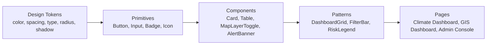

# 19 — UI Design System

## Purpose

Defines the design language, tokens, component library, and accessibility rules for all ClimateShield Nexus interfaces (web, mobile, public portal). Serves as the single source of truth for frontend implementation and for [`docs/21_Wireflows.md`](21_Wireflows.md).

> Version: 1.0 | Author: ClimateShield Nexus UI/UX Team | Last Updated: 2026-07-27

## Table of Contents

1. [Design Principles](#design-principles)
2. [Design Token Architecture](#design-token-architecture)
3. [Color System](#color-system)
4. [Risk Severity Color Scale](#risk-severity-color-scale)
5. [Typography](#typography)
6. [Spacing & Layout Grid](#spacing--layout-grid)
7. [Component Library (Atomic Structure)](#component-library-atomic-structure)
8. [Key Components](#key-components)
9. [Iconography](#iconography)
10. [Accessibility Standards](#accessibility-standards)
11. [Responsive Breakpoints](#responsive-breakpoints)
12. [Localization Considerations](#localization-considerations)
13. [Dark Mode](#dark-mode)
14. [References](#references)
15. [Revision History](#revision-history)

## Design Principles

1. **Clarity under pressure** — a disaster officer scanning the GIS Dashboard during an active event must find critical info in seconds.
2. **Trustworthy data presentation** — always show data source, timestamp, and confidence; never present a number without provenance.
3. **Progressive disclosure** — dashboards show summary first, drill-down on demand (no overwhelming first screens).
4. **Consistent severity language** — the same color/icon vocabulary for risk severity appears everywhere (dashboard, map, alert, report).
5. **Low-bandwidth resilience** — critical UI (alerts, current conditions) must render meaningfully even with degraded imagery/tiles.

## Design Token Architecture

Tokens are defined once (e.g., `frontend/design-tokens/tokens.json` once implementation begins) and consumed by Tailwind config, React Native theme, and the public portal — no duplicated hardcoded values.

## Color System

| Token | Hex | Usage |
|---|---|---|
| `color.primary.600` | #0B5FA5 | Primary actions, active nav |
| `color.primary.100` | #DCEBF8 | Primary backgrounds/hover |
| `color.neutral.900` | #14181F | Primary text |
| `color.neutral.500` | #6B7280 | Secondary text |
| `color.neutral.100` | #F3F4F6 | Surface background |
| `color.success.600` | #1D8A5A | Success states, "data fresh" |
| `color.warning.600` | #B7791F | Caution states |
| `color.danger.600` | #B42318 | Errors, destructive actions |
| `color.info.600` | #2563EB | Informational callouts |

All color pairs verified for ≥ 4.5:1 contrast ratio (WCAG 2.1 AA) for text-on-background usage.

## Risk Severity Color Scale

Colorblind-safe (Viridis/Okabe-Ito inspired), consistent across dashboard, map legend, alerts, and reports:

| Severity | Color | Hex | Icon |
|---|---|---|---|
| Low | Blue-green | #2E7D6B | ● |
| Moderate | Yellow | #C9A227 | ▲ |
| High | Orange | #D9730D | ▲ |
| Severe | Red-orange | #C0392B | ■ |
| Extreme | Deep red / magenta hatch | #8E1B3C | ✖ |

Never rely on color alone — severity is always paired with icon shape and text label (WCAG 1.4.1).

## Typography

| Token | Font | Size | Use |
|---|---|---|---|
| `font.family.base` | Inter (Latin), Noto Sans (Swahili diacritics fallback) | — | UI text |
| `font.family.mono` | JetBrains Mono | — | Data/API values, coordinates |
| `type.h1` | 28px / 36px line-height / 700 weight | Page titles |
| `type.h2` | 22px / 30px / 600 | Section headers |
| `type.body` | 16px / 24px / 400 | Default body |
| `type.small` | 14px / 20px / 400 | Secondary/meta text |
| `type.caption` | 12px / 16px / 500 | Timestamps, source attribution |

## Spacing & Layout Grid

- 8px base spacing unit (`space.1` = 4px, `space.2` = 8px, `space.4` = 16px, `space.8` = 32px …).
- 12-column responsive grid, 24px gutter desktop / 16px tablet / 8px mobile.
- Card border radius: `radius.md` = 8px; map panel radius `radius.lg` = 12px.

## Component Library (Atomic Structure)

| Layer | Examples |
|---|---|
| Primitives | Button, IconButton, Input, Select, Checkbox, Badge, Tooltip, Spinner |
| Components | Card, DataTable, Tabs, Modal, Toast, MapLayerToggle, SeverityBadge, DateRangePicker |
| Patterns | DashboardGrid, FilterBar, AlertBanner, RiskLegend, ReportPreviewPane, ConfidenceIndicator |
| Pages | Climate Dashboard, Forecast Dashboard, GIS Dashboard, AI Dashboard, Analytics Dashboard, Administration Dashboard, Public Portal Home |

## Key Components

### SeverityBadge
- Props: `severity: low|moderate|high|severe|extreme`, `hazardType`, `showLabel`.
- Renders color + icon + text per [Risk Severity Color Scale](#risk-severity-color-scale).

### ConfidenceIndicator
- Used on AI Assistant responses and risk assessments.
- Renders a 0-100% bar plus qualitative label (Low/Medium/High confidence) and a "human review required" flag state.

### AlertBanner
- Sticky top-of-dashboard banner for active High+ severity alerts in the user's scoped boundary.
- Dismissible per-session, never permanently for Severe/Extreme.

### MapLayerToggle
- Grouped layer categories (Boundaries, Hazards, Satellite, Infrastructure); supports opacity slider per layer.

### DataSourceFooter
- Appears on every chart/map/report: source name, last updated timestamp, freshness status (fresh/stale).

## Iconography

- Line-style icon set (24px grid, 2px stroke) for consistency with the low-clutter dashboard philosophy.
- Hazard-specific icon set: flood (wave), drought (cracked ground), heatwave (sun burst), agriculture (crop), infrastructure (bridge), population exposure (people cluster).

## Accessibility Standards

| Requirement | Detail |
|---|---|
| WCAG Level | 2.1 AA minimum on all primary flows ([`NFR-UX-001`](05_Non_Functional_Requirements.md#usability--accessibility)) |
| Keyboard navigation | All interactive elements reachable and operable via keyboard; visible focus states |
| Screen reader | Semantic HTML, ARIA labels on map controls and icon-only buttons |
| Color contrast | ≥ 4.5:1 text, ≥ 3:1 UI components/graphics |
| Motion | Respect `prefers-reduced-motion`; no auto-playing map animation loops by default |
| Text resize | UI remains usable at 200% browser zoom |
| Testing | Automated axe-core in CI + manual screen-reader pass each release ([`docs/14_Testing_Strategy.md`](14_Testing_Strategy.md#test-types--tooling)) |

## Responsive Breakpoints

| Name | Width | Primary Targets |
|---|---|---|
| `sm` | 360px+ | Mobile app, public portal on phone |
| `md` | 768px+ | Tablet, minimum supported for full dashboards ([`SRS-DASH-008`](04_Functional_Requirements.md#dashboards)) |
| `lg` | 1024px+ | Standard desktop |
| `xl` | 1440px+ | Wide monitors, GIS-heavy workstations |

## Localization Considerations

- All strings externalized (see [`NFR-LOC-001`](05_Non_Functional_Requirements.md#localization)); English and Swahili at launch.
- UI components accommodate ~30% text-length expansion for Swahili translations without truncation.
- Date/number formatting locale-aware; Africa/Nairobi default timezone display.

## Dark Mode

- Deferred to post-MVP (Could-have); token architecture supports it (`color.*` tokens have dark-mode pairs reserved) so it can be added without component rewrites.

## References

- [`docs/05_Non_Functional_Requirements.md`](05_Non_Functional_Requirements.md#usability--accessibility)
- [`docs/21_Wireflows.md`](21_Wireflows.md)
- [`docs/17_Coding_Standards.md`](17_Coding_Standards.md#react--frontend-standards)
- `docs/design/` — supplementary mockup references

## Revision History

| Version | Date | Author | Change |
|---|---|---|---|
| 1.0 | 2026-07-27 | ClimateShield Nexus UI/UX Team | Initial version |
