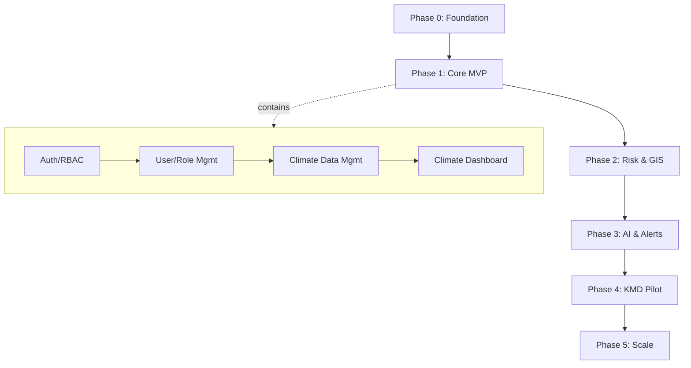

# 20 — Project Roadmap

## Purpose

Detailed, phase-by-phase roadmap expanding on the top-level [ROADMAP.md](../ROADMAP.md), including milestone exit criteria and module sequencing. Feeds [`docs/41_Project_Timeline.md`](41_Project_Timeline.md).

> Version: 1.0 | Author: ClimateShield Nexus Product & Architecture Team | Last Updated: 2026-07-27

## Table of Contents

1. [Roadmap Philosophy](#roadmap-philosophy)
2. [Phase 0 — Foundation](#phase-0--foundation)
3. [Phase 1 — Core Platform MVP](#phase-1--core-platform-mvp)
4. [Phase 2 — Risk Intelligence & GIS](#phase-2--risk-intelligence--gis)
5. [Phase 3 — AI & Early Warning](#phase-3--ai--early-warning)
6. [Phase 4 — KMD Pilot](#phase-4--kmd-pilot)
7. [Phase 5 — Scale & Multi-Agency Rollout](#phase-5--scale--multi-agency-rollout)
8. [Module Sequencing Diagram](#module-sequencing-diagram)
9. [Exit Criteria Summary](#exit-criteria-summary)
10. [References](#references)
11. [Revision History](#revision-history)

## Roadmap Philosophy

Each phase delivers a demonstrable, independently valuable increment; no phase depends on speculative future scope. Prioritization follows the MoSCoW backlog in [`docs/25_Product_Backlog.md`](25_Product_Backlog.md).

## Phase 0 — Foundation

**Status: Complete (this repository)**

- Full documentation foundation (42 core docs + supplementary artifacts).
- Repository scaffolding for all services.
- Sign-off checklist: [`docs/42_Final_Project_Checklist.md`](42_Final_Project_Checklist.md).

## Phase 1 — Core Platform MVP

**Goal**: A secure, usable platform shell with real climate data browsing — no risk intelligence yet.

| Deliverable | Modules |
|---|---|
| Identity & Access | Authentication, Authorization, User Management, Role Management |
| Data Foundation | Climate Data Management, Historical Climate Data, Data Validation |
| Dashboards | Climate Dashboard, Administration Dashboard |
| Platform Ops | Audit Logs, Settings/System Configuration, Monitoring |

**Exit Criteria**: All 14 personas can log in and see role-appropriate dashboards; historical data browsable and exportable; audit log capturing all privileged actions.

## Phase 2 — Risk Intelligence & GIS

**Goal**: Automated hazard scoring and spatial visualization.

| Deliverable | Modules |
|---|---|
| Risk Engines | Flood, Drought, Heatwave, Agriculture, Infrastructure, Population Exposure Analysis |
| GIS | Interactive GIS, Satellite Data, Remote Sensing, GIS Dashboard |
| Forecasting | Forecast Models, Forecast Dashboard |
| Environmental | Environmental Monitoring |

**Exit Criteria**: Risk assessments recompute automatically on new data; back-tested against ≥ 3 historical events per hazard at ≥ 85% precision; GIS Dashboard renders all hazard layers within performance targets ([`NFR-PERF-003`](05_Non_Functional_Requirements.md#performance)).

## Phase 3 — AI & Early Warning

**Goal**: Close the loop from insight to action.

| Deliverable | Modules |
|---|---|
| AI | AI Climate Assistant, Recommendation Engine, Knowledge Base, AI Dashboard |
| Early Warning | Alerts, Notifications |
| Reporting | Climate Reports, Automated Reports, PDF/Excel Export |
| Analytics | Analytics Dashboard |

**Exit Criteria**: Alert dispatch p95 < 5 minutes trigger-to-send ([`NFR-PERF-005`](05_Non_Functional_Requirements.md#performance)); AI Assistant passes golden-set evaluation; automated bulletins generated on schedule without manual intervention.

## Phase 4 — KMD Pilot

**Goal**: Real-world validation with actual KMD forecasters and disaster officers.

- Staged rollout: internal KMD staff (2 weeks) → limited external stakeholders (4 weeks) → full pilot cohort.
- Daily active usage, alert accuracy, and system reliability tracked against [`docs/01_Project_Vision.md`](01_Project_Vision.md#success-metrics).
- Feedback loop feeds a hardening backlog before Phase 5.

**Exit Criteria**: ≥ 80% forecaster daily-active-usage; zero Critical-severity incidents in final 2 weeks of pilot; KMD leadership go-live sign-off.

## Phase 5 — Scale & Multi-Agency Rollout

**Goal**: Prove modular adoption model and scale to national production load.

- Multi-tenant hardening validated with a second NMHS onboarding exercise (see [`UC-05`](11_Use_Cases.md#uc-05-onboard-a-new-agency-multi-agency-modularity)).
- Mobile app GA release.
- Scale testing to national concurrent-user targets ([`NFR-SCALE-002`](05_Non_Functional_Requirements.md#scalability)).

**Exit Criteria**: Second agency onboarded in < 2 engineer-weeks; platform sustains national-scale load in performance testing.

## Module Sequencing Diagram

## Exit Criteria Summary

| Phase | Primary Exit Metric |
|---|---|
| 1 | 100% RBAC acceptance criteria pass |
| 2 | ≥ 85% risk model back-test precision |
| 3 | < 5 min alert dispatch p95 |
| 4 | ≥ 80% pilot DAU, 0 Critical incidents |
| 5 | < 2 engineer-weeks second-agency onboarding |

## References

- [ROADMAP.md](../ROADMAP.md)
- [`docs/25_Product_Backlog.md`](25_Product_Backlog.md)
- [`docs/41_Project_Timeline.md`](41_Project_Timeline.md)
- [`docs/42_Final_Project_Checklist.md`](42_Final_Project_Checklist.md)

## Revision History

| Version | Date | Author | Change |
|---|---|---|---|
| 1.0 | 2026-07-27 | ClimateShield Nexus Product & Architecture Team | Initial version |
