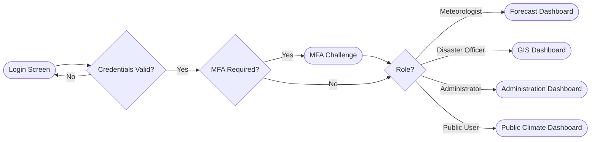
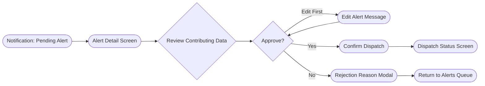
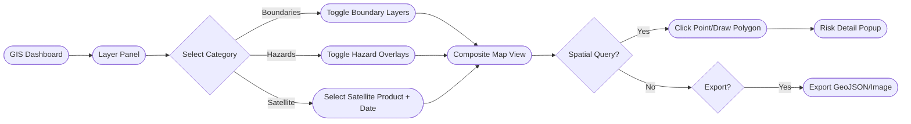
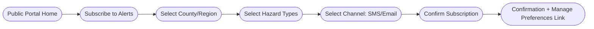
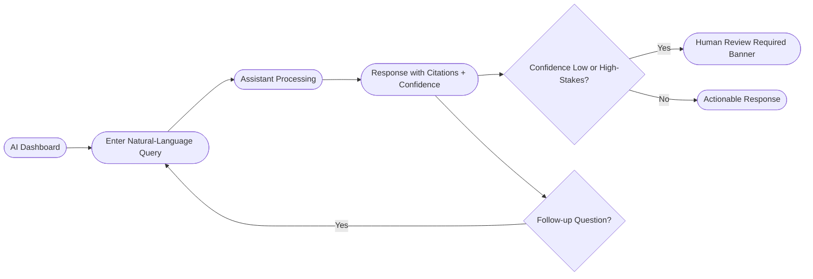
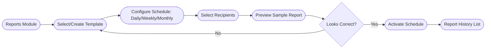

# 21 — Wireflows

## Purpose

Documents screen-to-screen navigation flows for the platform's primary journeys, bridging [`docs/19_UI_Design_System.md`](19_UI_Design_System.md) components into end-to-end user flows. Low-fidelity wireframe references live in [`docs/prototype/`](prototype/).

> Version: 1.0 | Author: ClimateShield Nexus UI/UX Team | Last Updated: 2026-07-27

## Table of Contents

1. [Notation](#notation)
2. [Wireflow 1: Login → Role-Based Dashboard](#wireflow-1-login--role-based-dashboard)
3. [Wireflow 2: Disaster Officer Alert Review & Approval](#wireflow-2-disaster-officer-alert-review--approval)
4. [Wireflow 3: GIS Analyst Layer Composition](#wireflow-3-gis-analyst-layer-composition)
5. [Wireflow 4: Public User Alert Subscription](#wireflow-4-public-user-alert-subscription)
6. [Wireflow 5: AI Assistant Query Journey](#wireflow-5-ai-assistant-query-journey)
7. [Wireflow 6: Automated Report Configuration](#wireflow-6-automated-report-configuration)
8. [References](#references)
9. [Revision History](#revision-history)

## Notation

Rounded boxes = screens; diamonds = decisions; arrows = navigation/user action.

## Wireflow 1: Login → Role-Based Dashboard

## Wireflow 2: Disaster Officer Alert Review & Approval

## Wireflow 3: GIS Analyst Layer Composition

## Wireflow 4: Public User Alert Subscription

## Wireflow 5: AI Assistant Query Journey

## Wireflow 6: Automated Report Configuration

## References

- [`docs/19_UI_Design_System.md`](19_UI_Design_System.md)
- [`docs/10_User_Stories.md`](10_User_Stories.md)
- [`docs/11_Use_Cases.md`](11_Use_Cases.md)
- [`docs/prototype/`](prototype/)

## Revision History

| Version | Date | Author | Change |
|---|---|---|---|
| 1.0 | 2026-07-27 | ClimateShield Nexus UI/UX Team | Initial version |
