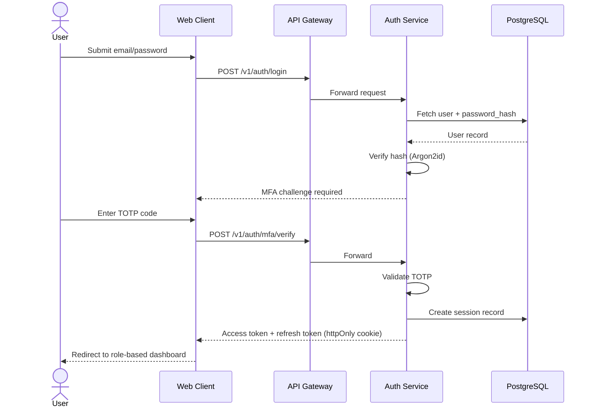
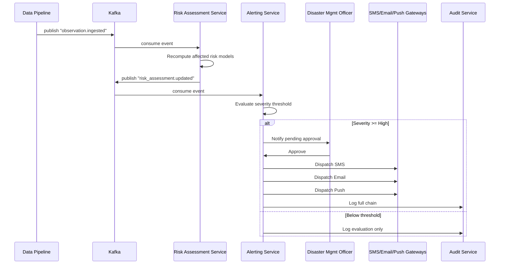
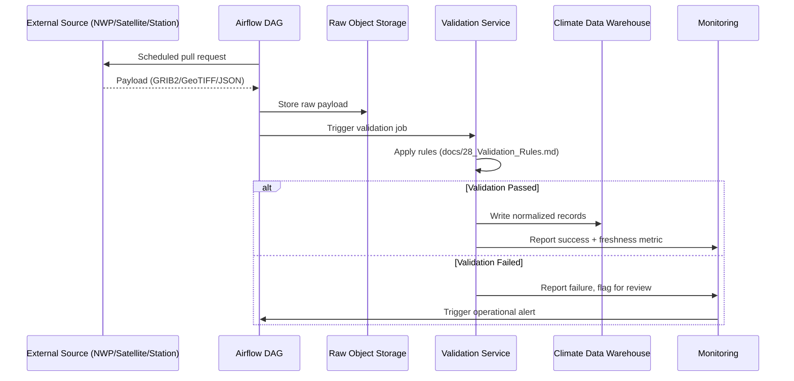
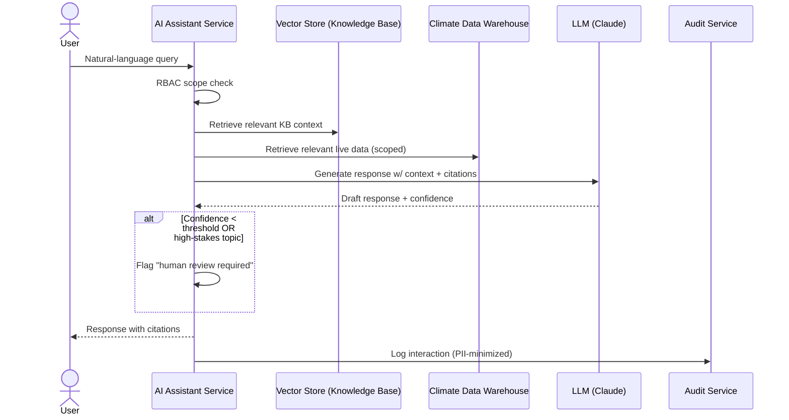
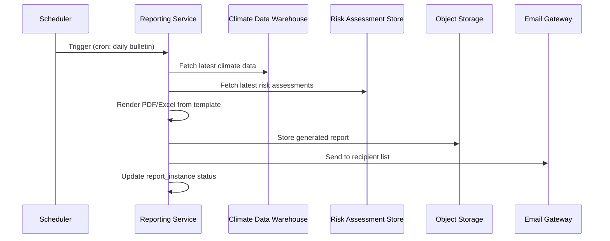
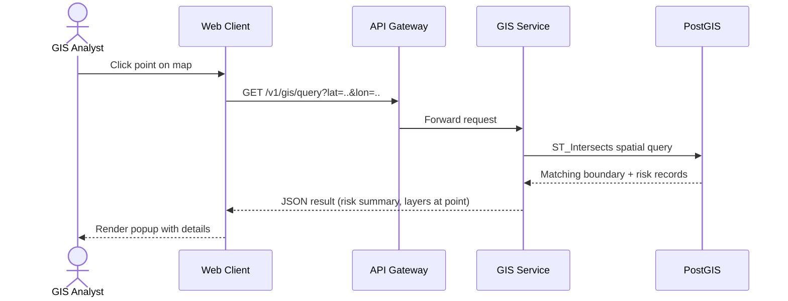

# 22 — Sequence Diagrams

## Purpose

Details cross-service interaction sequences for the platform's most critical and complex flows, complementing the static views in [`docs/06_System_Architecture.md`](06_System_Architecture.md) and [`docs/08_DFD.md`](08_DFD.md).

> Version: 1.0 | Author: ClimateShield Nexus Architecture Team | Last Updated: 2026-07-27

## Table of Contents

1. [Sequence 1: User Authentication with MFA](#sequence-1-user-authentication-with-mfa)
2. [Sequence 2: Risk Assessment Recompute → Alert Dispatch](#sequence-2-risk-assessment-recompute--alert-dispatch)
3. [Sequence 3: Data Ingestion & Validation Pipeline](#sequence-3-data-ingestion--validation-pipeline)
4. [Sequence 4: AI Assistant Query with RAG](#sequence-4-ai-assistant-query-with-rag)
5. [Sequence 5: Automated Report Generation](#sequence-5-automated-report-generation)
6. [Sequence 6: GIS Spatial Query](#sequence-6-gis-spatial-query)
7. [References](#references)
8. [Revision History](#revision-history)

## Sequence 1: User Authentication with MFA

## Sequence 2: Risk Assessment Recompute → Alert Dispatch

## Sequence 3: Data Ingestion & Validation Pipeline

## Sequence 4: AI Assistant Query with RAG

## Sequence 5: Automated Report Generation

## Sequence 6: GIS Spatial Query

## References

- [`docs/06_System_Architecture.md`](06_System_Architecture.md)
- [`docs/08_DFD.md`](08_DFD.md)
- [`docs/11_Use_Cases.md`](11_Use_Cases.md)
- [`docs/12_API_Specification.md`](12_API_Specification.md)

## Revision History

| Version | Date | Author | Change |
|---|---|---|---|
| 1.0 | 2026-07-27 | ClimateShield Nexus Architecture Team | Initial version |
