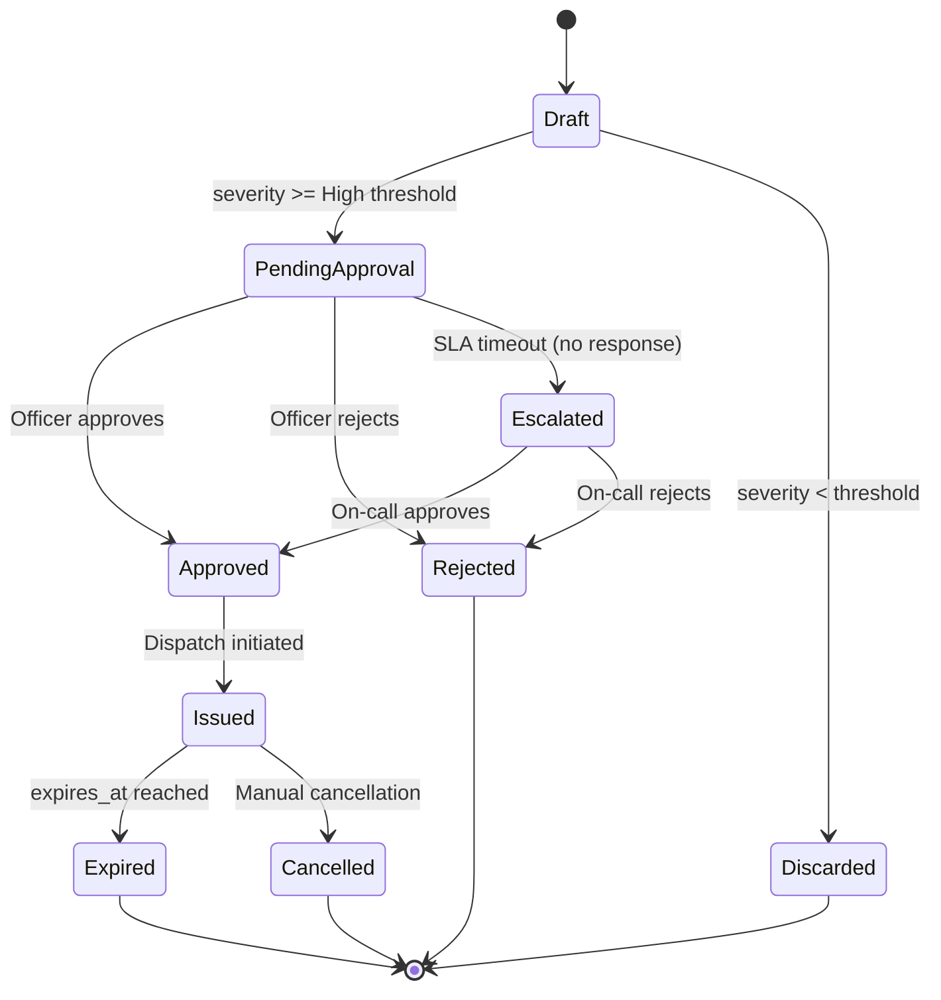
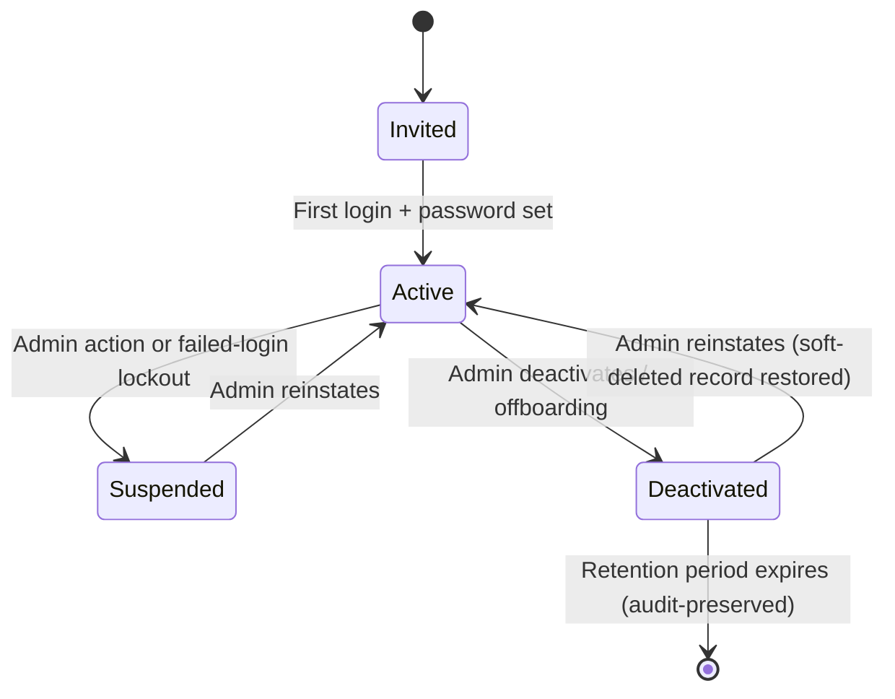
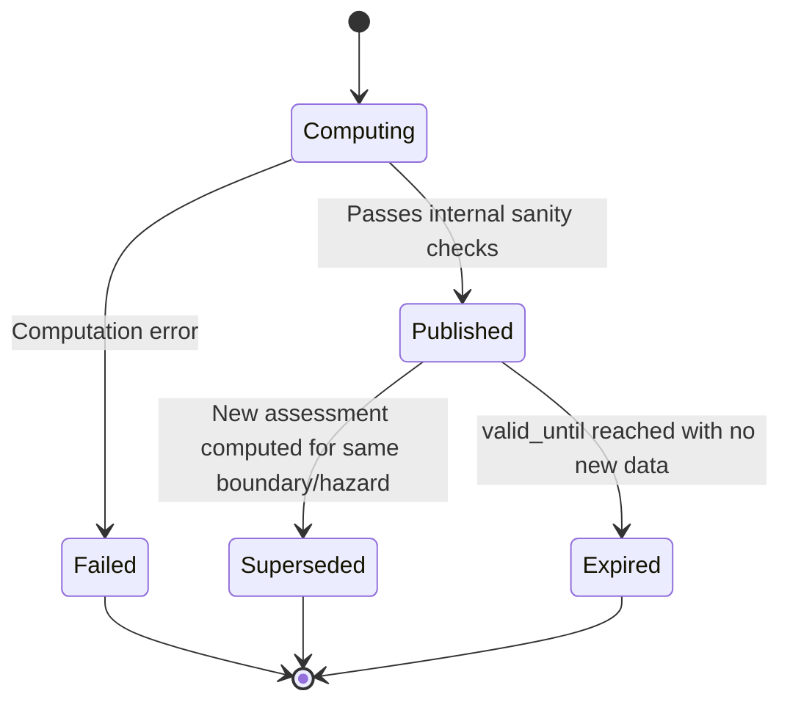
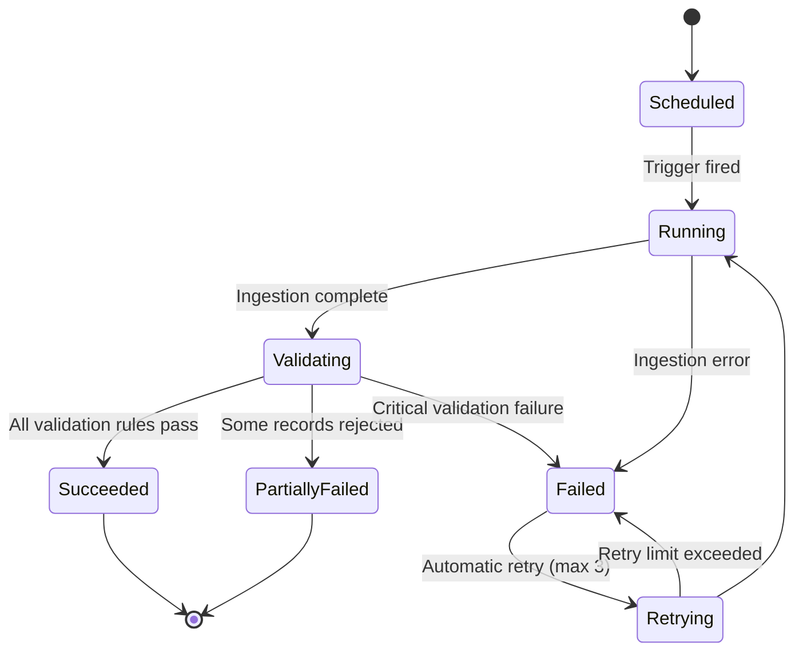
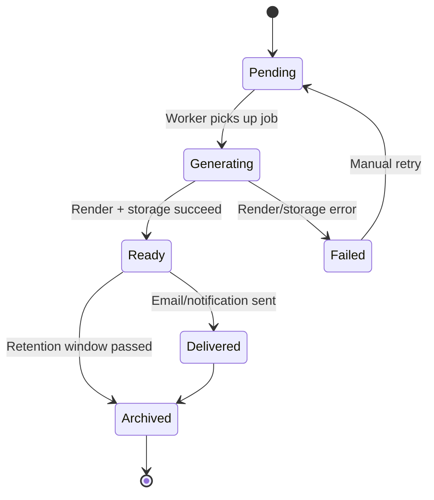
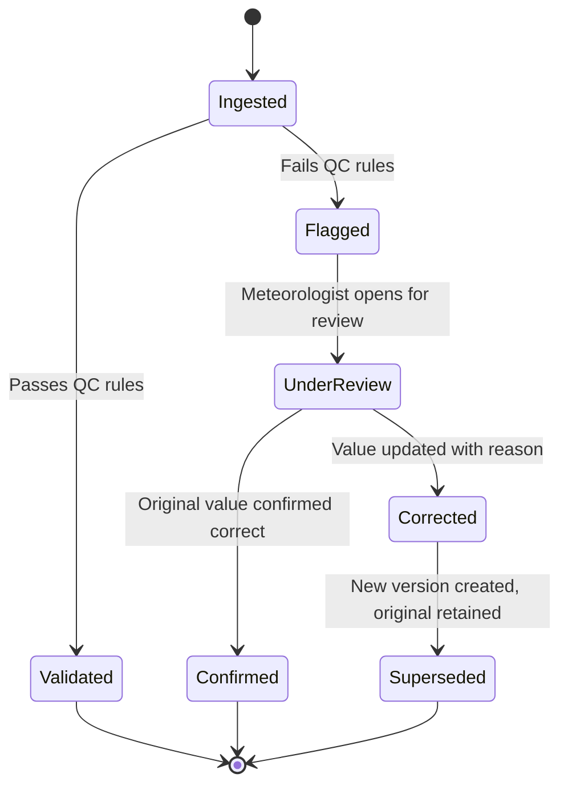

# 23 — State Diagrams

## Purpose

Defines the lifecycle state machines for the platform's core stateful entities, ensuring implementers build consistent transition logic and guard conditions.

> Version: 1.0 | Author: ClimateShield Nexus Architecture Team | Last Updated: 2026-07-27

## Table of Contents

1. [Alert Lifecycle](#alert-lifecycle)
2. [User Account Lifecycle](#user-account-lifecycle)
3. [Risk Assessment Lifecycle](#risk-assessment-lifecycle)
4. [Data Pipeline Run Lifecycle](#data-pipeline-run-lifecycle)
5. [Report Instance Lifecycle](#report-instance-lifecycle)
6. [Observation Correction Lifecycle](#observation-correction-lifecycle)
7. [References](#references)
8. [Revision History](#revision-history)

## Alert Lifecycle

## User Account Lifecycle

## Risk Assessment Lifecycle

## Data Pipeline Run Lifecycle

## Report Instance Lifecycle

## Observation Correction Lifecycle

## References

- [`docs/07_ERD.md`](07_ERD.md)
- [`docs/09_Database_Dictionary.md`](09_Database_Dictionary.md)
- [`docs/11_Use_Cases.md`](11_Use_Cases.md)
- [`docs/28_Validation_Rules.md`](28_Validation_Rules.md)

## Revision History

| Version | Date | Author | Change |
|---|---|---|---|
| 1.0 | 2026-07-27 | ClimateShield Nexus Architecture Team | Initial version |
