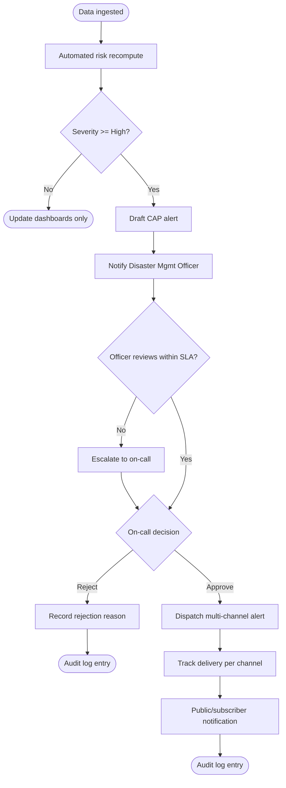
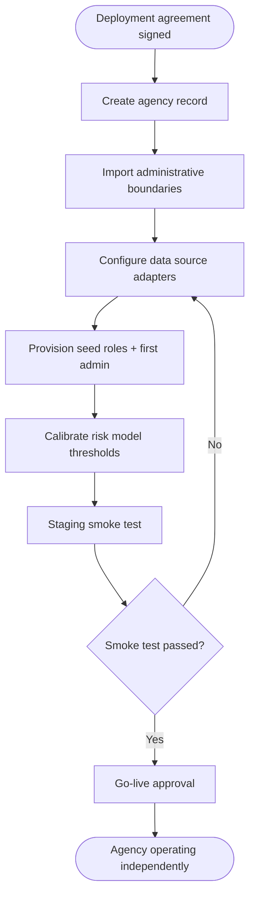
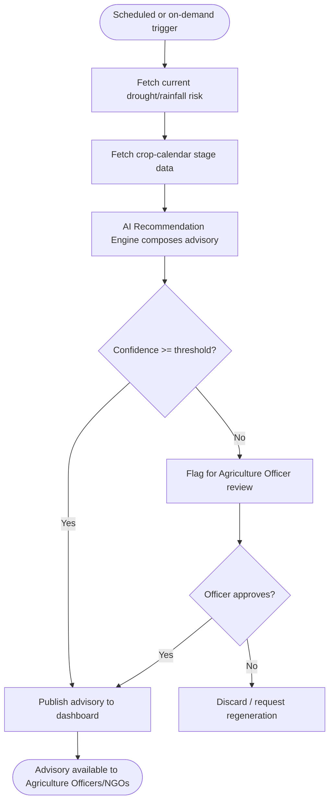
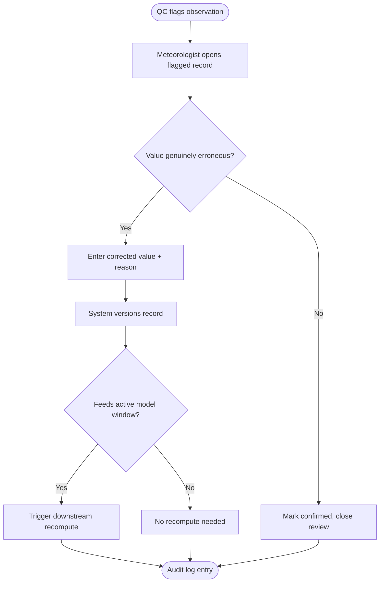
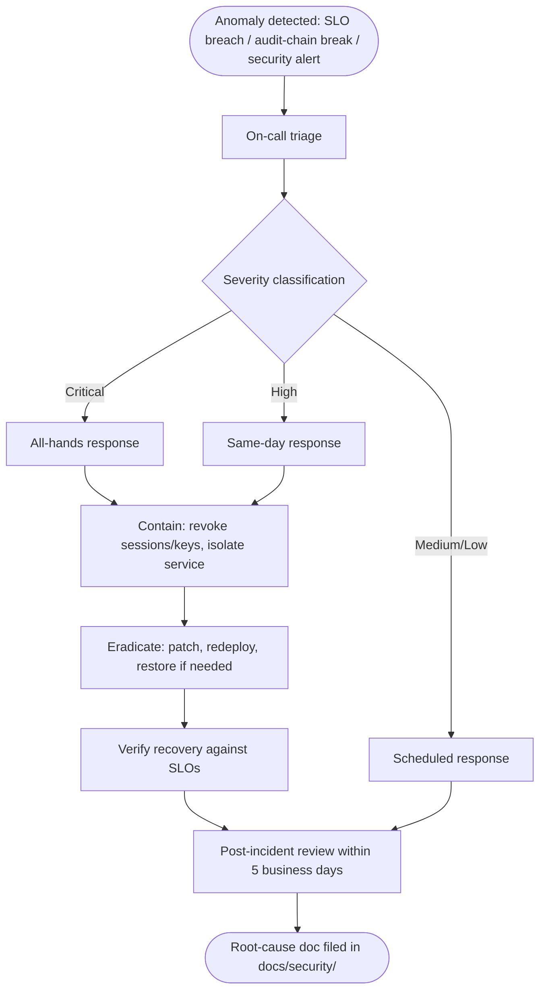

# 24 — Activity Diagrams

## Purpose

Models business process workflows spanning multiple actors and system decisions, complementing the technical [`docs/22_Sequence_Diagrams.md`](22_Sequence_Diagrams.md) with a process/business-rule view.

> Version: 1.0 | Author: ClimateShield Nexus Product Team | Last Updated: 2026-07-27

## Table of Contents

1. [Activity 1: Severe Weather Advisory Workflow](#activity-1-severe-weather-advisory-workflow)
2. [Activity 2: New Agency Onboarding](#activity-2-new-agency-onboarding)
3. [Activity 3: Agriculture Advisory Generation](#activity-3-agriculture-advisory-generation)
4. [Activity 4: Data Correction Review](#activity-4-data-correction-review)
5. [Activity 5: Incident Response](#activity-5-incident-response)
6. [References](#references)
7. [Revision History](#revision-history)

## Activity 1: Severe Weather Advisory Workflow

## Activity 2: New Agency Onboarding

## Activity 3: Agriculture Advisory Generation

## Activity 4: Data Correction Review

## Activity 5: Incident Response

## References

- [`docs/02_Business_Requirements.md`](02_Business_Requirements.md#business-process-overview)
- [`docs/11_Use_Cases.md`](11_Use_Cases.md)
- [`docs/22_Sequence_Diagrams.md`](22_Sequence_Diagrams.md)
- [`docs/13_Security_Design.md`](13_Security_Design.md#incident-response)

## Revision History

| Version | Date | Author | Change |
|---|---|---|---|
| 1.0 | 2026-07-27 | ClimateShield Nexus Product Team | Initial version |
