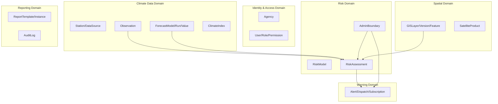

# 27 — Data Models

## Purpose

Describes the domain and logical data models of ClimateShield Nexus in narrative form — the "why" behind the physical structures in [`docs/07_ERD.md`](07_ERD.md) and [`docs/09_Database_Dictionary.md`](09_Database_Dictionary.md).

> Version: 1.0 | Author: ClimateShield Nexus Database Architecture Team | Last Updated: 2026-07-27

## Table of Contents

1. [Domain Model Overview](#domain-model-overview)
2. [Bounded Contexts](#bounded-contexts)
3. [Core Domain Concepts](#core-domain-concepts)
4. [Temporal Modeling Strategy](#temporal-modeling-strategy)
5. [Spatial Modeling Strategy](#spatial-modeling-strategy)
6. [Versioning Strategy](#versioning-strategy)
7. [Data Lifecycle](#data-lifecycle)
8. [References](#references)
9. [Revision History](#revision-history)

## Domain Model Overview

## Bounded Contexts

| Context | Owning Service | Notes |
|---|---|---|
| Identity & Access | Auth Service, User/Role Service | Cross-cutting; every other context depends on it for `user_id`/`role` references |
| Climate Data | Climate Data Service, Forecast Model Service | Source of truth for observed/forecast values |
| Risk | Risk Assessment Service | Consumes Climate Data + GIS boundaries; produces the platform's core value |
| Spatial | GIS Service | Owns geometry rendering, independent of risk semantics |
| Warning | Alerting Service | Consumes Risk; owns dispatch and subscription logic |
| Reporting/Audit | Reporting Service, Admin/Audit Service | Read-heavy, aggregates across other contexts |

Each context maps 1:1 to a service in [`docs/06_System_Architecture.md`](06_System_Architecture.md#service-catalog); cross-context references use IDs only (no foreign-key joins across service boundaries in the eventual microservice split — the current modular-monolith phase uses DB-level FKs for simplicity, see [ADR-001](architecture/)).

## Core Domain Concepts

| Concept | Definition |
|---|---|
| **Observation** | A single measured value at a point in time from a station or gridded source |
| **Forecast Run** | One execution of a forecast model producing a set of forecast values valid over a time window |
| **Risk Assessment** | A computed, versioned, boundary-scoped hazard severity judgment derived from observations/forecasts |
| **Admin Boundary** | A hierarchical spatial unit (national → county → sub-county → ward) used to scope risk and alerts |
| **Alert** | A CAP-structured notification derived from one or more risk assessments, subject to approval workflow |
| **Agency** | A deploying organization (KMD first); scopes users, branding, and (in future multi-tenant mode) data |

## Temporal Modeling Strategy

- **Observations & forecast values**: append-only, time-indexed (TimescaleDB hypertables) — never overwritten; corrections create new versions.
- **Risk assessments**: point-in-time snapshots with `assessed_at`/`valid_until`; history preserved for post-event analysis and model evaluation.
- **Audit log**: strictly append-only, hash-chained (see [`docs/13_Security_Design.md`](13_Security_Design.md#audit-integrity)).

## Spatial Modeling Strategy

- All spatial data normalized to SRID 4326 (WGS84) at ingestion; rendering-time reprojection handled by the GIS Service/GeoServer, not stored redundantly.
- Administrative boundaries sourced from an authoritative boundary dataset (KMD/Kenya National Bureau of Statistics) and versioned — boundary changes (e.g., new sub-county) do not retroactively alter historical risk-assessment boundary references.
- Grid-based forecast/satellite data stored as point-per-cell or raster-in-object-storage with metadata pointer, chosen per data volume (see [`docs/06_System_Architecture.md`](06_System_Architecture.md#data-architecture)).

## Versioning Strategy

| Entity | Versioning Approach |
|---|---|
| Observation | `version` integer + `superseded_by` pointer |
| Risk Model | Semantic version string per model; `risk_model.active` flag for current default |
| Forecast Model | Semantic version string; multiple versions can run concurrently during evaluation |
| GIS Layer | `gis_layer_version` per publish event |
| API | URI major versioning (see [`docs/12_API_Specification.md`](12_API_Specification.md#versioning)) |

## Data Lifecycle

Retention policy detail: [`docs/30_Backup_and_Recovery.md`](30_Backup_and_Recovery.md).

## References

- [`docs/07_ERD.md`](07_ERD.md)
- [`docs/09_Database_Dictionary.md`](09_Database_Dictionary.md)
- [`docs/06_System_Architecture.md`](06_System_Architecture.md)
- [`docs/28_Validation_Rules.md`](28_Validation_Rules.md)

## Revision History

| Version | Date | Author | Change |
|---|---|---|---|
| 1.0 | 2026-07-27 | ClimateShield Nexus Database Architecture Team | Initial version |
