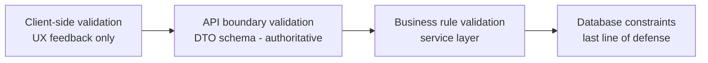

# 28 — Validation Rules

## Purpose

Defines field-level and business-level validation rules applied at data ingestion, form input, and API boundaries, ensuring the data quality guarantees referenced throughout [`docs/04_Functional_Requirements.md`](04_Functional_Requirements.md) and [`docs/09_Database_Dictionary.md`](09_Database_Dictionary.md).

> Version: 1.0 | Author: ClimateShield Nexus Data Engineering Team | Last Updated: 2026-07-27

## Table of Contents

1. [Validation Layers](#validation-layers)
2. [Climate Observation Validation](#climate-observation-validation)
3. [Forecast Data Validation](#forecast-data-validation)
4. [Risk Assessment Validation](#risk-assessment-validation)
5. [User & Access Validation](#user--access-validation)
6. [Alert Validation](#alert-validation)
7. [GIS/Spatial Validation](#gisspatial-validation)
8. [File Upload Validation](#file-upload-validation)
9. [Validation Failure Handling](#validation-failure-handling)
10. [References](#references)
11. [Revision History](#revision-history)

## Validation Layers

Client-side validation is a convenience; **the API boundary is the authoritative validation layer** — no request bypasses it.

## Climate Observation Validation

| Rule | Parameter | Detail |
|---|---|---|
| Range check | Temperature | -10°C to 50°C plausible range for Kenya; outside range flags for review, does not auto-reject |
| Range check | Rainfall (24h) | 0mm to 500mm; > 500mm flags as extreme-but-possible, requires secondary source confirmation before publish |
| Range check | Humidity | 0% to 100% (hard reject outside) |
| Range check | Wind speed | 0 to 150 km/h; > 150 flags for review |
| Consistency check | Dew point vs. temperature | Dew point shall not exceed air temperature (hard reject) |
| Completeness check | Required fields | `station_id` or gridded location, `parameter`, `value`, `unit`, `observed_at` all required |
| Temporal check | `observed_at` | Shall not be in the future beyond a 5-minute clock-skew tolerance |
| Duplicate check | Station + parameter + timestamp | Duplicate submissions are idempotently deduplicated, not treated as new versions |
| Freshness check | Per `data_source.sla_freshness` | Sources not delivering within SLA marked "stale" on Monitoring dashboard |

## Forecast Data Validation

| Rule | Detail |
|---|---|
| Schema conformance | `forecast_value` payload validated against the registered `forecast_model.output_schema` |
| Temporal ordering | `valid_from < valid_to` on `forecast_run`; individual `valid_at` must fall within that window |
| Spatial bounds | Forecast grid points must fall within the deploying agency's configured jurisdiction bounding box (±buffer for border regions) |
| Model registration | A `forecast_run` cannot be ingested for an unregistered `forecast_model`/version |

## Risk Assessment Validation

| Rule | Detail |
|---|---|
| Confidence bound | `confidence_score` strictly between 0 and 1 inclusive |
| Severity enum | Must be one of `low, moderate, high, severe, extreme` |
| Source citation | Every `risk_assessment` above `low` severity must have ≥ 1 `risk_contributing_source` record |
| Boundary scope | `admin_boundary_id` must reference an active (non-deprecated) boundary |
| Model activeness | Assessments can only be produced by a `risk_model` with `active = true` at computation time |

## User & Access Validation

| Rule | Detail |
|---|---|
| Email format | RFC 5322 compliant; uniqueness enforced per agency |
| Password policy | Minimum 12 characters, at least 3 of {uppercase, lowercase, digit, symbol}; checked against breached-password list |
| Role assignment | A user must always have exactly one `role_id`; role deletion blocked while assigned users exist ([`SRS-ROLE-003`](04_Functional_Requirements.md#role-management)) |
| MFA enrollment | Required roles cannot complete first login without MFA setup |

## Alert Validation

| Rule | Detail |
|---|---|
| CAP structure | Alert payload validated against CAP v1.2 XML/JSON schema before dispatch |
| Expiry | `expires_at` must be after `issued_at` |
| Approval gate | `status` cannot transition to `Issued` without a non-null `approved_by` for severity ≥ High ([`BR-03`](02_Business_Requirements.md#business-rules)) |
| Boundary requirement | Every alert must reference a valid `admin_boundary_id` — no boundary-less national blast alerts without explicit override permission |

## GIS/Spatial Validation

| Rule | Detail |
|---|---|
| Geometry validity | All ingested geometries validated via `ST_IsValid`; invalid geometries auto-repaired via `ST_MakeValid` where possible, else rejected |
| SRID conformance | All spatial input normalized/rejected if not convertible to SRID 4326 |
| Topology | Administrative boundaries checked for overlap/gap anomalies against the parent boundary on import |

## File Upload Validation

| Rule | Detail |
|---|---|
| CSV bulk user import | Header row required; row-level validation report returned, no partial silent success |
| GeoTIFF/NetCDF satellite ingest | File size cap (configurable, default 2GB per file); checksum verification against provider manifest where available |
| Max upload size (general) | 25MB for UI-initiated uploads; larger transfers use pre-signed object storage URLs |

## Validation Failure Handling

| Severity | Behavior |
|---|---|
| Hard reject | Record not persisted; error returned/logged with reason |
| Soft flag | Record persisted with a `flagged` status; surfaced for human review (per [`UC-02`](11_Use_Cases.md#uc-02-validate-and-correct-observation-data)) |
| Warning | Record persisted; warning logged to Monitoring for trend analysis, no user-facing interruption |

## References

- [`docs/04_Functional_Requirements.md`](04_Functional_Requirements.md#climate-data-management)
- [`docs/09_Database_Dictionary.md`](09_Database_Dictionary.md)
- [`docs/13_Security_Design.md`](13_Security_Design.md)
- [`docs/29_Logging_and_Monitoring.md`](29_Logging_and_Monitoring.md)

## Revision History

| Version | Date | Author | Change |
|---|---|---|---|
| 1.0 | 2026-07-27 | ClimateShield Nexus Data Engineering Team | Initial version |
