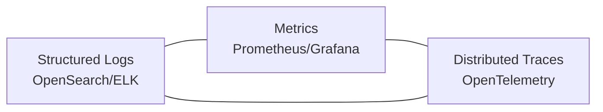

# 29 — Logging & Monitoring

## Purpose

Defines the observability strategy — logging, metrics, tracing, alerting on the platform itself (operational monitoring, distinct from the climate-hazard "Alerts" module) — satisfying [`NFR-OBS-*`](05_Non_Functional_Requirements.md#observability).

> Version: 1.0 | Author: ClimateShield Nexus DevOps Team | Last Updated: 2026-07-27

## Table of Contents

1. [Observability Pillars](#observability-pillars)
2. [Logging Architecture](#logging-architecture)
3. [Log Schema](#log-schema)
4. [Metrics & SLOs](#metrics--slos)
5. [Distributed Tracing](#distributed-tracing)
6. [Data Freshness Monitoring](#data-freshness-monitoring)
7. [Alerting Rules (Operational)](#alerting-rules-operational)
8. [Dashboards](#dashboards)
9. [On-Call & Escalation](#on-call--escalation)
10. [References](#references)
11. [Revision History](#revision-history)

## Observability Pillars



## Logging Architecture

- All services emit structured JSON logs to stdout; collected by a node-level agent (e.g., Fluent Bit) and shipped to OpenSearch.
- Log retention: 90 days hot, 1 year cold storage (audit log itself retained ≥ 7 years per [`NFR-SEC-005`](05_Non_Functional_Requirements.md#security), stored separately from operational logs).
- No PII/secrets in logs, enforced via scrubbing middleware ([`docs/17_Coding_Standards.md`](17_Coding_Standards.md#logging-conventions)).

## Log Schema

```json
{
  "timestamp": "2026-07-27T10:00:00.123Z",
  "level": "info",
  "service": "risk-assessment-service",
  "request_id": "req_9f8a2c",
  "user_id": "usr_...",
  "message": "Risk assessment computed",
  "context": {
    "risk_type": "flood",
    "admin_boundary_id": "b3f1...",
    "severity": "high",
    "duration_ms": 842
  }
}
```

## Metrics & SLOs

| SLO | Target | Metric Source |
|---|---|---|
| API availability | 99.9% | Gateway request success rate |
| API p95 latency | < 300ms | Prometheus histogram per route |
| Alert dispatch latency | < 5 min trigger-to-send p95 | Alerting Service custom metric |
| Data pipeline freshness | Per-source SLA (see below) | Airflow DAG success + data timestamp lag |
| Error rate | < 0.5% of requests 5xx | Gateway/service metrics |
| Risk recompute latency | < 2 min p95 | Risk Assessment Service custom metric |

SLO burn-rate alerting configured per Google SRE multi-window burn-rate method (fast burn: 1h/5m windows; slow burn: 6h/30m windows).

## Distributed Tracing

- OpenTelemetry SDK instrumented in every service; traces exported via OTLP to a collector, visualized in Grafana Tempo (or equivalent).
- Trace context propagated from API Gateway through to Kafka consumers (risk recompute, alerting) so a single alert's full lifecycle is traceable end-to-end.

## Data Freshness Monitoring

| Source | Expected Freshness SLA | Alert If Stale Beyond |
|---|---|---|
| KMD Station Network | 15 minutes | 30 minutes |
| NWP Model Output | Per model run cadence (e.g., 6h) | 1 run cycle missed |
| Satellite Products | Per provider cadence (varies by product) | 2x expected cadence |

Freshness status surfaced on the Administration Dashboard and via `DataSourceFooter` component ([`docs/19_UI_Design_System.md`](19_UI_Design_System.md#key-components)) on every consuming view.

## Alerting Rules (Operational)

| Condition | Severity | Notify |
|---|---|---|
| API 5xx rate > 1% over 5 min | Critical | On-call engineer (page) |
| Alert dispatch queue depth > threshold | Critical | On-call engineer (page) |
| Data source stale beyond SLA | High | Data Engineering channel |
| Audit-chain hash mismatch detected | Critical | Security Engineering (page) |
| Disk/DB storage > 85% capacity | Medium | DevOps channel |
| Pipeline DAG failure (after retries exhausted) | High | Data Engineering channel |

## Dashboards

| Dashboard | Audience | Content |
|---|---|---|
| Platform Health | On-call/DevOps | Service uptime, error rates, latency, resource utilization |
| Data Pipeline Status | Data Engineering | Per-source freshness, DAG run history |
| Alert Delivery | Disaster Mgmt/DevOps | Dispatch success/failure per channel |
| Security | Security Engineering | Auth anomalies, audit-chain integrity, failed-login trends |

## On-Call & Escalation

- Primary on-call rotation covers Alerting Service and API Gateway as highest-criticality paths ([`NFR-AVAIL-003`](05_Non_Functional_Requirements.md#availability--reliability)).
- Escalation policy: page primary → 15 min no-ack → page secondary → 15 min no-ack → page Lead Architect.
- Full incident response process: [`docs/13_Security_Design.md`](13_Security_Design.md#incident-response).

## References

- [`docs/05_Non_Functional_Requirements.md`](05_Non_Functional_Requirements.md#observability)
- [`docs/06_System_Architecture.md`](06_System_Architecture.md)
- [`docs/13_Security_Design.md`](13_Security_Design.md)
- [`docs/36_System_Maintenance.md`](36_System_Maintenance.md)

## Revision History

| Version | Date | Author | Change |
|---|---|---|---|
| 1.0 | 2026-07-27 | ClimateShield Nexus DevOps Team | Initial version |
