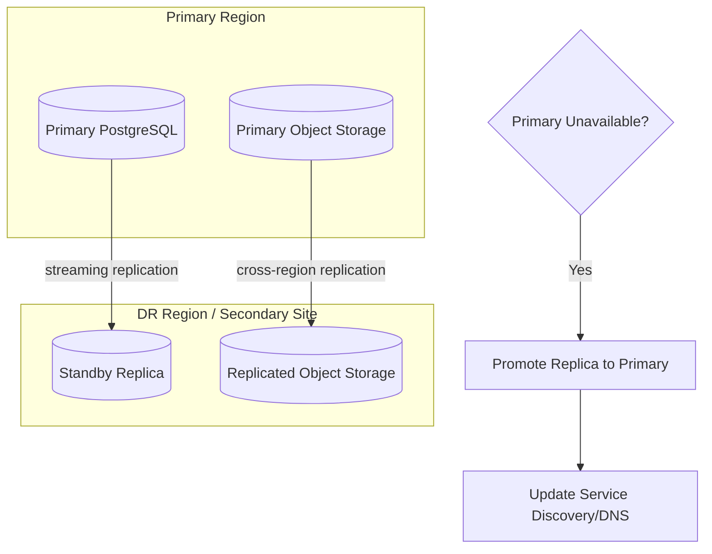

# 30 — Backup & Recovery

## Purpose

Defines backup procedures, retention policy, and disaster recovery strategy so ClimateShield Nexus meets the RPO/RTO targets in [`docs/05_Non_Functional_Requirements.md`](05_Non_Functional_Requirements.md#availability--reliability).

> Version: 1.0 | Author: ClimateShield Nexus DevOps Team | Last Updated: 2026-07-27

## Table of Contents

1. [Objectives](#objectives)
2. [Backup Scope & Schedule](#backup-scope--schedule)
3. [Retention Policy](#retention-policy)
4. [Disaster Recovery Strategy](#disaster-recovery-strategy)
5. [Recovery Procedures](#recovery-procedures)
6. [Backup Verification](#backup-verification)
7. [DR Drill Cadence](#dr-drill-cadence)
8. [References](#references)
9. [Revision History](#revision-history)

## Objectives

| Metric | Target |
|---|---|
| RPO (Recovery Point Objective) | ≤ 15 minutes |
| RTO — Alerting path | ≤ 1 hour |
| RTO — Full platform | ≤ 4 hours |

## Backup Scope & Schedule

| Data Store | Method | Frequency |
|---|---|---|
| PostgreSQL/PostGIS (primary) | Continuous WAL archiving + nightly full snapshot | Continuous + daily |
| TimescaleDB | Continuous WAL archiving + nightly full snapshot | Continuous + daily |
| Object Storage (raw/processed/reports) | Cross-region replication + versioning | Continuous |
| Redis | Not backed up (cache/session only, rebuildable) | N/A |
| Kafka | Topic retention (7 days) + consumer offset tracking; not treated as system of record | N/A |
| Audit Log | Daily checkpoint hash exported to WORM object storage | Daily |
| Infrastructure config (Terraform/K8s manifests) | Version-controlled in git | Continuous (every commit) |

## Retention Policy

| Data Class | Retention |
|---|---|
| Database backups (full snapshots) | 35 daily, 12 monthly, 3 yearly |
| WAL archives | 7 days rolling (sufficient for point-in-time recovery within RPO window) |
| Object storage (raw climate data) | Indefinite (scientific/historical value) |
| Object storage (generated reports) | 3 years, then archived to cold storage |
| Audit log | ≥ 7 years (regulatory record-keeping, [`NFR-SEC-005`](05_Non_Functional_Requirements.md#security)) |
| Operational logs | 90 days hot, 1 year cold ([`docs/29_Logging_and_Monitoring.md`](29_Logging_and_Monitoring.md)) |

## Disaster Recovery Strategy

- Warm-standby model: replica database kept in sync via streaming replication; promoted on primary failure.
- For KMD's on-premises deployment option, the secondary site is a separate rack/data-center zone within Kenya to satisfy data residency ([`NFR-RES-001`](05_Non_Functional_Requirements.md#data-residency)) while still providing physical redundancy.

## Recovery Procedures

### Database Point-in-Time Recovery
1. Identify target recovery timestamp (just before incident).
2. Restore latest full snapshot to a recovery instance.
3. Replay WAL archives up to target timestamp.
4. Validate data integrity (row counts, audit-chain continuity check).
5. Cut over application traffic once validated.

### Full Platform DR Failover
1. Declare DR event per [`docs/13_Security_Design.md`](13_Security_Design.md#incident-response).
2. Promote standby database replica to primary.
3. Redirect object storage endpoint to replicated bucket.
4. Update DNS/service discovery to point to DR-region Kubernetes cluster.
5. Run smoke tests (auth, dashboard load, alert-path dry run).
6. Communicate status to KMD stakeholders per incident communication plan.

## Backup Verification

- Automated weekly restore test into an isolated environment; validates backup is actually restorable, not just "created."
- Audit-chain integrity job (see [`docs/13_Security_Design.md`](13_Security_Design.md#audit-integrity)) run against restored data as part of verification.

## DR Drill Cadence

| Drill Type | Frequency |
|---|---|
| Database point-in-time recovery test | Monthly |
| Full DR region failover simulation | Semi-annually |
| Tabletop incident response exercise | Quarterly |

## References

- [`docs/05_Non_Functional_Requirements.md`](05_Non_Functional_Requirements.md#availability--reliability)
- [`docs/06_System_Architecture.md`](06_System_Architecture.md#resilience--failure-handling)
- [`docs/13_Security_Design.md`](13_Security_Design.md)
- [`docs/36_System_Maintenance.md`](36_System_Maintenance.md)

## Revision History

| Version | Date | Author | Change |
|---|---|---|---|
| 1.0 | 2026-07-27 | ClimateShield Nexus DevOps Team | Initial version |
