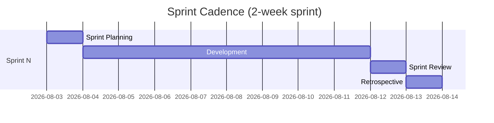

# 32 — Project Development Plan

## Purpose

Defines the SDLC methodology, team structure, ceremonies, and definition of done for ClimateShield Nexus delivery.

> Version: 1.0 | Author: ClimateShield Nexus Program Management | Last Updated: 2026-07-27

## Table of Contents

1. [Methodology](#methodology)
2. [Team Structure](#team-structure)
3. [Sprint Cadence](#sprint-cadence)
4. [Ceremonies](#ceremonies)
5. [Definition of Ready](#definition-of-ready)
6. [Definition of Done](#definition-of-done)
7. [Roles & RACI](#roles--raci)
8. [Tooling](#tooling)
9. [References](#references)
10. [Revision History](#revision-history)

## Methodology

Scrum-based, 2-week sprints, with a Kanban-style continuous-flow lane reserved for production incidents and urgent data-source integration work that cannot wait for sprint boundaries.

## Team Structure

Core team is the 5-developer squad defined in [`docs/40_Developer_Assignment.md`](40_Developer_Assignment.md), supported by:

| Role | Responsibility |
|---|---|
| Product Owner | Backlog prioritization, KMD stakeholder liaison |
| Lead Architect | Technical direction, ADR approval, cross-module consistency |
| 5 × Developers | Module implementation (see [`docs/40_Developer_Assignment.md`](40_Developer_Assignment.md)) |
| QA/Test Engineer (part-time or rotating) | Test strategy execution, UAT coordination |
| Security Engineer (advisory/part-time) | Security review gates, threat modeling updates |
| KMD Technical Liaison | Domain validation, data access facilitation |

## Sprint Cadence

## Ceremonies

| Ceremony | Frequency | Purpose |
|---|---|---|
| Sprint Planning | Every 2 weeks | Commit to sprint backlog from [`docs/25_Product_Backlog.md`](25_Product_Backlog.md) |
| Daily Standup | Daily, 15 min | Blockers, progress |
| Backlog Grooming | Weekly | Refine upcoming stories, re-prioritize |
| Sprint Review/Demo | End of sprint | Demo to Product Owner/KMD liaison |
| Retrospective | End of sprint | Process improvement |
| Risk Register Review | Start of sprint | Update [`docs/18_Risk_Assessment.md`](18_Risk_Assessment.md) |
| Architecture Sync | Bi-weekly | ADR review, cross-module dependency check |

## Definition of Ready

A backlog item is ready for sprint planning when it has:
- A linked functional requirement ID ([`docs/04_Functional_Requirements.md`](04_Functional_Requirements.md))
- Acceptance criteria drafted ([`docs/26_Acceptance_Criteria.md`](26_Acceptance_Criteria.md))
- No unresolved dependency on an undelivered module
- Estimated by the owning developer

## Definition of Done

- Code merged to `develop` per [`docs/16_Git_Workflow.md`](16_Git_Workflow.md)
- Tests meet coverage target ([`docs/14_Testing_Strategy.md`](14_Testing_Strategy.md))
- Passes all CI quality gates
- Documentation updated (API spec, user manual, etc. as applicable)
- Acceptance criteria verified in Staging
- No open Critical/High defects against the story

## Roles & RACI

| Activity | Product Owner | Lead Architect | Developers | QA | Security |
|---|---|---|---|---|---|
| Backlog prioritization | A/R | C | C | I | I |
| Architecture decisions | I | A/R | C | I | C |
| Code implementation | I | C | A/R | I | I |
| Test execution | I | I | R | A/R | I |
| Security review | I | C | C | I | A/R |
| Release approval | A | R | C | C | C |

(A=Accountable, R=Responsible, C=Consulted, I=Informed)

## Tooling

| Purpose | Tool |
|---|---|
| Issue tracking | GitHub Issues/Projects (or Jira, per KMD IT preference) |
| Communication | Slack/Teams (per KMD IT preference) |
| Documentation | This repository (`docs/`) |
| CI/CD | GitHub Actions |
| Design | Figma (referenced in [`docs/prototype/`](prototype/)) |

## References

- [`docs/25_Product_Backlog.md`](25_Product_Backlog.md)
- [`docs/40_Developer_Assignment.md`](40_Developer_Assignment.md)
- [`docs/41_Project_Timeline.md`](41_Project_Timeline.md)
- [`docs/16_Git_Workflow.md`](16_Git_Workflow.md)

## Revision History

| Version | Date | Author | Change |
|---|---|---|---|
| 1.0 | 2026-07-27 | ClimateShield Nexus Program Management | Initial version |
