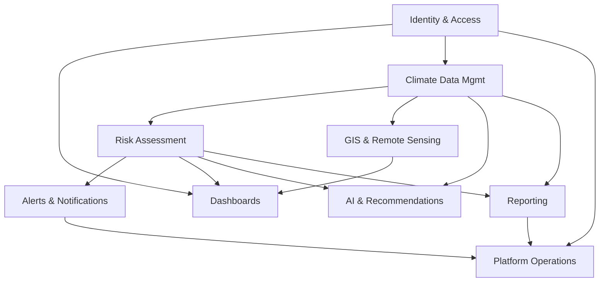

# 39 — Module Breakdown

## Purpose

Defines each platform module's ownership, dependencies, and repository location — the reference used to build [`docs/40_Developer_Assignment.md`](40_Developer_Assignment.md) and to keep service boundaries consistent with [`docs/06_System_Architecture.md`](06_System_Architecture.md).

> Version: 1.0 | Author: ClimateShield Nexus Architecture Team | Last Updated: 2026-07-27

## Table of Contents

1. [Module List](#module-list)
2. [Module Dependency Graph](#module-dependency-graph)
3. [Module Detail Table](#module-detail-table)
4. [Cross-Module Contracts](#cross-module-contracts)
5. [References](#references)
6. [Revision History](#revision-history)

## Module List

Grouped by the 9 domains from [`docs/25_Product_Backlog.md`](25_Product_Backlog.md#epic-overview): Identity & Access, Dashboards, Climate Data Management, Risk Assessment, GIS & Remote Sensing, Reporting, AI & Recommendations, Alerts & Notifications, Platform Operations.

## Module Dependency Graph

## Module Detail Table

| Module | Repository Location | Depends On | Exposes To |
|---|---|---|---|
| Identity & Access | `backend/auth-service/`, `backend/user-role-service/` | — (foundational) | All modules |
| Climate Data Management | `backend/climate-data-service/`, `climate-processing/` | Identity & Access | Risk Assessment, GIS, AI, Reporting |
| Forecast Models | `backend/forecast-model-service/` | Climate Data Management | Dashboards, Risk Assessment |
| Risk Assessment | `backend/risk-assessment-service/` | Climate Data Management, Forecast Models | Alerts, Dashboards, Reporting, AI |
| GIS & Remote Sensing | `gis-services/` | Climate Data Management | Dashboards, Risk Assessment (spatial join) |
| Dashboards | `frontend/` (per-dashboard route modules) | Identity & Access, Risk Assessment, GIS, Climate Data | End users |
| AI Climate Assistant / Recommendations | `ai-engine/` | Climate Data Management, Risk Assessment | Dashboards, external API consumers |
| Reporting | `backend/reporting-service/` | Climate Data Management, Risk Assessment | End users, email/export |
| Alerts & Notifications | `backend/alerting-service/` | Risk Assessment | End users, external webhook consumers |
| Platform Operations (Audit, Monitoring, Settings, API Mgmt) | `backend/admin-audit-service/` | Identity & Access | All modules (cross-cutting) |
| Data Pipelines & ML | `climate-processing/`, `ai-engine/ml/` | External data sources | Climate Data Management, Risk Assessment, AI |

## Cross-Module Contracts

- All cross-module communication happens via the documented REST API ([`docs/12_API_Specification.md`](12_API_Specification.md)) or Kafka events ([`docs/06_System_Architecture.md`](06_System_Architecture.md#c4-model--containers)) — no direct database access across module/service boundaries, even during the modular-monolith phase (enforced via code-review checklist, [`docs/17_Coding_Standards.md`](17_Coding_Standards.md#code-review-checklist)).
- Event contracts (Kafka topics) are versioned alongside the API; breaking event-schema changes follow the same deprecation policy as REST ([`docs/12_API_Specification.md`](12_API_Specification.md#versioning)).

## References

- [`docs/06_System_Architecture.md`](06_System_Architecture.md#service-catalog)
- [`docs/25_Product_Backlog.md`](25_Product_Backlog.md)
- [`docs/40_Developer_Assignment.md`](40_Developer_Assignment.md)

## Revision History

| Version | Date | Author | Change |
|---|---|---|---|
| 1.0 | 2026-07-27 | ClimateShield Nexus Architecture Team | Initial version |
