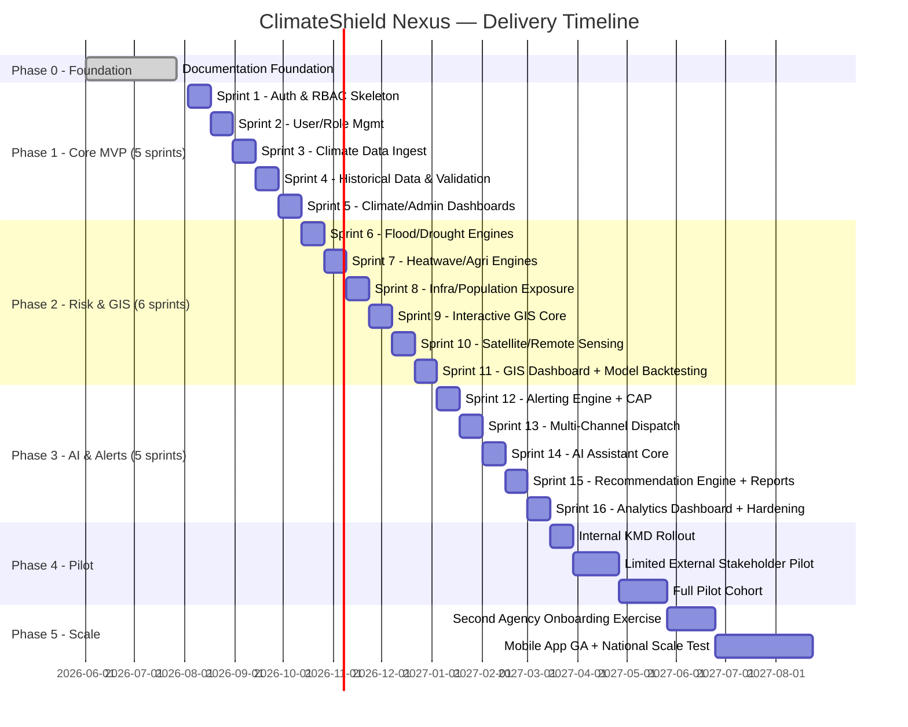

# 41 — Project Timeline

## Purpose

Gantt-style delivery timeline detailing sprints within each phase from [`docs/20_Project_Roadmap.md`](20_Project_Roadmap.md), aligned to the 5-developer team in [`docs/40_Developer_Assignment.md`](40_Developer_Assignment.md).

> Version: 1.0 | Author: ClimateShield Nexus Program Management | Last Updated: 2026-07-27

## Table of Contents

1. [Timeline Assumptions](#timeline-assumptions)
2. [Master Gantt Chart](#master-gantt-chart)
3. [Phase 1 Sprint Breakdown](#phase-1-sprint-breakdown)
4. [Phase 2 Sprint Breakdown](#phase-2-sprint-breakdown)
5. [Phase 3 Sprint Breakdown](#phase-3-sprint-breakdown)
6. [Milestones](#milestones)
7. [References](#references)
8. [Revision History](#revision-history)

## Timeline Assumptions

- 2-week sprints, 5-developer team, starting the first sprint immediately after foundation sign-off ([`docs/42_Final_Project_Checklist.md`](42_Final_Project_Checklist.md)).
- Dates are planning estimates from foundation completion (2026-07-27); actual start date depends on KMD contractual/onboarding timing.

## Master Gantt Chart

## Phase 1 Sprint Breakdown

| Sprint | Focus | Key Deliverables |
|---|---|---|
| 1 | Auth & RBAC skeleton | Login, MFA, JWT issuance, permission middleware |
| 2 | User/Role Management | CRUD, custom roles, seed personas |
| 3 | Climate Data ingestion | Station/NWP/satellite adapters, raw storage |
| 4 | Historical data & validation | Validation engine, correction workflow |
| 5 | Climate/Admin dashboards | First user-facing dashboards, audit log |

## Phase 2 Sprint Breakdown

| Sprint | Focus | Key Deliverables |
|---|---|---|
| 6 | Flood/Drought engines | Scoring models, versioning |
| 7 | Heatwave/Agriculture engines | Scoring models |
| 8 | Infrastructure/Population exposure | Overlay logic |
| 9 | Interactive GIS core | Map, layer toggle, spatial query |
| 10 | Satellite/Remote sensing | Ingestion, NDVI/LST layers |
| 11 | GIS Dashboard + backtesting | Full dashboard, model validation against historical events |

## Phase 3 Sprint Breakdown

| Sprint | Focus | Key Deliverables |
|---|---|---|
| 12 | Alerting engine + CAP | Threshold evaluation, CAP formatting, approval workflow |
| 13 | Multi-channel dispatch | SMS/email/push/webhook, delivery tracking |
| 14 | AI Assistant core | RAG pipeline, citation, confidence scoring |
| 15 | Recommendation Engine + Reports | Sector advisories, PDF/Excel automated reports |
| 16 | Analytics Dashboard + hardening | Final MVP dashboard, load/security testing |

## Milestones

| Milestone | Target | Gate |
|---|---|---|
| M1: Core MVP Complete | End of Sprint 5 | [`docs/20_Project_Roadmap.md`](20_Project_Roadmap.md#phase-1--core-platform-mvp) exit criteria |
| M2: Risk & GIS Complete | End of Sprint 11 | ≥85% back-test precision |
| M3: AI & Alerts Complete | End of Sprint 16 | <5min alert dispatch p95 |
| M4: KMD Pilot Go-Live | Post-Sprint 16 + hardening | KMD leadership sign-off |
| M5: Second Agency Onboarded | Post-pilot | <2 engineer-weeks onboarding |

## References

- [`docs/20_Project_Roadmap.md`](20_Project_Roadmap.md)
- [`docs/32_Project_Development_Plan.md`](32_Project_Development_Plan.md)
- [`docs/40_Developer_Assignment.md`](40_Developer_Assignment.md)
- [ROADMAP.md](../ROADMAP.md)

## Revision History

| Version | Date | Author | Change |
|---|---|---|---|
| 1.0 | 2026-07-27 | ClimateShield Nexus Program Management | Initial version |
