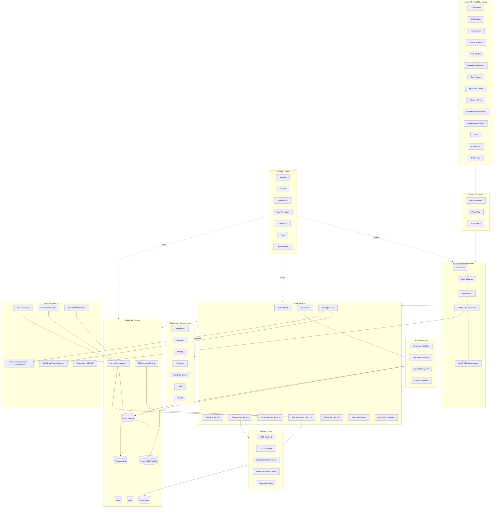

# Final Project Blueprint

## Purpose

The single master architecture document for ClimateShield Nexus: one coherent enterprise blueprint connecting every module, service, database, AI/GIS component, integration, workflow, external system, deployment environment, user role, data flow, and security layer defined across this repository. This is the document a new architect, auditor, or KMD stakeholder should read first to understand how everything fits together — every claim here links to its authoritative, detailed source rather than restating it.

> Version: 1.0 | Author: ClimateShield Nexus Architecture Team | Last Updated: 2026-07-27

## Table of Contents

1. [How to Read This Blueprint](#how-to-read-this-blueprint)
2. [Master Enterprise Diagram](#master-enterprise-diagram)
3. [All User Roles](#all-user-roles)
4. [All Modules & Services](#all-modules--services)
5. [All Databases & Stores](#all-databases--stores)
6. [All AI Components](#all-ai-components)
7. [All GIS Components](#all-gis-components)
8. [All External Integrations](#all-external-integrations)
9. [All Core Workflows](#all-core-workflows)
10. [All Deployment Environments](#all-deployment-environments)
11. [All Data Flows](#all-data-flows)
12. [All Security Layers](#all-security-layers)
13. [Blueprint-to-Document Cross-Reference](#blueprint-to-document-cross-reference)
14. [References](#references)
15. [Revision History](#revision-history)

## How to Read This Blueprint

This document is intentionally an *index with one big picture*, not a new source of truth — every fact here already exists in a Phase 1 or Phase 2 document; this blueprint's job is to show how those facts connect. If this document and a detailed document ever disagree, the detailed document wins and this blueprint should be corrected to match.

## Master Enterprise Diagram

## All User Roles

Full definitions: [`docs/02_Business_Requirements.md#user-personas`](../02_Business_Requirements.md#user-personas). Permission grants: [`docs/13_Security_Design.md#rbac-matrix`](../13_Security_Design.md#rbac-matrix). Role-specific navigation: [`docs/design/01_Information_Architecture.md#role-specific-navigation-trees`](../design/01_Information_Architecture.md#role-specific-navigation-trees).

Super Administrator · KMD Administrator · Meteorologist · Climate Scientist · GIS Analyst · Disaster Management Officer · Government Planner · Agriculture Officer · Aviation Officer · Water Resources Officer · Health Sector Officer · NGO · Researcher · Public User

## All Modules & Services

Full catalog: [`docs/39_Module_Breakdown.md`](../39_Module_Breakdown.md), [`docs/06_System_Architecture.md#service-catalog`](../06_System_Architecture.md#service-catalog), [`docs/design/03_Module_Specifications.md`](../design/03_Module_Specifications.md).

| Domain | Services |
|---|---|
| Identity & Access | Auth Service, User/Role Service |
| Climate Data | Climate Data Service, Forecast Model Service |
| Risk Intelligence | Risk Assessment Service |
| Spatial | GIS Service |
| AI | AI Assistant Service |
| Early Warning | Alerting Service |
| Reporting | Reporting Service |
| Platform Ops | Admin/Audit Service |
| Data/ML | Airflow Orchestrator, ML Inference Service |

## All Databases & Stores

Full schema: [`docs/09_Database_Dictionary.md`](../09_Database_Dictionary.md), [`docs/diagrams/06_Complete_ERD.md`](../diagrams/06_Complete_ERD.md), [`docs/diagrams/07_Database_Visual_Model.md`](../diagrams/07_Database_Visual_Model.md).

| Store | Content |
|---|---|
| PostgreSQL/PostGIS | Identity, Risk, Spatial, Warning, AI, Ops schemas (transactional + spatial) |
| TimescaleDB | Observations, forecast values, climate indices (time-series) |
| Redis | Sessions, rate-limit counters, cache |
| Kafka | Event backbone (`observation.ingested`, `risk_assessment.updated`, `alert.issued`) |
| Object Storage (S3-compatible) | Raw/processed climate data, satellite products, generated reports |
| Vector Store | Knowledge base embeddings for AI RAG retrieval |

## All AI Components

Full detail: [`docs/architecture/system-architecture-views.md#ai-architecture`](system-architecture-views.md#ai-architecture), [`docs/diagrams/13_Component_Diagrams.md#ai-engine-component-detail`](../diagrams/13_Component_Diagrams.md#ai-engine-component-detail).

AI Climate Assistant · Recommendation Engine · Knowledge Base (Vector Store) · RAG Retrieval Layer · Citation Enforcement Gate · Confidence/High-Stakes Gate · Interaction Audit Logger

## All GIS Components

Full detail: [`docs/architecture/system-architecture-views.md#gis-architecture`](system-architecture-views.md#gis-architecture), [`docs/diagrams/13_Component_Diagrams.md#gis-engine-component-detail`](../diagrams/13_Component_Diagrams.md#gis-engine-component-detail).

Interactive GIS · Satellite/Remote Sensing Ingestion · Geometry Validation Engine · GeoServer (WMS/WMTS/WFS) · Spatial Query API · Admin Boundary Store

## All External Integrations

Full detail: [`docs/12_API_Specification.md`](../12_API_Specification.md), [`docs/06_System_Architecture.md#integration-architecture`](../06_System_Architecture.md#integration-architecture).

NWP Providers (GFS/ECMWF/KMD models) · Satellite/Remote-Sensing Providers · KMD Station Network · SMS Gateway · Email (SMTP) · Push Notifications (FCM) · Webhook Consumers (NGO/Partner systems) · Government SSO/OIDC IdP

## All Core Workflows

Full detail: [`docs/workflows/01_Business_Workflows.md`](../workflows/01_Business_Workflows.md), [`docs/diagrams/04_User_Flows.md`](../diagrams/04_User_Flows.md), [`docs/24_Activity_Diagrams.md`](../24_Activity_Diagrams.md), [`docs/diagrams/12_Activity_Diagrams_Extended.md`](../diagrams/12_Activity_Diagrams_Extended.md).

Climate Data Lifecycle · Forecast Lifecycle · Risk Assessment Workflow · AI Decision Workflow · Alert Generation & Escalation · Notification Delivery · User Management · Report Generation · Authentication · Dataset Validation · Machine Learning · GIS Layer Publishing · Deployment · Maintenance

## All Deployment Environments

Full detail: [`docs/diagrams/14_Deployment_Diagrams.md`](../diagrams/14_Deployment_Diagrams.md), [`docs/15_Deployment_Guide.md#environments`](../15_Deployment_Guide.md#environments).

Development · Testing (CI) · Staging · Production · Government Data Center · Cloud · Hybrid

## All Data Flows

Full detail: [`docs/08_DFD.md`](../08_DFD.md), [`docs/diagrams/08_DFD_Full.md`](../diagrams/08_DFD_Full.md), [`docs/diagrams/15_Data_Pipelines.md`](../diagrams/15_Data_Pipelines.md).

External Source → Ingest → Validate → Normalize → Warehouse → {Risk Compute, GIS Layer, AI Context, Reports} → {Dashboards, Alerts, Exports}

## All Security Layers

Full detail: [`docs/architecture/system-architecture-views.md#security-architecture`](system-architecture-views.md#security-architecture), [`docs/diagrams/17_Security_Diagrams.md`](../diagrams/17_Security_Diagrams.md), [`docs/13_Security_Design.md`](../13_Security_Design.md).

Network (WAF/NetworkPolicies/mTLS) → Identity (MFA/OIDC/JWT) → Authorization (RBAC, deny-by-default) → Data (encryption at rest/in transit) → Application (SAST/DAST/dependency scanning) → Audit (hash-chained immutable log) → Operational (incident response/pen testing/backup/DR)

## Blueprint-to-Document Cross-Reference

| Blueprint Section | Phase 1 Source | Phase 2 Source |
|---|---|---|
| Vision & Requirements | `docs/01`–`docs/05` | — |
| System Architecture | `docs/06_System_Architecture.md` | `docs/architecture/system-architecture-views.md` |
| Data Model | `docs/07_ERD.md`, `docs/09_Database_Dictionary.md` | `docs/diagrams/06_Complete_ERD.md`, `docs/diagrams/07_Database_Visual_Model.md` |
| Data Flow | `docs/08_DFD.md` | `docs/diagrams/08_DFD_Full.md` |
| Requirements Traceability | `docs/10`, `docs/11`, `docs/26` | — |
| API Contract | `docs/12_API_Specification.md`, `docs/api/openapi.yaml` | — |
| Security | `docs/13_Security_Design.md`, `docs/security/` | `docs/diagrams/17_Security_Diagrams.md` |
| Testing | `docs/14_Testing_Strategy.md` | — |
| Deployment | `docs/15_Deployment_Guide.md` | `docs/diagrams/14_Deployment_Diagrams.md` |
| Process/Git/Standards | `docs/16`, `docs/17` | `docs/workflows/02_DevOps_Visuals.md` |
| UX/UI | `docs/19_UI_Design_System.md`, `docs/21_Wireflows.md` | `docs/design/`, `docs/prototype/` |
| Roadmap/Planning | `docs/20`, `docs/25`, `docs/32`, `docs/40`–`docs/42` | — |
| Behavioral Diagrams | `docs/22`, `docs/23`, `docs/24` | `docs/diagrams/10`, `11`, `12` |
| Business Workflows | `docs/02#business-process-overview` | `docs/workflows/01_Business_Workflows.md` |
| Module Specs | `docs/39_Module_Breakdown.md` | `docs/design/03_Module_Specifications.md` |
| Assets | — | `docs/assets/01_Asset_Manifest.md` |

## References

- [`docs/architecture/system-architecture-views.md`](system-architecture-views.md)
- [`docs/38_Project_Structure.md`](../38_Project_Structure.md)
- [`docs/42_Final_Project_Checklist.md`](../42_Final_Project_Checklist.md)
- Every document referenced in the [Blueprint-to-Document Cross-Reference](#blueprint-to-document-cross-reference) table above

## Revision History

| Version | Date | Author | Change |
|---|---|---|---|
| 1.0 | 2026-07-27 | ClimateShield Nexus Architecture Team | Initial version (Phase 2 visual design package capstone document) |
