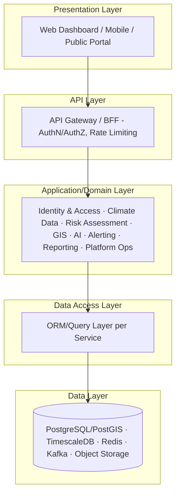
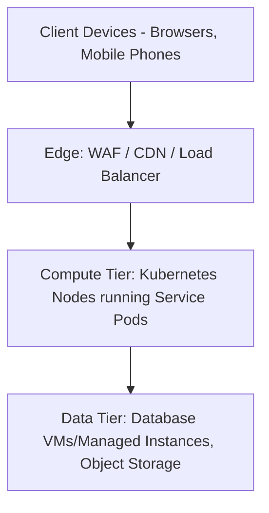
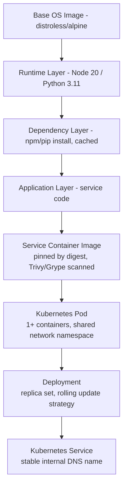
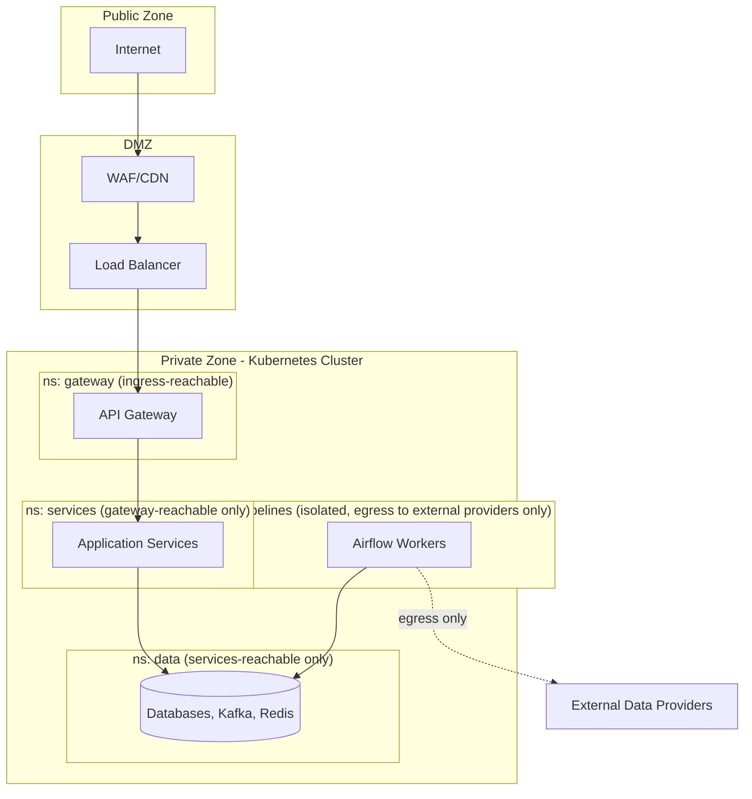
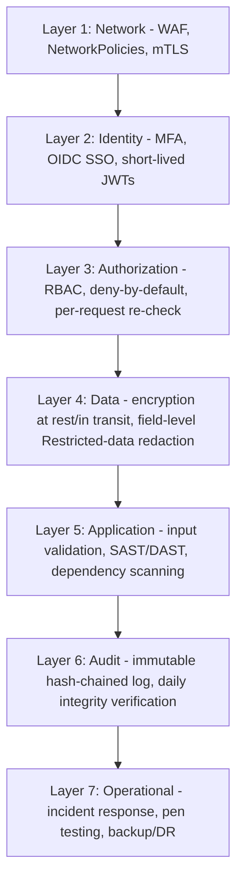
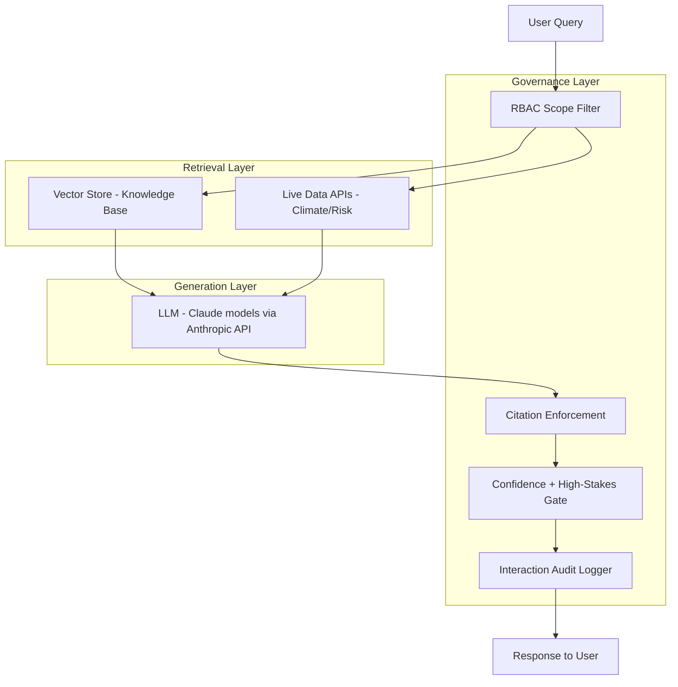
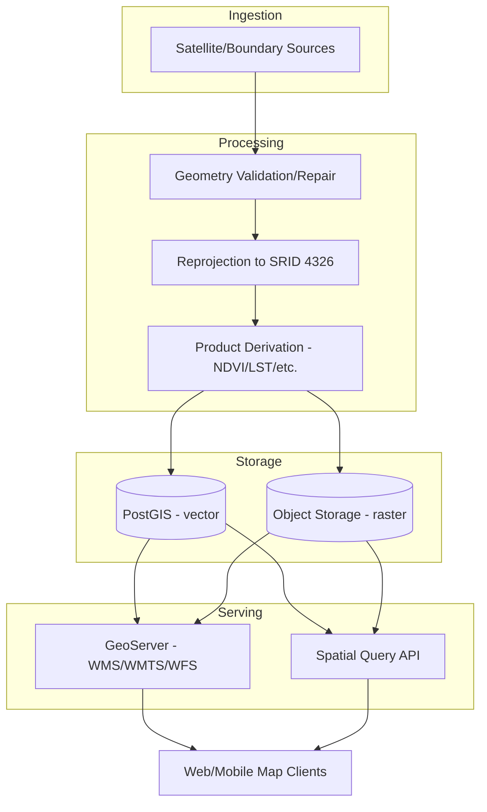
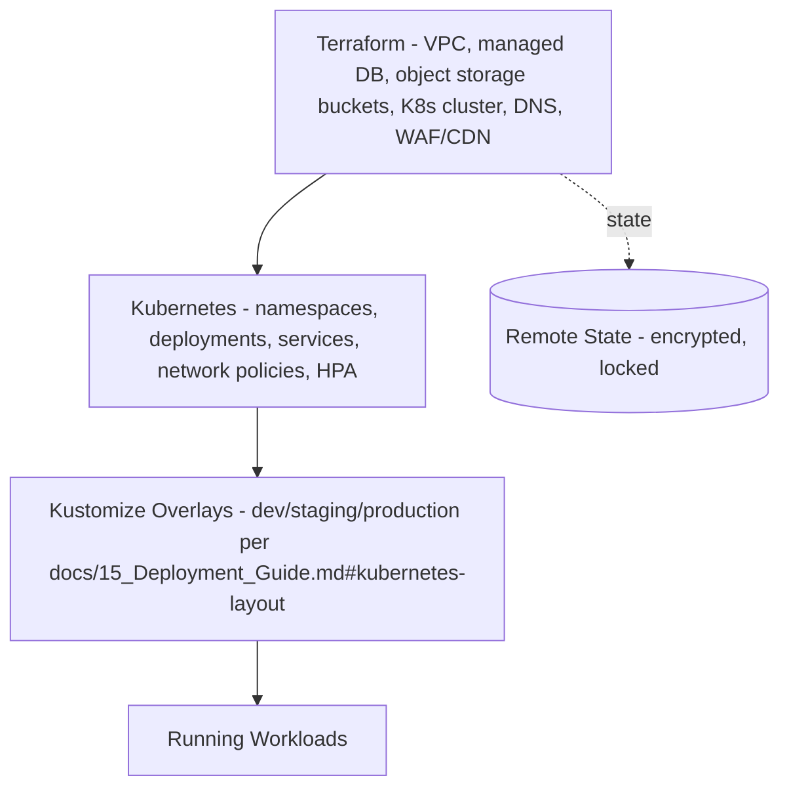
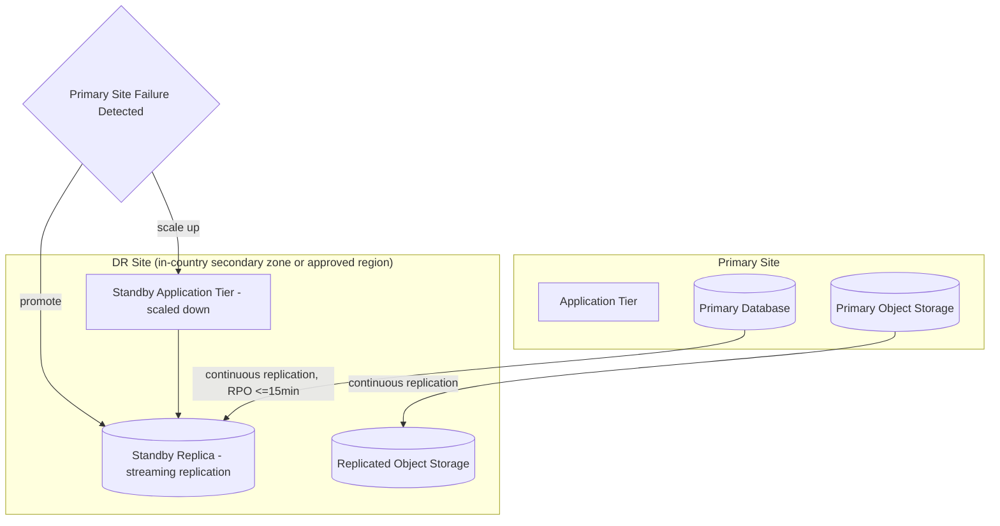
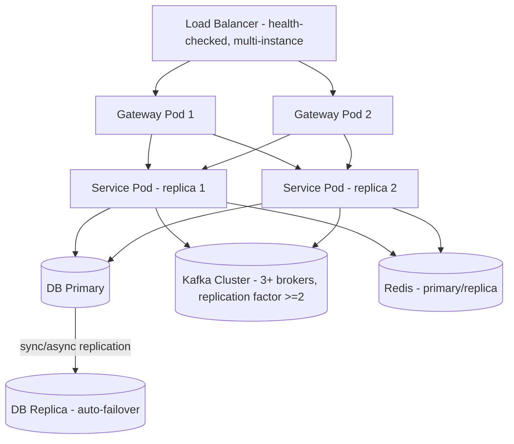

# System Architecture Views

## Purpose

Presents ClimateShield Nexus through 13 distinct architectural views — Logical, Physical, Cloud, Microservice, Container, Network, Data, Security, AI, GIS, Infrastructure, Disaster Recovery, and High Availability — each answering a different "how is this system built?" question. Where a view is already fully diagrammed elsewhere, this document cross-references it rather than duplicating; where a distinct view is missing, it is added here.

> Version: 1.0 | Author: ClimateShield Nexus Architecture Team | Last Updated: 2026-07-27

## Table of Contents

1. [View Index](#view-index)
2. [Logical Architecture](#logical-architecture)
3. [Physical Architecture](#physical-architecture)
4. [Cloud Architecture](#cloud-architecture)
5. [Microservice Architecture](#microservice-architecture)
6. [Container Architecture](#container-architecture)
7. [Network Architecture](#network-architecture)
8. [Data Architecture](#data-architecture)
9. [Security Architecture](#security-architecture)
10. [AI Architecture](#ai-architecture)
11. [GIS Architecture](#gis-architecture)
12. [Infrastructure Architecture](#infrastructure-architecture)
13. [Disaster Recovery Architecture](#disaster-recovery-architecture)
14. [High Availability Architecture](#high-availability-architecture)
15. [References](#references)
16. [Revision History](#revision-history)

## View Index

| View | New Diagram Here? | Primary Existing Source |
|---|---|---|
| Logical | Yes | [`docs/06_System_Architecture.md`](../06_System_Architecture.md) |
| Physical | Yes (summary) | [`docs/diagrams/14_Deployment_Diagrams.md`](../diagrams/14_Deployment_Diagrams.md) |
| Cloud | No (referenced) | [`docs/diagrams/14_Deployment_Diagrams.md#cloud-deployment`](../diagrams/14_Deployment_Diagrams.md#cloud-deployment) |
| Microservice | Yes | [`docs/06_System_Architecture.md#service-catalog`](../06_System_Architecture.md#service-catalog) |
| Container | Yes | `docker/`, `kubernetes/` |
| Network | Yes | [`docs/13_Security_Design.md#network-security`](../13_Security_Design.md#network-security) |
| Data | No (referenced) | [`docs/06_System_Architecture.md#data-architecture`](../06_System_Architecture.md#data-architecture), [`docs/diagrams/07_Database_Visual_Model.md`](../diagrams/07_Database_Visual_Model.md) |
| Security | Yes (layered summary) | [`docs/diagrams/17_Security_Diagrams.md`](../diagrams/17_Security_Diagrams.md) |
| AI | Yes | [`docs/diagrams/13_Component_Diagrams.md#ai-engine-component-detail`](../diagrams/13_Component_Diagrams.md#ai-engine-component-detail) |
| GIS | Yes | [`docs/diagrams/13_Component_Diagrams.md#gis-engine-component-detail`](../diagrams/13_Component_Diagrams.md#gis-engine-component-detail) |
| Infrastructure | Yes | `kubernetes/`, `docker/` |
| Disaster Recovery | Yes (topology) | [`docs/diagrams/17_Security_Diagrams.md#disaster-recovery-flow`](../diagrams/17_Security_Diagrams.md#disaster-recovery-flow) |
| High Availability | Yes | [`docs/05_Non_Functional_Requirements.md#availability--reliability`](../05_Non_Functional_Requirements.md#availability--reliability) |

## Logical Architecture



Pure layering view — no service boundaries shown (see [Microservice Architecture](#microservice-architecture) for that). Each domain module in L3 owns its own L4/L5 access per [ADR-001](ADR-001-modular-monolith-to-microservices.md).

## Physical Architecture



Maps to concrete infrastructure per environment in [`docs/diagrams/14_Deployment_Diagrams.md`](../diagrams/14_Deployment_Diagrams.md) — this view is the environment-agnostic summary; that document has the environment-specific detail (Dev/Test/Staging/Production/Gov Data Center/Cloud/Hybrid).

## Cloud Architecture

See [`docs/diagrams/14_Deployment_Diagrams.md#cloud-deployment`](../diagrams/14_Deployment_Diagrams.md#cloud-deployment) for the full topology. Key cloud-architecture principle: every managed service used (Kubernetes, managed Postgres, object storage, KMS) has an open-source or self-hostable equivalent, per [`NFR-PORT-001`](../05_Non_Functional_Requirements.md#portability--interoperability) — no cloud-proprietary service (e.g., a vendor-specific serverless function runtime) is load-bearing, so the same architecture runs in [Government Data Center](../diagrams/14_Deployment_Diagrams.md#government-data-center-deployment) mode without redesign.

## Microservice Architecture

```mermaid
flowchart LR
    GW[API Gateway] -->|REST| AUTH[Auth Service]
    GW -->|REST| USER[User/Role Service]
    GW -->|REST| CDM[Climate Data Service]
    GW -->|REST| RISK[Risk Assessment Service]
    GW -->|REST| GIS[GIS Service]
    GW -->|REST| AI[AI Assistant Service]
    GW -->|REST| ALERT[Alerting Service]
    GW -->|REST| RPT[Reporting Service]
    GW -->|REST| ADMIN[Admin/Audit Service]

    CDM -.Kafka: observation.ingested.-> RISK
    RISK -.Kafka: risk_assessment.updated.-> ALERT
    RISK -.Kafka: risk_assessment.updated.-> AI
    AUTH -.internal mTLS.-> GW
    ADMIN -.audit events.-> AUTH & USER & CDM & RISK & GIS & AI & ALERT & RPT
```

Synchronous REST for request/response (client-facing and most inter-service reads); asynchronous Kafka events for the latency-sensitive, multi-consumer risk→alert chain ([ADR-003](ADR-003-kafka-event-backbone.md)). Full service catalog with owning language/store: [`docs/06_System_Architecture.md#service-catalog`](../06_System_Architecture.md#service-catalog).

## Container Architecture



Multi-stage builds keep the shipped image to `RUNTIME + APP` only (build tooling discarded) per [`docs/15_Deployment_Guide.md#container-strategy`](../15_Deployment_Guide.md#container-strategy); non-root user, read-only root filesystem where feasible.

## Network Architecture



Kubernetes NetworkPolicies enforce one-directional reachability (gateway → services → data; no reverse or lateral paths) per [`docs/13_Security_Design.md#network-security`](../13_Security_Design.md#network-security). No namespace other than `gateway` accepts ingress from outside the cluster.

## Data Architecture

See [`docs/06_System_Architecture.md#data-architecture`](../06_System_Architecture.md#data-architecture) (raw → validated → warehouse → serving/ML zones) and [`docs/diagrams/07_Database_Visual_Model.md`](../diagrams/07_Database_Visual_Model.md) (schema layout, partitioning, archival) — both are authoritative and not repeated here.

## Security Architecture



Defense-in-depth summary; each layer's mechanism detail is in [`docs/diagrams/17_Security_Diagrams.md`](../diagrams/17_Security_Diagrams.md) and [`docs/13_Security_Design.md`](../13_Security_Design.md).

## AI Architecture



The Governance Layer is architecturally non-bypassable — every path from `M1` to `RESPONSE` passes through `G2`/`G3`/`G4`, implementing [`SRS-AI-002`](../04_Functional_Requirements.md#ai-climate-assistant) and [`SRS-AI-005`](../04_Functional_Requirements.md#ai-climate-assistant) as an architectural guarantee, not a per-call convention. Component-level detail: [`docs/diagrams/13_Component_Diagrams.md#ai-engine-component-detail`](../diagrams/13_Component_Diagrams.md#ai-engine-component-detail).

## GIS Architecture



Open geospatial standards (WMS/WMTS/WFS, GeoJSON) throughout, per [`NFR-PORT-002`](../05_Non_Functional_Requirements.md#portability--interoperability). Component detail: [`docs/diagrams/13_Component_Diagrams.md#gis-engine-component-detail`](../diagrams/13_Component_Diagrams.md#gis-engine-component-detail).

## Infrastructure Architecture



No manual production changes ([`NFR-MAINT-004`](../05_Non_Functional_Requirements.md#maintainability)) — every layer above is version-controlled and PR-reviewed.

## Disaster Recovery Architecture



RPO ≤15 min, RTO ≤1h (alert path) / ≤4h (full platform): [`docs/05_Non_Functional_Requirements.md#availability--reliability`](../05_Non_Functional_Requirements.md#availability--reliability). Procedure: [`docs/diagrams/17_Security_Diagrams.md#disaster-recovery-flow`](../diagrams/17_Security_Diagrams.md#disaster-recovery-flow), [`docs/30_Backup_and_Recovery.md`](../30_Backup_and_Recovery.md).

## High Availability Architecture



No single point of failure on the alert-dispatch path ([`NFR-AVAIL-006`](../05_Non_Functional_Requirements.md#availability--reliability)): every tier from Load Balancer to Kafka runs ≥2 instances in production; HPA (Horizontal Pod Autoscaler) scales service replica count on load per [`docs/15_Deployment_Guide.md#kubernetes-layout`](../15_Deployment_Guide.md#kubernetes-layout).

## References

- [`docs/06_System_Architecture.md`](../06_System_Architecture.md)
- [`docs/diagrams/`](../diagrams/)
- [`docs/13_Security_Design.md`](../13_Security_Design.md)
- [`docs/05_Non_Functional_Requirements.md`](../05_Non_Functional_Requirements.md)
- [`final-project-blueprint.md`](final-project-blueprint.md)

## Revision History

| Version | Date | Author | Change |
|---|---|---|---|
| 1.0 | 2026-07-27 | ClimateShield Nexus Architecture Team | Initial version (Phase 2 visual design package) |
