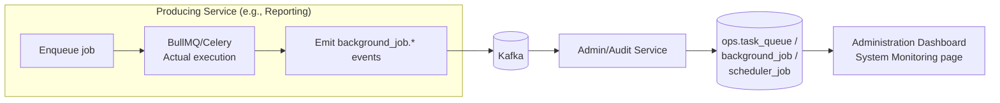
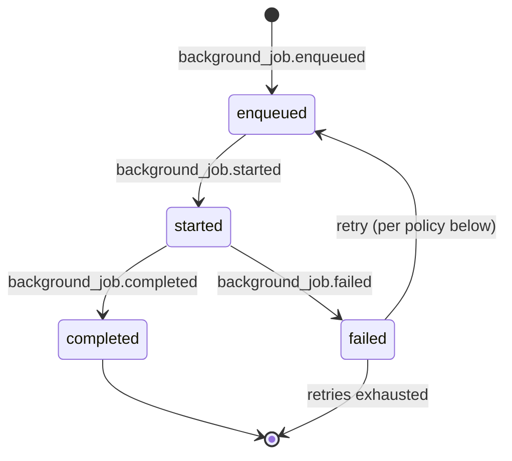

# 10 — Scheduler, Workers, and Queues Architecture

## Purpose

Defines the cross-cutting background-execution architecture — **Scheduler**, **Workers**, and **Queues** — a capability every service uses but none of them "owns" as a business domain. Resolves how per-service queue engines (BullMQ, Celery, Airflow) coexist with the `ops` schema's cross-service job ledger (per [`09_Platform_Operations_Service_Architecture.md#jobs-module`](09_Platform_Operations_Service_Architecture.md#jobs-module)) without contradiction.

> Version: 1.0 | Author: ClimateShield Nexus Backend Architecture Team | Last Updated: 2026-07-27

## Table of Contents

1. [The Core Principle: Execution vs. Ledger](#the-core-principle-execution-vs-ledger)
2. [Queue Engine per Runtime](#queue-engine-per-runtime)
3. [Scheduler Architecture](#scheduler-architecture)
4. [Worker Architecture](#worker-architecture)
5. [Job Lifecycle Contract](#job-lifecycle-contract)
6. [Retry and Dead-Letter Policy](#retry-and-dead-letter-policy)
7. [Decision Matrix: Which Mechanism for Which Job](#decision-matrix-which-mechanism-for-which-job)
8. [References](#references)
9. [Revision History](#revision-history)

## The Core Principle: Execution vs. Ledger

Two concerns that must not be conflated:

| Concern | Owner | Technology |
|---|---|---|
| **Execution** — actually running a job, retrying it, holding its in-flight state | The producing service itself, in its own runtime | BullMQ (Node services, Redis-backed), Celery (Python services, Redis/Kafka-backed, already established by [`climate-processing-worker`](../../docker-compose.yml)'s `celery worker` command), Airflow (DAG-level orchestration for multi-step pipelines) |
| **Ledger** — a cross-service, queryable record of "what jobs exist, what's their status, for the Administration dashboard" | Admin/Audit Service exclusively | `ops.task_queue`, `ops.background_job`, `ops.scheduler_job`, `ops.pipeline_run_log` |

No service other than Admin/Audit Service ever writes to these `ops.*` tables directly (restated from [`00_Backend_Architecture_Overview.md#service-to-schema-ownership-map`](00_Backend_Architecture_Overview.md#service-to-schema-ownership-map) and made unambiguous per [`09_Platform_Operations_Service_Architecture.md#jobs-module`](09_Platform_Operations_Service_Architecture.md#jobs-module)) — every producing service instead emits the `background_job.*` lifecycle events (per [`01_Microservice_Architecture_and_Module_Boundaries.md#event-catalog`](01_Microservice_Architecture_and_Module_Boundaries.md#event-catalog)), and Admin/Audit Service is the sole consumer that reflects them into `ops.*`.

## Queue Engine per Runtime

| Service Type | Queue Engine | Backing Store | Rationale |
|---|---|---|---|
| NestJS services (Alerting dispatch, Reporting generation, Climate Data dataset import/export) | BullMQ | Redis (already provisioned, per [`.env.example`](../../.env.example)'s "Cache / Queue" Redis role) | Native Node/TypeScript integration, no new infrastructure component |
| FastAPI services (Risk Assessment recompute, GIS tiling, AI Engine training) | Celery | Redis broker (matches the existing `climate-processing-worker` pattern) | Already established in Phase 3; consistent Python-side worker model across all Python services, not a new choice introduced here |
| Multi-step pipeline orchestration (climate-processing's ingest → validate → process → publish DAGs) | Apache Airflow | Its own metadata DB | Already decided in [`docs/06_System_Architecture.md#technology-stack`](../06_System_Architecture.md#technology-stack) — Airflow orchestrates *DAGs of tasks*, where individual tasks may themselves be Celery jobs; Airflow is for multi-step dependency graphs, Celery/BullMQ are for single-step background work |

## Scheduler Architecture

Two distinct scheduling needs, deliberately not merged into one mechanism:

| Need | Mechanism | Example |
|---|---|---|
| Recurring **data pipeline** DAGs (ingest, validate, derive indices) | Airflow's native DAG scheduler | Hourly station-network poll, daily NWP GRIB2 pull |
| Recurring **application-level** jobs (scheduled reports, vulnerability recompute, audit hash-chain verification, disabled-subscription cleanup) | `ops.scheduler_job` rows, executed by a lightweight cron-style dispatcher that enqueues the corresponding service's BullMQ/Celery job at the scheduled time | Weekly County Risk Summary report, monthly vulnerability_analysis refresh (per [`04_Risk_Engine_Service_Architecture.md#exposure-and-vulnerability-modules`](04_Risk_Engine_Service_Architecture.md#exposure-and-vulnerability-modules)) |

The application-level dispatcher lives in Admin/Audit Service (it already owns `ops.scheduler_job` as the ledger) but **only enqueues** — it calls the owning service's internal "run this job now" endpoint (or publishes a `{job}.trigger` internal event) rather than executing the job's logic itself, keeping "what a job does" inside the service that owns that business capability and "when it runs" centralized for visibility.

## Worker Architecture

- Every worker process (a BullMQ worker, a Celery worker, an Airflow task) is a **separately deployable process** from its service's API process — per [`kubernetes/`](../../kubernetes/)'s existing pattern (`climate-processing-worker` is already a distinct container from `climate-processing-scheduler`, per [`docker-compose.yml`](../../docker-compose.yml)) — so a burst of report-generation jobs scales independently of the Reporting Service's API pod count.
- Workers are stateless between jobs (per [`docs/06_System_Architecture.md#architecture-principles`](../06_System_Architecture.md#architecture-principles)'s "stateless services, stateful stores" principle) — any job state that must survive a worker restart lives in Redis/the queue engine's own persistence, never in worker process memory.
- Long-running worker jobs (report generation, satellite tiling, model training) emit progress updates as intermediate `background_job` lifecycle detail (a `progress_percent` field on the `.started` event's periodic re-emission) so the Admin/Audit ledger — and therefore the frontend's job-status polling — reflects real progress, not just a binary pending/done.

## Job Lifecycle Contract

Every background job, regardless of engine, emits exactly these four lifecycle points (per [`01_Microservice_Architecture_and_Module_Boundaries.md#event-catalog`](01_Microservice_Architecture_and_Module_Boundaries.md#event-catalog)):

A job's `id` is stable across retries (the same logical job, re-attempted) — Admin/Audit Service's ledger shows retry history against one job record, not a new row per attempt.

## Retry and Dead-Letter Policy

| Job Category | Retry Policy | Dead-Letter Behavior |
|---|---|---|
| Idempotent, low-risk (report generation, tile generation) | 3 retries, exponential backoff | After exhaustion, `background_job.failed` is terminal; surfaced on the Administration Dashboard for manual re-trigger |
| Non-idempotent, high-consequence (alert dispatch — see [`07_Alerting_and_Notifications_Service_Architecture.md#dispatch-module-notifications`](07_Alerting_and_Notifications_Service_Architecture.md#dispatch-module-notifications)) | Per-channel retry policy owned by that channel's adapter, not this generic policy — a failed SMS send retries against the SMS gateway specifically, never "retries the whole alert" | Per-channel dead-letter, visible per-`alert_dispatch` row, not a generic queue DLQ |
| Data pipeline tasks (Airflow) | Airflow's native task retry (`retries`/`retry_delay` per task) | Failed DAG runs surface in `ops.pipeline_run_log`, per [`09_Platform_Operations_Service_Architecture.md#jobs-module`](09_Platform_Operations_Service_Architecture.md#jobs-module) |
| Kafka consumer processing failures (any event consumer) | Kafka-level: message redelivered per consumer group semantics | Persistent failure after N redeliveries routes to `dead-letter.<topic>` (per [`01_Microservice_Architecture_and_Module_Boundaries.md#event-catalog`](01_Microservice_Architecture_and_Module_Boundaries.md#event-catalog)), surfaced the same way as other job failures |

## Decision Matrix: Which Mechanism for Which Job

| If the work is... | Use |
|---|---|
| A single-step, request-triggered background task within one service | BullMQ (Node) / Celery (Python) |
| A multi-step pipeline with dependencies between steps, run on a data-engineering cadence | Airflow DAG |
| Triggered by a Kafka event, not a schedule or a user action | A Kafka consumer directly (no queue engine needed — the event itself is the trigger and Kafka's own offset/redelivery is the retry mechanism) |
| Triggered by a fixed schedule, application-level (not a data pipeline) | An `ops.scheduler_job` entry, enqueuing into the owning service's BullMQ/Celery |

## References

- [`docker-compose.yml`](../../docker-compose.yml) (existing `climate-processing-scheduler`/`-worker` pattern)
- [`database/schema/012_ops.sql`](../../database/schema/012_ops.sql)
- [`09_Platform_Operations_Service_Architecture.md#jobs-module`](09_Platform_Operations_Service_Architecture.md#jobs-module)
- [`01_Microservice_Architecture_and_Module_Boundaries.md#event-catalog`](01_Microservice_Architecture_and_Module_Boundaries.md#event-catalog)
- [`docs/06_System_Architecture.md#technology-stack`](../06_System_Architecture.md#technology-stack)

## Revision History

| Version | Date | Author | Change |
|---|---|---|---|
| 1.0 | 2026-07-27 | ClimateShield Nexus Backend Architecture Team | Initial version (Phase 6 backend blueprint) |
