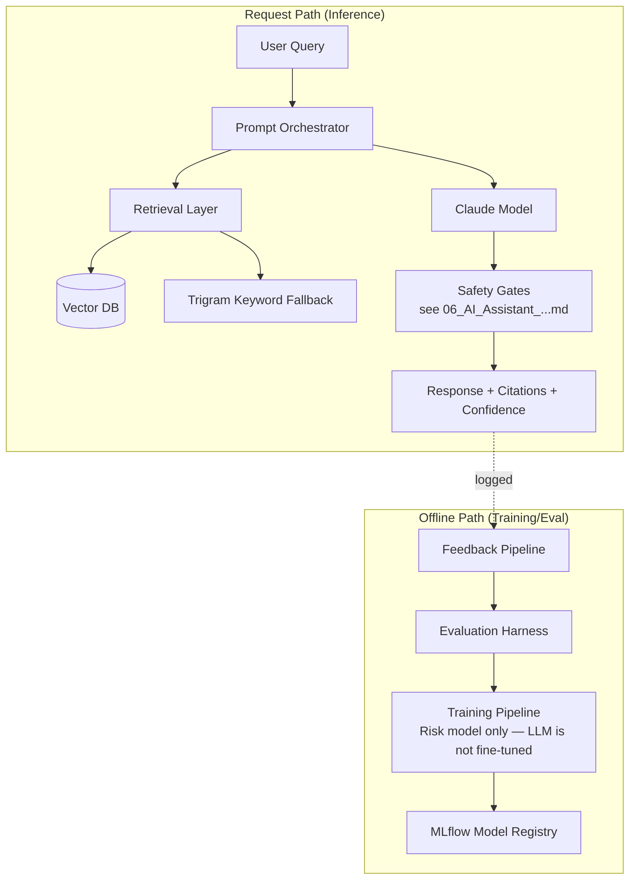
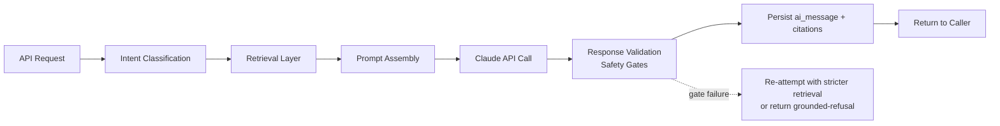

# 13 — AI Architecture

## Purpose

Deep-dive AI/ML architecture underlying [`06_AI_Assistant_and_Knowledge_Base_Service_Architecture.md`](06_AI_Assistant_and_Knowledge_Base_Service_Architecture.md) — prompt orchestration, model selection, retrieval strategy, the vector database plan, evaluation strategy, and the inference/training/feedback pipelines. Implementation planning only — no prompt text, no model weights, no training code.

> Version: 1.0 | Author: ClimateShield Nexus Backend Architecture Team | Last Updated: 2026-07-27

## Table of Contents

1. [AI System Overview](#ai-system-overview)
2. [Prompt Orchestration](#prompt-orchestration)
3. [Model Selection](#model-selection)
4. [Retrieval Strategy](#retrieval-strategy)
5. [Vector Database Plan](#vector-database-plan)
6. [Inference Pipeline](#inference-pipeline)
7. [Training Pipeline](#training-pipeline)
8. [Feedback Pipeline](#feedback-pipeline)
9. [Evaluation Strategy](#evaluation-strategy)
10. [References](#references)
11. [Revision History](#revision-history)

## AI System Overview

Two AI systems coexist under one service, kept architecturally distinct: the **conversational/RAG system** (Claude models via Anthropic API — never trained/fine-tuned by this platform) and the **predictive ML system** (risk-scoring-adjacent models, e.g., a learned severity classifier feeding into Risk Assessment Service — trained and versioned via MLflow). Conflating "AI" into one undifferentiated pipeline is a common source of architectural confusion this document deliberately avoids.

## Prompt Orchestration

- **System prompt isolation**: a fixed system prompt (versioned as `ai.ai_prompt`, per [`06_AI_Assistant_and_Knowledge_Base_Service_Architecture.md#conversational-assistant-module`](06_AI_Assistant_and_Knowledge_Base_Service_Architecture.md#conversational-assistant-module)) is assembled server-side and never includes unsanitized user input in a position the model would treat as an instruction — user query and retrieved context are inserted into clearly delimited sections (e.g., XML-tagged blocks) the system prompt explicitly instructs the model to treat as data, not commands, per [`docs/13_Security_Design.md#ai-governance--safety`](../13_Security_Design.md#ai-governance--safety)'s prompt-injection defense requirement.
- **Orchestration stages** (one function per stage, independently testable): (1) classify query intent (climate-data lookup, risk explanation, general knowledge, high-stakes topic) — this classification is what drives the human-in-the-loop gate in [`06_AI_Assistant_and_Knowledge_Base_Service_Architecture.md#safety-gates-enforced-at-this-layer`](06_AI_Assistant_and_Knowledge_Base_Service_Architecture.md#safety-gates-enforced-at-this-layer); (2) retrieve grounding context (see [Retrieval Strategy](#retrieval-strategy)); (3) assemble the final prompt from system prompt + retrieved context + conversation history + query; (4) call the model; (5) parse/validate the response.
- **Conversation history windowing**: only the most recent N turns (a fixed, tunable budget) are included in each new prompt — full history is persisted in `ai.ai_message` regardless, but prompt assembly is bounded to control both cost and the model's context-dilution risk on a long-running conversation.
- **Prompt versioning**: every `ai_prompt` version change is A/B-evaluatable against the golden set (per [`ai-engine/README.md`](../../ai-engine/README.md)'s `tests/golden-set/`) before promotion to `active=true` — a prompt change is treated with the same rigor as a code change to the scoring logic in Risk Assessment Service, not as a casual text edit.

## Model Selection

| Use Case | Model Choice | Rationale |
|---|---|---|
| Conversational responses, RAG synthesis | Claude (Anthropic API), per [`docs/06_System_Architecture.md#technology-stack`](../06_System_Architecture.md#technology-stack) | Explainability and citation-following behavior, already the platform's confirmed choice — not reopened here |
| Embeddings (for retrieval) | A dedicated embedding model (evaluated at implementation time between Anthropic's or an open-source alternative such as a `sentence-transformers` model) — decision deferred to implementation, since it's swappable behind the Retrieval Layer's interface without touching the orchestration layer | Embedding-model choice is an implementation detail the Retrieval Strategy's interface boundary insulates the rest of the system from |
| Risk-adjacent predictive ML (e.g., a learned drought-onset classifier, if Risk Assessment's rule-based scoring is later supplemented by a trained model) | XGBoost/PyTorch, per [`docs/06_System_Architecture.md#technology-stack`](../06_System_Architecture.md#technology-stack) | Already the confirmed ML stack — this document does not introduce a new model family |
| Model routing | A single active model per use case at MVP (no multi-model routing/ensemble) — a documented Could-have for later if cost/latency/quality tradeoffs justify routing simple queries to a smaller/cheaper model | Keeps the orchestration layer simple for a 5-developer team; the interface is designed so routing can be added later without a rewrite (the orchestrator already calls an abstracted "get completion" function, not a hardcoded model name inline) |

## Retrieval Strategy

- **Hybrid retrieval**: vector similarity search (primary) + trigram keyword fallback (per [`06_AI_Assistant_and_Knowledge_Base_Service_Architecture.md#knowledge-base-module`](06_AI_Assistant_and_Knowledge_Base_Service_Architecture.md#knowledge-base-module)) — results from both are merged and re-ranked, since pure semantic search under-performs on exact-token queries (station codes, model names) that climate/GIS domain users frequently type.
- **Multi-source retrieval**: the Retrieval Layer queries not only `knowledge_base_article` but also (via REST, read-only) recent `risk_assessment` and `observation` data relevant to the query's detected admin-boundary/hazard-type entities — a query like "why is Kisumu flood risk high" retrieves both knowledge-base explanatory content *and* the actual current `risk_contributing_source` rows for that boundary, which is what makes citations concrete and verifiable rather than generic.
- **RBAC-scoped retrieval**: restated from [`06_AI_Assistant_and_Knowledge_Base_Service_Architecture.md#safety-gates-enforced-at-this-layer`](06_AI_Assistant_and_Knowledge_Base_Service_Architecture.md#safety-gates-enforced-at-this-layer) — every retrieval call carries the querying user's token, so a Public User's query never retrieves Restricted-classification risk data even if semantically relevant.
- **Retrieval budget**: capped top-K (a fixed, tunable number of chunks/records) per source type, to keep the assembled prompt within the context-window/cost budget — a query matching more than K relevant chunks gets the K highest-scored, not all of them.

## Vector Database Plan

| Decision | Choice | Rationale |
|---|---|---|
| Technology | **pgvector** (Postgres extension) over a dedicated vector database (Pinecone/Weaviate/Milvus) | The platform already runs PostgreSQL/PostGIS/TimescaleDB as its unified data platform ([ADR-002](../architecture/ADR-002-postgis-timescaledb-data-platform.md)) — adding pgvector to the existing `ai` schema avoids introducing a fourth data store to operate for a 5-person team, consistent with [ADR-003](../architecture/ADR-003-kafka-event-backbone.md)'s own "operational overhead a small team can sustain" reasoning applied to a new decision here |
| Storage | A new `ai.knowledge_base_embedding` table (one row per chunk, `embedding vector(N)` column, FK to `knowledge_base_article`) — flagged here as a schema addition Phase 4's design didn't anticipate, to be added via a standard incremental migration (per [`docs/migrations/00_Migration_Strategy.md`](../migrations/00_Migration_Strategy.md)), not a Phase 4 rework |
| Index | `ivfflat` or `hnsw` (pgvector's ANN index types — the specific choice is an implementation-time tuning decision based on corpus size) with cosine similarity, matching typical sentence-embedding distance conventions |
| Scale ceiling | pgvector performs well into the low-millions-of-vectors range, comfortably beyond this platform's knowledge-base corpus size projections; a dedicated vector DB is the documented migration path if the corpus (or a future multi-agency deployment's combined corpus) ever exceeds that range — the same "revisit at scale" pattern used throughout this blueprint |
| Consistency | Because embeddings live in the same Postgres instance as the source `knowledge_base_article` row, a single transaction can update both — avoiding the dual-write consistency problem a separate vector database would introduce between "article updated" and "embedding updated" |

## Inference Pipeline

- Synchronous for typical conversational turns (bounded by a response-time budget appropriate to a chat UI, per [`docs/frontend/06_Component_Inventory.md#ai-components`](../frontend/06_Component_Inventory.md#ai-components)'s streaming-response affordance) — the API streams tokens back to the frontend as they're generated (matches the `AIPromptInput`/`AIMessageBubble` streaming UX already designed) rather than waiting for full completion.
- Asynchronous for proactive recommendation generation (triggered by `risk_assessment.updated`, per [`06_AI_Assistant_and_Knowledge_Base_Service_Architecture.md#recommendation-module`](06_AI_Assistant_and_Knowledge_Base_Service_Architecture.md#recommendation-module)) — runs as a Celery task, not on any request path.

## Training Pipeline

Applies only to the **predictive ML** track (per [AI System Overview](#ai-system-overview)) — the conversational Claude model is never fine-tuned by this platform, so "training" here means the risk-adjacent classifiers/regressors, if/when Risk Assessment Service's rule-based scoring (per [`04_Risk_Engine_Service_Architecture.md#hazard-module-pattern`](04_Risk_Engine_Service_Architecture.md#hazard-module-pattern)) is supplemented by a learned model:

- **Feature source**: the ML Feature Store in [`docs/06_System_Architecture.md#data-architecture`](../06_System_Architecture.md#data-architecture), built from the same `climate`/`risk` schema data the rule-based scorers already read — no separate feature pipeline duplicating that extraction logic.
- **Training orchestration**: an Airflow DAG (`ai-engine/ml/`) — training is a scheduled/on-demand pipeline job, never triggered inline by an API request.
- **Model registry**: MLflow (per [`docs/06_System_Architecture.md#technology-stack`](../06_System_Architecture.md#technology-stack)) tracks every training run's parameters/metrics/artifact; a model is promoted to "serving" only after passing the [Evaluation Strategy](#evaluation-strategy)'s back-testing bar — mirrors [`04_Risk_Engine_Service_Architecture.md#model-version-registry`](04_Risk_Engine_Service_Architecture.md#model-version-registry)'s "only one active model" discipline, applied to ML artifacts specifically.
- **Deployment**: the ML Inference Service serves the MLflow-registered model; Risk Assessment Service calls it via REST exactly as it calls any other service dependency (per [`01_Microservice_Architecture_and_Module_Boundaries.md#synchronous-contract-rules`](01_Microservice_Architecture_and_Module_Boundaries.md#synchronous-contract-rules)) — a learned model is an additional *input* to the hazard modules' threshold evaluation stage, not a replacement for the documented rule-based structure.

## Feedback Pipeline

- **Explicit feedback**: a thumbs-up/down (or similar) action on an `ai_message` in the frontend (a new, small addition to `AIMessageBubble`'s interaction surface, flagged for the frontend team at implementation time) writes to a new `ai.ai_message_feedback` table (schema addition via standard migration, same pattern as [Vector Database Plan](#vector-database-plan)'s embedding table).
- **Implicit feedback**: whether a recommendation was approved/rejected (`ai_recommendation.status`, already modeled in Phase 4) is itself feedback signal — a pattern of rejected recommendations for a given topic/hazard type is a strong evaluation signal without requiring a separate explicit-feedback UI action.
- **Feedback loop closure**: feedback data feeds the [Evaluation Strategy](#evaluation-strategy)'s golden-set expansion (a recurring "did we get this wrong" review adds confirmed-bad cases to the regression test set) and, for the predictive ML track only, into the next [Training Pipeline](#training-pipeline) run's evaluation baseline — feedback never triggers an automatic silent model change; every promotion remains a reviewed, evaluated step.

## Evaluation Strategy

- **Golden-set regression testing**: `ai-engine/tests/golden-set/` (already scaffolded per [`ai-engine/README.md`](../../ai-engine/README.md)) is a curated set of representative Q&A pairs with expected citation sources and acceptable-answer criteria — every prompt/model change runs against this set before promotion, matching [`docs/14_Testing_Strategy.md#test-types--tooling`](../14_Testing_Strategy.md#test-types--tooling)'s "ML/Model Validation: custom back-testing harness against historical events" row, applied to the conversational track specifically.
- **Safety-gate regression**: a dedicated evaluation subset specifically probing prompt-injection attempts and high-stakes-topic detection (per [`06_AI_Assistant_and_Knowledge_Base_Service_Architecture.md#safety-gates-enforced-at-this-layer`](06_AI_Assistant_and_Knowledge_Base_Service_Architecture.md#safety-gates-enforced-at-this-layer)) — a prompt/model change that regresses on *this* subset blocks promotion regardless of how well it scores on general quality, since safety-gate integrity is a harder requirement than answer quality.
- **Predictive ML evaluation**: precision/recall/bias metrics against historical events, per [`docs/14_Testing_Strategy.md#test-types--tooling`](../14_Testing_Strategy.md#test-types--tooling) — a new model version must meet or exceed the currently-serving version's metrics before promotion (never a silent regression accepted for the sake of a newer model).
- **Human review sampling**: independent of automated evaluation, a periodic sample of real (anonymized, per [`docs/13_Security_Design.md#ai-governance--safety`](../13_Security_Design.md#ai-governance--safety)'s PII-minimization requirement) conversation logs is reviewed by a Climate Scientist/Meteorologist for domain-accuracy issues automated metrics can't catch — feeds back into golden-set expansion per [Feedback Pipeline](#feedback-pipeline).

## References

- [`06_AI_Assistant_and_Knowledge_Base_Service_Architecture.md`](06_AI_Assistant_and_Knowledge_Base_Service_Architecture.md)
- [`docs/13_Security_Design.md#ai-governance--safety`](../13_Security_Design.md#ai-governance--safety)
- [ADR-002](../architecture/ADR-002-postgis-timescaledb-data-platform.md)
- [`docs/14_Testing_Strategy.md#test-types--tooling`](../14_Testing_Strategy.md#test-types--tooling)
- [`ai-engine/README.md`](../../ai-engine/README.md)

## Revision History

| Version | Date | Author | Change |
|---|---|---|---|
| 1.0 | 2026-07-27 | ClimateShield Nexus Backend Architecture Team | Initial version (Phase 6 backend blueprint) |
