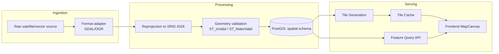

# 14 — GIS Architecture

## Purpose

Deep-dive spatial architecture underlying [`05_GIS_Engine_Service_Architecture.md`](05_GIS_Engine_Service_Architecture.md) — spatial/raster/vector processing, tile generation, map rendering, coordinate systems, and caching. Implementation planning only — no spatial algorithm code.

> Version: 1.0 | Author: ClimateShield Nexus Backend Architecture Team | Last Updated: 2026-07-27

## Table of Contents

1. [Spatial Processing Pipeline](#spatial-processing-pipeline)
2. [Raster Processing](#raster-processing)
3. [Vector Processing](#vector-processing)
4. [Tile Generation](#tile-generation)
5. [Map Rendering](#map-rendering)
6. [Coordinate Systems](#coordinate-systems)
7. [Caching](#caching)
8. [References](#references)
9. [Revision History](#revision-history)

## Spatial Processing Pipeline

Every geometry entering `spatial.*` passes through the same validation step regardless of source (uploaded shapefile, satellite footprint, drawn analysis polygon from [`docs/frontend/06_Component_Inventory.md#map-components`](../frontend/06_Component_Inventory.md#map-components)'s `MapDrawTools`) — `ST_IsValid` check, `ST_MakeValid` auto-repair for common topology errors (self-intersections), and rejection with an actionable error for anything `ST_MakeValid` cannot resolve. This is one shared validation module (`gis-services/api/layers/validation.py`), not reimplemented per ingestion source.

## Raster Processing

- **Formats**: GeoTIFF (satellite products, DEM data) processed via GDAL — reprojection, resampling, and band-math operations (e.g., NDVI derivation for agriculture-sector context) run as Celery tasks (per [`10_Scheduler_Workers_Queues_Architecture.md`](10_Scheduler_Workers_Queues_Architecture.md)), never inline with an API request, since raster operations on large scenes are minutes, not milliseconds.
- **Metadata**: `spatial.raster_layer_metadata` (per [`database/schema/006_gis.sql`](../../database/schema/006_gis.sql)) records band count, resolution, pixel type, CRS — the metadata row is written only after processing completes successfully, so a partially-processed raster is never visible as if it were ready.
- **Chunking for large scenes**: a satellite scene above a size threshold is processed in spatial tiles (not as one monolithic GDAL operation) — bounds each processing job's memory footprint predictably regardless of input scene size, and allows partial-progress reporting (per [`10_Scheduler_Workers_Queues_Architecture.md#worker-architecture`](10_Scheduler_Workers_Queues_Architecture.md#worker-architecture)'s progress-percent pattern).

## Vector Processing

- **Formats**: Shapefile, GeoJSON, KML accepted at upload (GIS Analyst layer authoring, per [`docs/prototype/05_GIS_and_Satellite_Pages.md`](../prototype/05_GIS_and_Satellite_Pages.md)) — converted to PostGIS geometry via OGR, never stored in their original file format as the system of record (the uploaded file itself is retained in object storage per [`11_Storage_and_Search_Architecture.md`](11_Storage_and_Search_Architecture.md) for provenance, but all querying happens against the PostGIS `spatial.gis_feature` rows).
- **Simplification**: vector layers intended for low-zoom-level display are pre-simplified (`ST_SimplifyPreserveTopology`, a fixed tolerance per zoom band) at publish time, not computed per-request — matches [`docs/database/02_Performance_Strategy.md#query-budget-targets`](../database/02_Performance_Strategy.md#query-budget-targets)'s spatial-query budget by avoiding repeated simplification cost on every map pan/zoom.
- **Attribute schema**: `spatial.vector_layer_metadata.attribute_schema` (JSONB, per [`database/schema/006_gis.sql`](../../database/schema/006_gis.sql)) is validated against the uploaded feature set's actual attributes at publish time — a layer with inconsistent per-feature attribute keys is flagged for GIS Analyst correction before publish, not silently accepted.

## Tile Generation

- **Vector tiles** (MVT format) for boundary/feature layers, generated via GeoServer's built-in MVT output (per [`docs/06_System_Architecture.md#technology-stack`](../06_System_Architecture.md#technology-stack)'s GeoServer + GDAL choice) — chosen over raster map tiles for these layers specifically because vector tiles support client-side styling (severity choropleth recoloring without a re-tile, per [`docs/frontend/09_Performance_and_Rendering_Strategy.md#map-and-chart-performance`](../frontend/09_Performance_and_Rendering_Strategy.md#map-and-chart-performance)).
- **Raster tiles** (WMTS) for satellite imagery and any layer that is inherently pixel-based rather than feature-based.
- **Pre-generation vs. on-demand**: boundary layers (rarely change) are pre-generated at publish time across the standard zoom range; satellite/observation-driven layers are generated on-demand with aggressive caching (see [Caching](#caching)) since pre-generating every possible time-slice would be wasteful for data that's queried far less often than it's produced.
- **Publish triggers regeneration**: a `gis_layer.published` event (per [`01_Microservice_Architecture_and_Module_Boundaries.md#event-catalog`](01_Microservice_Architecture_and_Module_Boundaries.md#event-catalog)) triggers both tile regeneration for the new version and a cache purge for the old version's tile URLs — the two are coupled in one handler so a published update is never visible as "half old tiles, half new."

## Map Rendering

- **Server responsibility**: serve correctly-projected, appropriately-simplified vector/raster tiles and feature GeoJSON — nothing more. Actual map rendering (basemap composition, layer styling, interaction) is entirely a frontend concern, per [`docs/frontend/06_Component_Inventory.md#map-components`](../frontend/06_Component_Inventory.md#map-components)'s `MapCanvas`/`BoundaryLayer`/`MapLayerToggle` components — this backend never rasterizes a "final map image" for the frontend to display, avoiding a server-side rendering responsibility that would duplicate what Mapbox GL/MapLibre already does client-side efficiently.
- **Style definitions**: choropleth/severity styling rules live in `gis-services/geoserver-config/` (style provisioning config, per the existing Phase 3 scaffold) for the server-styled WMS fallback path (used by the Public Climate Dashboard's simpler map treatment, per [`docs/frontend/04_Layouts.md#public-layout`](../frontend/04_Layouts.md#public-layout)) but are the frontend's Mapbox GL paint-expression responsibility for the interactive authenticated dashboards — two styling implementations for two genuinely different rendering contexts, not accidental duplication.

## Coordinate Systems

- **Canonical SRID**: 4326 (WGS 84) for all stored geometry and all API responses (GeoJSON per [`docs/12_API_Specification.md#conventions`](../12_API_Specification.md#conventions)) — restated from Phase 1/4, not reopened.
- **Reprojection boundary**: any source data arriving in a different CRS (e.g., a UTM-zone-projected shapefile from a field survey) is reprojected to 4326 at ingestion (per [Spatial Processing Pipeline](#spatial-processing-pipeline)) — 4326 is the only CRS that ever appears in `spatial.*` tables, so no query or API consumer needs to reason about mixed CRSs.
- **Web Mercator (3857) at the tile-serving edge only**: tile generation projects to 3857 (the standard web-map tiling projection) as the final output step — 3857 exists only in the generated tile artifacts, never in the stored/queried geometry, keeping the "one canonical storage CRS" rule intact while still serving standard web map tiles.
- **Distance/area calculations**: any computation genuinely needing accurate distance/area (not just display) uses a geography-cast (`::geography`) calculation or an appropriate local projected CRS chosen per calculation, never naive Cartesian math on 4326 degrees — flagged explicitly since this is a common spatial-computation correctness pitfall.

## Caching

| Layer | What's Cached | Invalidation |
|---|---|---|
| CDN (edge) | Public (`is_public=true`) layer tiles, per [`docs/database/02_Performance_Strategy.md#caching-strategy`](../database/02_Performance_Strategy.md#caching-strategy)'s existing 1-hour TTL row | `gis_layer.published` event triggers an explicit CDN purge for that layer's tile URL pattern — not left to passive TTL expiry alone for a just-published update |
| GeoServer tile cache (GeoWebCache) | All generated tiles, public and internal | Same publish-event trigger; also a scheduled sweep for time-sliced satellite tiles beyond their useful-query window (matches the "recent runs matter most" reasoning in [`docs/database/02_Performance_Strategy.md#partition-strategy`](../database/02_Performance_Strategy.md#partition-strategy) for forecast data) |
| Application-layer (GIS Service, in-process) | Admin boundary hierarchy (changes only on rare redistricting events) | Long TTL (hours), explicit invalidation on an `admin_boundary` write — mirrors [`docs/database/02_Performance_Strategy.md#caching-strategy`](../database/02_Performance_Strategy.md#caching-strategy)'s "load once" treatment of other rarely-changing reference data |
| Frontend (browser) | Standard HTTP cache headers on tile responses (`Cache-Control`, `ETag`) | Browser-native; the CDN/GeoWebCache layers above are the ones this service actively manages |

## References

- [`database/schema/004_spatial_admin_boundary.sql`](../../database/schema/004_spatial_admin_boundary.sql), [`006_gis.sql`](../../database/schema/006_gis.sql)
- [`docs/06_System_Architecture.md#technology-stack`](../06_System_Architecture.md#technology-stack)
- [`docs/database/02_Performance_Strategy.md`](../database/02_Performance_Strategy.md)
- [`05_GIS_Engine_Service_Architecture.md`](05_GIS_Engine_Service_Architecture.md)
- [`docs/frontend/06_Component_Inventory.md#map-components`](../frontend/06_Component_Inventory.md#map-components)

## Revision History

| Version | Date | Author | Change |
|---|---|---|---|
| 1.0 | 2026-07-27 | ClimateShield Nexus Backend Architecture Team | Initial version (Phase 6 backend blueprint) |
