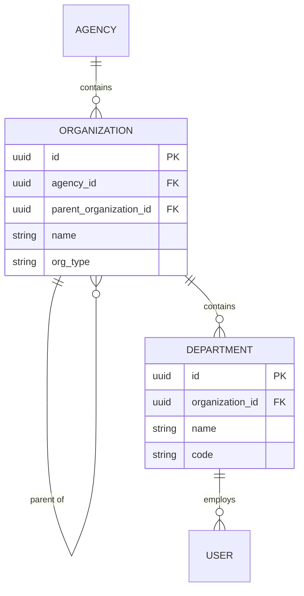
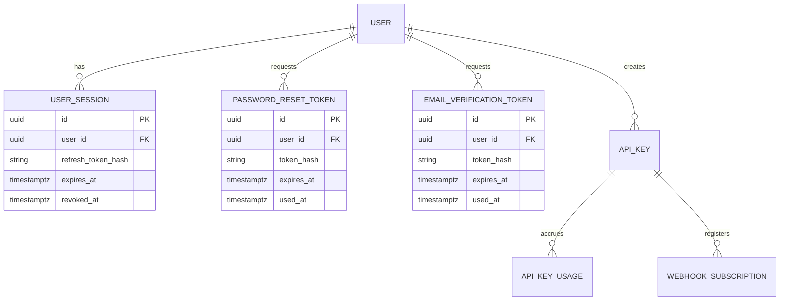
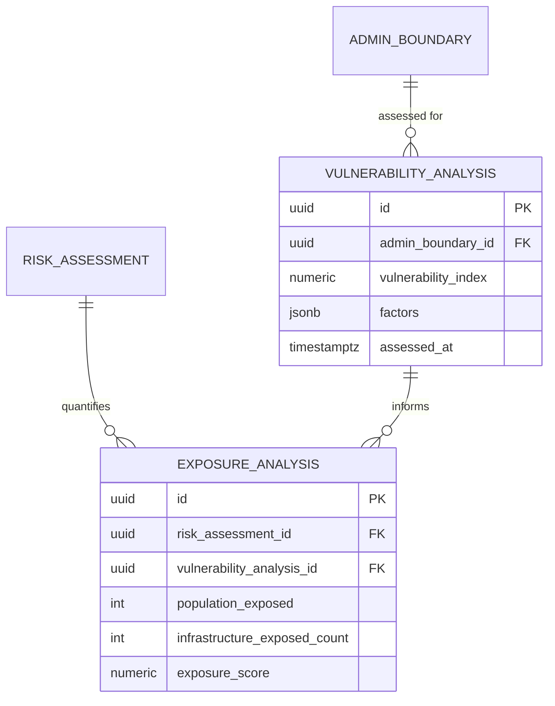
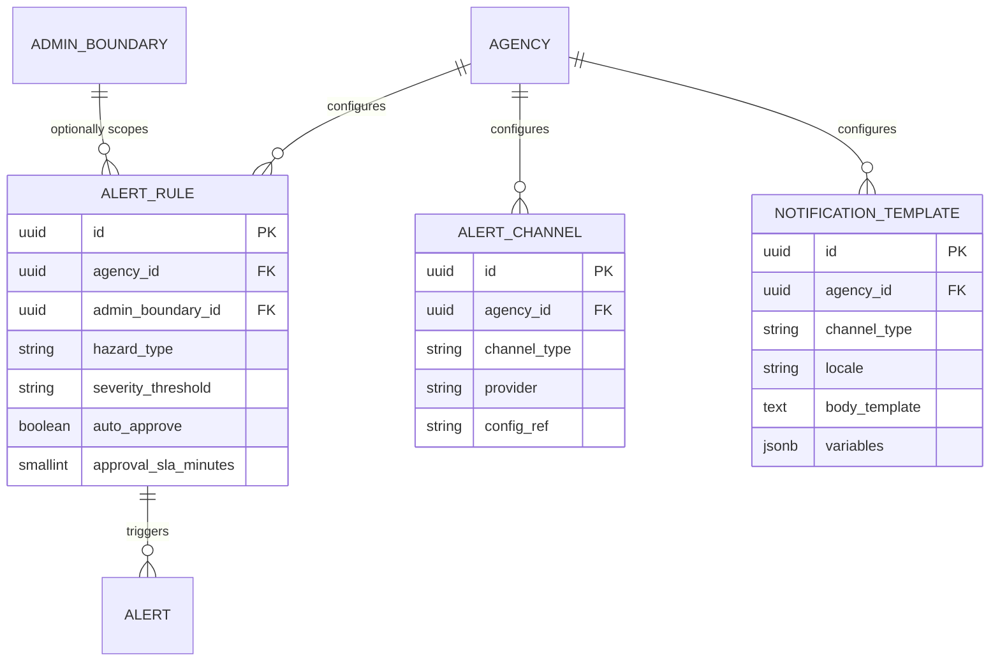
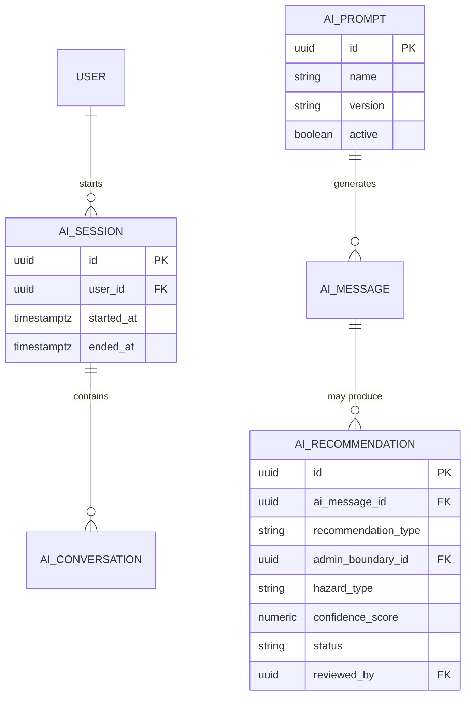
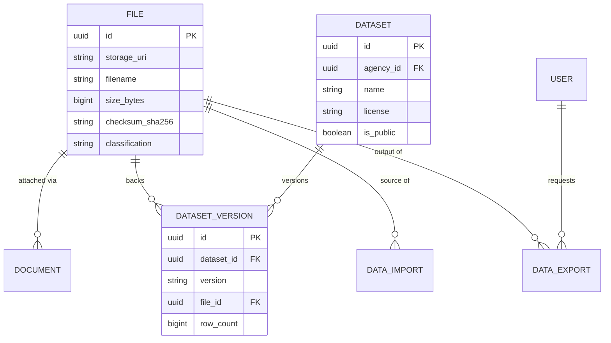
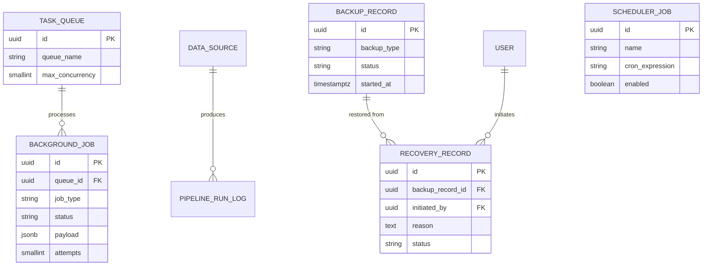

# Schema Diagrams — Phase 4 Extensions

## Purpose

Extends [`docs/diagrams/06_Complete_ERD.md`](../diagrams/06_Complete_ERD.md) and [`docs/diagrams/07_Database_Visual_Model.md`](../diagrams/07_Database_Visual_Model.md) with ER diagrams for every entity introduced in this Phase 4 data-layer expansion — organizational structure, hazard-specific risk parameters, exposure/vulnerability analysis, alert configuration, extended AI entities, datasets, and the operations/jobs/backup entities. The master 73-entity relationship map lives in [`docs/models/00_Domain_Model_Overview.md#master-domain-diagram`](../models/00_Domain_Model_Overview.md#master-domain-diagram) and is not repeated here.

> Version: 1.0 | Author: ClimateShield Nexus Database Architecture Team | Last Updated: 2026-07-27

## Table of Contents

1. [Organizational Structure ERD](#organizational-structure-erd)
2. [Identity Tokens & Credentials ERD](#identity-tokens--credentials-erd)
3. [Hazard-Specific Risk Parameters ERD](#hazard-specific-risk-parameters-erd)
4. [Exposure & Vulnerability ERD](#exposure--vulnerability-erd)
5. [Alert Configuration ERD](#alert-configuration-erd)
6. [GIS Layer Metadata Specialization ERD](#gis-layer-metadata-specialization-erd)
7. [Extended AI ERD](#extended-ai-erd)
8. [Dataset & Content ERD](#dataset--content-erd)
9. [Operations, Jobs & Backup ERD](#operations-jobs--backup-erd)
10. [References](#references)
11. [Revision History](#revision-history)

## Organizational Structure ERD



## Identity Tokens & Credentials ERD



## Hazard-Specific Risk Parameters ERD

```mermaid
erDiagram
    RISK_MODEL ||--o| FLOOD_MODEL_PARAMETERS : "typed extension (risk_type=flood)"
    RISK_MODEL ||--o| DROUGHT_MODEL_PARAMETERS : "typed extension (risk_type=drought)"
    RISK_MODEL ||--o| HEATWAVE_MODEL_PARAMETERS : "typed extension (risk_type=heatwave)"

    FLOOD_MODEL_PARAMETERS {
        uuid risk_model_id PK_FK
        numeric rainfall_moderate_mm
        numeric rainfall_high_mm
        numeric rainfall_severe_mm
        numeric rainfall_extreme_mm
        smallint accumulation_window_hours
    }
    DROUGHT_MODEL_PARAMETERS {
        uuid risk_model_id PK_FK
        numeric spi3_moderate
        numeric spi3_high
        numeric spi3_severe
        numeric spi3_extreme
    }
    HEATWAVE_MODEL_PARAMETERS {
        uuid risk_model_id PK_FK
        numeric heat_index_moderate_celsius
        numeric heat_index_high_celsius
        numeric heat_index_severe_celsius
        numeric heat_index_extreme_celsius
        smallint minimum_consecutive_days
    }
```

## Exposure & Vulnerability ERD



## Alert Configuration ERD



## GIS Layer Metadata Specialization ERD

```mermaid
erDiagram
    GIS_LAYER_VERSION ||--o| RASTER_LAYER_METADATA : "typed extension (layer_type=raster)"
    GIS_LAYER_VERSION ||--o| VECTOR_LAYER_METADATA : "typed extension (layer_type=vector)"

    RASTER_LAYER_METADATA {
        uuid layer_version_id PK_FK
        smallint band_count
        numeric resolution_meters
        string pixel_type
        string crs
    }
    VECTOR_LAYER_METADATA {
        uuid layer_version_id PK_FK
        string geometry_type
        int feature_count
        jsonb attribute_schema
    }
```

## Extended AI ERD



## Dataset & Content ERD



## Operations, Jobs & Backup ERD



## References

- [`docs/diagrams/06_Complete_ERD.md`](../diagrams/06_Complete_ERD.md)
- [`docs/models/00_Domain_Model_Overview.md#master-domain-diagram`](../models/00_Domain_Model_Overview.md#master-domain-diagram)
- [`database/schema/`](../../database/schema/)

## Revision History

| Version | Date | Author | Change |
|---|---|---|---|
| 1.0 | 2026-07-27 | ClimateShield Nexus Database Architecture Team | Initial version (Phase 4 data layer) |
