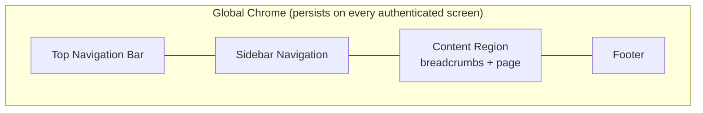
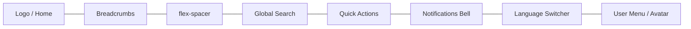
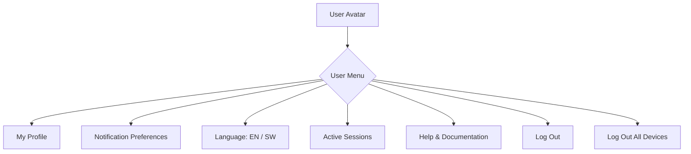
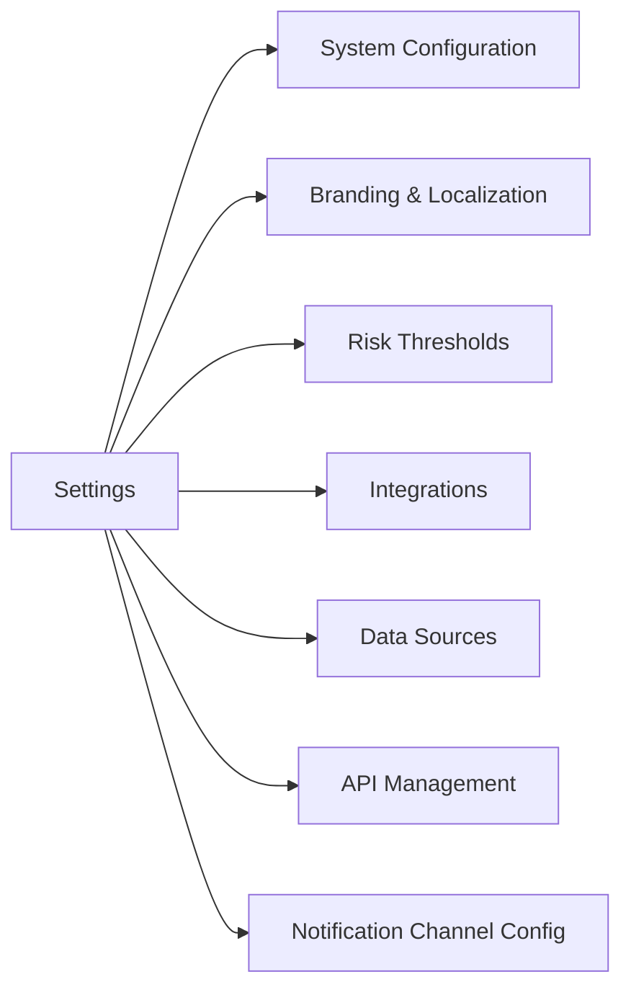
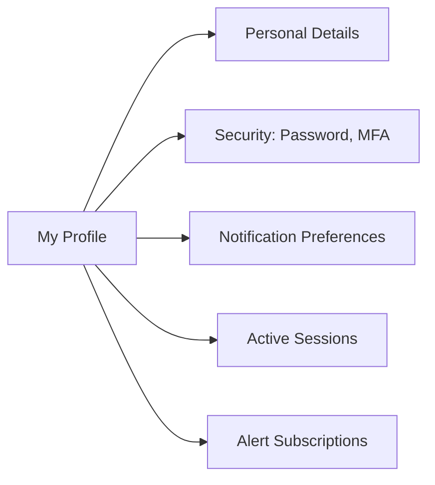
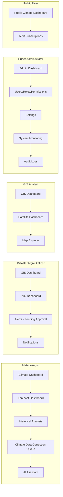
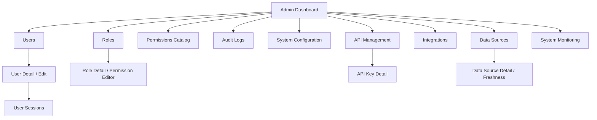
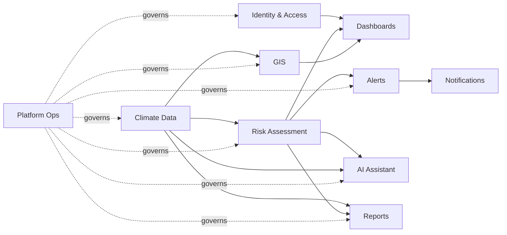
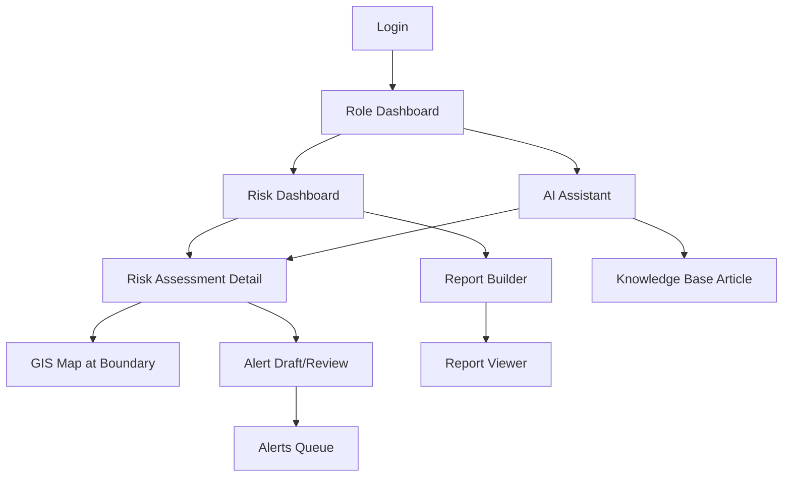

# Information Architecture

## Purpose

Defines the complete navigation hierarchy, global chrome, and screen relationships for ClimateShield Nexus — the structural map every screen in [`docs/prototype/`](../prototype/) is placed within. Complements [`docs/21_Wireflows.md`](../21_Wireflows.md) (behavioral flows) with the static structure those flows navigate through.

> Version: 1.0 | Author: ClimateShield Nexus UI/UX Team | Last Updated: 2026-07-27

## Table of Contents

1. [IA Principles](#ia-principles)
2. [Global Navigation Chrome](#global-navigation-chrome)
3. [Sidebar Navigation](#sidebar-navigation)
4. [Top Navigation Bar](#top-navigation-bar)
5. [Footer](#footer)
6. [User Menu](#user-menu)
7. [Global Search](#global-search)
8. [Notifications Panel](#notifications-panel)
9. [Quick Actions](#quick-actions)
10. [Settings Navigation](#settings-navigation)
11. [Profile Navigation](#profile-navigation)
12. [Breadcrumbs](#breadcrumbs)
13. [Full Sitemap](#full-sitemap)
14. [Role-Specific Navigation Trees](#role-specific-navigation-trees)
15. [Admin Navigation](#admin-navigation)
16. [Module Relationship Map](#module-relationship-map)
17. [Screen Relationship Map](#screen-relationship-map)
18. [References](#references)
19. [Revision History](#revision-history)

## IA Principles

1. **One primary sidebar, role-filtered** — every persona sees the same sidebar structure with items hidden (not disabled) if outside their RBAC scope ([`docs/13_Security_Design.md`](../13_Security_Design.md#rbac-matrix)).
2. **Dashboards are the home base** — every session lands on a role-appropriate dashboard ([`docs/21_Wireflows.md`](../21_Wireflows.md#wireflow-1-login--role-based-dashboard)); all deep navigation returns there via the logo/breadcrumb root.
3. **Three navigation depths maximum** — Sidebar Section → Module Landing → Detail/Record, matching [`NFR-UX-004`](../05_Non_Functional_Requirements.md#usability--accessibility) (max 3 clicks to any primary dashboard).
4. **Consistent chrome, changing content** — Top Nav, Sidebar, and Footer never change shape between screens; only the content region changes.
5. **Public and authenticated IA are separate trees** that merge only at the Login screen.

## Global Navigation Chrome

## Sidebar Navigation

Sections shown/hidden per role (see [Role-Specific Navigation Trees](#role-specific-navigation-trees)). Order fixed across all roles for muscle-memory consistency.

| Section | Items | Module Ref |
|---|---|---|
| Home | Climate Dashboard | [`docs/04_Functional_Requirements.md#dashboards`](../04_Functional_Requirements.md#dashboards) |
| Forecasting | Forecast Dashboard, Historical Analysis | Forecast Models |
| Risk Intelligence | Risk Dashboard, Flood, Drought, Heat, Agriculture, Infrastructure, Population Exposure | Risk Assessment |
| GIS | GIS Dashboard, Satellite Dashboard, Map Explorer | GIS & Remote Sensing |
| AI | AI Assistant (Chat), Knowledge Base | AI Climate Assistant |
| Reports | Report Builder, Report Viewer | Climate Reports |
| Alerts | Alerts, Notifications | Alerts & Notifications |
| Administration | Users, Roles, Permissions, Audit Logs, Settings, API Management, Integrations, Data Sources | Platform Operations |
| Monitoring | System Monitoring, System Health, Maintenance | Platform Operations |
| Support | Documentation, Support | — |

Sidebar is collapsible to icon-only rail below `lg` breakpoint (see [`docs/19_UI_Design_System.md#responsive-breakpoints`](../19_UI_Design_System.md#responsive-breakpoints)).

## Top Navigation Bar

Left-anchored: Logo, Breadcrumbs. Right-anchored: Search, Quick Actions, Notifications, Language, User Menu. An `AlertBanner` ([`docs/19_UI_Design_System.md#key-components`](../19_UI_Design_System.md#key-components)) renders as a full-width strip immediately below the Top Nav when an active High+ severity alert exists in the user's scope.

## Footer

| Zone | Content |
|---|---|
| Left | © ClimateShield Nexus, agency name, data-source attribution link |
| Center | Links: About, Documentation, Support, [Privacy](../../SECURITY.md#data-sensitivity-classes) |
| Right | Platform version tag, system status link (→ System Health) |

Footer is omitted on full-screen map/dashboard views (GIS Dashboard, Map Explorer) to maximize viewport for spatial content; reachable there via a collapsed "..." menu.

## User Menu

## Global Search

Single search box in Top Nav, scoped by RBAC. Result groups, in order: **Locations** (admin boundaries) → **Risk Assessments** → **Alerts** → **Reports** → **Knowledge Base Articles** → **Users** (Administrator roles only). Empty query shows recent searches; results are keyboard-navigable (see [`docs/19_UI_Design_System.md#accessibility-standards`](../19_UI_Design_System.md#accessibility-standards)).

## Notifications Panel

Slide-over panel from the bell icon. Tabs: **All**, **Alerts** (climate hazard alerts), **System** (pipeline/data-freshness/audit notices relevant to the user's role), **Mentions** (report/AI review assignments). Each item deep-links to its source record. Unread count badge on the bell icon; "Mark all read" action in panel header.

## Quick Actions

Role-filtered `+` menu in Top Nav for the most common create/action tasks:

| Role | Quick Actions |
|---|---|
| Meteorologist | Publish Advisory, Correct Observation |
| Disaster Mgmt Officer | Review Pending Alerts, Draft Manual Alert |
| GIS Analyst | New Map View, Export Layer |
| Administrator | Invite User, Create Role |
| Any authenticated role | Ask AI Assistant, Request Report |

## Settings Navigation

Visible only to Administrator/Super Administrator roles ([`docs/13_Security_Design.md#rbac-matrix`](../13_Security_Design.md#rbac-matrix)).

## Profile Navigation

Available to every authenticated role, including Public User (limited to PDETAILS, PNOTIF, PSUBS).

## Breadcrumbs

Pattern: `Sidebar Section > Module Landing > Record/Detail`. Example: `Risk Intelligence > Flood Analysis > Kilifi County — 2026-07-27`. Root crumb always links to the section landing page, never to the dashboard (dashboard is reached via Logo).

## Full Sitemap

```mermaid
flowchart TD
    ROOT((ClimateShield Nexus))

    ROOT --> PUBLIC[Public Site]
    PUBLIC --> P_LAND[Landing Page]
    PUBLIC --> P_ABOUT[About]
    PUBLIC --> P_DOCS[Documentation]
    PUBLIC --> P_DASH[Public Climate Dashboard]
    P_LAND --> AUTH

    ROOT --> AUTH[Authentication]
    AUTH --> A_LOGIN[Login]
    AUTH --> A_REG[Registration]
    AUTH --> A_FORGOT[Forgot Password]
    AUTH --> A_RESET[Reset Password]
    AUTH --> A_VERIFY[Email Verification]
    AUTH --> A_2FA[Two-Factor Authentication]
    A_LOGIN --> APP

    ROOT --> APP[Authenticated App]

    APP --> DASH[Dashboards]
    DASH --> D_ADMIN[Admin Dashboard]
    DASH --> D_METEO[Meteorologist Dashboard]
    DASH --> D_RESEARCH[Research Dashboard]
    DASH --> D_GOV[Government Dashboard]
    DASH --> D_CLIMATE[Climate Dashboard]
    DASH --> D_FCST[Forecast Dashboard]
    DASH --> D_HIST[Historical Analysis]

    APP --> RISK[Risk Intelligence]
    RISK --> R_MAIN[Risk Dashboard]
    RISK --> R_FLOOD[Flood Dashboard]
    RISK --> R_DROUGHT[Drought Dashboard]
    RISK --> R_HEAT[Heat Dashboard]
    RISK --> R_AGRI[Agriculture Dashboard]

    APP --> GIS[GIS]
    GIS --> G_DASH[GIS Dashboard]
    GIS --> G_SAT[Satellite Dashboard]
    GIS --> G_MAP[Map Explorer]

    APP --> RPT[Reports]
    RPT --> RPT_BUILD[Report Builder]
    RPT --> RPT_VIEW[Report Viewer]

    APP --> AI[AI]
    AI --> AI_CHAT[AI Assistant Chat]
    AI --> AI_KB[Knowledge Base]

    APP --> WARN[Alerts & Notifications]
    WARN --> W_ALERTS[Alerts]
    WARN --> W_NOTIF[Notifications]

    APP --> ADMIN[Administration]
    ADMIN --> AD_USERS[Users]
    ADMIN --> AD_ROLES[Roles]
    ADMIN --> AD_PERMS[Permissions]
    ADMIN --> AD_AUDIT[Audit Logs]
    ADMIN --> AD_SETTINGS[Settings]
    ADMIN --> AD_API[API Management]
    ADMIN --> AD_INTEG[Integrations]
    ADMIN --> AD_SRC[Data Sources]

    APP --> MON[Monitoring]
    MON --> M_SYS[System Monitoring]
    MON --> M_HEALTH[System Health]
    MON --> M_MAINT[Maintenance]

    APP --> SUP[Support & Profile]
    SUP --> S_SUPPORT[Support]
    SUP --> S_PROFILE[Profile]
```

## Role-Specific Navigation Trees

Full role-to-module matrix: [`docs/02_Business_Requirements.md#role-to-module-value-map`](../02_Business_Requirements.md#role-to-module-value-map); permission grants: [`docs/13_Security_Design.md#rbac-matrix`](../13_Security_Design.md#rbac-matrix).

## Admin Navigation

## Module Relationship Map

Mirrors [`docs/39_Module_Breakdown.md#module-dependency-graph`](../39_Module_Breakdown.md#module-dependency-graph) — the IA structure is a direct reflection of the module dependency graph, not an independent design.

## Screen Relationship Map

## References

- [`docs/19_UI_Design_System.md`](../19_UI_Design_System.md)
- [`docs/21_Wireflows.md`](../21_Wireflows.md)
- [`docs/39_Module_Breakdown.md`](../39_Module_Breakdown.md)
- [`docs/prototype/`](../prototype/)

## Revision History

| Version | Date | Author | Change |
|---|---|---|---|
| 1.0 | 2026-07-27 | ClimateShield Nexus UI/UX Team | Initial version (Phase 2 visual design package) |
