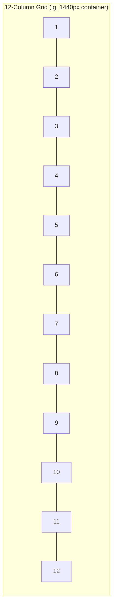

# High-Fidelity Design Specification

## Purpose

Extends [`docs/19_UI_Design_System.md`](../19_UI_Design_System.md) with implementation-precise detail — exact grid math, full color/type scales, elevation, component states, motion timing, and light/dark/print mode values — so no visual decision is left to an implementer's judgment. No images are produced (per Phase 2 scope); every value below is a literal design-token definition.

> Version: 1.0 | Author: ClimateShield Nexus UI/UX Team | Last Updated: 2026-07-27

## Table of Contents

1. [Relationship to docs/19](#relationship-to-docs19)
2. [Grid System](#grid-system)
3. [Spacing Scale](#spacing-scale)
4. [Color Palette — Full Scale](#color-palette--full-scale)
5. [Typography — Full Scale](#typography--full-scale)
6. [Elevation](#elevation)
7. [Component Specifications](#component-specifications)
8. [Icons](#icons)
9. [Animation & Transitions](#animation--transitions)
10. [Loading Indicators](#loading-indicators)
11. [Notification Styles](#notification-styles)
12. [Accessibility Specification](#accessibility-specification)
13. [Responsive Breakpoints](#responsive-breakpoints)
14. [Dark Mode](#dark-mode)
15. [Light Mode](#light-mode)
16. [Print Styles](#print-styles)
17. [References](#references)
18. [Revision History](#revision-history)

## Relationship to docs/19

[`docs/19_UI_Design_System.md`](../19_UI_Design_System.md) is authoritative for design **principles** (why); this document is authoritative for design **values** (exact numbers/hex codes an implementer copies into `tailwind.config`/theme files). Where the two overlap, this document's values win as they are more specific.

## Grid System

- 12-column fluid grid, `max-width: 1440px` container, centered.
- Gutter: 24px (`lg`+), 16px (`md`), 8px (`sm`).
- Margin (outer): 32px (`xl`), 24px (`lg`), 16px (`md`), 12px (`sm`).
- Dashboard layouts use a 12-col grid with common card spans: full (12), half (6), third (4), quarter (3).
- GIS/map views break the grid — map fills the content region edge-to-edge with floating panels (layer control, legend) at fixed 16px insets.

## Spacing Scale

8px base unit, matching [`docs/19_UI_Design_System.md#spacing--layout-grid`](../19_UI_Design_System.md#spacing--layout-grid):

| Token | Value | Typical Use |
|---|---|---|
| `space.0` | 0px | Reset |
| `space.1` | 4px | Icon-to-label gap |
| `space.2` | 8px | Tight stack spacing |
| `space.3` | 12px | Form field internal padding |
| `space.4` | 16px | Card internal padding, default stack gap |
| `space.6` | 24px | Section gap |
| `space.8` | 32px | Page-level vertical rhythm |
| `space.12` | 48px | Major section separation |
| `space.16` | 64px | Landing-page hero spacing |

## Color Palette — Full Scale

Base palette from [`docs/19_UI_Design_System.md#color-system`](../19_UI_Design_System.md#color-system), expanded to full 50-900 scales for implementation:

| Scale | 50 | 100 | 300 | 500 | 600 (base) | 700 | 900 |
|---|---|---|---|---|---|---|---|
| Primary (blue) | #EAF3FB | #DCEBF8 | #7EB3DE | #2E80B8 | #0B5FA5 | #094C85 | #062F52 |
| Neutral (gray) | #F9FAFB | #F3F4F6 | #D1D5DB | #9CA3AF | #6B7280 | #4B5563 | #14181F |
| Success (green) | #EAF7F1 | #D2EFE1 | #6FC49B | #2FA070 | #1D8A5A | #146843 | #0B3D28 |
| Warning (amber) | #FBF3E1 | #F5E4BE | #D9AE4E | #C09225 | #B7791F | #8F5E18 | #533610 |
| Danger (red) | #FBEAE8 | #F5D0CC | #DE8A80 | #C64A3B | #B42318 | #8C1B12 | #52100B |
| Info (indigo) | #EAF0FE | #D6E2FD | #90ABF7 | #4A73EF | #2563EB | #1D4EBD | #142F70 |

Severity scale (fixed hex, not derived from base palette, for colorblind-safety per [`docs/19_UI_Design_System.md#risk-severity-color-scale`](../19_UI_Design_System.md#risk-severity-color-scale)): Low `#2E7D6B`, Moderate `#C9A227`, High `#D9730D`, Severe `#C0392B`, Extreme `#8E1B3C`.

## Typography — Full Scale

| Token | Size / Line-height | Weight | Use |
|---|---|---|---|
| `type.display` | 36px / 44px | 700 | Landing page hero only |
| `type.h1` | 28px / 36px | 700 | Page titles |
| `type.h2` | 22px / 30px | 600 | Section headers |
| `type.h3` | 18px / 26px | 600 | Card/panel headers |
| `type.body` | 16px / 24px | 400 | Default body |
| `type.body-strong` | 16px / 24px | 600 | Emphasized inline text |
| `type.small` | 14px / 20px | 400 | Secondary/meta text |
| `type.caption` | 12px / 16px | 500 | Timestamps, source attribution |
| `type.data-lg` | 32px / 36px | 700 mono | KPI tile primary value |
| `type.data-md` | 20px / 26px | 600 mono | Table numeric cells |

Font families: `Inter` (UI), `Noto Sans` (Swahili diacritic fallback), `JetBrains Mono` (data/coordinates) — per [`docs/19_UI_Design_System.md#typography`](../19_UI_Design_System.md#typography).

## Elevation

| Token | Shadow | Use |
|---|---|---|
| `elevation.0` | none | Flat page background |
| `elevation.1` | `0 1px 2px rgba(20,24,31,0.06)` | Cards at rest |
| `elevation.2` | `0 2px 8px rgba(20,24,31,0.10)` | Hovered card, dropdown menu |
| `elevation.3` | `0 8px 24px rgba(20,24,31,0.14)` | Modal, popover |
| `elevation.4` | `0 16px 40px rgba(20,24,31,0.18)` | Toast/notification stack |

Dark mode uses the same shadow shape at higher opacity (see [Dark Mode](#dark-mode)) since shadows read differently against dark surfaces.

## Component Specifications

### Cards
- Radius `radius.md` (8px), padding `space.4` (16px), elevation `elevation.1` at rest / `elevation.2` on hover (interactive cards only).
- Header row: `type.h3` title + optional overflow menu, right-aligned.
- `DataSourceFooter` ([`docs/19_UI_Design_System.md#key-components`](../19_UI_Design_System.md#key-components)) always present on any card displaying climate/risk data.

### Buttons
| Variant | Background | Text | Use |
|---|---|---|---|
| Primary | `primary.600` | white | Main CTA, one per view |
| Secondary | transparent, 1px `neutral.300` border | `neutral.900` | Secondary actions |
| Destructive | `danger.600` | white | Reject alert, delete role |
| Ghost | transparent | `primary.600` | Tertiary/inline actions |
| Icon-only | transparent, `radius.md` hit area ≥ 40x40px | — | Toolbar actions, always with `aria-label` |

States: rest, hover (`elevation` +1 step or 8% darken), active (4% darken), focus (2px `primary.600` outline offset 2px), disabled (40% opacity, no pointer).

### Inputs
- Height 40px, `radius.sm` (6px), 1px `neutral.300` border, `space.3` internal padding.
- Focus: 2px `primary.600` outline; Error: 1px `danger.600` border + `type.caption` error text below in `danger.600` with an alert icon (never color alone, per [`docs/19_UI_Design_System.md#accessibility-standards`](../19_UI_Design_System.md#accessibility-standards)).
- Label always above the field, never placeholder-only (WCAG 1.3.1 / 3.3.2).

### Dropdowns / Select
- Trigger matches Input spec; menu panel `elevation.2`, `radius.md`, max-height 320px with internal scroll, keyboard-navigable (arrow keys + type-ahead).

### Tables
- Row height 48px (desktop), sticky header, zebra striping off by default (rely on row-hover `neutral.50` highlight instead, cleaner for dense climate data tables).
- Numeric columns right-aligned, `type.data-md` font.
- Sortable column headers show a directional caret; multi-column sort via shift-click.
- Row-level actions in a trailing "..." menu; bulk actions via leading checkbox column + contextual action bar.

### Charts
- Library-agnostic spec: line charts for time series (observations, forecasts), bar charts for categorical comparison (risk by county), choropleth for spatial severity.
- Chart colors always draw from the Severity scale when representing hazard data, from the Primary/Info scale otherwise — never arbitrary chart-library defaults.
- Every chart has an accessible data table fallback (`<table>` visually hidden but screen-reader-reachable) per [`NFR-UX-001`](../05_Non_Functional_Requirements.md#usability--accessibility).

### Maps
- Base style: light, low-saturation basemap so overlay data (hazard layers) remains the visual focus.
- Layer legend: fixed bottom-left panel, collapsible, always shows active layers with the Severity scale swatches.
- Zoom control top-left; attribution bottom-right (required for satellite/basemap provider compliance).

### Dialogs / Modals
- Max-width 560px (standard), 800px (wide, e.g., alert detail with map preview), centered, `elevation.3`.
- Always keyboard-trap focus within, `Esc` closes (unless a destructive in-progress action is running), returns focus to the triggering element on close.

### Forms
- Single-column at `sm`/`md`; two-column allowed at `lg`+ only for clearly paired fields (e.g., date range).
- Inline validation on blur; submit button disabled until required fields valid, but never hidden (so screen readers can announce why it's disabled).

## Icons

24px grid, 2px stroke, line style (per [`docs/19_UI_Design_System.md#iconography`](../19_UI_Design_System.md#iconography)). Full icon inventory tracked in [`docs/assets/01_Asset_Manifest.md`](../assets/01_Asset_Manifest.md).

## Animation & Transitions

| Token | Duration | Easing | Use |
|---|---|---|---|
| `motion.fast` | 100ms | ease-out | Hover/focus state changes |
| `motion.base` | 200ms | ease-in-out | Panel expand/collapse, dropdown open |
| `motion.slow` | 300ms | ease-in-out | Modal/dialog enter-exit, page transition |
| `motion.map` | 500ms | ease-in-out | Map fly-to/zoom transitions |

All durations honor `prefers-reduced-motion: reduce` by dropping to `0ms` with an opacity-only cross-fade, per [`docs/19_UI_Design_System.md#accessibility-standards`](../19_UI_Design_System.md#accessibility-standards).

## Loading Indicators

| Pattern | Use |
|---|---|
| Skeleton blocks | Dashboard cards, tables on initial load (matches final layout shape) |
| Spinner (16px inline) | Button in-progress state |
| Progress bar (determinate) | Report generation, bulk import |
| Map tile shimmer | GIS layer loading, non-blocking (map remains interactive) |

Never a full-page blocking spinner for authenticated views — partial content (e.g., sidebar, chrome) always renders immediately; only data regions show loading state.

## Notification Styles

| Type | Style | Duration |
|---|---|---|
| Toast — success | `success.600` left border, check icon | Auto-dismiss 4s |
| Toast — error | `danger.600` left border, alert icon | Manual dismiss |
| Toast — info | `info.600` left border, info icon | Auto-dismiss 6s |
| `AlertBanner` (hazard) | Full-width, severity-colored per [Severity scale](#color-palette--full-scale), icon + label | Persistent until resolved/dismissed (Severe/Extreme cannot be dismissed, per [`docs/19_UI_Design_System.md#key-components`](../19_UI_Design_System.md#key-components)) |

## Accessibility Specification

Extends [`docs/19_UI_Design_System.md#accessibility-standards`](../19_UI_Design_System.md#accessibility-standards):

- Minimum hit target 44x44px (WCAG 2.5.5) on touch/mobile contexts, 40x40px minimum on desktop pointer contexts.
- Focus order follows visual/DOM reading order in all layouts including the 12-column grid — no CSS-order tricks that break tab sequence.
- Every icon-only control has `aria-label`; every data visualization has a text alternative (see [Charts](#charts)).
- Form errors announced via `aria-live="polite"` region adjacent to the form.

## Responsive Breakpoints

Restated from [`docs/19_UI_Design_System.md#responsive-breakpoints`](../19_UI_Design_System.md#responsive-breakpoints) with layout behavior:

| Breakpoint | Width | Sidebar | Grid |
|---|---|---|---|
| `sm` | 360px+ | Hidden, hamburger drawer | 4-column |
| `md` | 768px+ | Icon-rail collapsed | 8-column |
| `lg` | 1024px+ | Full, expandable | 12-column |
| `xl` | 1440px+ | Full, pinned | 12-column, wider gutters |

## Dark Mode

Deferred to post-MVP per [`docs/19_UI_Design_System.md#dark-mode`](../19_UI_Design_System.md#dark-mode), but full token pairs are pre-defined so no redesign is needed when enabled:

| Token | Light | Dark |
|---|---|---|
| `surface.base` | #FFFFFF | #14181F |
| `surface.raised` | #F9FAFB | #1D222C |
| `text.primary` | #14181F | #F3F4F6 |
| `text.secondary` | #6B7280 | #9CA3AF |
| `border.default` | #D1D5DB | #3A404C |
| Severity scale | unchanged (already high-contrast) | unchanged |

## Light Mode

Light is the default and only mode shipped at MVP — all values in [Color Palette](#color-palette--full-scale) and [Component Specifications](#component-specifications) above are the light-mode values.

## Print Styles

Applies to Report Viewer and any "Print" action:

- Sidebar, Top Nav, notification/quick-action controls hidden (`@media print`).
- Charts render as static (already-rendered) images, not interactive canvases.
- Color severity scale retained (printers increasingly support color; a grayscale-safe pattern/hatch fallback is layered per hazard icon shape, matching [`docs/19_UI_Design_System.md#risk-severity-color-scale`](../19_UI_Design_System.md#risk-severity-color-scale) icon-shape redundancy).
- Page header/footer: report title, generation timestamp, data source attribution, page number — mandatory on every printed page per [`SRS-RPT-004`](../04_Functional_Requirements.md#climate-reports).

## References

- [`docs/19_UI_Design_System.md`](../19_UI_Design_System.md)
- [`docs/prototype/`](../prototype/)
- [`docs/assets/01_Asset_Manifest.md`](../assets/01_Asset_Manifest.md)

## Revision History

| Version | Date | Author | Change |
|---|---|---|---|
| 1.0 | 2026-07-27 | ClimateShield Nexus UI/UX Team | Initial version (Phase 2 visual design package) |
