# User Flows

## Purpose

Mermaid flowcharts for every primary user journey through ClimateShield Nexus, from the user's perspective (decisions and screens), complementing the technical [Sequence Diagrams](10_Sequence_Diagrams_Extended.md) and the screen-level [Wireflows](../21_Wireflows.md). Screens referenced are specified in [`docs/prototype/`](../prototype/).

> Version: 1.0 | Author: ClimateShield Nexus UI/UX Team | Last Updated: 2026-07-27

## Table of Contents

1. [Login](#login)
2. [Registration](#registration)
3. [Forgot Password](#forgot-password)
4. [Dashboard Access](#dashboard-access)
5. [Role Assignment](#role-assignment)
6. [Climate Data Upload](#climate-data-upload)
7. [Climate Processing](#climate-processing)
8. [Forecast Generation](#forecast-generation)
9. [Risk Assessment](#risk-assessment)
10. [GIS Visualization](#gis-visualization)
11. [AI Assistant](#ai-assistant)
12. [Report Generation](#report-generation)
13. [Alert Generation](#alert-generation)
14. [Notification Delivery](#notification-delivery)
15. [Administration](#administration)
16. [Backup](#backup)
17. [Recovery](#recovery)
18. [Maintenance](#maintenance)
19. [References](#references)
20. [Revision History](#revision-history)

## Login

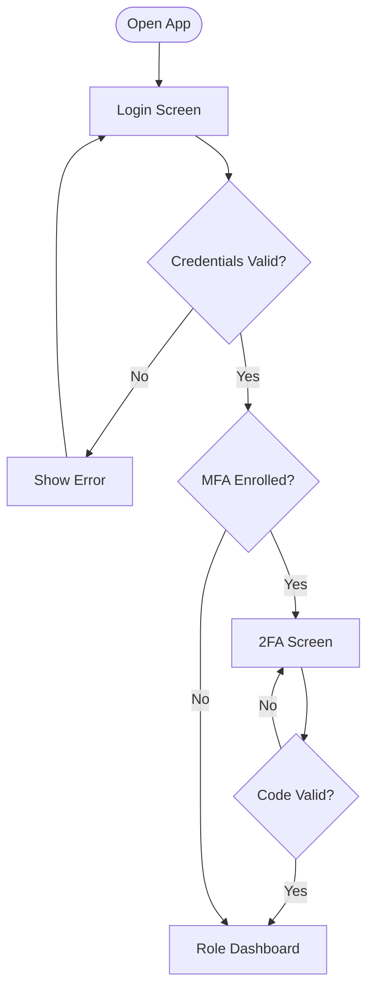

## Registration

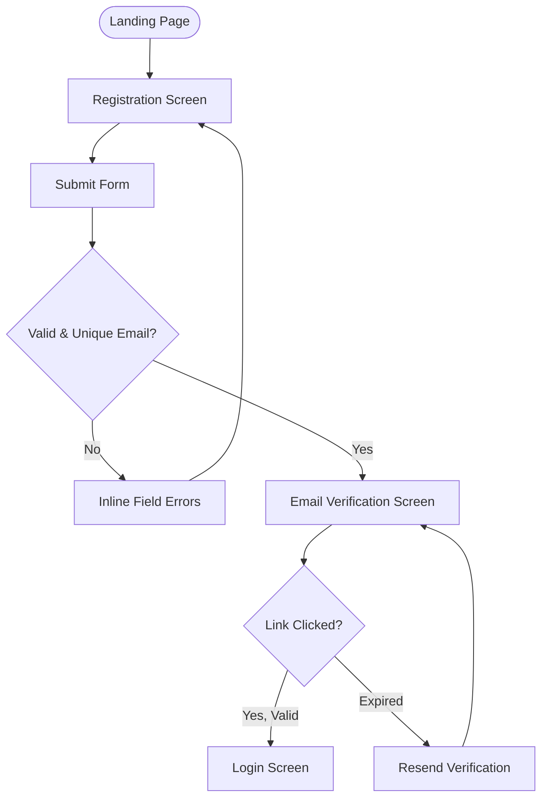

## Forgot Password

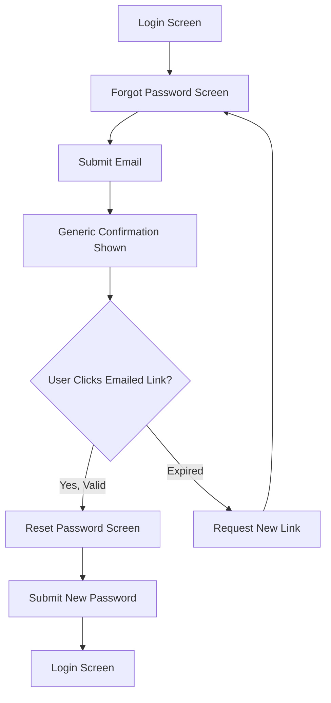

## Dashboard Access

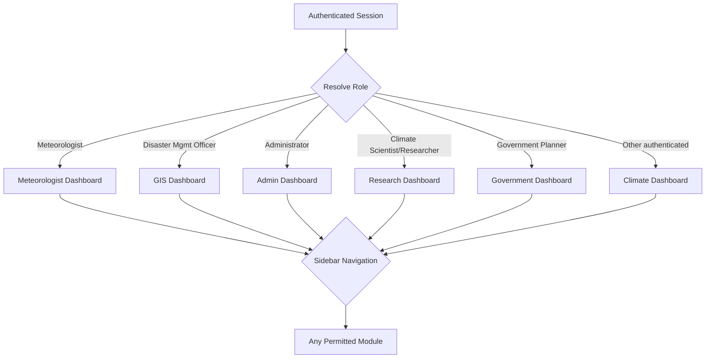

## Role Assignment

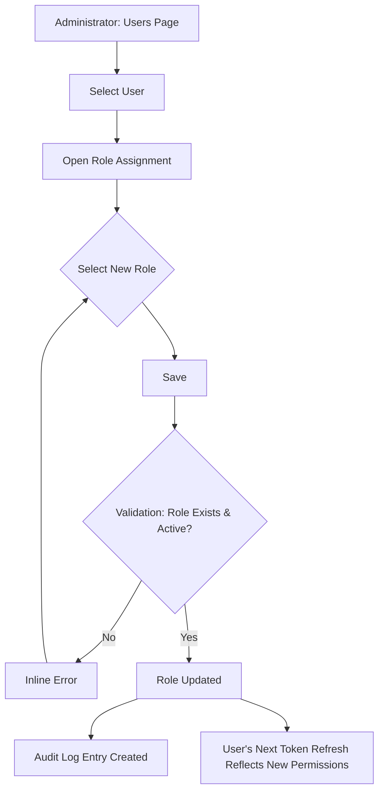

## Climate Data Upload

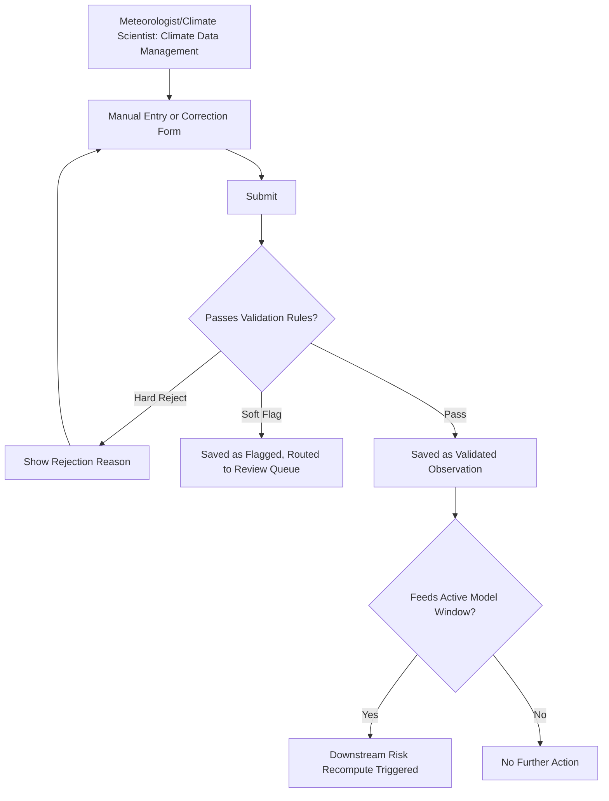

## Climate Processing

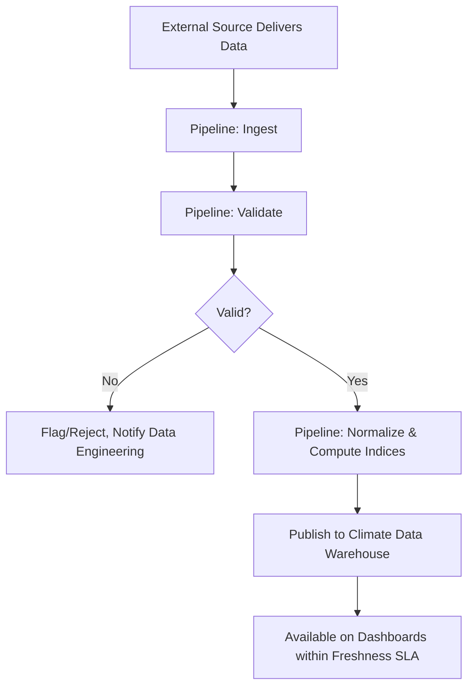

## Forecast Generation

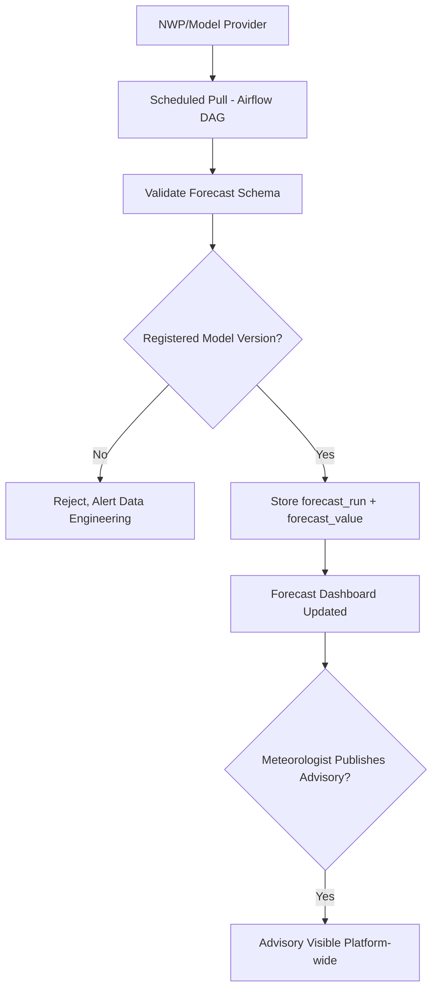

## Risk Assessment

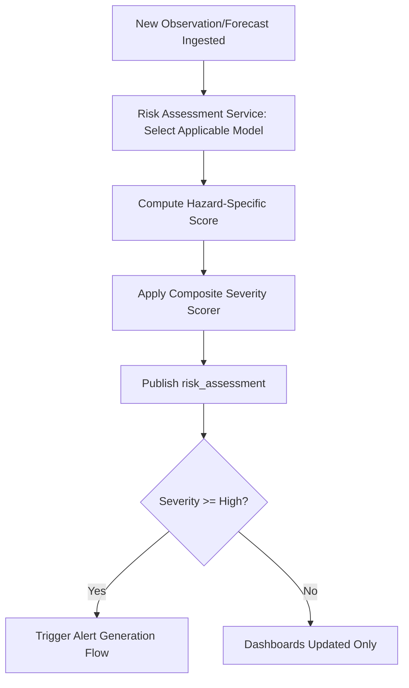

## GIS Visualization

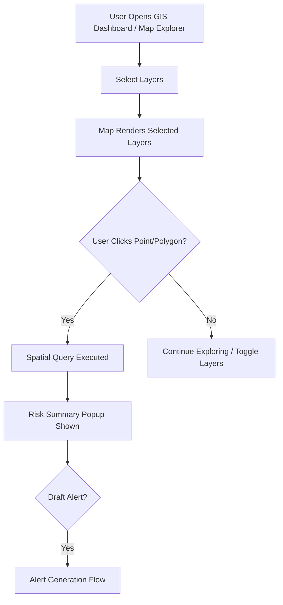

## AI Assistant

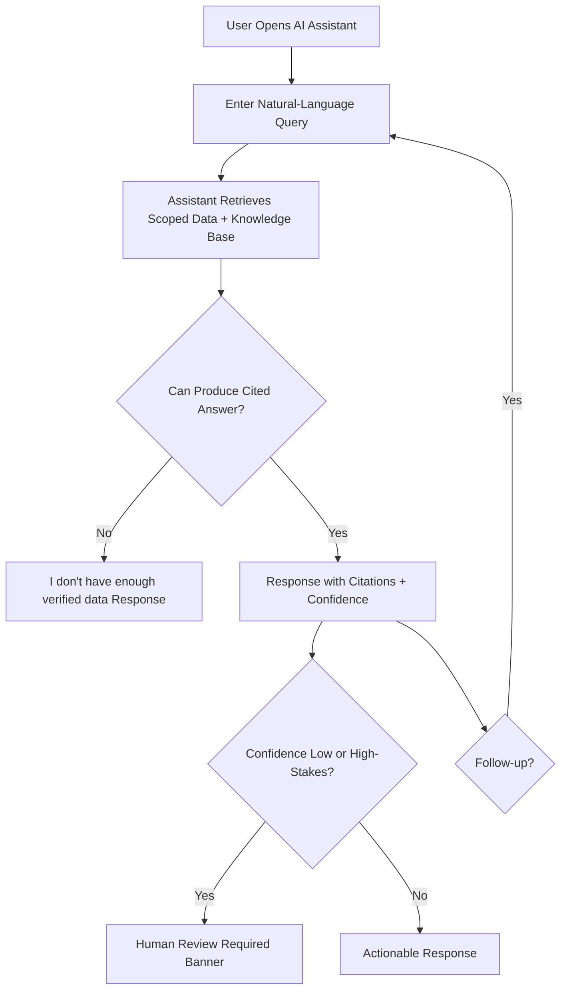

## Report Generation

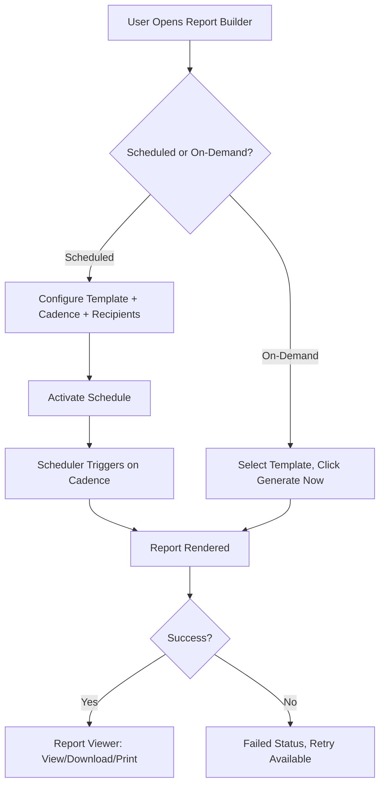

## Alert Generation

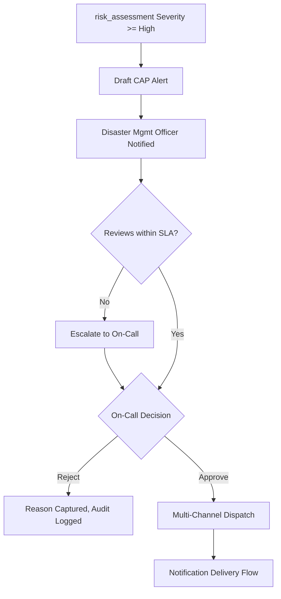

## Notification Delivery

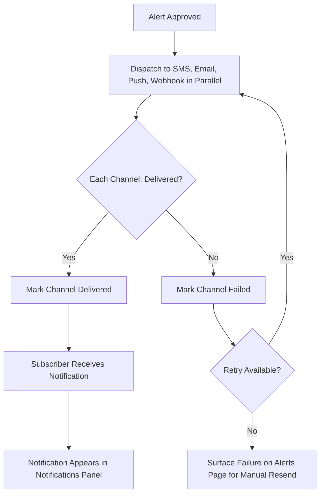

## Administration

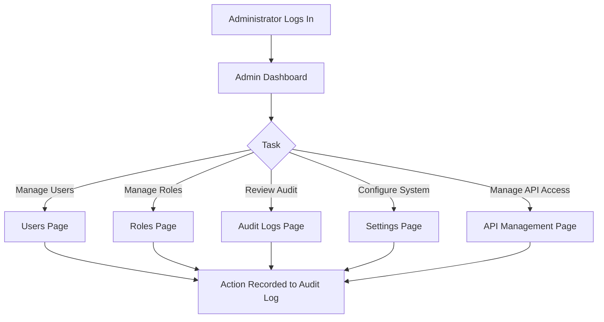

## Backup

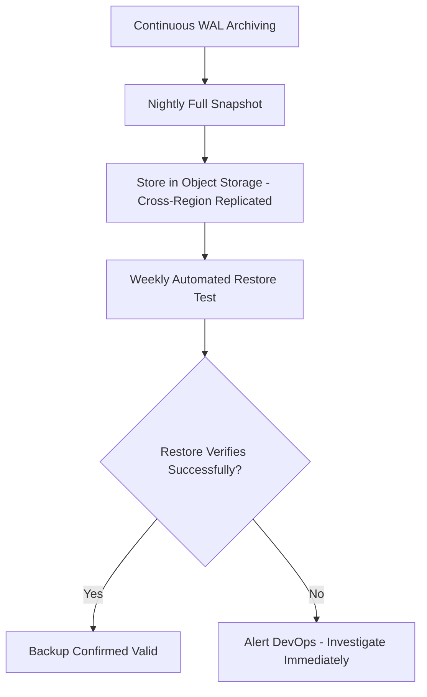

## Recovery

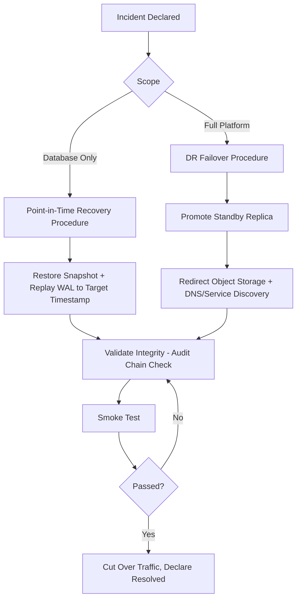

## Maintenance

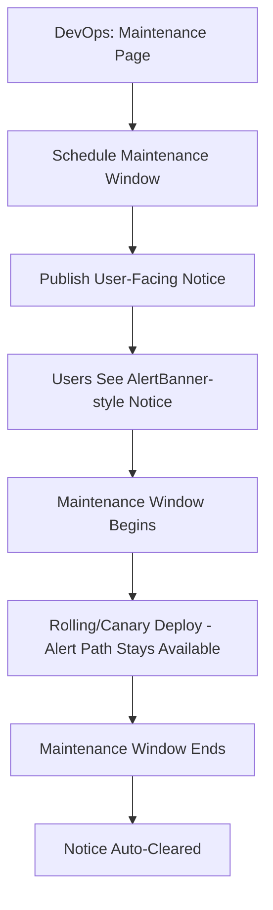

## References

- [`docs/21_Wireflows.md`](../21_Wireflows.md)
- [`docs/prototype/`](../prototype/)
- [`10_Sequence_Diagrams_Extended.md`](10_Sequence_Diagrams_Extended.md)
- [`docs/11_Use_Cases.md`](../11_Use_Cases.md)

## Revision History

| Version | Date | Author | Change |
|---|---|---|---|
| 1.0 | 2026-07-27 | ClimateShield Nexus UI/UX Team | Initial version (Phase 2 visual design package) |
