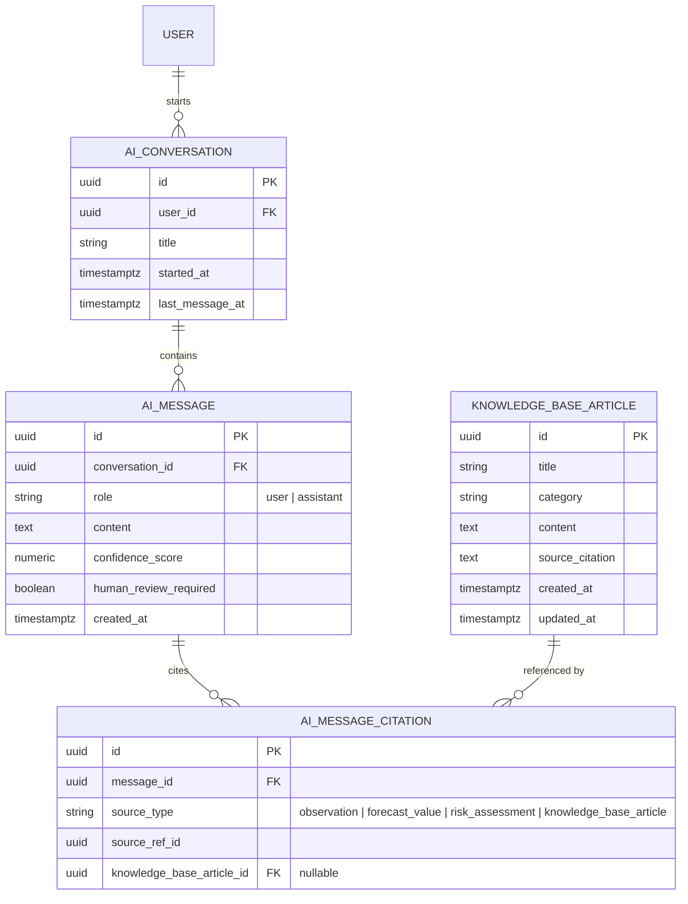
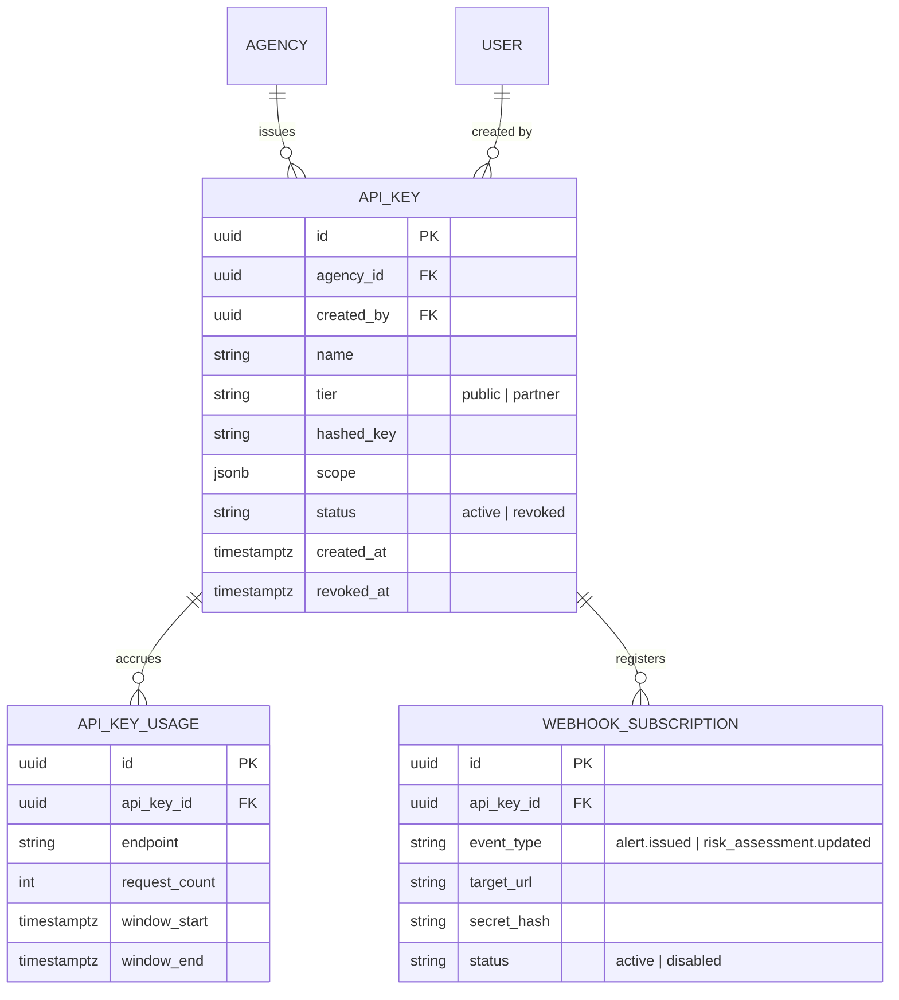
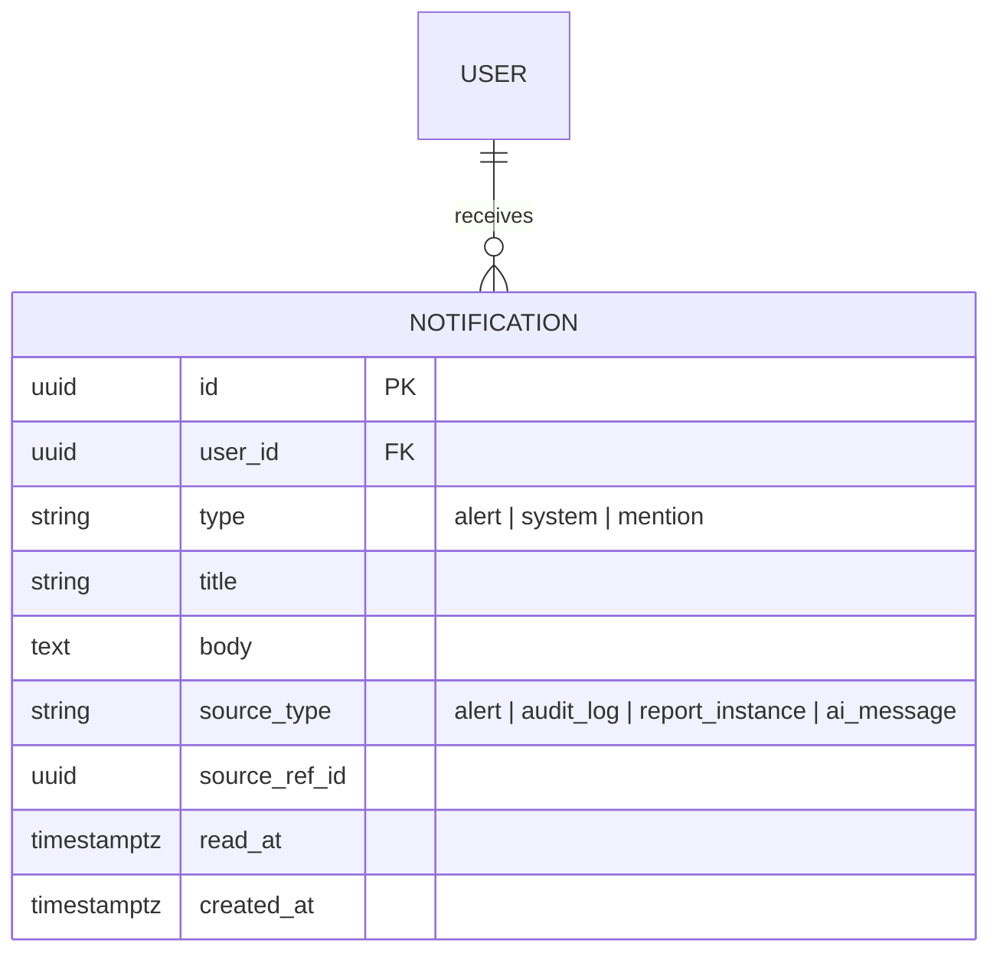
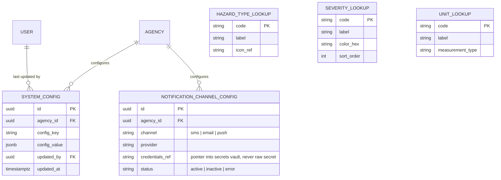
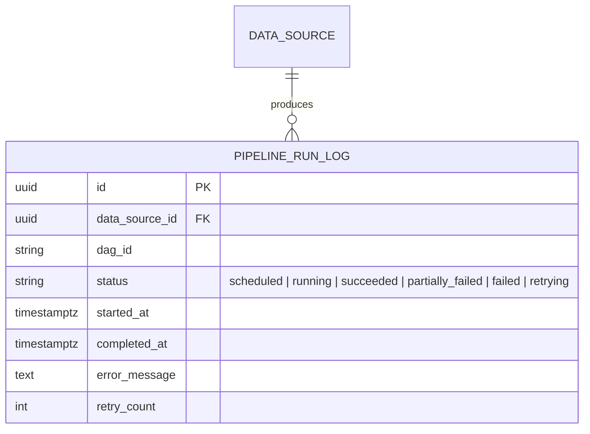

# Complete Enterprise ERD

## Purpose

Extends [`docs/07_ERD.md`](../07_ERD.md) into a single, complete enterprise Entity Relationship Diagram covering every entity in the system — including the AI, API management, in-app notification, configuration, and lookup entities not detailed in the Phase 1 core document — with primary keys, foreign keys, cardinality, and constraints fully specified. Column-level types/constraints for the entities introduced here follow the same conventions as [`docs/09_Database_Dictionary.md#conventions`](../09_Database_Dictionary.md#conventions).

> Version: 1.0 | Author: ClimateShield Nexus Database Architecture Team | Last Updated: 2026-07-27

## Table of Contents

1. [Relationship to docs/07_ERD.md](#relationship-to-docs07_erdmd)
2. [AI & Knowledge Base Entities](#ai--knowledge-base-entities)
3. [API Management & Integration Entities](#api-management--integration-entities)
4. [In-App Notification Entities](#in-app-notification-entities)
5. [Configuration & Lookup Entities](#configuration--lookup-entities)
6. [Pipeline Run Log Entities](#pipeline-run-log-entities)
7. [Full Enterprise ERD (Master Diagram)](#full-enterprise-erd-master-diagram)
8. [Constraint & Index Summary — New Entities](#constraint--index-summary--new-entities)
9. [References](#references)
10. [Revision History](#revision-history)

## Relationship to docs/07_ERD.md

[`docs/07_ERD.md`](../07_ERD.md) is authoritative for: Identity & Access, Climate Data & Forecasting, Risk Assessment, GIS & Spatial, Alerts & Notifications (alert-side), and Reporting & Audit entities. This document adds the entity groups required to make the ERD **complete** per this phase's scope — AI, API Management, in-app Notifications (distinct from hazard Alerts), Configuration, Lookups, and Pipeline logs — then presents everything together in one [master diagram](#full-enterprise-erd-master-diagram).

## AI & Knowledge Base Entities

Implements [`SRS-AI-002`](../04_Functional_Requirements.md#ai-climate-assistant) (mandatory citation) and [`SRS-AI-005`](../04_Functional_Requirements.md#ai-climate-assistant) (human-review flag) at the schema level — `human_review_required` and at-least-one `AI_MESSAGE_CITATION` row are non-optional for any persisted assistant message.

## API Management & Integration Entities

Backs [`SRS-OPS-004`](../04_Functional_Requirements.md#platform-operations) and the webhook mechanism in [`docs/12_API_Specification.md#webhooks`](../12_API_Specification.md#webhooks).

## In-App Notification Entities

`NOTIFICATION` is distinct from `ALERT` (hazard warnings, [`docs/07_ERD.md#alerts--notifications-erd`](../07_ERD.md#alerts--notifications-erd)): a `NOTIFICATION` row is created for *any* platform event relevant to a specific user (including a copy when an `ALERT` reaches them), backing the [Notifications page](../prototype/08_Alerts_and_Notifications_Pages.md#notifications) and Top Nav panel ([`docs/design/01_Information_Architecture.md#notifications-panel`](../design/01_Information_Architecture.md#notifications-panel)).

## Configuration & Lookup Entities

`HAZARD_TYPE_LOOKUP` and `SEVERITY_LOOKUP` are the authoritative source for the `risk_type_enum`/`severity_enum` values used throughout [`docs/09_Database_Dictionary.md#enumerated-types`](../09_Database_Dictionary.md#enumerated-types) — implemented as lookup tables (not hard database enums) specifically so labels/colors/icons can be localized and re-themed per agency ([`docs/01_Project_Vision.md#modularity-for-multi-agency-adoption`](../01_Project_Vision.md#modularity-for-multi-agency-adoption)) without a schema migration.

## Pipeline Run Log Entities

Backs the [Data Pipeline Run Lifecycle](../23_State_Diagrams.md#data-pipeline-run-lifecycle) and the [System Monitoring page](../prototype/10_System_and_Profile_Pages.md#system-monitoring).

## Full Enterprise ERD (Master Diagram)

Every entity across [`docs/07_ERD.md`](../07_ERD.md) and this document, consolidated. Attribute lists are omitted here for readability (see the domain-specific diagrams above and in [`docs/07_ERD.md`](../07_ERD.md) for full columns); this view exists to show **every relationship in one place**.

```mermaid
erDiagram
    AGENCY ||--o{ USER : employs
    AGENCY ||--o{ ROLE : defines
    AGENCY ||--o{ API_KEY : issues
    AGENCY ||--o{ SYSTEM_CONFIG : configures
    AGENCY ||--o{ NOTIFICATION_CHANNEL_CONFIG : configures
    USER }o--|| ROLE : "assigned"
    ROLE ||--o{ ROLE_PERMISSION : grants
    PERMISSION ||--o{ ROLE_PERMISSION : "included in"
    USER ||--o{ USER_SESSION : has
    USER ||--o{ AUDIT_LOG : generates
    USER ||--o{ API_KEY : "created by"
    USER ||--o{ NOTIFICATION : receives
    USER ||--o{ AI_CONVERSATION : starts
    USER ||--o{ ALERT_SUBSCRIPTION : subscribes
    USER ||--o{ REPORT_INSTANCE : requests

    STATION ||--o{ OBSERVATION : records
    DATA_SOURCE ||--o{ OBSERVATION : provides
    DATA_SOURCE ||--o{ FORECAST_RUN : provides
    DATA_SOURCE ||--o{ PIPELINE_RUN_LOG : produces
    FORECAST_MODEL ||--o{ FORECAST_RUN : versions
    FORECAST_RUN ||--o{ FORECAST_VALUE : contains
    OBSERVATION ||--o{ CLIMATE_INDEX : derives

    RISK_MODEL ||--o{ RISK_ASSESSMENT : versions
    ADMIN_BOUNDARY ||--o{ RISK_ASSESSMENT : "scoped to"
    RISK_ASSESSMENT ||--o{ RISK_CONTRIBUTING_SOURCE : cites
    RISK_ASSESSMENT ||--o| ALERT : triggers

    GIS_LAYER ||--o{ GIS_LAYER_VERSION : versions
    GIS_LAYER_VERSION ||--o{ GIS_FEATURE : contains
    SATELLITE_PRODUCT ||--o{ GIS_LAYER_VERSION : "renders as"

    ALERT ||--o{ ALERT_DISPATCH : "dispatched via"
    ALERT ||--o{ NOTIFICATION : "generates copy for"
    ADMIN_BOUNDARY ||--o{ ALERT_SUBSCRIPTION : "scoped to"
    ADMIN_BOUNDARY ||--o{ ALERT : "scoped to"

    REPORT_TEMPLATE ||--o{ REPORT_INSTANCE : generates

    AI_CONVERSATION ||--o{ AI_MESSAGE : contains
    AI_MESSAGE ||--o{ AI_MESSAGE_CITATION : cites
    KNOWLEDGE_BASE_ARTICLE ||--o{ AI_MESSAGE_CITATION : "referenced by"

    API_KEY ||--o{ API_KEY_USAGE : accrues
    API_KEY ||--o{ WEBHOOK_SUBSCRIPTION : registers

    HAZARD_TYPE_LOOKUP ||--o{ RISK_ASSESSMENT : classifies
    HAZARD_TYPE_LOOKUP ||--o{ ALERT : classifies
    SEVERITY_LOOKUP ||--o{ RISK_ASSESSMENT : classifies
    SEVERITY_LOOKUP ||--o{ ALERT : classifies
    UNIT_LOOKUP ||--o{ OBSERVATION : measures
    UNIT_LOOKUP ||--o{ FORECAST_VALUE : measures
```

## Constraint & Index Summary — New Entities

| Entity | Key Constraints | Recommended Index |
|---|---|---|
| `ai_conversation` | `user_id` NOT NULL | BTREE(`user_id`, `last_message_at DESC`) |
| `ai_message` | `confidence_score` in [0,1]; `human_review_required` NOT NULL DEFAULT derived from confidence threshold | BTREE(`conversation_id`, `created_at`) |
| `ai_message_citation` | ≥1 row required per persisted assistant `ai_message` (enforced in application layer per [`SRS-AI-002`](../04_Functional_Requirements.md#ai-climate-assistant), not a DB constraint, since citation count is data-dependent) | BTREE(`message_id`) |
| `api_key` | `hashed_key` UNIQUE; never store raw key | BTREE(`agency_id`, `status`) |
| `api_key_usage` | UNIQUE(`api_key_id`, `endpoint`, `window_start`) | BTREE(`api_key_id`, `window_start DESC`) |
| `notification` | `user_id` NOT NULL | BTREE(`user_id`, `read_at`, `created_at DESC`) |
| `system_config` | UNIQUE(`agency_id`, `config_key`) | BTREE(`agency_id`, `config_key`) |
| `hazard_type_lookup` / `severity_lookup` / `unit_lookup` | `code` PK, seeded at deployment, not user-editable via API | N/A (small, fully cached) |
| `pipeline_run_log` | `status` enum-checked | BTREE(`data_source_id`, `started_at DESC`) |

## References

- [`docs/07_ERD.md`](../07_ERD.md)
- [`docs/09_Database_Dictionary.md`](../09_Database_Dictionary.md)
- [`07_Database_Visual_Model.md`](07_Database_Visual_Model.md)
- [`docs/12_API_Specification.md`](../12_API_Specification.md)

## Revision History

| Version | Date | Author | Change |
|---|---|---|---|
| 1.0 | 2026-07-27 | ClimateShield Nexus Database Architecture Team | Initial version (Phase 2 visual design package) |
