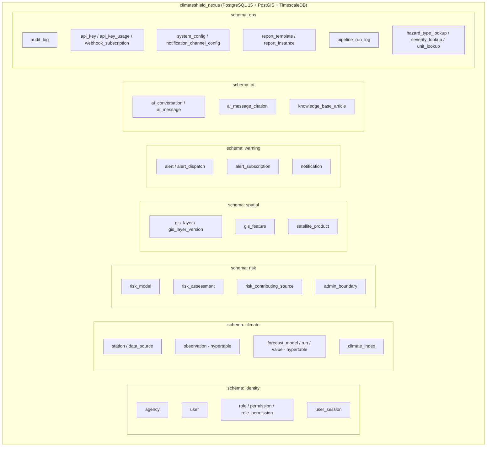
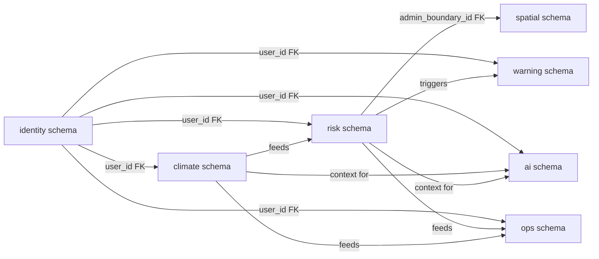
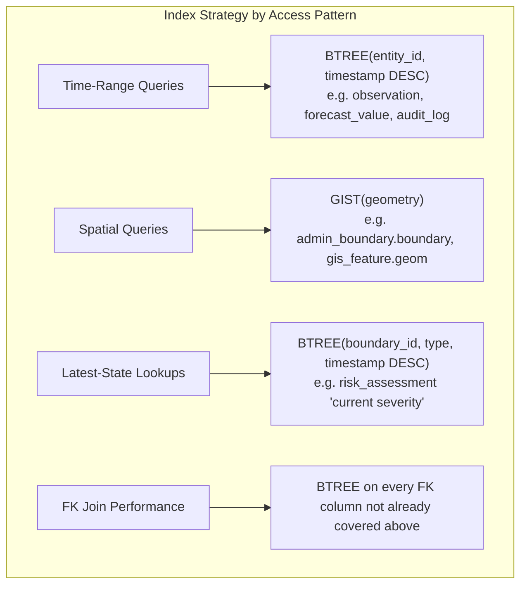
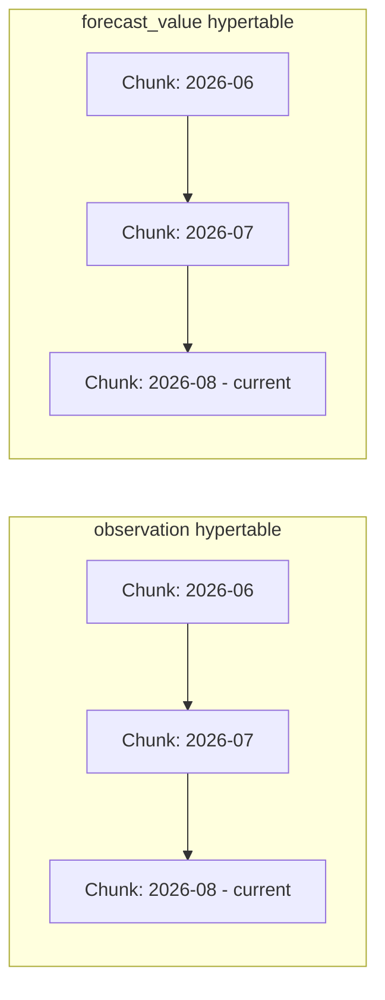
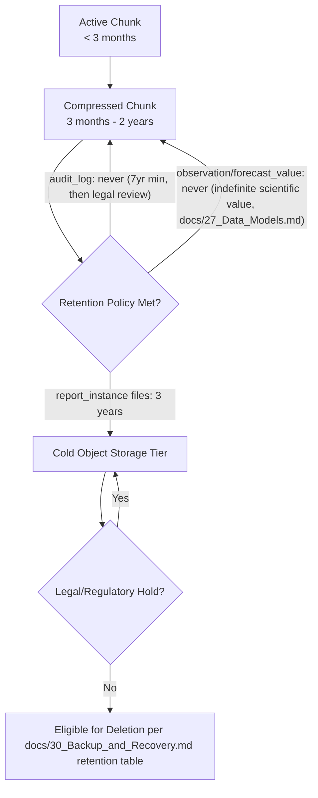

# Database Visual Model

## Purpose

Visualizes the physical database organization — schema/bounded-context layout, relationship groupings, normalization posture, indexing, partitioning, and archival strategy — extending [`docs/09_Database_Dictionary.md`](../09_Database_Dictionary.md) and [ADR-002](../architecture/ADR-002-postgis-timescaledb-data-platform.md) with diagrams.

> Version: 1.0 | Author: ClimateShield Nexus Database Architecture Team | Last Updated: 2026-07-27

## Table of Contents

1. [Schema Layout](#schema-layout)
2. [Relationship Groups](#relationship-groups)
3. [Normalization Posture](#normalization-posture)
4. [Indexing Overview](#indexing-overview)
5. [Partition Strategy](#partition-strategy)
6. [Archive Strategy](#archive-strategy)
7. [References](#references)
8. [Revision History](#revision-history)

## Schema Layout

One physical PostgreSQL database per agency deployment ([ADR-004](../architecture/ADR-004-single-tenant-per-deployment.md)), organized into logical Postgres schemas matching bounded contexts from [`docs/27_Data_Models.md#bounded-contexts`](../27_Data_Models.md#bounded-contexts):

Schema boundaries mirror service ownership ([`docs/06_System_Architecture.md#service-catalog`](../06_System_Architecture.md#service-catalog)) — a service only writes to its own schema, reading cross-schema only through the owning service's API in a future microservice split, matching [ADR-001](../architecture/ADR-001-modular-monolith-to-microservices.md).

## Relationship Groups

Four relationship clusters, matching the [Module Dependency Graph](../39_Module_Breakdown.md#module-dependency-graph):
1. **Identity fan-out** — every schema has a `user_id`/`agency_id` foreign key back to `identity`.
2. **Climate → Risk pipeline** — one-directional data flow, never reversed.
3. **Risk → Spatial join** — via `admin_boundary_id`, not a spatial join on raw geometry (performance: boundary lookup is a simple key join, not a `ST_Contains` on every read).
4. **Risk → Warning trigger** — the only cross-schema write trigger in the system (risk assessment creation may create an alert draft).

## Normalization Posture

| Area | Posture | Rationale |
|---|---|---|
| Identity, Risk, Warning, Ops schemas | 3NF | Transactional integrity matters most (RBAC correctness, audit accuracy, alert approval state) |
| `climate.observation`, `climate.forecast_value` | Denormalized wide rows (one row per parameter reading, not a pivoted table) | Optimized for time-series append/query patterns over strict normalization; parameter/unit still normalized via `unit_lookup` |
| `spatial.gis_feature.properties` | Intentionally denormalized JSONB | Feature properties vary per layer type; forcing a rigid column schema would require a migration per new layer type |
| `ai.ai_message_citation` | 3NF, polymorphic `source_type` + `source_ref_id` | Citations can reference any of several source tables; a single FK column per possible source type was rejected as unmaintainable at scale |

## Indexing Overview

Full column-level index list: [`docs/09_Database_Dictionary.md#indexing-strategy`](../09_Database_Dictionary.md#indexing-strategy).

## Partition Strategy

TimescaleDB hypertables partition the platform's two highest-volume tables by time, per [ADR-002](../architecture/ADR-002-postgis-timescaledb-data-platform.md):

| Table | Chunk Interval | Rationale |
|---|---|---|
| `climate.observation` | 1 month | Balances chunk count vs. per-chunk size at expected national ingestion volume ([`NFR-SCALE-004`](../05_Non_Functional_Requirements.md#scalability)) |
| `climate.forecast_value` | 1 month | Same rationale; forecast horizon (max 10 days + seasonal) never spans more than 2 active chunks |
| `ops.audit_log` | 3 months | Lower write volume than climate tables but long retention (≥7 years) benefits from coarser chunking to limit chunk-table count over time |

Compression policy: chunks older than 3 months are compressed (TimescaleDB native compression) but remain queryable — no data becomes cold/inaccessible without an explicit archive step (see below).

## Archive Strategy

Archive/retention periods per data class are the authoritative values in [`docs/30_Backup_and_Recovery.md#retention-policy`](../30_Backup_and_Recovery.md#retention-policy); this diagram shows the *mechanism* (compress in place → move report/object artifacts to cold storage tier → retention-gated deletion), not new retention numbers.

## References

- [`docs/09_Database_Dictionary.md`](../09_Database_Dictionary.md)
- [`docs/27_Data_Models.md`](../27_Data_Models.md)
- [`docs/30_Backup_and_Recovery.md`](../30_Backup_and_Recovery.md)
- [`docs/architecture/ADR-002-postgis-timescaledb-data-platform.md`](../architecture/ADR-002-postgis-timescaledb-data-platform.md)

## Revision History

| Version | Date | Author | Change |
|---|---|---|---|
| 1.0 | 2026-07-27 | ClimateShield Nexus Database Architecture Team | Initial version (Phase 2 visual design package) |
