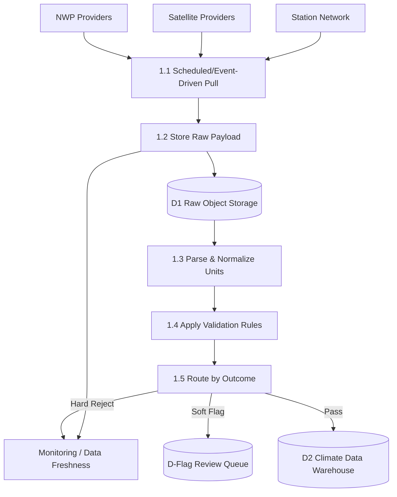
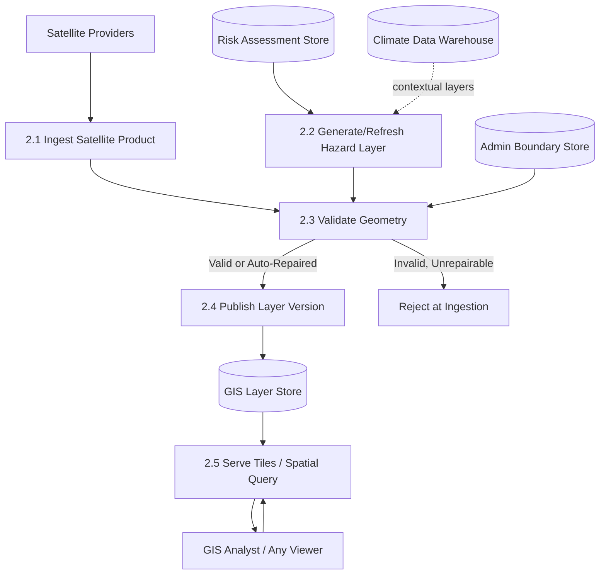
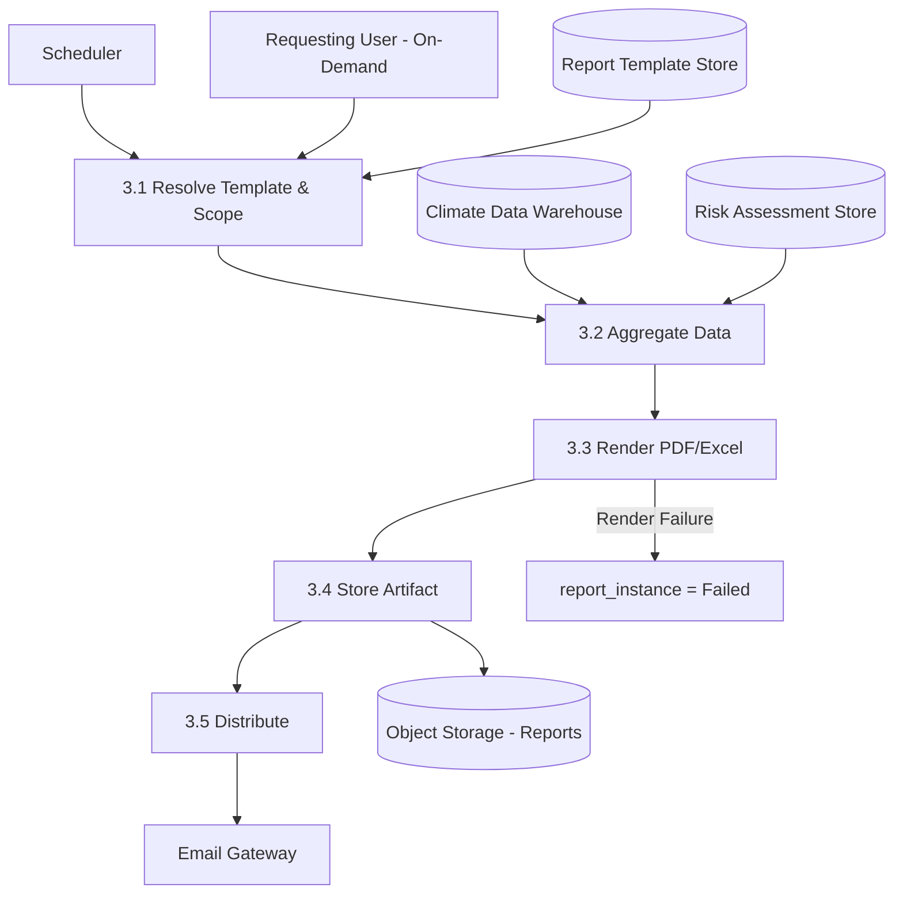
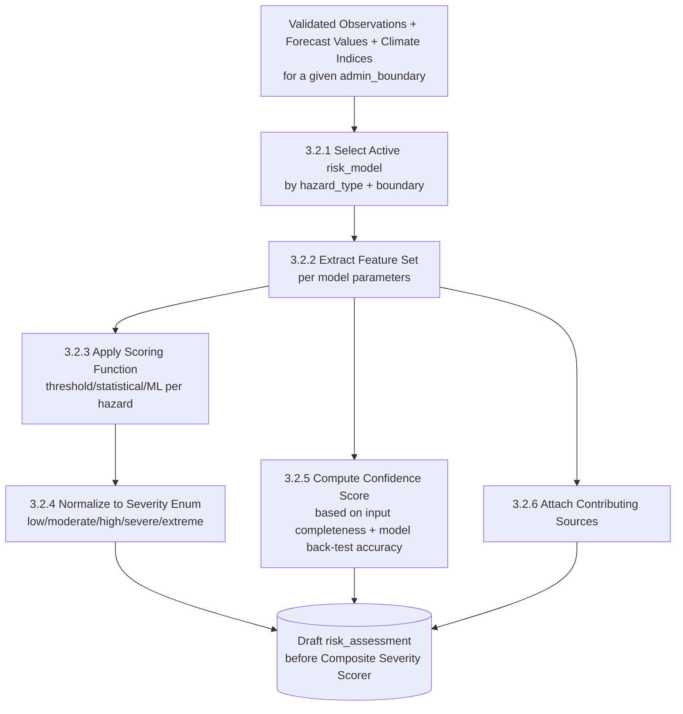

# Data Flow Diagrams — Full Set (Context through Level 3)

## Purpose

Extends [`docs/08_DFD.md`](../08_DFD.md) (Context, Level 0, and Level 1-2 for the Risk/Alerting and AI subsystems) with Level 1-2 decomposition for the three remaining major subsystems — Climate Data Ingestion, GIS, and Reporting — and a Level 3 decomposition of the single most complex process (Risk Scoring internals), demonstrating the decomposition pattern to the depth requested for this phase.

> Version: 1.0 | Author: ClimateShield Nexus Architecture Team | Last Updated: 2026-07-27

## Table of Contents

1. [Relationship to docs/08_DFD.md](#relationship-to-docs08_dfdmd)
2. [Context & Level 0 (Reference)](#context--level-0-reference)
3. [Level 1-2 — Climate Data Ingestion Subsystem](#level-1-2--climate-data-ingestion-subsystem)
4. [Level 1-2 — GIS Subsystem](#level-1-2--gis-subsystem)
5. [Level 1-2 — Reporting Subsystem](#level-1-2--reporting-subsystem)
6. [Level 3 — Risk Scoring Internals](#level-3--risk-scoring-internals)
7. [Subsystem Decomposition Index](#subsystem-decomposition-index)
8. [References](#references)
9. [Revision History](#revision-history)

## Relationship to docs/08_DFD.md

[`docs/08_DFD.md`](../08_DFD.md) already provides: [Context/Level 0](../08_DFD.md#level-0--context-diagram), [Level 1 — Major Processes](../08_DFD.md#level-1--major-processes), [Level 2 — Risk Assessment & Alerting](../08_DFD.md#level-2--risk-assessment--alerting-detail), and [Level 2 — AI Climate Assistant](../08_DFD.md#level-2--ai-climate-assistant-detail). This document does not repeat those; it completes the set.

## Context & Level 0 (Reference)

See [`docs/08_DFD.md#level-0--context-diagram`](../08_DFD.md#level-0--context-diagram) and [`docs/08_DFD.md#level-1--major-processes`](../08_DFD.md#level-1--major-processes) — unchanged, authoritative.

## Level 1-2 — Climate Data Ingestion Subsystem

Validation rule detail: [`docs/28_Validation_Rules.md`](../28_Validation_Rules.md). Review-queue flow: [`UC-02`](../11_Use_Cases.md#uc-02-validate-and-correct-observation-data).

## Level 1-2 — GIS Subsystem

Geometry validation rules: [`docs/28_Validation_Rules.md#gisspatial-validation`](../28_Validation_Rules.md#gisspatial-validation).

## Level 1-2 — Reporting Subsystem

## Level 3 — Risk Scoring Internals

Decomposes Process 3.2 ("Compute Hazard-Specific Score") from [`docs/08_DFD.md#level-2--risk-assessment--alerting-detail`](../08_DFD.md#level-2--risk-assessment--alerting-detail) one level further:

Feeds into Process 3.3 ("Apply Composite Severity Scorer") in [`docs/08_DFD.md#level-2--risk-assessment--alerting-detail`](../08_DFD.md#level-2--risk-assessment--alerting-detail) unchanged. Per-hazard scoring-function detail (flood rainfall-runoff, drought SPI/SPEI, heat index, agriculture composite, infrastructure exposure, population exposure) is documented functionally in [`docs/04_Functional_Requirements.md#risk-assessment`](../04_Functional_Requirements.md#risk-assessment); this DFD shows the common pipeline shape shared by all six.

## Subsystem Decomposition Index

| Subsystem | Context/L0 | Level 1 | Level 2 | Level 3 |
|---|---|---|---|---|
| Whole Platform | [`docs/08_DFD.md`](../08_DFD.md#level-0--context-diagram) | [`docs/08_DFD.md`](../08_DFD.md#level-1--major-processes) | — | — |
| Risk Assessment & Alerting | — | — | [`docs/08_DFD.md`](../08_DFD.md#level-2--risk-assessment--alerting-detail) | [This document](#level-3--risk-scoring-internals) |
| AI Climate Assistant | — | — | [`docs/08_DFD.md`](../08_DFD.md#level-2--ai-climate-assistant-detail) | — (RAG pipeline sequence detail instead: [`docs/22_Sequence_Diagrams.md#sequence-4-ai-assistant-query-with-rag`](../22_Sequence_Diagrams.md#sequence-4-ai-assistant-query-with-rag)) |
| Climate Data Ingestion | — | — | [This document](#level-1-2--climate-data-ingestion-subsystem) | — |
| GIS | — | — | [This document](#level-1-2--gis-subsystem) | — |
| Reporting | — | — | [This document](#level-1-2--reporting-subsystem) | — |

## References

- [`docs/08_DFD.md`](../08_DFD.md)
- [`docs/04_Functional_Requirements.md`](../04_Functional_Requirements.md)
- [`docs/28_Validation_Rules.md`](../28_Validation_Rules.md)

## Revision History

| Version | Date | Author | Change |
|---|---|---|---|
| 1.0 | 2026-07-27 | ClimateShield Nexus Architecture Team | Initial version (Phase 2 visual design package) |
