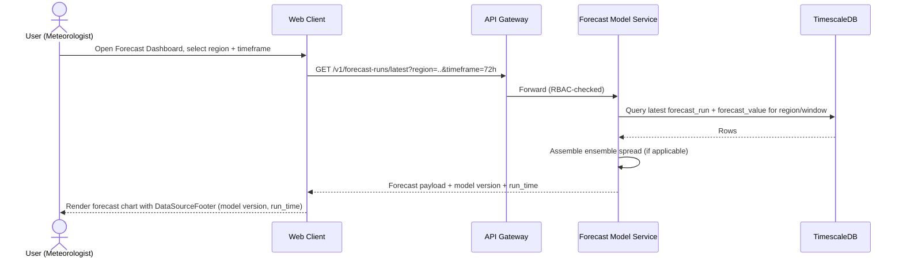
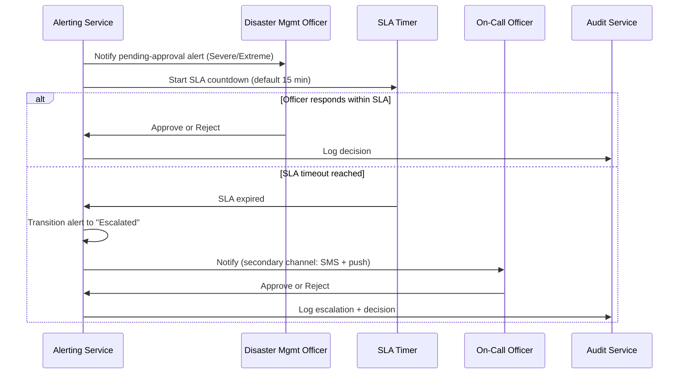
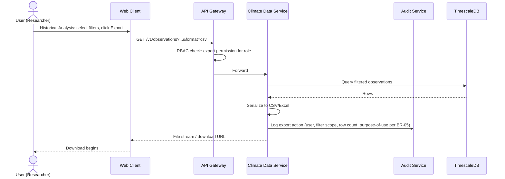
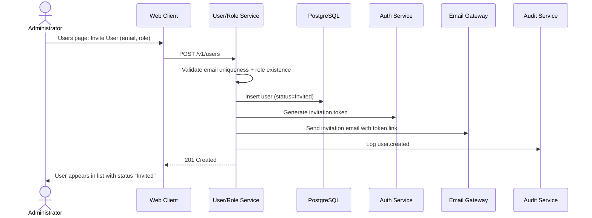
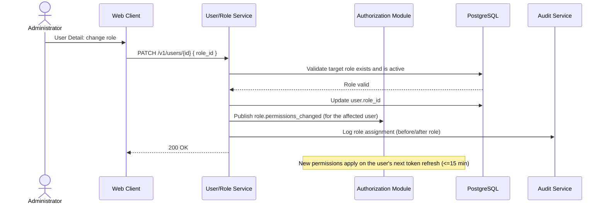
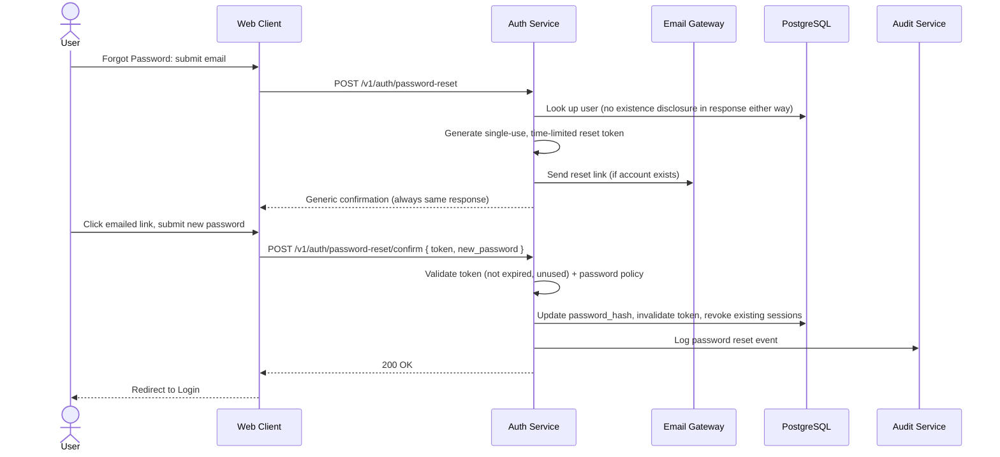
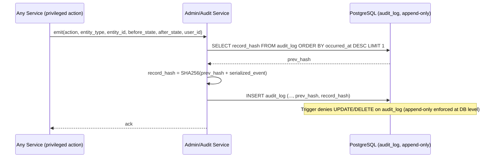

# Sequence Diagrams — Extended Set

## Purpose

Extends [`docs/22_Sequence_Diagrams.md`](../22_Sequence_Diagrams.md) with the remaining sequences requested for the Phase 2 visual design package: Forecast Request, Alert Escalation, Data Import, Data Export, User Creation, Role Assignment, Password Reset, and Audit Logging. Login, Climate Processing, Risk Analysis, AI Query, Report Generation, and GIS Query already have authoritative sequences in the referenced document and are not repeated.

> Version: 1.0 | Author: ClimateShield Nexus Architecture Team | Last Updated: 2026-07-27

## Table of Contents

1. [Coverage Index](#coverage-index)
2. [Forecast Request](#forecast-request)
3. [Alert Escalation](#alert-escalation)
4. [Data Import](#data-import)
5. [Data Export](#data-export)
6. [User Creation](#user-creation)
7. [Role Assignment](#role-assignment)
8. [Password Reset](#password-reset)
9. [Audit Logging](#audit-logging)
10. [References](#references)
11. [Revision History](#revision-history)

## Coverage Index

| Requested Sequence | Location |
|---|---|
| Login | [`docs/22_Sequence_Diagrams.md#sequence-1-user-authentication-with-mfa`](../22_Sequence_Diagrams.md#sequence-1-user-authentication-with-mfa) |
| Forecast Request | [This document](#forecast-request) |
| Climate Processing | [`docs/22_Sequence_Diagrams.md#sequence-3-data-ingestion--validation-pipeline`](../22_Sequence_Diagrams.md#sequence-3-data-ingestion--validation-pipeline) |
| Risk Analysis | [`docs/22_Sequence_Diagrams.md#sequence-2-risk-assessment-recompute--alert-dispatch`](../22_Sequence_Diagrams.md#sequence-2-risk-assessment-recompute--alert-dispatch) |
| AI Query | [`docs/22_Sequence_Diagrams.md#sequence-4-ai-assistant-query-with-rag`](../22_Sequence_Diagrams.md#sequence-4-ai-assistant-query-with-rag) |
| Report Generation | [`docs/22_Sequence_Diagrams.md#sequence-5-automated-report-generation`](../22_Sequence_Diagrams.md#sequence-5-automated-report-generation) |
| Notification (dispatch) | Covered within [`docs/22_Sequence_Diagrams.md#sequence-2-risk-assessment-recompute--alert-dispatch`](../22_Sequence_Diagrams.md#sequence-2-risk-assessment-recompute--alert-dispatch) |
| Alert Escalation | [This document](#alert-escalation) |
| Data Import | [This document](#data-import) |
| Data Export | [This document](#data-export) |
| User Creation | [This document](#user-creation) |
| Role Assignment | [This document](#role-assignment) |
| Password Reset | [This document](#password-reset) |
| Audit Logging | [This document](#audit-logging) |

## Forecast Request



## Alert Escalation



## Data Import

```mermaid
sequenceDiagram
    actor A as Administrator
    participant W as Web Client
    participant USVC as User/Role Service
    participant VALID as Validation Layer
    participant DB as PostgreSQL

    A->>W: Upload CSV (bulk user import)
    W->>USVC: POST /v1/users/bulk-import (file)
    USVC->>VALID: Validate rows (schema, email uniqueness, role existence)
    VALID-->>USVC: Row-level validation report
    USVC->>DB: Insert valid rows only (transactional per-row, not all-or-nothing)
    DB-->>USVC: Insert results
    USVC-->>W: Validation report (success/failed rows + reasons)
    W-->>A: Render report; failed rows downloadable for correction/retry
```

## Data Export



## User Creation



## Role Assignment



## Password Reset



## Audit Logging



Backs [`docs/13_Security_Design.md#audit-integrity`](../13_Security_Design.md#audit-integrity); the daily integrity-verification job re-walks this hash chain independently (see [Security Diagrams — Audit Flow](17_Security_Diagrams.md#audit-flow)).

## References

- [`docs/22_Sequence_Diagrams.md`](../22_Sequence_Diagrams.md)
- [`docs/12_API_Specification.md`](../12_API_Specification.md)
- [`docs/13_Security_Design.md`](../13_Security_Design.md)

## Revision History

| Version | Date | Author | Change |
|---|---|---|---|
| 1.0 | 2026-07-27 | ClimateShield Nexus Architecture Team | Initial version (Phase 2 visual design package) |
