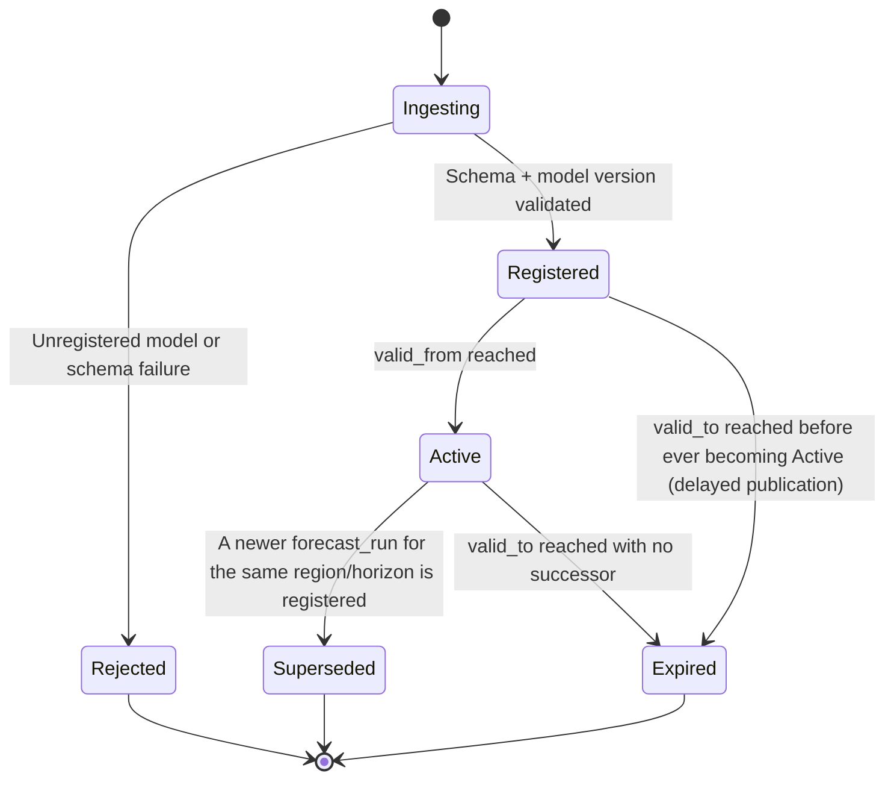
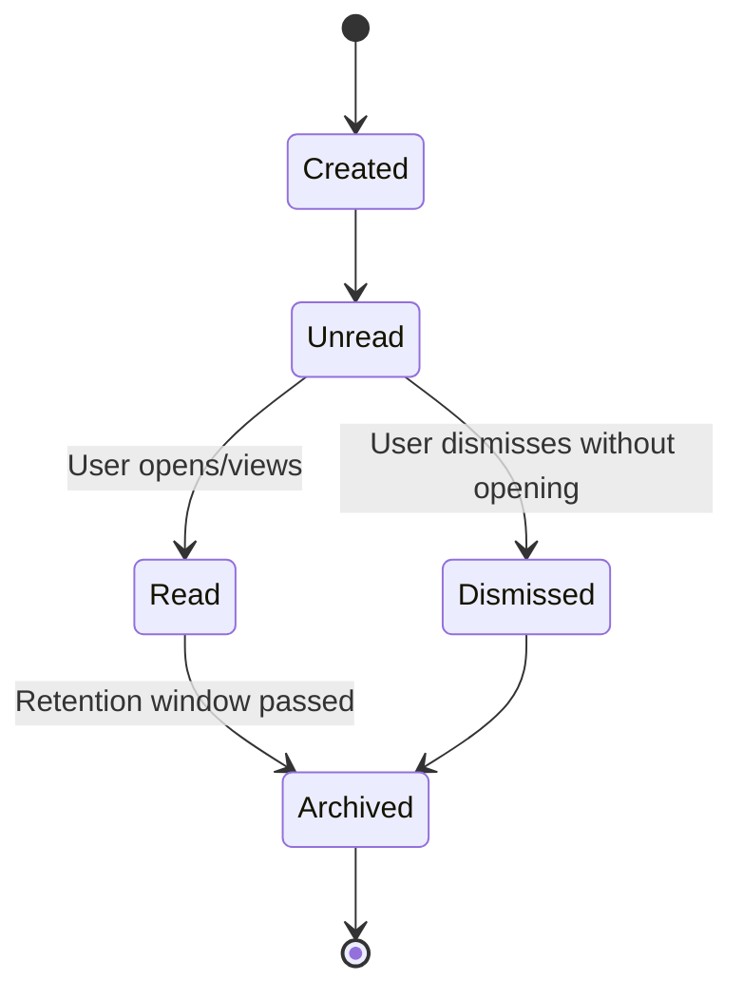
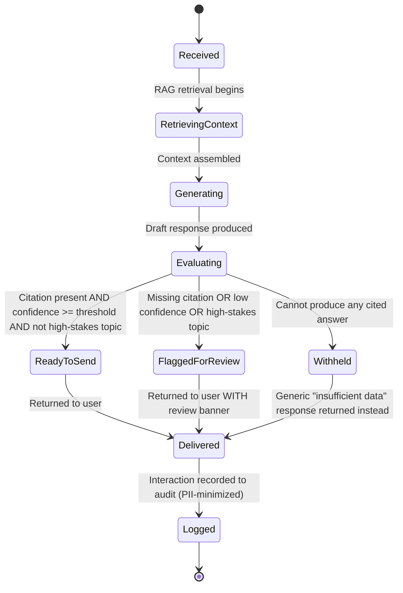

# State Diagrams — Extended Set

## Purpose

Extends [`docs/23_State_Diagrams.md`](../23_State_Diagrams.md) with the three lifecycle state machines not yet covered — Forecast, Notification, and AI Job — completing the full set requested for this phase (User, Forecast, Dataset, Alert, Notification, Report, Risk Assessment, AI Job, Processing Job).

> Version: 1.0 | Author: ClimateShield Nexus Architecture Team | Last Updated: 2026-07-27

## Table of Contents

1. [Coverage Index](#coverage-index)
2. [Forecast Lifecycle](#forecast-lifecycle)
3. [Notification Lifecycle](#notification-lifecycle)
4. [AI Job Lifecycle](#ai-job-lifecycle)
5. [References](#references)
6. [Revision History](#revision-history)

## Coverage Index

| Requested State Diagram | Location |
|---|---|
| User | [`docs/23_State_Diagrams.md#user-account-lifecycle`](../23_State_Diagrams.md#user-account-lifecycle) |
| Forecast | [This document](#forecast-lifecycle) |
| Dataset | [`docs/23_State_Diagrams.md#observation-correction-lifecycle`](../23_State_Diagrams.md#observation-correction-lifecycle) |
| Alert | [`docs/23_State_Diagrams.md#alert-lifecycle`](../23_State_Diagrams.md#alert-lifecycle) |
| Notification | [This document](#notification-lifecycle) |
| Report | [`docs/23_State_Diagrams.md#report-instance-lifecycle`](../23_State_Diagrams.md#report-instance-lifecycle) |
| Risk Assessment | [`docs/23_State_Diagrams.md#risk-assessment-lifecycle`](../23_State_Diagrams.md#risk-assessment-lifecycle) |
| AI Job | [This document](#ai-job-lifecycle) |
| Processing Job | [`docs/23_State_Diagrams.md#data-pipeline-run-lifecycle`](../23_State_Diagrams.md#data-pipeline-run-lifecycle) |

## Forecast Lifecycle

Lifecycle of a `forecast_run` (distinct from the generic Data Pipeline Run Lifecycle — this tracks the forecast's *validity/usefulness* over time, not its ingestion mechanics):

`Active` is the only state in which a `forecast_run`'s values are surfaced as the primary forecast on the [Forecast Dashboard](../prototype/03_Core_Dashboards.md#forecast-dashboard); `Superseded`/`Expired` runs remain queryable for model-comparison purposes ([`docs/14_Testing_Strategy.md#module-specific-testing-considerations`](../14_Testing_Strategy.md#module-specific-testing-considerations)) but are not shown by default.

## Notification Lifecycle

Lifecycle of an individual `notification` row (in-app, per-user — distinct from the hazard `Alert` lifecycle it may originate from):

A `notification` is created for the receiving user the moment its source event occurs (e.g., `alert.issued`, `report.generated`, `audit.recorded` for a relevant admin); it does not have its own approval/delivery sub-states — those belong to the source (`Alert`'s `alert_dispatch` records the channel-delivery status separately, per [`docs/07_ERD.md#alerts--notifications-erd`](../07_ERD.md#alerts--notifications-erd)).

## AI Job Lifecycle

Lifecycle of a single AI Assistant query (`ai_message` generation job):

Implements the Failure Condition defined in [`docs/design/03_Module_Specifications.md#ai-climate-assistant`](../design/03_Module_Specifications.md#ai-climate-assistant): the `Withheld` path is a first-class, expected outcome — not an error state — whenever the Assistant cannot ground its answer in cited data.

## References

- [`docs/23_State_Diagrams.md`](../23_State_Diagrams.md)
- [`docs/09_Database_Dictionary.md`](../09_Database_Dictionary.md)
- [`06_Complete_ERD.md`](06_Complete_ERD.md#ai--knowledge-base-entities)

## Revision History

| Version | Date | Author | Change |
|---|---|---|---|
| 1.0 | 2026-07-27 | ClimateShield Nexus Architecture Team | Initial version (Phase 2 visual design package) |
