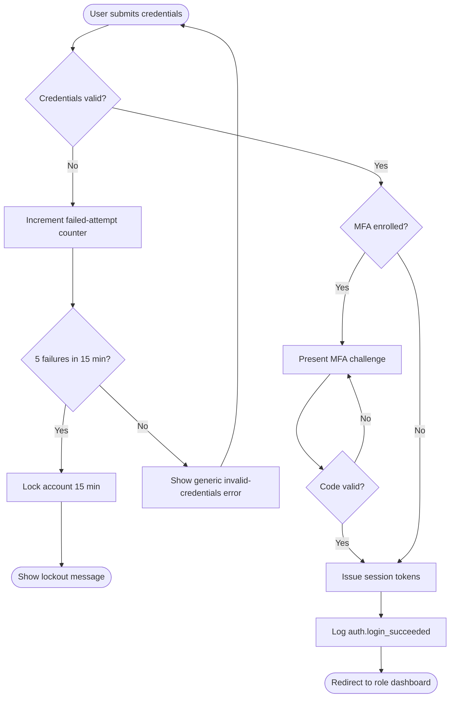
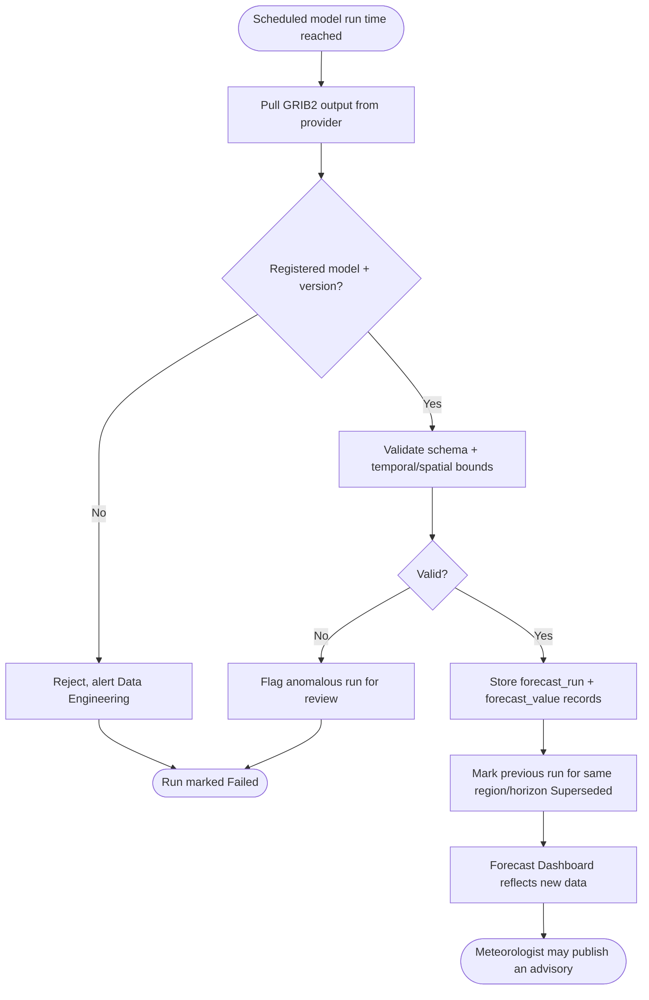
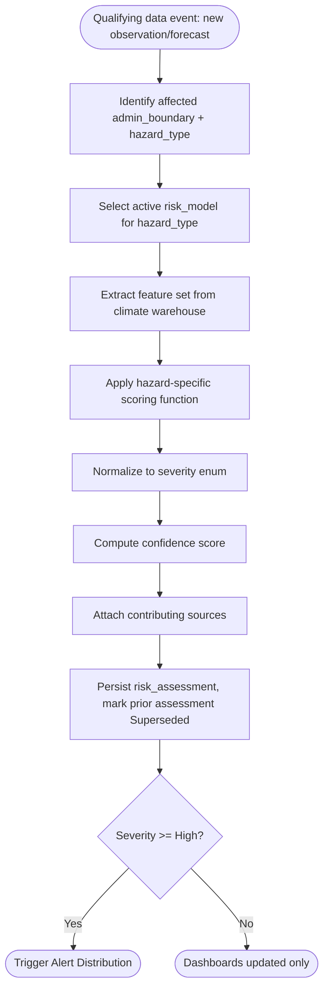
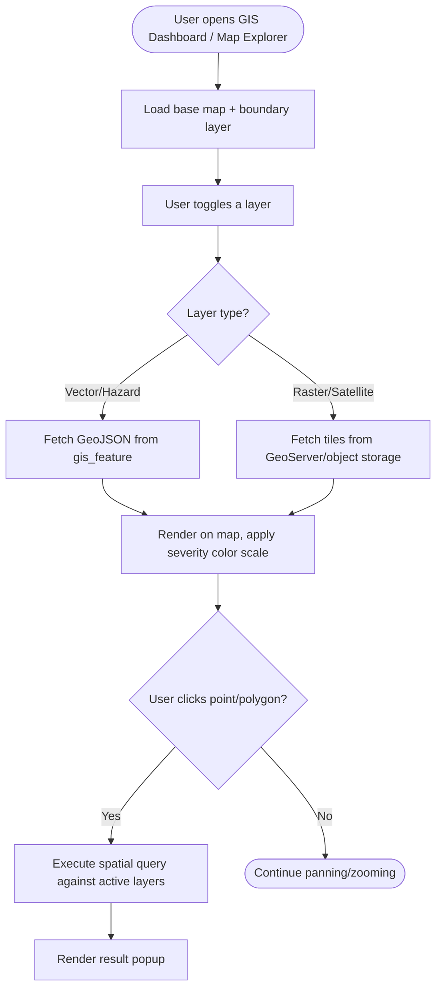
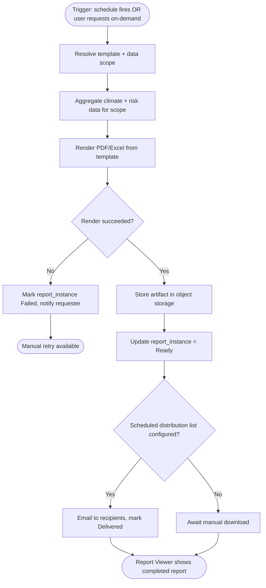
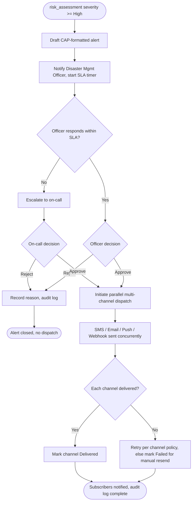
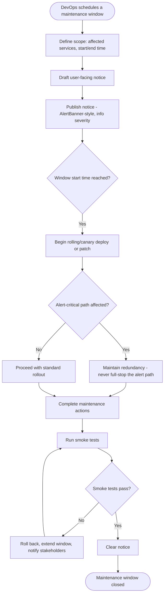

# Activity Diagrams — Extended Set

## Purpose

Extends [`docs/24_Activity_Diagrams.md`](../24_Activity_Diagrams.md) with the ten process-level activity diagrams requested for this phase: User Registration, Authentication, Forecast Generation, Climate Analysis, Risk Calculation, Map Rendering, Report Creation, AI Processing, Alert Distribution, and System Maintenance. These model swimlane-free business/system activity flow (decision-heavy process view); cross-service technical timing is covered in [Sequence Diagrams](10_Sequence_Diagrams_Extended.md).

> Version: 1.0 | Author: ClimateShield Nexus Architecture Team | Last Updated: 2026-07-27

## Table of Contents

1. [User Registration](#user-registration)
2. [Authentication](#authentication)
3. [Forecast Generation](#forecast-generation)
4. [Climate Analysis](#climate-analysis)
5. [Risk Calculation](#risk-calculation)
6. [Map Rendering](#map-rendering)
7. [Report Creation](#report-creation)
8. [AI Processing](#ai-processing)
9. [Alert Distribution](#alert-distribution)
10. [System Maintenance](#system-maintenance)
11. [References](#references)
12. [Revision History](#revision-history)

## User Registration

```mermaid
flowchart TD
    Start([User visits Registration page]) --> A[Fill form: name, email, org, password]
    A --> B[Submit]
    B --> C{Email format valid?}
    C -- No --> D[Inline field error] --> A
    C -- Yes --> E{Email already registered?}
    E -- Yes --> F[Generic "unable to create account" message] --> A
    E -- No --> G{Password meets policy?}
    G -- No --> H[Show live policy checklist] --> A
    G -- Yes --> I[Create account, status = Invited/Unverified]
    I --> J[Send verification email]
    J --> End([Redirect to Email Verification page])
```

## Authentication



## Forecast Generation



## Climate Analysis

```mermaid
flowchart TD
    Start([User opens Historical Analysis / Research Dashboard]) --> A[Select station/region, parameters, date range]
    A --> B[Query climate warehouse]
    B --> C{Data available for selection?}
    C -- No --> D[Show "No records found", suggest widening range] --> A
    C -- Yes --> E[Render comparison chart + data table]
    E --> F{User requests comparison baseline?}
    F -- Yes --> G[Overlay historical average / prior period]
    F -- No --> H[Single-series view]
    G --> I{Export?}
    H --> I
    I -- Yes --> J[Generate CSV/Excel, log export action]
    I -- No --> End([Analysis session continues])
```

## Risk Calculation



## Map Rendering



## Report Creation



## AI Processing

```mermaid
flowchart TD
    Start([User submits natural-language query]) --> A[RBAC scope check]
    A --> B{Permitted for this role?}
    B -- No --> C[Deny, no response generated] --> End1([Access-denied message])
    B -- Yes --> D[Retrieve context: knowledge base + scoped live data]
    D --> E[Generate draft response with LLM]
    E --> F{Draft includes >=1 valid citation?}
    F -- No --> G[Return "insufficient verified data" response] --> End2([Logged, no citation-less claim returned])
    F -- Yes --> H{Confidence >= threshold AND not high-stakes topic?}
    H -- Yes --> I[Return response] --> End3([Logged])
    H -- No --> J[Return response with "Human review required" flag] --> End3
```

## Alert Distribution



## System Maintenance



## References

- [`docs/24_Activity_Diagrams.md`](../24_Activity_Diagrams.md)
- [`docs/11_Use_Cases.md`](../11_Use_Cases.md)
- [`docs/04_Functional_Requirements.md`](../04_Functional_Requirements.md)

## Revision History

| Version | Date | Author | Change |
|---|---|---|---|
| 1.0 | 2026-07-27 | ClimateShield Nexus Architecture Team | Initial version (Phase 2 visual design package) |
