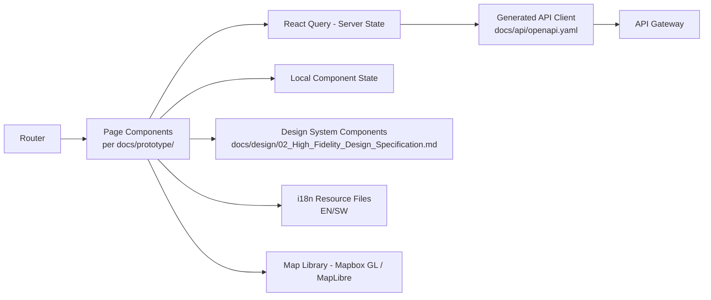
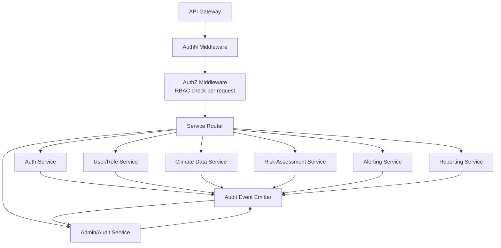
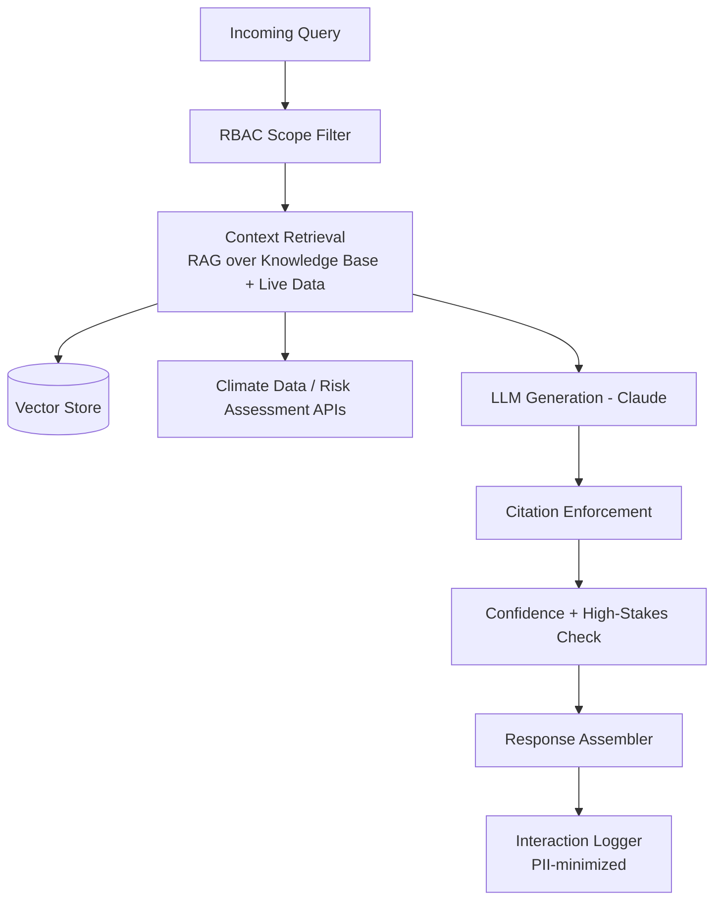
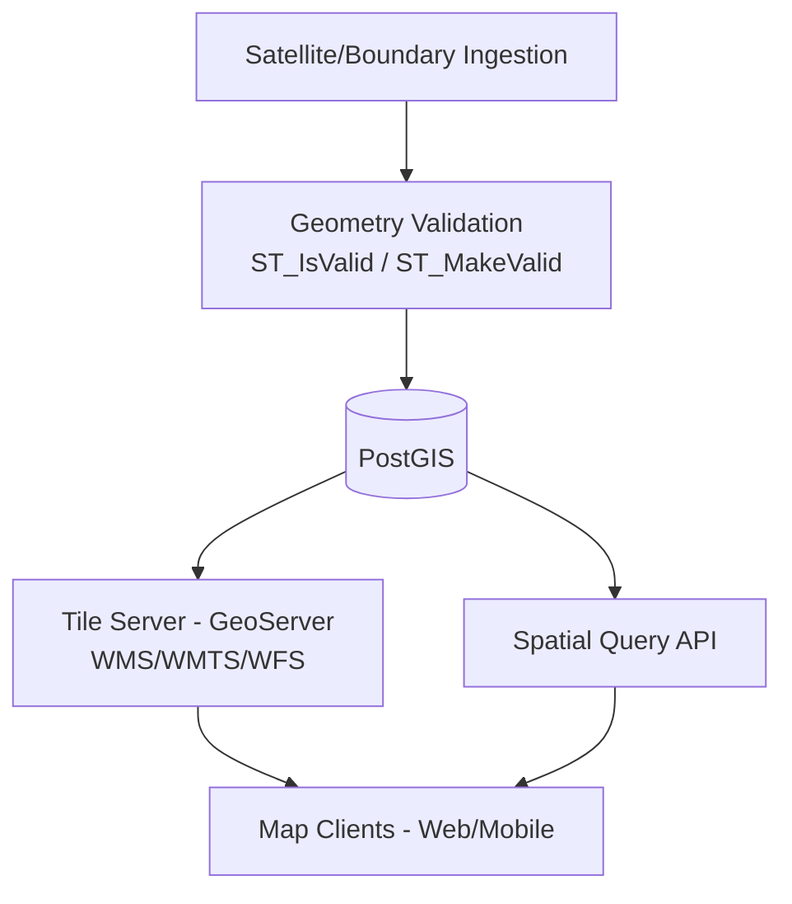
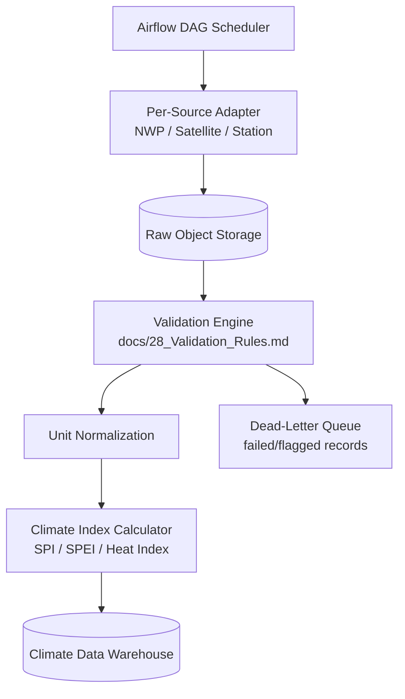

# Component Diagrams

## Purpose

Shows the interaction and dependency structure between ClimateShield Nexus's major components — Frontend, Backend, Database, AI Engine, GIS Engine, Climate Processing Engine, Authentication Service, Notification Service, Storage, and Monitoring — at a level of detail between the C4 Container view in [`docs/06_System_Architecture.md`](../06_System_Architecture.md) and individual service internals.

> Version: 1.0 | Author: ClimateShield Nexus Architecture Team | Last Updated: 2026-07-27

## Table of Contents

1. [Master Component Diagram](#master-component-diagram)
2. [Frontend Component Detail](#frontend-component-detail)
3. [Backend Core Services Component Detail](#backend-core-services-component-detail)
4. [AI Engine Component Detail](#ai-engine-component-detail)
5. [GIS Engine Component Detail](#gis-engine-component-detail)
6. [Climate Processing Engine Component Detail](#climate-processing-engine-component-detail)
7. [Cross-Cutting Components](#cross-cutting-components)
8. [References](#references)
9. [Revision History](#revision-history)

## Master Component Diagram

```mermaid
flowchart TB
    subgraph Frontend["Frontend (frontend/)"]
        FE_WEB[Web Dashboard - React]
        FE_MOB[Mobile App - React Native]
        FE_PUB[Public Portal]
    end

    subgraph Backend["Backend (backend/)"]
        BE_GW[API Gateway / BFF]
        BE_AUTH[Authentication Service]
        BE_USER[User/Role Service]
        BE_CDM[Climate Data Service]
        BE_RISK[Risk Assessment Service]
        BE_ALERT[Notification Service\n(Alerting)]
        BE_RPT[Reporting Service]
        BE_ADMIN[Admin/Audit Service]
    end

    subgraph AIEngine["AI Engine (ai-engine/)"]
        AI_ASSIST[AI Climate Assistant]
        AI_REC[Recommendation Engine]
        AI_KB[Knowledge Base / Vector Store]
    end

    subgraph GISEngine["GIS Engine (gis-services/)"]
        GIS_API[Spatial API]
        GIS_TILE[Tile/Layer Server - GeoServer]
        GIS_SAT[Satellite Ingestion]
    end

    subgraph ClimateEngine["Climate Processing Engine (climate-processing/)"]
        CP_ORCH[Airflow Orchestrator]
        CP_ADAPT[Source Adapters]
        CP_VALID[Validation Engine]
        CP_INDEX[Index Computation]
    end

    subgraph Database["Database (database/)"]
        DB_PG[(PostgreSQL / PostGIS)]
        DB_TS[(TimescaleDB)]
    end

    subgraph Storage["Storage"]
        ST_OBJ[(Object Storage - S3-compatible)]
    end

    subgraph Monitoring["Monitoring"]
        MON_PROM[Prometheus / Grafana]
        MON_LOG[OpenSearch / ELK]
        MON_TRACE[OpenTelemetry Collector]
    end

    FE_WEB & FE_MOB & FE_PUB --> BE_GW
    BE_GW --> BE_AUTH
    BE_GW --> BE_USER & BE_CDM & BE_RISK & BE_ALERT & BE_RPT & BE_ADMIN
    BE_GW --> AI_ASSIST

    BE_CDM --> DB_PG & DB_TS
    BE_RISK --> DB_PG
    BE_ALERT --> DB_PG
    BE_RPT --> ST_OBJ
    BE_ADMIN --> DB_PG

    AI_ASSIST --> AI_KB
    AI_ASSIST --> BE_CDM
    AI_ASSIST --> BE_RISK
    AI_REC --> BE_RISK

    GIS_API --> DB_PG
    GIS_API --> GIS_TILE
    GIS_SAT --> ST_OBJ
    BE_RISK --> GIS_API

    CP_ORCH --> CP_ADAPT --> CP_VALID --> CP_INDEX
    CP_INDEX --> DB_TS
    CP_ORCH --> ST_OBJ
    CP_VALID --> BE_CDM

    BE_AUTH -.every service authenticates via.-> BE_GW
    BE_ADMIN -.audit events from.-> BE_USER & BE_CDM & BE_RISK & BE_ALERT & BE_RPT & AI_ASSIST & GIS_API

    Backend -.metrics.-> MON_PROM
    Backend -.logs.-> MON_LOG
    Backend -.traces.-> MON_TRACE
    AIEngine -.metrics/logs.-> MON_PROM
    GISEngine -.metrics/logs.-> MON_PROM
    ClimateEngine -.metrics/logs.-> MON_PROM
```

## Frontend Component Detail



## Backend Core Services Component Detail



## AI Engine Component Detail



## GIS Engine Component Detail



## Climate Processing Engine Component Detail



## Cross-Cutting Components

| Component | Interacts With | Purpose |
|---|---|---|
| Authentication Service | Every Backend service, Frontend, Mobile | Session/token issuance, MFA |
| Notification Service (Alerting) | Risk Assessment, Admin/Audit, external gateways | Threshold evaluation, CAP formatting, multi-channel dispatch |
| Storage (Object Storage) | Climate Processing, GIS Engine, Reporting Service | Raw/processed data, satellite products, generated reports |
| Monitoring (Prometheus/Grafana, OpenSearch, OpenTelemetry) | Every component | Metrics, logs, traces per [`docs/29_Logging_and_Monitoring.md`](../29_Logging_and_Monitoring.md) |

## References

- [`docs/06_System_Architecture.md`](../06_System_Architecture.md)
- [`docs/39_Module_Breakdown.md`](../39_Module_Breakdown.md)
- [`14_Deployment_Diagrams.md`](14_Deployment_Diagrams.md)

## Revision History

| Version | Date | Author | Change |
|---|---|---|---|
| 1.0 | 2026-07-27 | ClimateShield Nexus Architecture Team | Initial version (Phase 2 visual design package) |
