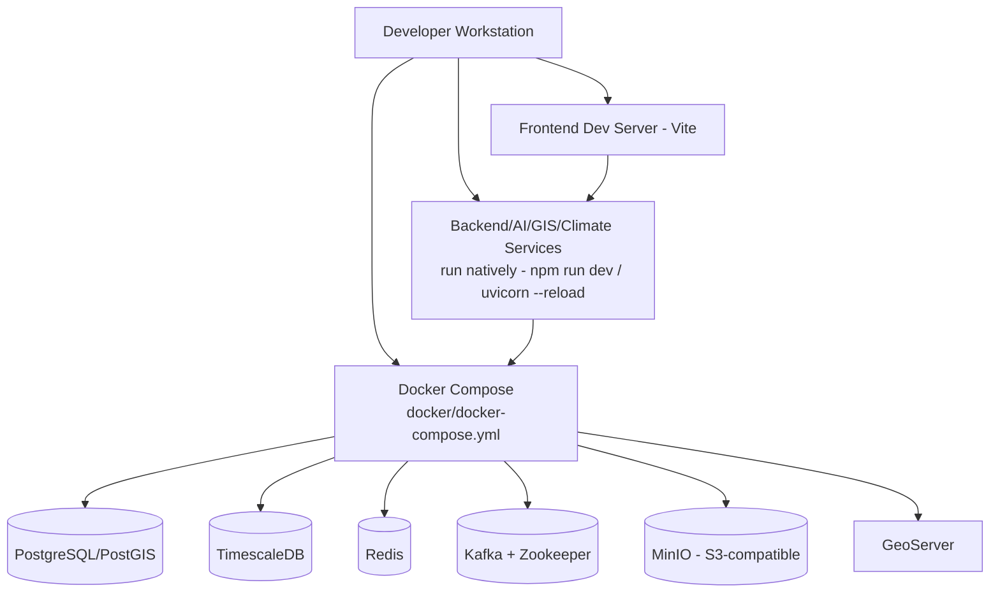
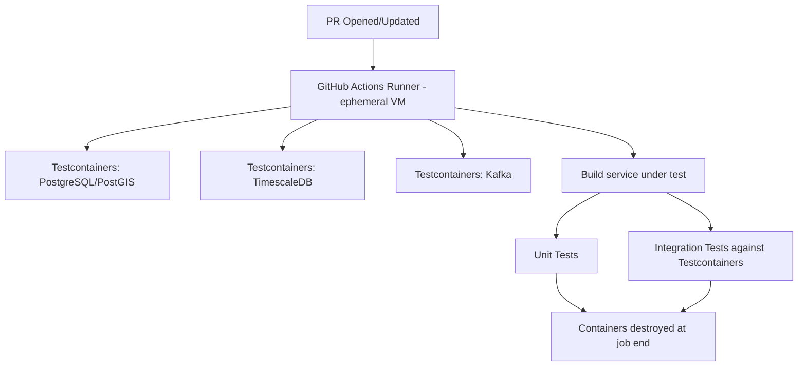
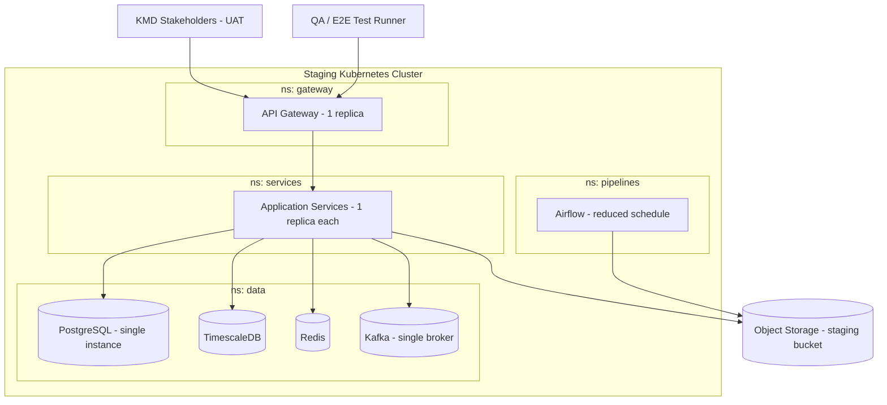
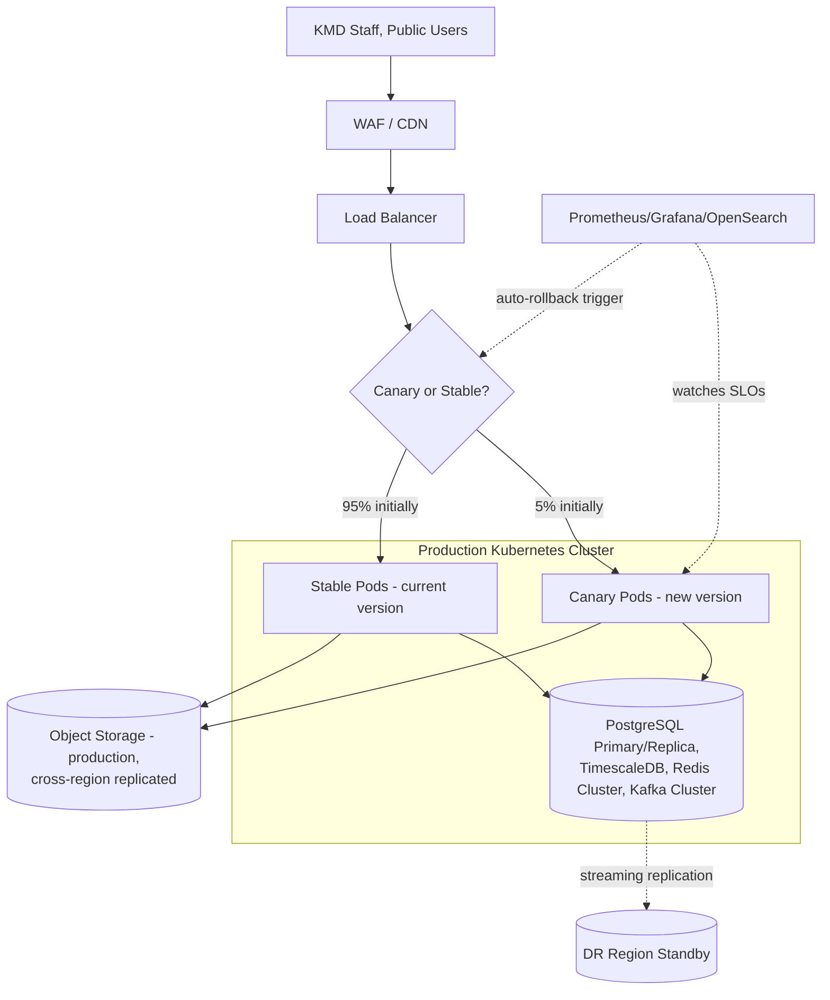
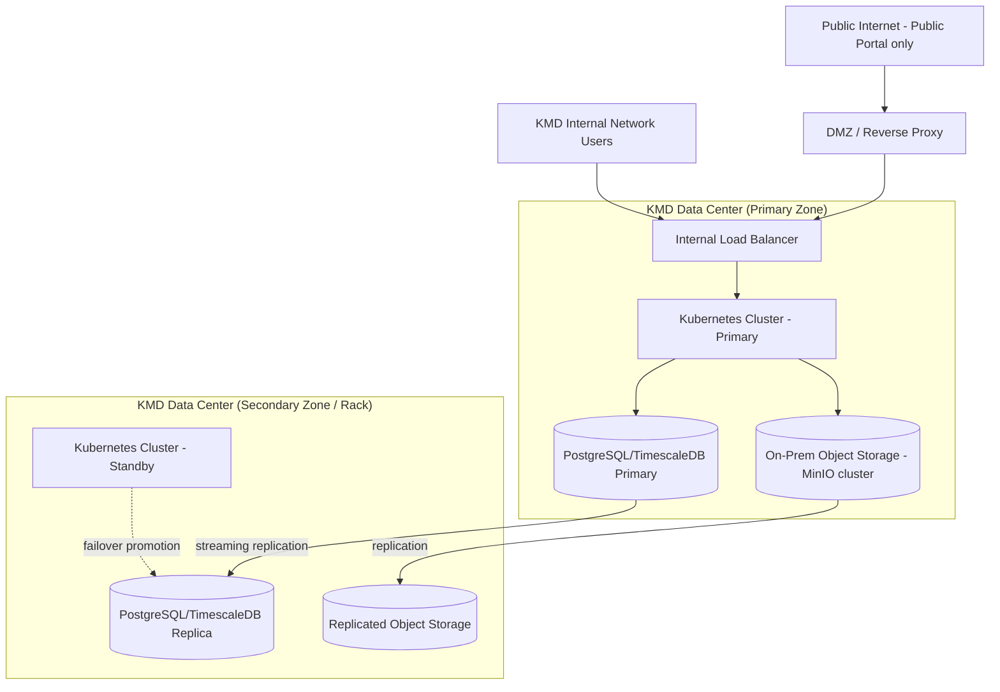
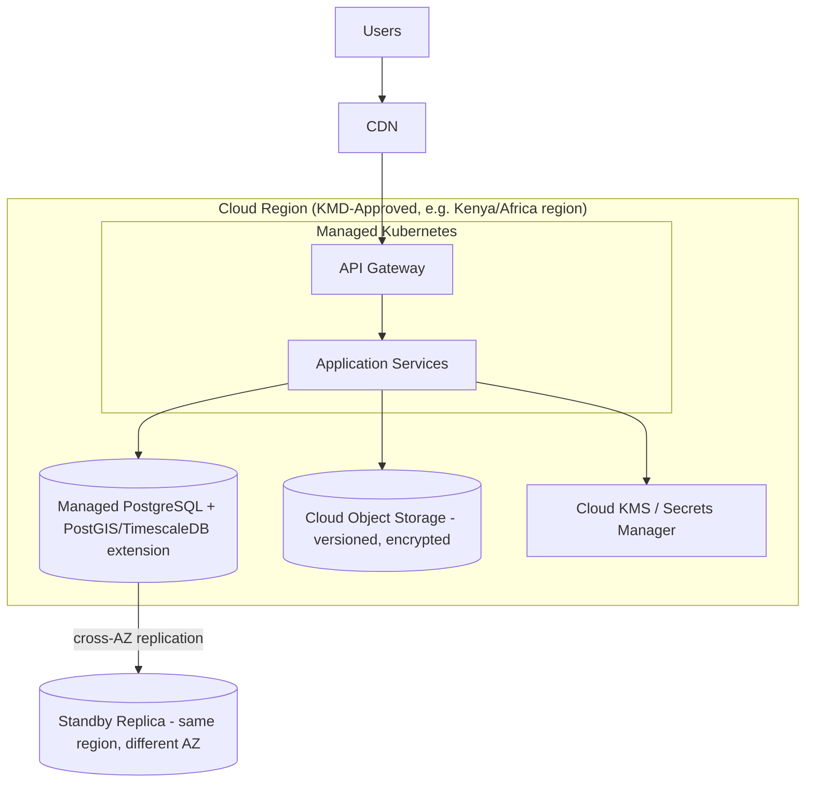
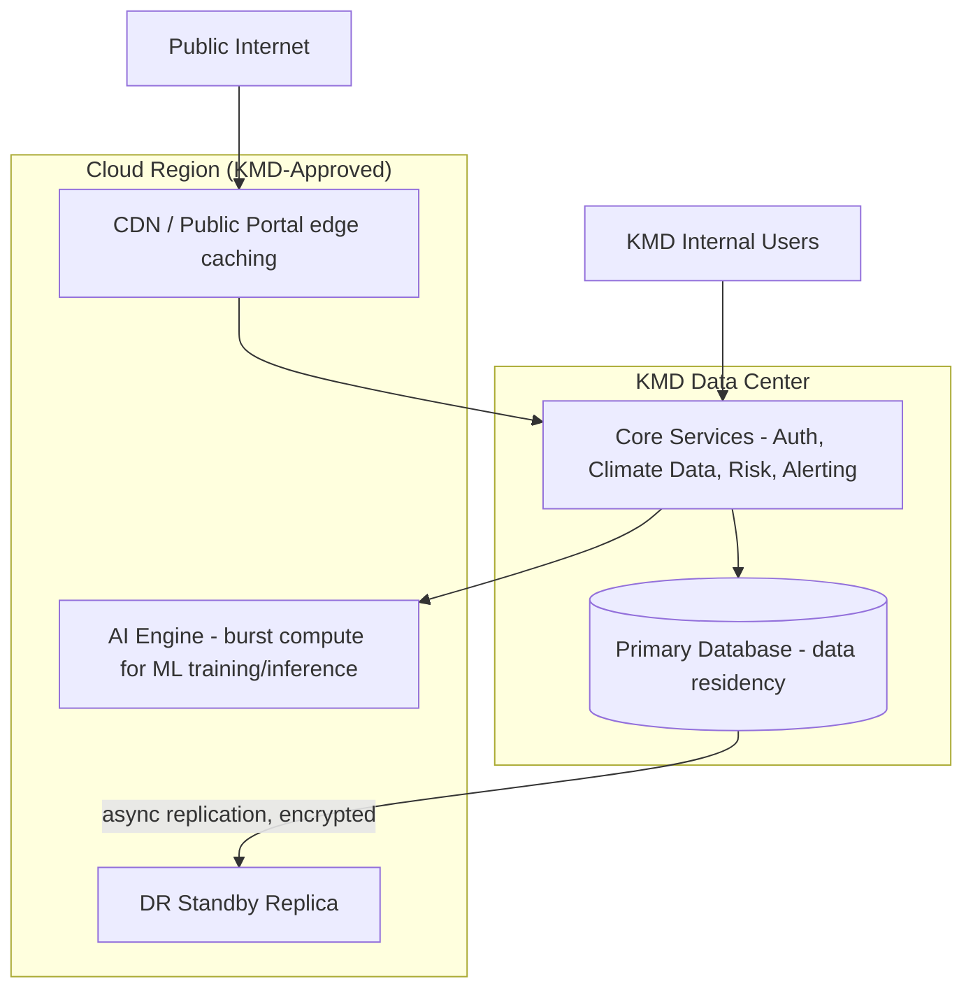

# Deployment Diagrams

## Purpose

Visualizes ClimateShield Nexus's physical deployment topology across every target environment, extending the single generic topology in [`docs/06_System_Architecture.md#deployment-topology`](../06_System_Architecture.md#deployment-topology) and the environment matrix in [`docs/15_Deployment_Guide.md#environments`](../15_Deployment_Guide.md#environments) with per-environment diagrams.

> Version: 1.0 | Author: ClimateShield Nexus DevOps Team | Last Updated: 2026-07-27

## Table of Contents

1. [Development](#development)
2. [Testing (CI)](#testing-ci)
3. [Staging](#staging)
4. [Production](#production)
5. [Government Data Center Deployment](#government-data-center-deployment)
6. [Cloud Deployment](#cloud-deployment)
7. [Hybrid Deployment](#hybrid-deployment)
8. [References](#references)
9. [Revision History](#revision-history)

## Development

Single machine, no orchestrator, no TLS termination. See [`docs/34_Developer_Guide.md#local-environment-setup`](../34_Developer_Guide.md#local-environment-setup).

## Testing (CI)

Fully ephemeral per [`docs/14_Testing_Strategy.md#test-environments`](../14_Testing_Strategy.md#test-environments) — no persistent state, no shared infrastructure between runs.

## Staging

Sampled/anonymized data only ([`docs/14_Testing_Strategy.md#test-environments`](../14_Testing_Strategy.md#test-environments)); auto-deployed on merge to `develop` ([`docs/15_Deployment_Guide.md#cicd-pipeline`](../15_Deployment_Guide.md#cicd-pipeline)).

## Production

Full release process (canary → monitor 30 min → full rollout, auto-rollback on SLO breach): [`docs/15_Deployment_Guide.md#release-process`](../15_Deployment_Guide.md#release-process).

## Government Data Center Deployment

Satisfies data-residency requirement [`NFR-RES-001`](../05_Non_Functional_Requirements.md#data-residency): all primary data remains within Kenya; the secondary zone provides physical redundancy without leaving the country, per [`docs/30_Backup_and_Recovery.md#disaster-recovery-strategy`](../30_Backup_and_Recovery.md#disaster-recovery-strategy). Selection between this option and [Cloud Deployment](#cloud-deployment) is a Phase 1 discovery decision tracked in [`docs/42_Final_Project_Checklist.md#outstanding-items-before-sprint-1`](../42_Final_Project_Checklist.md#outstanding-items-before-sprint-1).

## Cloud Deployment

Cloud-agnostic per [`NFR-PORT-001`](../05_Non_Functional_Requirements.md#portability--interoperability) — any Kubernetes-conformant provider; region selection constrained to one satisfying Kenya data-residency requirements.

## Hybrid Deployment

A pragmatic middle path if KMD data-center capacity cannot support GPU/burst ML workloads: sensitive/primary data and core transactional services stay on-prem; compute-elastic, lower-sensitivity workloads (AI training, public CDN edge) run in cloud. Not the default plan — evaluated only if the [Government Data Center](#government-data-center-deployment) option proves capacity-constrained during Phase 1 discovery.

## References

- [`docs/06_System_Architecture.md#deployment-topology`](../06_System_Architecture.md#deployment-topology)
- [`docs/15_Deployment_Guide.md`](../15_Deployment_Guide.md)
- [`docs/30_Backup_and_Recovery.md`](../30_Backup_and_Recovery.md)
- `kubernetes/`, `docker/` (repository root)

## Revision History

| Version | Date | Author | Change |
|---|---|---|---|
| 1.0 | 2026-07-27 | ClimateShield Nexus DevOps Team | Initial version (Phase 2 visual design package) |
