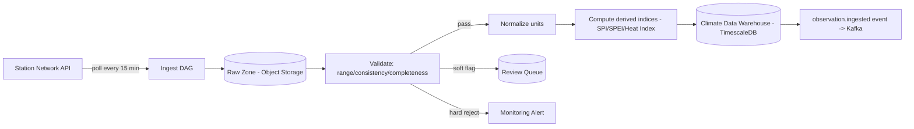
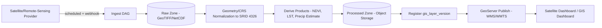
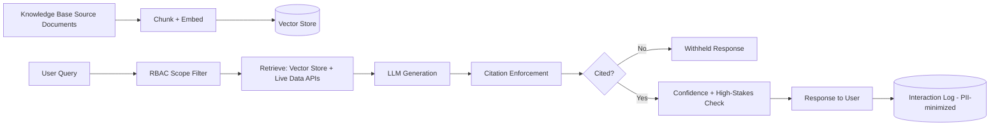
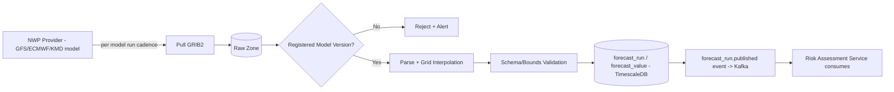
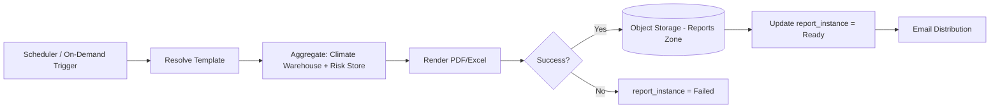
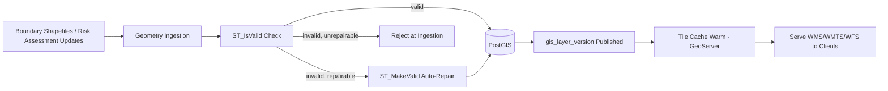
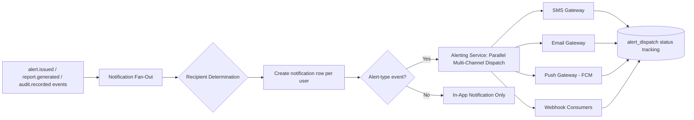
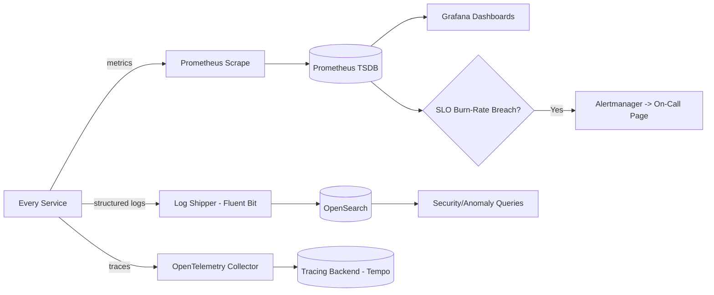

# Data Pipelines

## Purpose

Illustrates every major data pipeline in ClimateShield Nexus end-to-end — source to sink — complementing the process-level [DFDs](08_DFD_Full.md) with a pipeline/pipeline-stage view oriented around Airflow DAG design.

> Version: 1.0 | Author: ClimateShield Nexus Data Engineering Team | Last Updated: 2026-07-27

## Table of Contents

1. [Climate Data Pipeline](#climate-data-pipeline)
2. [Satellite Pipeline](#satellite-pipeline)
3. [AI Pipeline](#ai-pipeline)
4. [Forecast Pipeline](#forecast-pipeline)
5. [Reporting Pipeline](#reporting-pipeline)
6. [GIS Pipeline](#gis-pipeline)
7. [Notification Pipeline](#notification-pipeline)
8. [Monitoring Pipeline](#monitoring-pipeline)
9. [References](#references)
10. [Revision History](#revision-history)

## Climate Data Pipeline

## Satellite Pipeline

## AI Pipeline

## Forecast Pipeline

## Reporting Pipeline

## GIS Pipeline

## Notification Pipeline

## Monitoring Pipeline

## References

- [`08_DFD_Full.md`](08_DFD_Full.md)
- [`docs/06_System_Architecture.md#data-architecture`](../06_System_Architecture.md#data-architecture)
- [`docs/29_Logging_and_Monitoring.md`](../29_Logging_and_Monitoring.md)
- `climate-processing/`, `gis-services/`, `ai-engine/` (repository root)

## Revision History

| Version | Date | Author | Change |
|---|---|---|---|
| 1.0 | 2026-07-27 | ClimateShield Nexus Data Engineering Team | Initial version (Phase 2 visual design package) |
