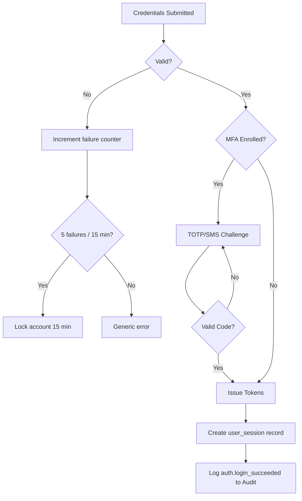
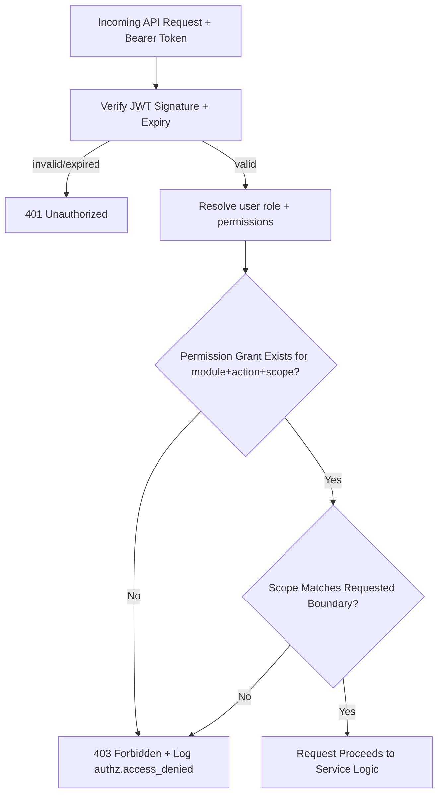
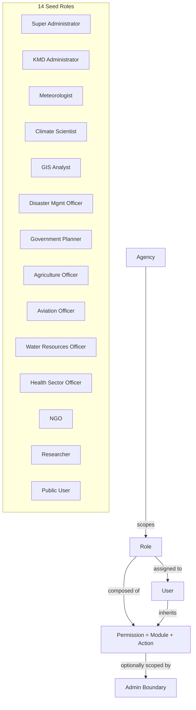
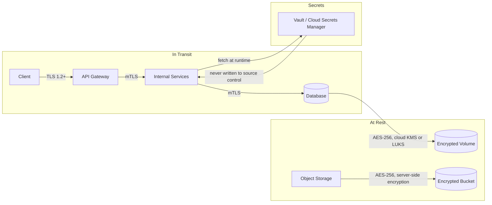
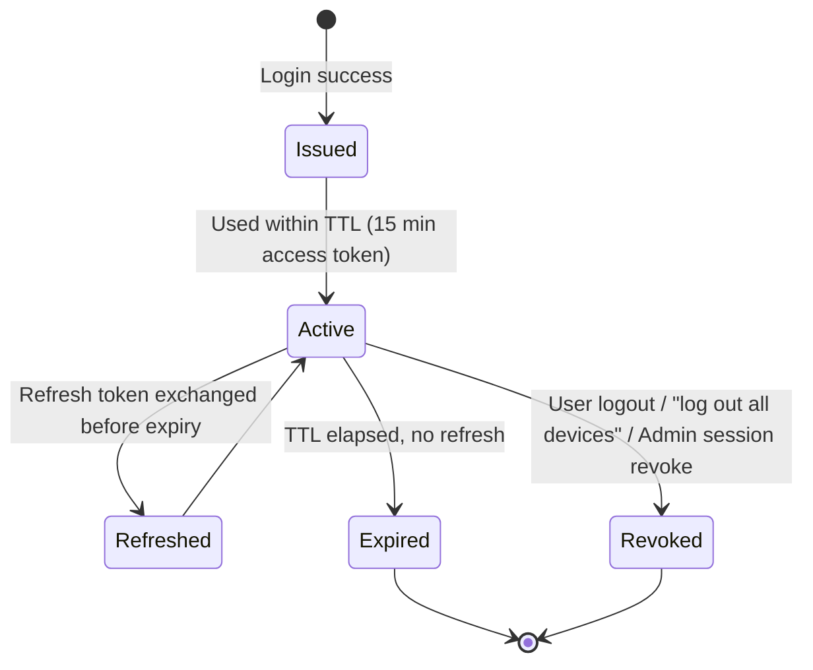
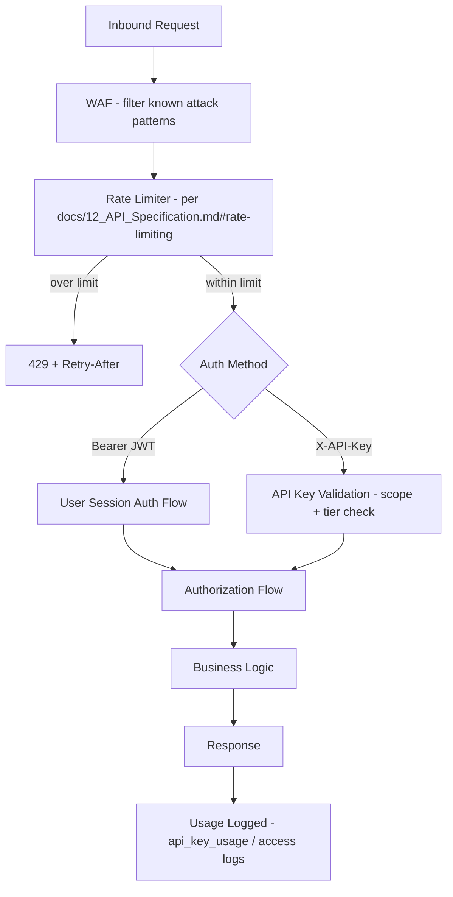
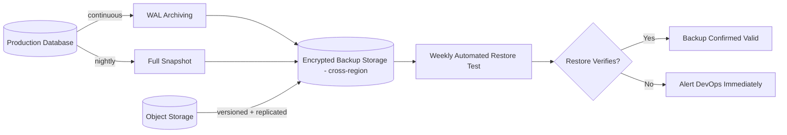
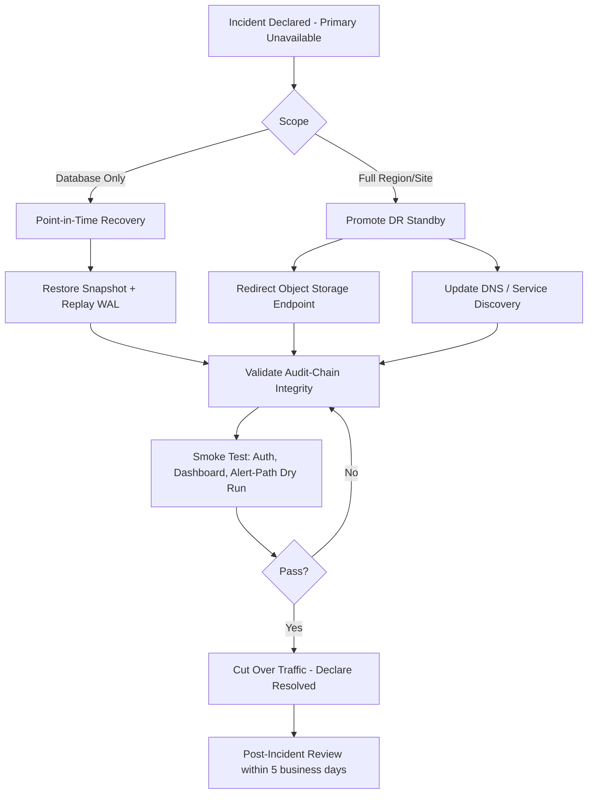

# Security Diagrams

## Purpose

Visualizes the security mechanisms defined narratively in [`docs/13_Security_Design.md`](../13_Security_Design.md): authentication, authorization/RBAC, encryption, token lifecycle, API security, audit integrity, backup, and disaster recovery.

> Version: 1.0 | Author: ClimateShield Nexus Security Engineering | Last Updated: 2026-07-27

## Table of Contents

1. [Authentication Flow](#authentication-flow)
2. [Authorization Flow](#authorization-flow)
3. [RBAC Model](#rbac-model)
4. [Encryption Flow](#encryption-flow)
5. [Token Lifecycle](#token-lifecycle)
6. [API Security Flow](#api-security-flow)
7. [Audit Flow](#audit-flow)
8. [Backup Flow](#backup-flow)
9. [Disaster Recovery Flow](#disaster-recovery-flow)
10. [References](#references)
11. [Revision History](#revision-history)

## Authentication Flow



Full sequence: [`docs/22_Sequence_Diagrams.md#sequence-1-user-authentication-with-mfa`](../22_Sequence_Diagrams.md#sequence-1-user-authentication-with-mfa).

## Authorization Flow



Re-evaluated on **every** request — no client-trusted permission cache ([`SRS-AUTHZ-005`](../04_Functional_Requirements.md#authorization)).

## RBAC Model



Full permission grid: [`docs/13_Security_Design.md#rbac-matrix`](../13_Security_Design.md#rbac-matrix).

## Encryption Flow



## Token Lifecycle



Access token TTL 15 min, refresh token TTL 30 days, per [`SRS-AUTH-004`](../04_Functional_Requirements.md#authentication) and [`docs/31_Environment_Variables.md#authentication--authorization`](../31_Environment_Variables.md#authentication--authorization).

## API Security Flow



## Audit Flow

```mermaid
flowchart TD
    A[Privileged Action Occurs] --> B[Service emits audit event]
    B --> C[Admin/Audit Service]
    C --> D[Fetch prev_hash of latest audit_log row]
    D --> E[Compute record_hash = SHA256(prev_hash + event)]
    E --> F[(INSERT audit_log - append-only, UPDATE/DELETE denied by trigger)]
    F --> G[Daily Integrity Job: Re-walk Chain]
    G --> H{Chain Intact?}
    H -- Yes --> I[Checkpoint hash written to WORM storage]
    H -- No --> J[Critical Incident - docs/13_Security_Design.md#incident-response]
```

## Backup Flow



Retention detail: [`docs/30_Backup_and_Recovery.md#retention-policy`](../30_Backup_and_Recovery.md#retention-policy).

## Disaster Recovery Flow



RPO ≤15 min, RTO ≤1h (alert path) / ≤4h (full platform) per [`docs/05_Non_Functional_Requirements.md#availability--reliability`](../05_Non_Functional_Requirements.md#availability--reliability).

## References

- [`docs/13_Security_Design.md`](../13_Security_Design.md)
- [`docs/security/threat-model.md`](../security/threat-model.md)
- [`docs/30_Backup_and_Recovery.md`](../30_Backup_and_Recovery.md)
- [`docs/09_Database_Dictionary.md`](../09_Database_Dictionary.md)

## Revision History

| Version | Date | Author | Change |
|---|---|---|---|
| 1.0 | 2026-07-27 | ClimateShield Nexus Security Engineering | Initial version (Phase 2 visual design package) |
