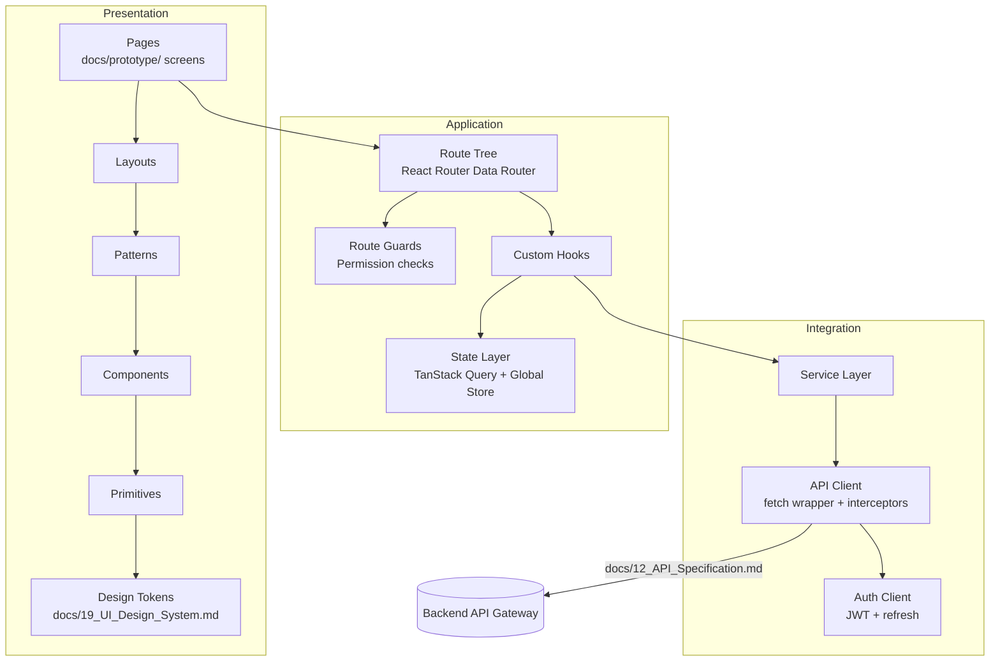

# 00 — Frontend Architecture Overview

## Purpose

Root document for the ClimateShield Nexus frontend architecture package. Defines the frontend's guiding principles, confirms the technology stack established in [`docs/06_System_Architecture.md#technology-stack`](../06_System_Architecture.md#technology-stack), and indexes the detailed architecture documents that follow. This package designs **how the frontend is built** (structure, patterns, conventions) — it does not implement it. No application code, no business logic, and no page-specific visual design are produced here; those live in [`frontend/`](../../frontend/) (future implementation) and [`docs/design/`](../design/) / [`docs/prototype/`](../prototype/) (already-complete visual/UX design) respectively.

> Version: 1.0 | Author: ClimateShield Nexus Frontend Architecture Team | Last Updated: 2026-07-27

## Table of Contents

1. [Scope and Non-Goals](#scope-and-non-goals)
2. [Confirmed Technology Stack](#confirmed-technology-stack)
3. [Framework Decision: Vite + React Router, Not Next.js](#framework-decision-vite--react-router-not-nextjs)
4. [Guiding Principles](#guiding-principles)
5. [Architecture Layers](#architecture-layers)
6. [Document Index](#document-index)
7. [References](#references)
8. [Revision History](#revision-history)

## Scope and Non-Goals

**In scope**: folder/project structure, component architecture, routing/navigation, layouts, design-system integration, the full component inventory, state management architecture, the React application architecture (hooks, services, API client, auth, permissions, route guards, error boundaries), performance/rendering strategy, accessibility/i18n strategy, offline strategy, component documentation/Storybook plan, frontend testing strategy, and coding/naming conventions.

**Out of scope** (explicitly not produced by this package):
- Application/business logic implementation — no working React components, no real API calls.
- Visual design of individual screens — already complete in [`docs/prototype/`](../prototype/) (low-fidelity, ~50 screens) and [`docs/design/02_High_Fidelity_Design_Specification.md`](../design/02_High_Fidelity_Design_Specification.md).
- Design tokens themselves (colors, type scale, spacing values) — already complete in [`docs/19_UI_Design_System.md`](../19_UI_Design_System.md). This package defines how the frontend *consumes* those tokens, not the token values.
- Backend/API implementation — contract already defined in [`docs/12_API_Specification.md`](../12_API_Specification.md).

## Confirmed Technology Stack

Restated from [`docs/06_System_Architecture.md#technology-stack`](../06_System_Architecture.md#technology-stack) — this package does not change it:

| Concern | Choice |
|---|---|
| UI library | React 18 + TypeScript |
| Build tool / dev server | Vite |
| Server-state / data fetching | TanStack Query (React Query) v5 |
| Styling | Tailwind CSS |
| Mapping | Mapbox GL JS, with MapLibre GL JS fallback (vendor-lock-in avoidance for public sector); Leaflet fallback for low-end devices |
| Routing | React Router v6 (Data Router / `createBrowserRouter`) — see [Framework Decision](#framework-decision-vite--react-router-not-nextjs) |
| Package management | npm workspaces (`frontend` workspace, per root [`package.json`](../../package.json)) |

## Framework Decision: Vite + React Router, Not Next.js

This phase's brief asks for a "Next.js App Router structure." [ADR-001](../architecture/ADR-001-modular-monolith-to-microservices.md) and [`docs/06_System_Architecture.md#technology-stack`](../06_System_Architecture.md#technology-stack) already established **React 18 + Vite** (a client-rendered SPA, not a Next.js server-rendered application) as the frontend foundation, decided during Phase 1/2 for these reasons:

- The web dashboard is an **authenticated, internal-facing application** for the large majority of its screens (only the Marketing/Public pages and Public Climate Dashboard are unauthenticated) — the SEO and first-byte-content benefits of Next.js's server rendering are largely irrelevant behind a login wall.
- A single SPA build deploys identically to the static-hosting + CDN topology already defined in [`terraform/modules/`](../../terraform/modules/) and [`kubernetes/base/`](../../kubernetes/base/), avoiding a Node.js SSR runtime as an additional piece of production infrastructure to operate, patch, and scale for a 5-person engineering team.
- Vite's dev-server iteration speed was an explicit Phase 1 rationale (`docs/06_System_Architecture.md`'s "Fast iteration... large talent pool in Kenya's dev market" note).

Per the "Phases 1–3 are COMPLETE, DO NOT regenerate previous work" constraint, this package does **not** reopen that decision. Instead, it satisfies the intent behind the "Next.js App Router" request — file-system-adjacent, nested, layout-aware routing with co-located data loading — using **React Router v6.4+'s Data Router APIs** (`createBrowserRouter`, nested `<Outlet/>` layouts, `loader`/`action` functions, `errorElement`), which provide the same architectural shape (nested layouts, route-level data loading, pending/error states) without adopting a server-rendering runtime. See [`03_Routing_and_Navigation_Architecture.md`](03_Routing_and_Navigation_Architecture.md).

The two unauthenticated, SEO-relevant pages (Landing Page, About) are small enough that static pre-rendering via `vite-plugin-ssg` (build-time HTML generation, no server runtime) is the documented option if SEO needs later exceed what a standard SPA + sitemap + meta tags provides — see [`09_Performance_and_Rendering_Strategy.md#seo-strategy`](09_Performance_and_Rendering_Strategy.md#seo-strategy). This is flagged as a Phase 5+ (implementation-time) decision, not resolved here.

## Guiding Principles

1. **Structure mirrors the domain, not the framework.** Feature folders map to the modules in [`docs/design/03_Module_Specifications.md`](../design/03_Module_Specifications.md) (Climate Data, Risk Assessment, GIS, AI Assistant, Alerts, Administration, ...), not to generic technical buckets.
2. **Server state and client state are architecturally distinct.** TanStack Query owns anything that came from the API; a minimal global store owns only genuinely cross-cutting client state (auth session, theme, active notification toasts). See [`07_State_Management_Architecture.md`](07_State_Management_Architecture.md).
3. **Every screen in [`docs/prototype/`](../prototype/) maps to exactly one route and one page-level component** — no orphaned prototype pages, no routes without a prototype spec.
4. **Accessibility and severity-color consistency are non-negotiable**, inherited directly from [`docs/19_UI_Design_System.md#accessibility-standards`](../19_UI_Design_System.md#accessibility-standards) — enforced structurally (component API design), not left to per-page discipline.
5. **Fail closed.** A route the user isn't permitted to see never mounts its data-fetching logic, mirroring the API's own fail-closed rule in [`docs/17_Coding_Standards.md#error-handling`](../17_Coding_Standards.md#error-handling).
6. **Low-bandwidth resilience** (from [`docs/19_UI_Design_System.md#design-principles`](../19_UI_Design_System.md#design-principles)) is a frontend-architecture concern, not just a design concern — see [`11_Offline_and_Resilience_Strategy.md`](11_Offline_and_Resilience_Strategy.md).

## Architecture Layers

## Document Index

| # | Document | Covers |
|---|---|---|
| 00 | This document | Scope, stack confirmation, principles |
| 01 | [`01_Folder_and_Project_Structure.md`](01_Folder_and_Project_Structure.md) | Full `frontend/` directory tree, feature-based + atomic hybrid |
| 02 | [`02_Component_Architecture.md`](02_Component_Architecture.md) | Atomic Design layering, feature-based composition, component contracts |
| 03 | [`03_Routing_and_Navigation_Architecture.md`](03_Routing_and_Navigation_Architecture.md) | Route tree, navigation model, route guards, deep-linking |
| 04 | [`04_Layouts.md`](04_Layouts.md) | Auth, dashboard, responsive, error, loading, skeleton layouts |
| 05 | [`05_Design_System_Extensions.md`](05_Design_System_Extensions.md) | Frontend-specific consumption of tokens: elevation, motion, dark/light mode wiring |
| 06 | [`06_Component_Inventory.md`](06_Component_Inventory.md) | Every reusable component, widget, chart, table, card, modal, form, map/AI component |
| 07 | [`07_State_Management_Architecture.md`](07_State_Management_Architecture.md) | Global/feature/server/cache/session/theme/notification/user state |
| 08 | [`08_React_Application_Architecture.md`](08_React_Application_Architecture.md) | Hooks, utilities, service layer, API/auth clients, permissions, guards, error boundaries |
| 09 | [`09_Performance_and_Rendering_Strategy.md`](09_Performance_and_Rendering_Strategy.md) | Code splitting, lazy loading, Suspense, SEO, perf budgets |
| 10 | [`10_Accessibility_and_Internationalization_Strategy.md`](10_Accessibility_and_Internationalization_Strategy.md) | WCAG conformance strategy, i18n/l10n architecture (English/Swahili) |
| 11 | [`11_Offline_and_Resilience_Strategy.md`](11_Offline_and_Resilience_Strategy.md) | Offline/low-bandwidth strategy, service worker, degraded states |
| 12 | [`12_Component_Documentation_and_Storybook_Plan.md`](12_Component_Documentation_and_Storybook_Plan.md) | Storybook structure, documentation standard per component |
| 13 | [`13_Frontend_Testing_Strategy.md`](13_Frontend_Testing_Strategy.md) | Unit/component/integration/E2E/visual/a11y testing strategy |
| 14 | [`14_Frontend_Coding_and_Naming_Conventions.md`](14_Frontend_Coding_and_Naming_Conventions.md) | Naming, folder, import, and file conventions |

## References

- [`docs/06_System_Architecture.md`](../06_System_Architecture.md)
- [`docs/19_UI_Design_System.md`](../19_UI_Design_System.md)
- [`docs/21_Wireflows.md`](../21_Wireflows.md)
- [`docs/design/`](../design/), [`docs/prototype/`](../prototype/)
- [`docs/12_API_Specification.md`](../12_API_Specification.md)
- [`docs/17_Coding_Standards.md#react--frontend-standards`](../17_Coding_Standards.md#react--frontend-standards)
- [`frontend/README.md`](../../frontend/README.md)

## Revision History

| Version | Date | Author | Change |
|---|---|---|---|
| 1.0 | 2026-07-27 | ClimateShield Nexus Frontend Architecture Team | Initial version (Phase 5 frontend architecture) |
