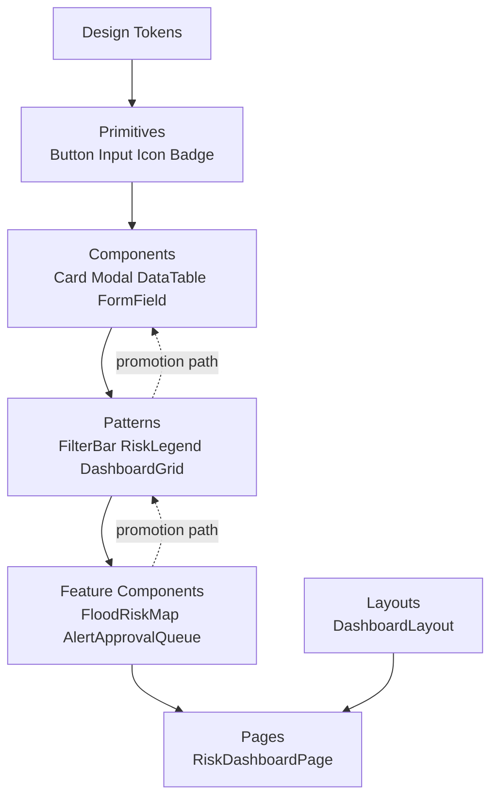

# 02 — Component Architecture

## Purpose

Defines how components are layered (Atomic Design), how that layering interacts with the feature-based structure from [`01_Folder_and_Project_Structure.md`](01_Folder_and_Project_Structure.md), and the fixed contract every component must satisfy regardless of layer.

> Version: 1.0 | Author: ClimateShield Nexus Frontend Architecture Team | Last Updated: 2026-07-27

## Table of Contents

1. [Atomic Design Layers](#atomic-design-layers)
2. [Layer Definitions and Promotion Rules](#layer-definitions-and-promotion-rules)
3. [Component Contract](#component-contract)
4. [Composition Patterns](#composition-patterns)
5. [Controlled vs. Uncontrolled Components](#controlled-vs-uncontrolled-components)
6. [Component Diagram](#component-diagram)
7. [References](#references)
8. [Revision History](#revision-history)

## Atomic Design Layers

| Layer | Folder | Definition | Example |
|---|---|---|---|
| Tokens | `design-tokens/` | Raw design values, not components | `colors.risk.high`, `spacing.4` |
| Primitives | `components/primitives/` | Smallest renderable unit; wraps one HTML element + tokens; no composition of other components | `Button`, `Input`, `Icon`, `Badge`, `Text`, `Avatar` |
| Components | `components/components/` | Composes 2+ primitives into a reusable, still domain-agnostic unit | `Card`, `Modal`, `Dropdown`, `DataTable`, `FormField` |
| Patterns | `components/patterns/` | Composes components into a recurring cross-feature layout convention; may know about *shape* of data (e.g., "a severity value") but not about a specific feature's API | `FilterBar`, `RiskLegend`, `DataFreshnessBadge`, `DashboardGrid` |
| Feature Components | `features/*/components/` | Composes patterns/components with feature-specific data and behavior | `FloodRiskMap`, `AlertApprovalQueue`, `AIConversationThread` |
| Layouts | `layouts/` | Page chrome — composes patterns (nav, header) around a content slot | `DashboardLayout`, `AuthLayout` |
| Pages | `features/*/routes.tsx` route elements | Composes one layout + feature components for one route in [`docs/prototype/`](../prototype/) | `RiskDashboardPage` |

## Layer Definitions and Promotion Rules

A component starts in the feature that needs it (`features/*/components/`). It is **promoted** to `components/patterns/` (or lower) only when:
1. A second, unrelated feature needs the same behavior, **and**
2. Removing the feature-specific data/API coupling is possible without losing the component's purpose.

This is a deliberate anti-premature-abstraction rule (per the project's general engineering principle of not designing for hypothetical reuse) — most components never get promoted, and that is the expected, healthy outcome.

Promotion direction is always upward (feature → pattern → component → primitive), never downward — a primitive never gains feature-specific props.

## Component Contract

Every component in `components/` (any layer) must satisfy:

| Requirement | Detail |
|---|---|
| Typed props | Exported `interface {ComponentName}Props`; no untyped `any` props (per [`docs/17_Coding_Standards.md`](../17_Coding_Standards.md)) |
| Forwarded ref | Interactive primitives (`Button`, `Input`, ...) use `forwardRef` so consumers can focus-manage them |
| No implicit data fetching | Data arrives via props only — see [Import Boundary Rules](01_Folder_and_Project_Structure.md#import-boundary-rules) |
| Keyboard + screen-reader accessible | Meets [`docs/19_UI_Design_System.md#accessibility-standards`](../19_UI_Design_System.md#accessibility-standards); verified via axe-core in Storybook (see [`12_Component_Documentation_and_Storybook_Plan.md`](12_Component_Documentation_and_Storybook_Plan.md)) |
| Responsive by default | Honors the breakpoints in [`docs/19_UI_Design_System.md#responsive-breakpoints`](../19_UI_Design_System.md#responsive-breakpoints) without a consumer needing to pass responsive overrides for the common case |
| Themed via tokens only | No hardcoded hex/px values — always references `design-tokens/` (directly or via Tailwind classes mapped to tokens) |
| A Storybook story | See [`12_Component_Documentation_and_Storybook_Plan.md`](12_Component_Documentation_and_Storybook_Plan.md) |

## Composition Patterns

- **Slot props** (`children`, or named slots like `header`/`footer`) preferred over boolean "mode" props — e.g., `<Card footer={<Actions/>}>` rather than `<Card hasFooter showActions>`.
- **Compound components** for multi-part UI with shared implicit state — `<Tabs><Tabs.List><Tabs.Tab/></Tabs.List><Tabs.Panels>...` — used for `Tabs`, `Accordion`, `DataTable` (Table/Row/Cell), `Dropdown` (Trigger/Menu/Item).
- **Render props / children-as-function** reserved for the small number of cases needing per-item render control (e.g., `<DataTable renderRowActions={(row) => ...}>` ), not used as a default pattern.
- **Headless-first for complex interaction primitives** — `Dropdown`, `Modal`/`Dialog`, `Tabs`, `Tooltip`, `Combobox`, and date pickers wrap Radix UI primitives (unstyled, accessible-by-default) rather than being built from scratch, so keyboard/focus/ARIA behavior is never reinvented.

## Controlled vs. Uncontrolled Components

| Component Type | Default | Rationale |
|---|---|---|
| Form inputs (`Input`, `Select`, `Checkbox`, ...) | Uncontrolled, registered via `react-hook-form` | Avoids re-render-per-keystroke on data-heavy admin forms |
| Disclosure widgets (`Modal`, `Dropdown`, `Tabs`) | Uncontrolled by default, controlled-mode prop available (`open`/`onOpenChange`) | Simple usage stays simple; feature code can still drive state when a URL/query-param needs to reflect it (e.g., a modal deep-linked from a notification) |
| Data display (`DataTable`, charts) | Controlled — feature/page owns sort/filter/pagination state | This state is frequently synced to the URL (per [`03_Routing_and_Navigation_Architecture.md#url-state`](03_Routing_and_Navigation_Architecture.md#url-state-for-filters-and-tables)), so the component cannot own it internally |

## Component Diagram

## References

- [`docs/19_UI_Design_System.md#component-library-atomic-structure`](../19_UI_Design_System.md#component-library-atomic-structure)
- [`01_Folder_and_Project_Structure.md`](01_Folder_and_Project_Structure.md)
- [`06_Component_Inventory.md`](06_Component_Inventory.md)
- [`12_Component_Documentation_and_Storybook_Plan.md`](12_Component_Documentation_and_Storybook_Plan.md)

## Revision History

| Version | Date | Author | Change |
|---|---|---|---|
| 1.0 | 2026-07-27 | ClimateShield Nexus Frontend Architecture Team | Initial version (Phase 5 frontend architecture) |
