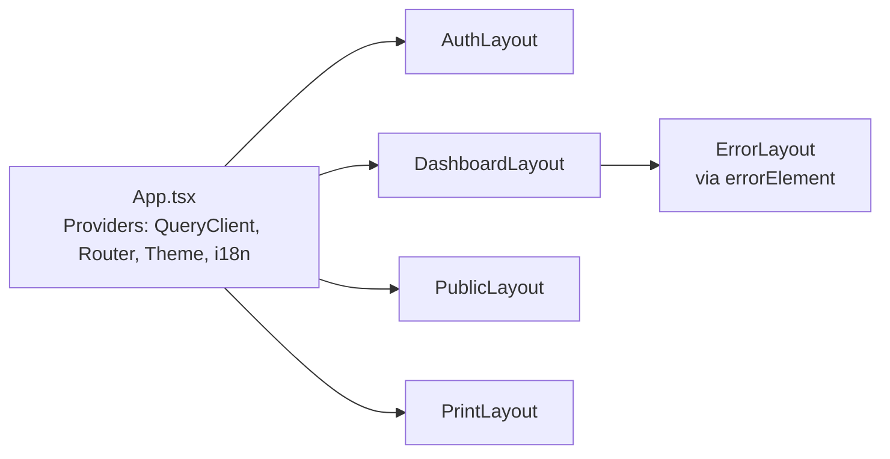

# 04 — Layouts

## Purpose

Specifies every layout shell in the application — the composable chrome around page content — including authentication, dashboard, responsive, error, loading, and skeleton variants.

> Version: 1.0 | Author: ClimateShield Nexus Frontend Architecture Team | Last Updated: 2026-07-27

## Table of Contents

1. [Layout Composition Model](#layout-composition-model)
2. [Auth Layout](#auth-layout)
3. [Dashboard Layout](#dashboard-layout)
4. [Public Layout](#public-layout)
5. [Print Layout](#print-layout)
6. [Responsive Layout Behavior](#responsive-layout-behavior)
7. [Error Layout](#error-layout)
8. [Loading Layout](#loading-layout)
9. [Skeleton Layouts](#skeleton-layouts)
10. [References](#references)
11. [Revision History](#revision-history)

## Layout Composition Model

Every route resolves to exactly one top-level layout (`AuthLayout`, `DashboardLayout`, `PublicLayout`, or `PrintLayout`), matching [`03_Routing_and_Navigation_Architecture.md#complete-route-tree`](03_Routing_and_Navigation_Architecture.md#complete-route-tree). Layouts render an `<Outlet/>` for the matched child route and own nothing feature-specific — only chrome (nav, header, footer, session/theme wiring).



## Auth Layout

Used for: Login, Registration, Forgot/Reset Password, Email Verification, MFA Verification ([`docs/prototype/02_Authentication_Pages.md`](../prototype/02_Authentication_Pages.md)).

- Centered single-column card on a branded background; no primary nav (a logged-out user has nothing to navigate to yet).
- Fixed max-width (420px) regardless of viewport — this layout does not need the responsive grid treatment dashboard pages do.
- Renders a language switcher (English/Swahili, per [`10_Accessibility_and_Internationalization_Strategy.md`](10_Accessibility_and_Internationalization_Strategy.md)) in the header — the one piece of chrome an unauthenticated user needs.
- On successful auth, `AuthLayout`'s child routes never redirect internally — that is the route guard's job (per [`03_Routing_and_Navigation_Architecture.md#route-guards`](03_Routing_and_Navigation_Architecture.md#route-guards)), keeping the layout itself free of navigation logic.

## Dashboard Layout

Used for: every `/app/*` route ([`docs/prototype/03_Core_Dashboards.md`](../prototype/03_Core_Dashboards.md) through [`10_System_and_Profile_Pages.md`](../prototype/10_System_and_Profile_Pages.md)).

Structure:
```
┌─────────────────────────────────────────────┐
│ Top Bar: logo, breadcrumb, search, notif bell, user menu │
├───────────┬───────────────────────────────────┤
│ Sidebar   │ Page Content (<Outlet/>)          │
│ (role-    │  - optional page header w/ actions │
│  filtered │  - optional contextual tab nav     │
│  nav)     │  - main content region             │
└───────────┴───────────────────────────────────┘
```

- Sidebar is collapsible (state in `ui-preferences-store`, per [`07_State_Management_Architecture.md#user-state`](07_State_Management_Architecture.md#user-state)); collapsed state persists across sessions via `localStorage`.
- Notification bell subscribes to `notification-store` (real-time via WebSocket client, per [`08_React_Application_Architecture.md#websocket-client`](08_React_Application_Architecture.md)) — badge count updates without a page refresh.
- Top bar's user menu surfaces Profile, theme toggle, language switcher, and Logout — the only chrome-level actions global to every dashboard page.

## Public Layout

Used for: Landing Page, About, Documentation, Public Climate Dashboard ([`docs/prototype/01_Marketing_and_Public_Pages.md`](../prototype/01_Marketing_and_Public_Pages.md)).

- Marketing-style header/footer (distinct from `DashboardLayout`'s app chrome) with a "Log In" call-to-action rather than a user menu.
- No sidebar; content is full-width with a max content width for readability on the Documentation page.
- The Public Climate Dashboard variant reuses dashboard **components** (charts, maps) but stays within `PublicLayout`'s chrome — it is a public-facing page, not an authenticated one, per [`docs/13_Security_Design.md#rbac-matrix`](../13_Security_Design.md).

## Print Layout

Used for: Report Viewer's print/PDF-preview mode ([`docs/prototype/06_Reports_Pages.md`](../prototype/06_Reports_Pages.md)).

- No nav, no interactive chrome at all — only the report content, formatted for `@media print` and for the server-side PDF rendering path (`content.report_instance.format='pdf'`, per [`database/schema/009_content.sql`](../../database/schema/009_content.sql)).
- Shares typography/spacing tokens with `DashboardLayout` but overrides color usage to print-safe (no dark backgrounds, sufficient contrast in grayscale).

## Responsive Layout Behavior

Breakpoints restated from [`docs/19_UI_Design_System.md#responsive-breakpoints`](../19_UI_Design_System.md#responsive-breakpoints) (`sm` 360px+, `md` 768px+, `lg` 1024px+, `xl` 1440px+); layout-level behavior at each:

| Breakpoint | Dashboard Layout Behavior |
|---|---|
| Below `md` (< 768px) | Sidebar becomes an off-canvas drawer (hidden by default, opened via top-bar hamburger); contextual tabs become a horizontal scroll strip; `DashboardGrid` collapses to single column. Per [`SRS-DASH-008`](../04_Functional_Requirements.md#dashboards), dashboards must remain usable down to tablet width (768px) — below that, mobile users are steered toward the Mobile app instead |
| `md`–`lg` (768–1023px) | Sidebar collapses to icon-only by default (expandable on hover/tap); `DashboardGrid` at 2 columns |
| `lg` and above (≥ 1024px) | Sidebar fully expanded by default; `DashboardGrid` at up to 4 columns depending on page; `xl` (1440px+) unlocks the widest GIS-workstation map layout |

GIS/Map Explorer pages are the one documented exception: below tablet width, the map takes the full viewport and the layer/filter panel becomes a bottom sheet rather than a side panel, per [`docs/prototype/05_GIS_and_Satellite_Pages.md#responsive-behavior`](../prototype/05_GIS_and_Satellite_Pages.md).

## Error Layout

Used for: unmatched routes (404), `RequirePermission` failures (403), and any route-level `errorElement` catching an unhandled loader/render error (500-class).

- Renders within whichever parent layout is still valid — a 403 inside `/app/admin/*` still shows the `DashboardLayout` chrome (so the user isn't stranded with no nav), while a fully unmatched top-level path falls back to a standalone `ErrorLayout` with no assumptions about session state.
- Every error page shows: what happened (in plain language, per [`docs/17_Coding_Standards.md#error-handling`](../17_Coding_Standards.md#error-handling)'s "actionable, non-technical" rule), a primary action (Go to Dashboard / Go Back), and — for 500-class errors only — a `request_id` for support reference (matching the API's error envelope in [`docs/12_API_Specification.md#error-format`](../12_API_Specification.md#error-format)).

## Loading Layout

Two distinct loading states, not conflated:

| State | Used When | Treatment |
|---|---|---|
| **Route-transition loading** | React Router navigation is in flight (`useNavigation().state === 'loading'`) | A thin top-of-viewport progress bar (persistent across the transition), chrome stays mounted — never a full-page spinner replacing the whole app |
| **Full-page initial load** | App boot, before the auth session is resolved | A centered brand spinner on a blank canvas — the only place a full-page spinner is used, since there is no prior chrome to preserve |

## Skeleton Layouts

Per-content skeleton placeholders (not spinners) are the default for in-page data loading, matching each page's actual layout shape so there is no content reflow on load:

- `DashboardGrid` skeleton: gray rounded-rectangle placeholders in the exact card-grid shape the loaded content will take.
- `DataTable` skeleton: header row rendered immediately (real column labels), body rows as shimmering placeholder bars.
- Chart skeleton: axis/legend chrome rendered immediately, plot area as a shimmering placeholder.
- Map skeleton: base tile layer loads independently of data layers — a data layer still loading shows a small inline spinner on its legend entry, never blocking the base map.

Skeletons are themselves components in `components/patterns/skeletons/` (per [`06_Component_Inventory.md#skeleton-components`](06_Component_Inventory.md#skeleton--loading-components)), each paired 1:1 with the real component it stands in for, so a developer adding a new dashboard card gets its skeleton "for free" via the same component family.

## References

- [`docs/prototype/`](../prototype/) (all files)
- [`docs/19_UI_Design_System.md#responsive-breakpoints`](../19_UI_Design_System.md#responsive-breakpoints)
- [`03_Routing_and_Navigation_Architecture.md`](03_Routing_and_Navigation_Architecture.md)
- [`06_Component_Inventory.md`](06_Component_Inventory.md)

## Revision History

| Version | Date | Author | Change |
|---|---|---|---|
| 1.0 | 2026-07-27 | ClimateShield Nexus Frontend Architecture Team | Initial version (Phase 5 frontend architecture) |
