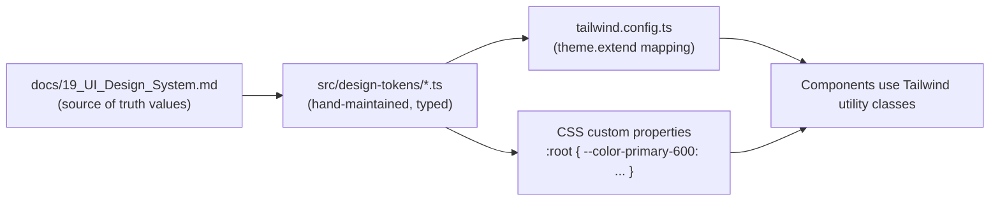

# 05 — Design System Extensions (Frontend Consumption)

## Purpose

[`docs/19_UI_Design_System.md`](../19_UI_Design_System.md) defines the design language's *values* (colors, type scale, spacing, breakpoints). This document defines how the **frontend codebase consumes** those values — the token pipeline, the two token categories Phase 2 left undefined (elevation, motion/animation), and the theming architecture (light mode now, dark mode structurally ready but deferred). It does not redefine or duplicate any token value already specified in `docs/19_UI_Design_System.md`.

> Version: 1.0 | Author: ClimateShield Nexus Frontend Architecture Team | Last Updated: 2026-07-27

## Table of Contents

1. [Token Pipeline](#token-pipeline)
2. [Elevation](#elevation)
3. [Motion and Animation](#motion-and-animation)
4. [Light Mode (Active) and Dark Mode (Structural Readiness)](#light-mode-active-and-dark-mode-structural-readiness)
5. [Tailwind Integration](#tailwind-integration)
6. [Icon System Integration](#icon-system-integration)
7. [References](#references)
8. [Revision History](#revision-history)

## Token Pipeline

Token values are **hand-maintained** in `src/design-tokens/*.ts` (not auto-generated from a design tool at this stage — no Figma/token-studio pipeline exists yet per [`docs/design/02_High_Fidelity_Design_Specification.md`](../design/02_High_Fidelity_Design_Specification.md)'s tooling notes). A single source-of-truth file per token category keeps `docs/19_UI_Design_System.md` and the codebase reconcilable by inspection; a design-tool-driven pipeline is a documented future improvement, not a Phase 5 requirement.

Components consume tokens exclusively through Tailwind utility classes (`bg-primary-600`, `text-neutral-900`) or, where a value must be read in JS/TS (e.g., a chart library's color prop), through the typed `design-tokens/colors.ts` export — never a hardcoded hex/px literal, per the [component contract](02_Component_Architecture.md#component-contract).

## Elevation

Not defined in Phase 2's design system — specified here since the frontend needs a concrete elevation scale to implement `Card`, `Modal`, `Dropdown`, and the sticky `AlertBanner`/top bar consistently:

| Token | Shadow | Usage |
|---|---|---|
| `elevation.0` | none | Flat surfaces, page background |
| `elevation.1` | `0 1px 2px rgba(20,24,31,0.06)` | Cards at rest, table rows |
| `elevation.2` | `0 2px 8px rgba(20,24,31,0.08)` | Hovered card, dropdown trigger focus |
| `elevation.3` | `0 4px 16px rgba(20,24,31,0.12)` | Open dropdown menu, tooltip, popover |
| `elevation.4` | `0 8px 32px rgba(20,24,31,0.16)` | Modal/dialog, `AlertBanner` when sticky-pinned |

Elevation increases strictly with interaction/layering priority — never used as a purely decorative variation — so a screen reader-free sighted user's visual hierarchy (what's "on top") matches the actual DOM/z-index stacking order, avoiding a common source of focus-order/visual-order mismatch accessibility bugs.

## Motion and Animation

Also not defined in Phase 2 — specified here at the level a component library needs:

| Token | Duration | Easing | Usage |
|---|---|---|---|
| `motion.instant` | 0ms | — | `prefers-reduced-motion` fallback for everything below |
| `motion.fast` | 120ms | `ease-out` | Hover/focus state changes, toggle switches |
| `motion.base` | 200ms | `ease-in-out` | Dropdown/modal open-close, tab switch |
| `motion.slow` | 320ms | `ease-in-out` | Page/route transition fade, sidebar collapse |
| `motion.chart` | 400ms | `ease-out` | Chart value transitions (e.g., risk score changing on refresh) |

Rules:
- Every animation respects `prefers-reduced-motion: reduce` by substituting `motion.instant` (per [`docs/19_UI_Design_System.md#accessibility-standards`](../19_UI_Design_System.md#accessibility-standards)'s existing motion requirement) — enforced centrally via a `useMotionSafe()` hook wrapping Framer Motion's `useReducedMotion`, not left to each component to remember.
- No infinite/looping animation on map layers or dashboard widgets by default (restates the existing design principle) — a "live updating" indicator uses a single pulse on data change, not a continuous loop.
- Framer Motion is the animation library (co-locates well with React, supports `prefers-reduced-motion` natively); CSS transitions are used for simple hover/focus states where a full library is unnecessary overhead.

## Light Mode (Active) and Dark Mode (Structural Readiness)

Per [`docs/19_UI_Design_System.md#dark-mode`](../19_UI_Design_System.md#dark-mode): dark mode is a **Could-have deferred to post-MVP**. This section defines how the frontend avoids a future rewrite without building dark mode itself now:

- Every color token is referenced by **semantic name** (`color.surface`, `color.text.primary`), never by raw hex, in both Tailwind config and components. The semantic-to-hex mapping lives in one place (`design-tokens/colors.ts`).
- `theme-store.ts` (Zustand, per [`07_State_Management_Architecture.md#theme-state`](07_State_Management_Architecture.md#theme-state)) exists from day one with a `mode: 'light'` value hardcoded (no toggle UI rendered at MVP) — so the state slice, not just the tokens, is already shaped correctly when dark mode is prioritized.
- CSS custom properties (`--color-surface`, etc.) are generated per-mode at build time; only the `light` set ships at MVP. Adding `dark` is a token-file + build-config change, not a component-level rewrite, which is the concrete promise Phase 2's "reserved dark-mode pairs" note depends on.
- No component hardcodes a light-mode assumption (e.g., "shadow implies darker than background") that would break under a dark theme — verified via the Storybook dark-mode-preview addon (configured, per [`12_Component_Documentation_and_Storybook_Plan.md`](12_Component_Documentation_and_Storybook_Plan.md)) even though the app itself doesn't ship dark mode yet.

## Tailwind Integration

- `tailwind.config.ts`'s `theme.extend` is generated (a small build-time script, not hand-duplicated) from `design-tokens/*.ts` so the two never drift.
- Custom Tailwind plugins register the `elevation-*` and `motion-*` utility classes defined above, since they aren't native Tailwind scales.
- The 12-column grid and gutter values ([`docs/19_UI_Design_System.md#spacing--layout-grid`](../19_UI_Design_System.md#spacing--layout-grid)) map to a `DashboardGrid` pattern component built on CSS Grid (`grid-cols-12` + responsive `col-span-*`), not to Tailwind's default flex-based container utilities.

## Icon System Integration

- Line-style 24px/2px-stroke icon set ([`docs/19_UI_Design_System.md#iconography`](../19_UI_Design_System.md#iconography)) is implemented as a single tree-shakeable `Icon` primitive (`components/primitives/Icon`) accepting a `name` prop mapped to an SVG sprite — not one React component per icon — keeping bundle size predictable as the icon set grows.
- Hazard-specific icons (flood/drought/heatwave/agriculture/infrastructure/population) are a separate named export set (`HazardIcon`) consumed by `SeverityBadge`, map legends, and alert cards, so hazard iconography stays visually consistent everywhere it appears (restates the existing "consistent severity language" design principle at the component-API level).

## References

- [`docs/19_UI_Design_System.md`](../19_UI_Design_System.md) (source of truth for all base token values)
- [`docs/design/02_High_Fidelity_Design_Specification.md`](../design/02_High_Fidelity_Design_Specification.md)
- [`02_Component_Architecture.md`](02_Component_Architecture.md)
- [`07_State_Management_Architecture.md#theme-state`](07_State_Management_Architecture.md#theme-state)

## Revision History

| Version | Date | Author | Change |
|---|---|---|---|
| 1.0 | 2026-07-27 | ClimateShield Nexus Frontend Architecture Team | Initial version (Phase 5 frontend architecture) |
